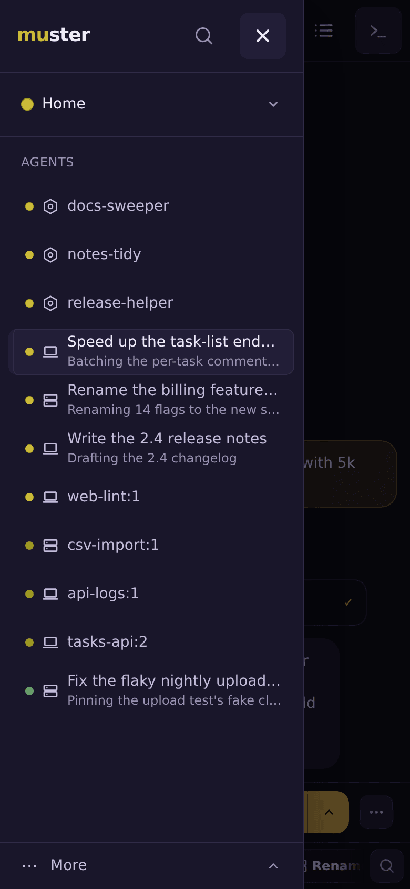
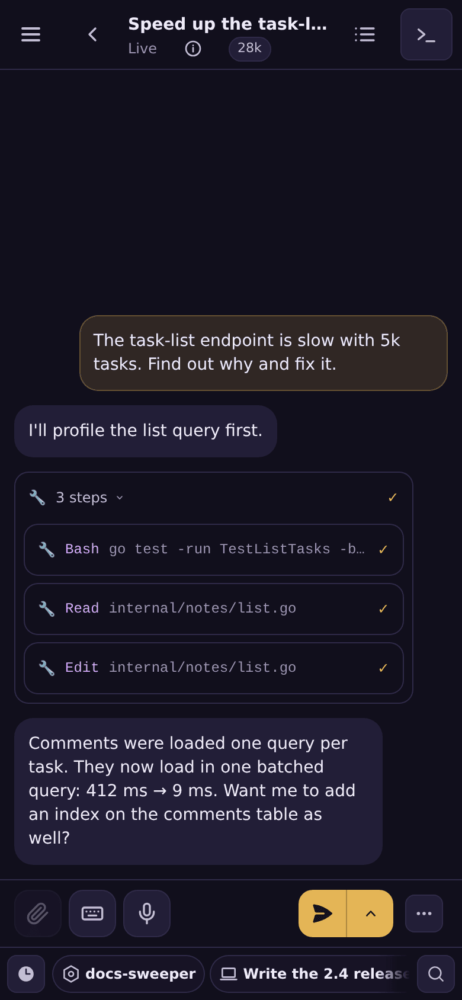
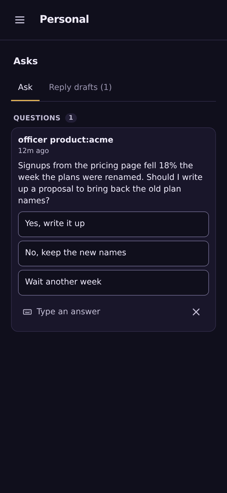
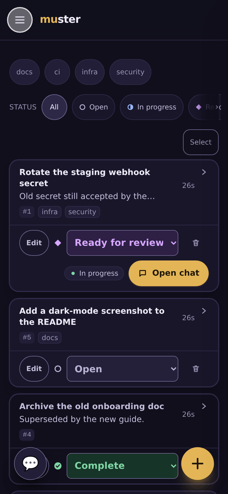
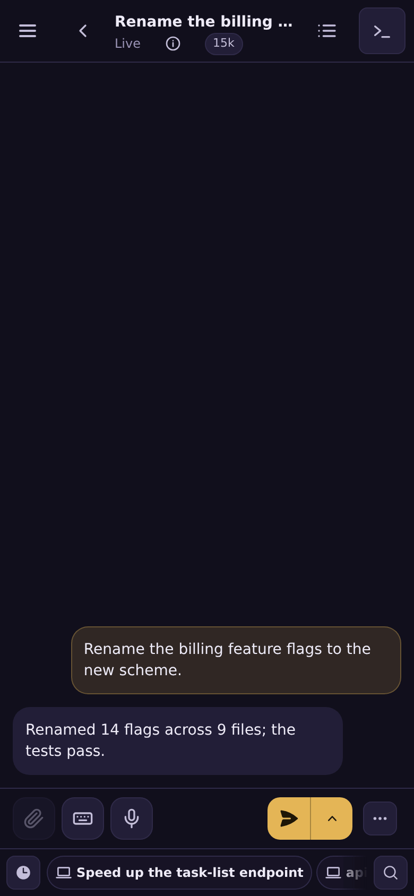
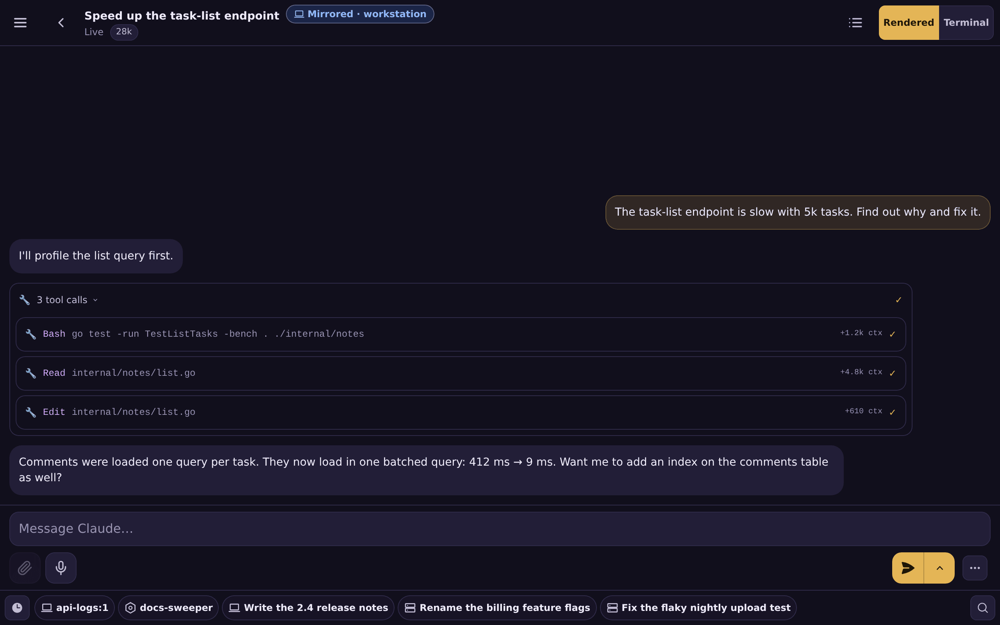

<div align="center">

# muster

### Every coding agent on every machine, in one list on your phone.

**Claude Code · Codex · opencode** (any model, incl. OpenRouter) **· anything else you run in tmux.**<br>
When a Claude Code session needs you, you get a push, answer from your phone, and it carries on.<br>
Self-hosted: start on this machine at `http://localhost`, then add your phone over your own Tailscale network.

[](https://github.com/ZacxDev/muster/releases/latest)
[](LICENSE)
[](INSTALL.md)
[](#how-it-works)


</div>

## Quick start

Two ways in. Both start on **this machine**, at a `http://localhost` address,
with nothing to fill in; your phone and your other machines come after, in one
step, over [Tailscale](https://tailscale.com).

**(a) Let your agent install it.** Paste this one prompt into the coding agent
(Claude Code, Codex, opencode, Gemini CLI, …) on the machine that should run
muster:

```text
Set up muster for me. Download its install guide with `curl -fsSL -o muster-install.md https://github.com/ZacxDev/muster/releases/latest/download/INSTALL.md`, read that whole file and follow it step by step. If that download fails, stop and tell me what it printed; never work from another copy of the guide, such as the one on the main branch, or from memory. Ask me everything you need in one go up front, then do the rest yourself. Where the guide and the machine disagree, trust `muster doctor`, each command's `--help` and the code at https://github.com/ZacxDev/muster over memory.
```

The agent downloads [INSTALL.md](INSTALL.md), a guide written for agents to
execute, from the newest release, asks its questions once, up front, installs
muster with the one-liner below, and finishes with `muster doctor`. If you
want the phone and your other machines, it adds Tailscale; on each further
machine, paste the same prompt and tell the agent muster already runs. More in
[docs/onboarding.md](docs/onboarding.md).

**(b) Install it yourself, in one line** (Docker with Compose v2, and tmux):

```sh
curl -fsSL https://github.com/ZacxDev/muster/releases/latest/download/install.sh | sh
```

It starts muster in Docker with every secret generated, shows this machine's
tmux sessions, and runs `muster doctor`; adding your phone is one section of
[docs/quickstart-local.md](docs/quickstart-local.md#add-your-phone).
**On Kubernetes** (the advanced path, which also runs dispatched agents): the
Helm chart, [docs/kubernetes.md](docs/kubernetes.md).

## What you get

<table>
<tr>
<td align="center" valign="top" width="33%">
<br>
<b>Every session, one list</b><br>
<sub>Every tmux window on every machine, Claude Code, Codex, opencode and shells alike, with the ones waiting on you first.</sub>
</td>
<td align="center" valign="top" width="33%">
<br>
<b>Agents ask instead of stopping</b><br>
<sub>A Claude Code question becomes a form on your phone, pushed with its text; answer it and the session carries on. One-time setup per machine.</sub>
</td>
<td align="center" valign="top" width="33%">
<br>
<b>A chat, not a terminal</b><br>
<sub>A Claude Code session reads as a chat, with the message box under your thumb.</sub>
</td>
</tr>
<tr>
<td align="center" valign="top">
<br>
<b>Talk instead of typing</b><br>
<sub>Optional dictation: tap the mic and speak, and read the transcript in the box before you press Send.</sub>
</td>
<td align="center" valign="top">
<br>
<b>Queue the next message</b><br>
<sub>Queue messages while the agent works: the server sends each one once Claude Code has been idle for 30 s, even with your phone closed.</sub>
</td>
<td align="center" valign="top">
<br>
<b>Officers and a chief</b><br>
<sub>Optional: standing agents with a job, which can ask you on the Asks page, and a chief you can ask what every session is on.</sub>
</td>
</tr>
</table>

<sub>Sessions are called by a **name**: the one you give with **Rename…**, or
their first good focus title ([focus](docs/features.md#focus): optional, needs
an OpenRouter key). Without either, a window shows its tmux session and window
(`work:1`), or a label you give that tmux session (`muster-mirror
-labels-file`), as the shells, the Codex windows and the opencode window in
these pictures do.</sub>

- **A push when a session needs you, and one queue for everything waiting.** A
  session's stop is pushed once and never quoted; asks are pushed with their
  text ([below](#notifications-only-when-you-are-needed)). The **Asks** page
  gathers everything blocked on you. This needs Push, which INSTALL.md turns
  on; on iOS, Add to Home Screen first.
- **Mixed agents in one place.** Claude Code renders as a chat; opencode has
  its own read view; Codex, Gemini CLI and plain shells are live terminals.
  Each opens in a Terminal view you can type into, on a machine you let muster
  type into.
- **Everything stays on your machines and your tailnet** (unless you turn on
  an optional feature that calls an outside API, such as suggested replies,
  focus or a hosted speech-to-text). The server runs on one of your machines
  and is reached only over Tailscale. Each machine dials
  out to it, so muster opens no network port on them (the optional MCP
  endpoint listens on loopback only). Machines are read-only until you let
  muster type into them, one machine at a time.

<details>
<summary><b>More on asks and the chief</b></summary>

- **Agents ask you instead of stopping.** A Claude Code session can ask you a
  question with options and wait for your answer, and Claude Code's own
  multiple-choice questions become a form you answer from your phone. Each
  needs a one-time setup per machine.
- **A chief that knows what every session is on.** An optional fleet agent
  you chat with: ask it what everyone is working on, who is on what, or what
  needs you, and have it hand a request or a task to the session already on
  it (routing is off until `MUSTER_SESSION_ROUTING=1`). It sends what it reads of your sessions to its model, and on an
  OpenRouter key muster sets no budget: put a credit limit on the key.
  Finding who is on what, routing and its standups rely on
  [focus](docs/features.md#focus), which needs an OpenRouter key. What it needs: [docs/features.md](docs/features.md#chief);
  prompts that work, with real replies:
  [docs/chief-cookbook.md](docs/chief-cookbook.md).
- **Officers** need Kubernetes, or run in the Compose stack as host-spawned
  sessions on one opted-in machine: [docs/features.md](docs/features.md#officers).

<p align="center"></p>

</details>

<p align="center">
  
</p>

## Ecosystem

muster grows with what you plug into it.

- **Plugins** bring your other inboxes to muster: email, a chat, a forum, a
  support desk. Your agents read what arrives and draft the answers, and
  nothing is sent until you approve the exact words, unless you choose to
  let muster answer someone you trust automatically.
- **Officers** are agents with one standing job, such as answering support,
  writing release notes or testing each change. Each works on its own and
  asks you before anything leaves.
- **Together**, a plugin and an officer make an assistant for one channel:
  it handles the routine messages, brings you the ones that need you, and
  sends only the replies you approve.

Anyone can build one and share it. See what exists and how to list yours in
[Building on muster](docs/ecosystem.md), build your first plugin with
[Build a plugin in 15 minutes](docs/plugins-quickstart.md), and give it an
officer with
[Recipe: a specialised officer with its own plugin](docs/officer-plugin-recipe.md).

<!-- MEDIA SLOT (ecosystem): the film goes here, then 2-3 stills in a row
     (a message arriving, the draft on the Asks page, the reply sent).
     Add them once shot; no placeholder images. -->

## How it works

1. A server (one Go binary and Postgres, in Docker Compose) runs on one of your
   machines, reached over your tailnet through `tailscale serve`.
2. On each machine, `muster-mirror` dials out to it and mirrors every tmux
   window as a **mirrored session**; a message from your phone is typed into
   that same session, so it is all there when you are back at the keyboard.
3. Your phone opens the server as an installable web app (a PWA).

muster sees only sessions inside tmux, and the one-prompt install above sets
up mirrored sessions only. How to bring a session you already have
into tmux, and how mirrored sessions differ from the opt-in **dispatched
agents** that muster starts in Kubernetes pods:
[docs/mirroring.md](docs/mirroring.md#mirrored-sessions-and-dispatched-agents).
The components and what each trusts: [docs/architecture.md](docs/architecture.md).

## Install


What each part needs, and what is optional: [Core vs optional](#core-vs-optional).
While there is no session yet, home walks an admin through connecting a
computer and starting an agent in plain steps; the same prompt and the tmux
command (`tmux new -A -s work claude`) are each behind an ⓘ with a Copy
button. Anyone who is not an admin is told to ask their admin.

<details>
<summary><b>Install from inside Claude Code, or as a skill</b></summary>

The one prompt above is the main path. In Claude Code you can instead add this
repository as a plugin marketplace and install the `muster` plugin:

```text
/plugin marketplace add ZacxDev/muster
/plugin install muster@muster
```

Then ask Claude Code to "set up muster". The plugin holds one skill,
`muster-setup`, which downloads the same [INSTALL.md](INSTALL.md) from the
newest release and follows it, so it never carries a copy of the steps.

Other coding agents can install the same skill with the
[skills](https://skills.sh) CLI:

```text
npx skills add ZacxDev/muster --skill muster-setup
```

This is muster by ZacxDev. Other repositories publish unrelated
skills named `muster`, so install it by this repository's name, not by
searching for the word.

</details>

To hack on muster, [docs/development.md](docs/development.md) runs it from source
against a throwaway database.

## Notifications: only when you are needed

From v0.146.0 the Compose stack pushes each stop of a session **once**: when it
waits on you, or when it has sat idle 10 minutes (stalled). The push names the
session and never quotes it. Asks are pushed with their text: an agent's or the
chief's question, muster's own, a Claude Code question held by the ask hook, and
opencode questions and permission requests
([docs/attention.md](docs/attention.md#stalled--waiting-session-state)). Task
events have their own switches under **Account → Notifications**. Turning
this off: [docs/features.md](docs/features.md#session-state).

## Core vs optional

The core runs with **no optional dependency**: Docker Compose with its bundled
Postgres on one machine, and `muster-mirror` and tmux on each machine;
Tailscale adds the phone and other machines. Everything else is off until you give it what it needs, and is
turned on with a few lines in `.env` (and, for some, a Compose profile).

<details>
<summary><b>Every feature, what it needs, and its default</b></summary>

| feature | needs | default |
|---|---|---|
| [Core](docs/features.md#core): mirrored sessions, chat and Terminal views, typing into sessions, sidebar and search, the Asks page, tasks, the installable app, the CLI and `muster doctor` | Compose and its Postgres; `muster-mirror` and tmux on each machine; Tailscale | on |
| [Push](docs/features.md#push) | keys the Compose stack generates; HTTPS (Tailscale) for the phone | on |
| [One push per stop](docs/features.md#session-state) | Push (above) | on in the Compose stack, from v0.146.0 |
| [Dictation](docs/features.md#dictation) | `--profile stt` (bundled, CPU), `--profile stt-cohere` (GPU), or your own OpenAI-compatible speech-to-text | off (the agent install asks) |
| [Attachments](docs/features.md#attachments) | `--profile s3`, or your own S3-compatible store | off |
| [Suggested replies](docs/features.md#suggested-replies) and [focus](docs/features.md#focus) | an OpenRouter key | off until the key is set; suggested replies then stay off for each user until they turn them on in Account (with no database, until `MUSTER_SUGGEST=on`) |
| [Agent ask tool](docs/features.md#agent-ask-tool) and [ask cards](docs/features.md#ask-cards) | a one-time setup on each machine | off |
| [Accounts](docs/features.md#accounts) (per-user sign-in, passkeys) | a GoTrue server you run | off (one shared password) |
| [Chief](docs/features.md#chief) | `--profile chief` (amd64 hosts), the connector store's key, and a Claude subscription token or an OpenRouter key; routing work to sessions also needs `MUSTER_SESSION_ROUTING=1` | off (routing too) |
| [Dispatch](docs/features.md#dispatch) | **Kubernetes** | off; not in the Compose stack |
| [Officers](docs/features.md#officers) | **Kubernetes** (pods), **or** in the Compose stack as host-spawned sessions on one opted-in machine (built-in backend only; outbound drafts and connectors work, HQ, ship gates, tiers, transcripts and the LLM proxy do not; the sessions run as that machine's user with no pod isolation, so muster's approval of their posts is the sanctioned path, not a boundary) | off |
| [Approval router](docs/features.md#approval-router) | an external permission router you run (advanced) | off |

</details>

Every other optional feature, what it needs and the `.env` lines that turn it
on: [docs/features.md](docs/features.md). `muster doctor` checks the install
end to end and says how to fix what fails
([docs/cli.md](docs/cli.md#muster-doctor)); each section of docs/features.md
ends with how to check that feature is on.

## A guide per feature

Set up the core first, then add one optional dependency at a time, each with a
short guide (what it adds, what it needs, the settings, how `muster doctor`
confirms it, how to turn it off). The guides:
[docs/README.md](docs/README.md#set-it-up-the-core-first-then-one-feature-at-a-time).
The words muster uses: [docs/glossary.md](docs/glossary.md).

## muster vs Remote Control

If you use only Claude Code on a paid Claude plan, **Remote Control is less
work**: nothing to install or host, a native app with its own push for
permission prompts and questions, those prompts answered in the app,
first-party support, deeper Claude Code integration (subagent progress,
compaction), and Trusted Devices.

muster is for what it does not cover: agents other than Claude Code, Claude
Code on an API key, Bedrock, Google Cloud, Microsoft Foundry or a custom
`ANTHROPIC_BASE_URL`, every tmux session on every machine in one list, and a
session that stays on your own machines and tailnet instead of going through
Anthropic's servers. muster also picks up every session already in tmux on
its own, with nothing to run inside each one, and reads the session on your
own machine.

The full comparison, with Happy and SSH + tmux too and the sources for every
cell, plus a line each on herdr and Paseo citing their READMEs:
[docs/comparison.md](docs/comparison.md).

## Limits

- **Linux.** macOS hosts are experimental: the Terminal view cannot attach on
  macOS yet (`internal/mirrorhost/pty_other.go`), so there only a Claude Code
  window whose Rendered view resolves can be viewed, and Rendered-view
  detection is unverified on a real Mac. No Windows.
- **muster assumes sessions run without permission prompts.** Start your own
  Claude Code sessions in `bypassPermissions` or auto mode. The agents a host
  starts for your chief start in their normal permission mode unless that
  host opts in with `-agent-spawn-skip-permissions`
  ([docs/mirroring.md](docs/mirroring.md#permission-prompts-in-a-spawned-agent)),
  and owner-authority calls from such a host need your phone
  ([docs/mirroring.md](docs/mirroring.md#a-machine-that-starts-agents-is-step-up-gated)).
  A Claude Code permission prompt that does appear is answered in the Terminal
  view: the chat view refuses to type into a waiting prompt, and there is no
  one-tap approve ([docs/sending-and-step-up.md](docs/sending-and-step-up.md)).
- **Codex and Gemini CLI get no waiting push** and no ask tool: they are
  terminal views. The message box sends to opencode only on an opted-in host
  ([docs/mirroring.md](docs/mirroring.md#sending-to-opencode)).
- **It needs Docker on one machine and tmux on every machine**, and Tailscale
  for your phone and other machines; what each machine needs is checked by
  [INSTALL.md, "Preflight (every machine)"](INSTALL.md#step-0-preflight-every-machine). muster sees
  only sessions inside tmux.
- **It is a PWA, not a native app.** On iOS, install it to the Home Screen
  before it can receive push.
- **Run one replica.** Some background loops and the mirror tunnel keep their
  state in memory.
- **An interactive mirror is a shell on that host.** Anyone who can type into
  that host's Terminal view (after a recent sign-in) can run commands as the
  user `muster-mirror` runs as.
- **Agent dispatch is opt-in and only lightly proven.** It needs Kubernetes:
  the Helm chart in `charts/muster` installs it ([docs/kubernetes.md](docs/kubernetes.md)).

The full list is in [docs/limits.md](docs/limits.md).

## Features

Every feature, what it needs and how to turn it on: [docs/features.md](docs/features.md).
The full documentation index: [docs/README.md](docs/README.md).

<p align="center">
  
</p>

<details>
<summary><b>The name</b></summary>

Not to be confused with two other apps called Muster: the Mac menu-bar app
([agentmuster.app](https://agentmuster.app/)) and the desktop app for running
parallel agents in git worktrees ([musterup.dev](https://musterup.dev/)). This
muster is the self-hosted one, for your phone and every machine you run agents
on.

*To muster is to assemble a force for duty. A muster roll is the register of who
is present and what each is assigned.*

</details>

## Licence

MIT. See [LICENSE](LICENSE).
