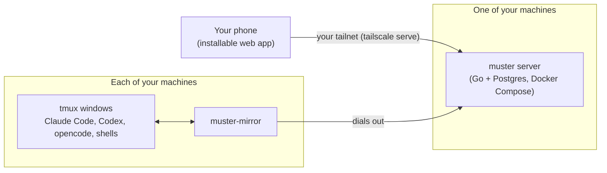
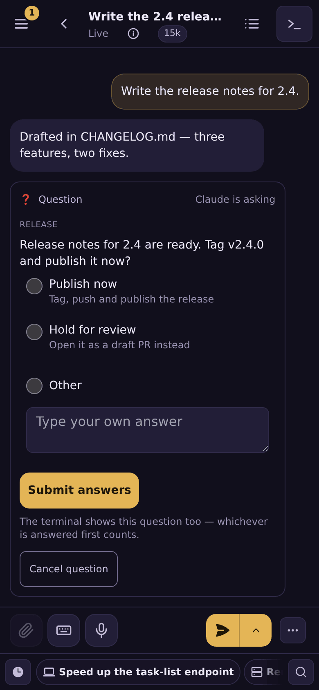
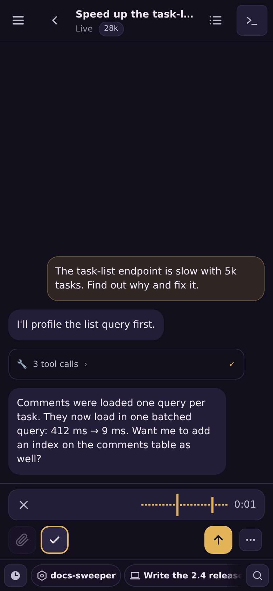
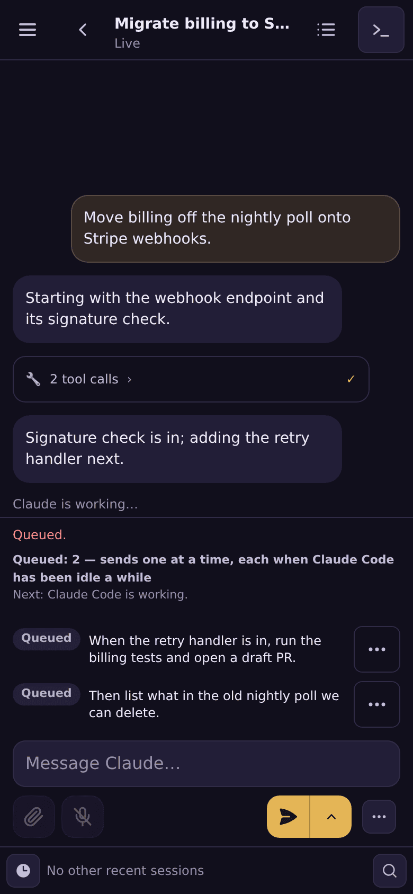

<div align="center">

<!-- LOGO PLACEHOLDER: the muster logo lockup goes here once the brand pack lands.
     Until then this comment is the only thing in this slot; do not put an image here. -->

# muster

### Every coding agent on every machine, in one list on your phone.

[](https://github.com/ZacxDev/muster/actions/workflows/ci.yml?query=branch%3Amain)
[](https://github.com/ZacxDev/muster/releases/latest)
[](LICENSE)
[](go.mod)


</div>

## What it is

muster is a self-hosted server that puts every coding agent session on every
one of your machines into one list on your phone: **Claude Code, Codex,
opencode** (any model, OpenRouter included) **and anything else you run in
tmux.** When a Claude Code session needs you, you get a push, answer from your
phone, and it carries on.

It is for people who run several coding agents at once, on one machine or
many, and want to see and steer them away from the keyboard. Everything stays
on your machines and your own Tailscale network: muster starts on this machine
at a `http://localhost` address, and your phone and other machines join over
your tailnet.

## How it works



1. A server (one Go binary and Postgres, in Docker Compose) runs on one of your
   machines, reached over your tailnet through `tailscale serve`.
2. On each machine, `muster-mirror` dials out to it and mirrors every tmux
   window as a **mirrored session**; a message from your phone is typed into
   that same session, so it is all there when you are back at the keyboard.
3. Your phone opens the server as an installable web app (a PWA).

muster sees only sessions inside tmux, and the one-prompt install sets up
mirrored sessions only. How to bring a session you already have into tmux, and
how mirrored sessions differ from the opt-in **dispatched agents** that muster
starts in Kubernetes pods:
[docs/mirroring.md](docs/mirroring.md#mirrored-sessions-and-dispatched-agents).
The components and what each trusts: [docs/architecture.md](docs/architecture.md).

## Quick start

**1. Install muster on this machine.** Paste this one prompt into the coding
agent (Claude Code, Codex, opencode, Gemini CLI, …) on the machine that should
run muster:

```text
Set up muster for me. Download its install guide with `curl -fsSL -o muster-install.md https://github.com/ZacxDev/muster/releases/latest/download/INSTALL.md`, read that whole file and follow it step by step. If that download fails, stop and tell me what it printed; never work from another copy of the guide, such as the one on the main branch, or from memory. Ask me everything you need in one go up front, then do the rest yourself. Where the guide and the machine disagree, trust `muster doctor`, each command's `--help` and the code at https://github.com/ZacxDev/muster over memory.
```

The agent downloads [INSTALL.md](INSTALL.md), a guide written for agents to
execute, from the newest release, asks its questions once, up front, installs
muster and finishes with `muster doctor`
([docs/onboarding.md](docs/onboarding.md)). Or do it by hand, with Docker
(Compose v2) and tmux: this one line starts muster with every secret generated.

```sh
curl -fsSL https://github.com/ZacxDev/muster/releases/latest/download/install.sh | sh
```

**2. Start an agent in tmux:** `tmux new -A -s work claude`. It shows up in
muster at its `http://localhost` address. On each further machine, paste the
same prompt and tell the agent muster already runs.

**3. Add your phone** over Tailscale (on iOS, then add the app to the Home
Screen for push): [docs/quickstart-local.md](docs/quickstart-local.md#add-your-phone).

## Features

<table>
<tr>
<td align="center" valign="top" width="33%">
<br>
<a href="docs/mirroring.md"><b>Every session, one list</b></a><br>
<sub>Every tmux window on every machine, Claude Code, Codex, opencode and shells alike, with the ones waiting on you first.</sub>
</td>
<td align="center" valign="top" width="33%">
<br>
<a href="docs/attention.md"><b>Agents ask instead of stopping</b></a><br>
<sub>A Claude Code question becomes a form on your phone, pushed with its text; answer it and the session carries on. One-time setup per machine.</sub>
</td>
<td align="center" valign="top" width="33%">
<br>
<a href="docs/sending-and-step-up.md"><b>A chat, not a terminal</b></a><br>
<sub>A Claude Code session reads as a chat, with the message box under your thumb.</sub>
</td>
</tr>
<tr>
<td align="center" valign="top">
<br>
<a href="docs/dictation.md"><b>Talk instead of typing</b></a><br>
<sub>Optional dictation: tap the mic and speak, and read the transcript in the box before you press Send.</sub>
</td>
<td align="center" valign="top">
<br>
<a href="docs/sending-and-step-up.md#queue-send-when-claude-code-is-idle"><b>Queue the next message</b></a><br>
<sub>Queue messages while the agent works: the server sends each one once Claude Code has been idle for 30 s, even with your phone closed.</sub>
</td>
<td align="center" valign="top">
<br>
<a href="docs/officers-builtin.md"><b>Officers and a chief</b></a><br>
<sub>Optional: standing agents with a job, which can ask you on the Asks page, and a chief you can ask what every session is on.</sub>
</td>
</tr>
</table>


Every feature, what it needs and the `.env` lines that turn it on:
[docs/features.md](docs/features.md). The long version of this page (what you
get, notifications, the core and the optional features, the comparison with
Remote Control, the limits): [docs/overview.md](docs/overview.md).

## Ecosystem

muster grows with what you plug into it.

- **Plugins** bring your other inboxes to muster: email, a chat, a forum, a
  support desk. Your agents read what arrives and draft the answers, and
  nothing is sent until you approve the exact words, unless you choose to
  let muster answer someone you trust automatically.
- **Officers** are agents with one standing job, such as answering support,
  writing release notes or testing each change. Each works on its own and
  asks you before anything leaves.
- **Together**, a plugin and an officer make an assistant for one channel:
  it handles the routine messages, brings you the ones that need you, and
  sends only the replies you approve.

Anyone can build one and share it. See what exists and how to list yours in
[Building on muster](docs/ecosystem.md), build your first plugin with
[Build a plugin in 15 minutes](docs/plugins-quickstart.md), and give it an
officer with
[Recipe: a specialised officer with its own plugin](docs/officer-plugin-recipe.md).

<!-- MEDIA SLOT (ecosystem): the film goes here, then 2-3 stills in a row
     (a message arriving, the draft on the Asks page, the reply sent).
     Add them once shot; no placeholder images. -->

## Install options

Every release publishes these assets on its
[release page](https://github.com/ZacxDev/muster/releases/latest), with a
`checksums.txt` of their sha256.

| option | what you download | for | guide |
|---|---|---|---|
| **Docker Compose** (recommended) | `install.sh`, or `docker-compose.yml` with `env.example` saved as `.env` | the server on one machine; the images come from GHCR | [docs/quickstart-local.md](docs/quickstart-local.md) |
| **Helm chart** | `muster-<X.Y.Z>.tgz` | the server on Kubernetes, and dispatched agents | [docs/kubernetes.md](docs/kubernetes.md) |
| **Mirror daemon** | `muster-mirror_<os>_<arch>.tar.gz` | each machine whose tmux sessions muster shows | [docs/mirroring.md](docs/mirroring.md) |
| **CLI** | `muster_<os>_<arch>.tar.gz` | `muster doctor`, tasks and the rest from a terminal | [docs/cli.md](docs/cli.md) |
| **From source** | a clone of this repository | working on muster | [docs/development.md](docs/development.md) |

The binaries are built for `<os>` = `linux` or `darwin` and `<arch>` = `amd64`
or `arm64`. There is no server binary: the server ships as the container image
the Compose file and the chart run.

<details>
<summary><b>Install from inside Claude Code, or as a skill</b></summary>

The one prompt above is the main path. In Claude Code you can instead add this
repository as a plugin marketplace and install the `muster` plugin:

```text
/plugin marketplace add ZacxDev/muster
/plugin install muster@muster
```

Then ask Claude Code to "set up muster". The plugin holds one skill,
`muster-setup`, which downloads the same [INSTALL.md](INSTALL.md) from the
newest release and follows it, so it never carries a copy of the steps.

Other coding agents can install the same skill with the
[skills](https://skills.sh) CLI:

```text
npx skills add ZacxDev/muster --skill muster-setup
```

This is muster by ZacxDev. Other repositories publish unrelated
skills named `muster`, so install it by this repository's name, not by
searching for the word.

</details>

## Requirements

- **Docker with Compose v2** on the machine that runs the server, or a
  Kubernetes cluster for the Helm chart.
- **tmux on every machine** whose sessions you want to see: muster sees only
  sessions inside tmux. What each machine needs is checked by
  [INSTALL.md, "Preflight (every machine)"](INSTALL.md#step-0-preflight-every-machine).
- **Linux.** macOS machines are experimental; there is no Windows support.
- **Tailscale** for your phone and your other machines. On iOS, install the app
  to the Home Screen before it can receive push.

What it does not do, or has not proven: [docs/limits.md](docs/limits.md).

## Learn more

- [Documentation index](docs/README.md) and the [glossary](docs/glossary.md)
- [Every feature and what it needs](docs/features.md), and a
  [guide per optional feature](docs/README.md#set-it-up-the-core-first-then-one-feature-at-a-time)
- [muster compared with other ways to reach coding agents from a phone](docs/comparison.md)
- [Contributing](CONTRIBUTING.md), the [Code of Conduct](CODE_OF_CONDUCT.md)
  and the [security policy](SECURITY.md)
- [Releases](https://github.com/ZacxDev/muster/releases) and
  [Discussions](https://github.com/ZacxDev/muster/discussions)

## License

MIT. See [LICENSE](LICENSE).
