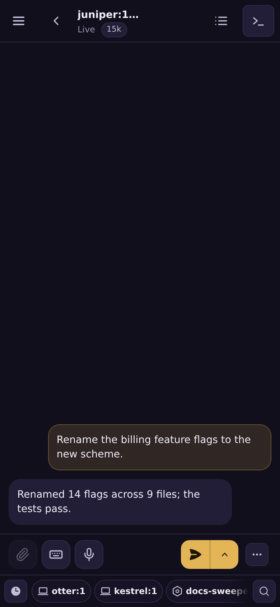
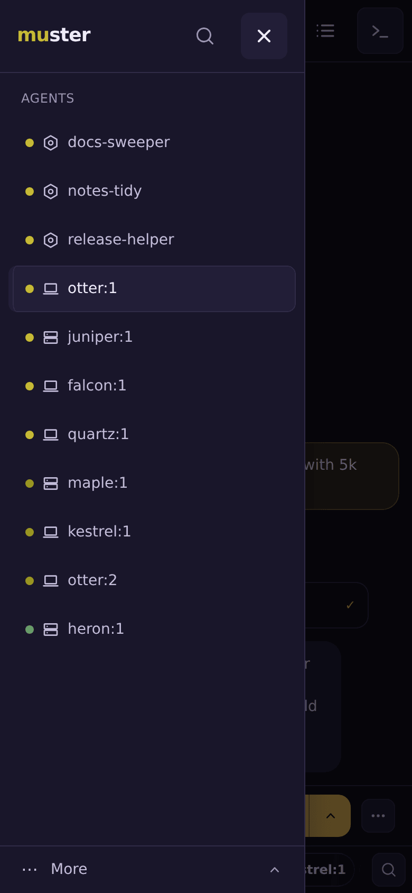
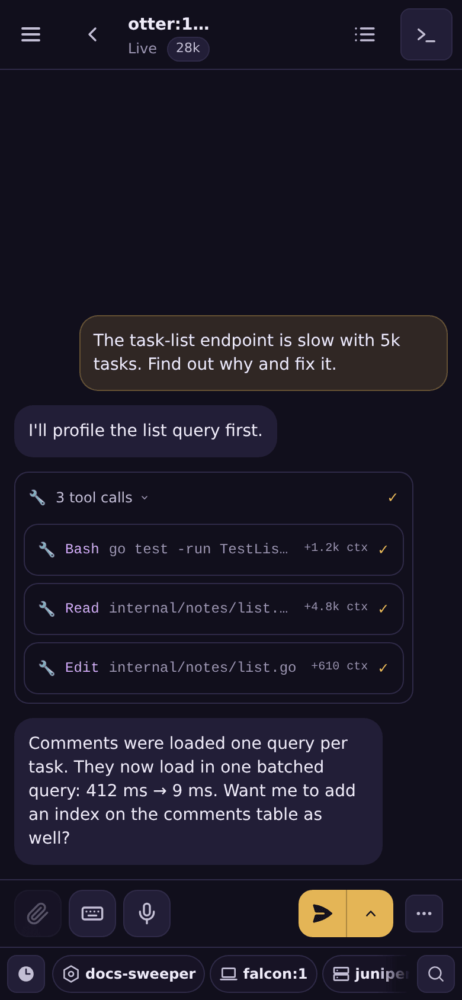
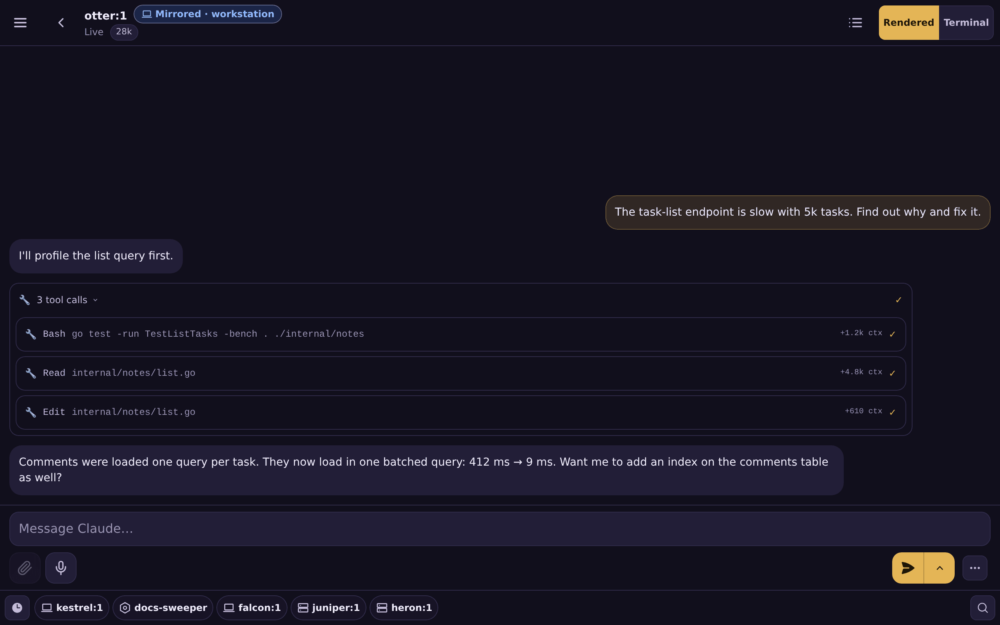
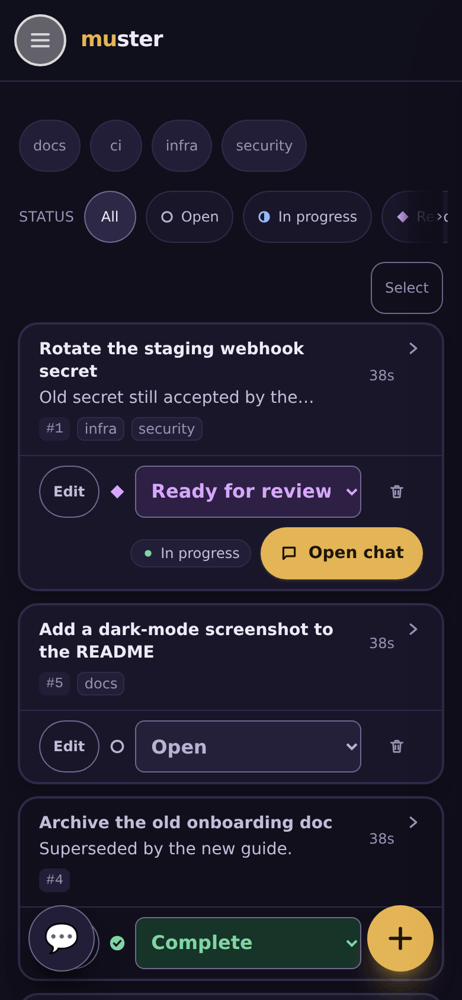
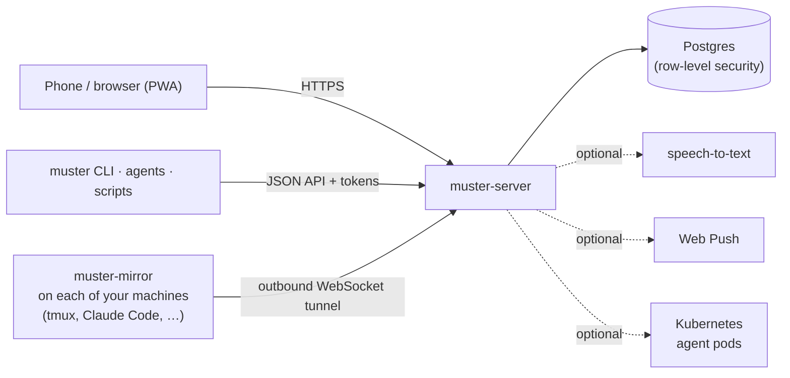

# muster

**Drive multiple Claude Code sessions from your phone, and get notified in one
consolidated queue when they need your input.**

Self-hosted, on your own machines, over your own Tailscale network. Any coding
agent you run in tmux shows up; Claude Code gets the most.

<p align="center">
  
  
  
</p>

## What you get

- **A push when a session needs you, and one queue for everything waiting.**
  Every session on every machine is in one list, with the ones waiting on you
  first, and the **Asks** page gathers everything blocked on you. Each stop is
  pushed once and the push never quotes the session
  ([details below](#notifications-only-when-you-are-needed)).
- **A chat on your phone, not a terminal.** A Claude Code session opens as a
  chat with a message box at the bottom, within reach of your thumb. With
  dictation on, tap the mic and speak: the transcript lands in the box, and you read it before you
  press Send.
- **What Remote Control leaves out.** muster picks up every session already
  running in tmux, with nothing to turn on per session; lists all your
  machines side by side; shows Codex, opencode, Gemini CLI and shells next to
  Claude Code; and reads the session on your own machine, so it works with an
  API key, Amazon Bedrock or a custom `ANTHROPIC_BASE_URL`, which Remote
  Control does not support.
- **Everything stays on your machines and your tailnet.** The server runs on
  one of your machines and is reached only over Tailscale. Each machine dials
  out to it, so muster opens no network port on them (the optional MCP
  endpoint listens on loopback only). Machines are read-only until you let
  muster type into them, one machine at a time.
- **Mixed agents in one place.** Claude Code renders as a chat; opencode and
  Hermes have their own read views; Codex, Gemini CLI and plain shells are
  live terminals.
- **Agents ask you instead of stopping.** A Claude Code session can ask you a
  question with options and wait for your answer, and Claude Code's own
  multiple-choice questions become a form you answer from your phone. Each
  needs a one-time setup per machine.

## How it works

1. A server (one Go binary and Postgres, in Docker Compose) runs on one of your
   machines, reached over your tailnet through `tailscale serve`.
2. On each machine, `muster-mirror` dials out to it and mirrors every tmux
   window as a **mirrored session**; a message from your phone is typed into
   that same session, so it is all there when you are back at the keyboard.
3. Your phone opens the server as an installable web app (a PWA).

muster sees only sessions inside tmux, and the one-prompt install below sets
up mirrored sessions only. How to bring a session you already have
into tmux, and how mirrored sessions differ from the opt-in **dispatched
agents** that muster starts in Kubernetes pods:
[docs/mirroring.md](docs/mirroring.md#mirrored-sessions-and-dispatched-agents).
The components and what each trusts: [docs/architecture.md](docs/architecture.md).

## Notifications: only when you are needed

In the Compose stack (from the first release after v0.144.0), a session is
pushed **once per stop**:

- at once, when it waits on you (a permission prompt, a question);
- or once, when it has sat idle past the stall threshold (10 minutes by
  default), as **stalled**.

The push names the session, as `<window> needs you` or `is stalled`, and
**never quotes it**: no tool, command or anything the session said. It closes
when you act in the session or open it in muster, and a stop you dealt with is
not pushed again. **The exception:** an agent's ask, and a Claude Code
multiple-choice question held by the ask hook, are pushed with the question's text, so you can see what is
asked. Task events, such as a task ready for review, have their own switches
under **Account → Notifications**. Details:
[docs/attention.md](docs/attention.md#stalled--waiting-session-state) and
[docs/push.md](docs/push.md); turning it off:
[docs/features.md](docs/features.md#session-state).

## Quickstart

You need:

- a [Tailscale](https://tailscale.com) account with MagicDNS and HTTPS
  certificates on, and Tailscale on every machine and on your phone;
- on the machine that will run the server: Docker with Compose v2, and about
  10 GB of free disk (20 GB with local dictation);
- tmux on every machine. Linux, amd64 or arm64; macOS hosts are experimental
  ([Limits](#limits)).

**(a) Let your agent install it.** Paste this one prompt into the coding agent
(Claude Code, Codex, opencode, Gemini CLI, …) on each machine you want in
muster. The first paste sets up the server; on each further machine, tell the
agent muster already runs, and that machine joins it:

```text
Set up muster for me: read https://raw.githubusercontent.com/ZacxDev/muster/main/INSTALL.md and follow it step by step. Ask me everything you need in one go up front, then do the rest yourself.
```

It asks its questions once, up front (other machines, how dictation should work,
whether muster may type into each machine's terminals), then:

- runs the server in Docker, behind `tailscale serve` on your tailnet;
- connects each machine's tmux sessions with `muster-mirror`;
- finishes with `muster doctor`, which checks every part end to end, says how
  to fix what fails, and (with `qrencode` installed) prints a QR code of the
  address for your phone.

While there is no session yet, home shows how to start an agent in tmux
(`tmux new -A -s work claude`) and the same prompt, to connect another
machine. More in [docs/onboarding.md](docs/onboarding.md).

**(b) Install it yourself.** [INSTALL.md](INSTALL.md) is the same guide, step by
step.

### Install from inside Claude Code

The one prompt above is the main path. In Claude Code you can instead add this
repository as a plugin marketplace and install the `muster` plugin:

```text
/plugin marketplace add ZacxDev/muster
/plugin install muster@muster
```

Then ask Claude Code to "set up muster". The plugin holds one skill,
`muster-setup`, which follows the same [INSTALL.md](INSTALL.md) from its URL,
so it never carries a copy of the steps.

Other coding agents can install the same skill with the
[skills](https://skills.sh) CLI:

```text
npx skills add ZacxDev/muster --skill muster-setup
```

This is muster by ZacxDev. Other repositories publish unrelated
skills named `muster`, so install it by this repository's name, not by
searching for the word.

To hack on muster, [docs/development.md](docs/development.md) runs it from source
against a throwaway database.

## Core vs optional

The core runs with **no optional dependency**: Docker Compose with its bundled
Postgres on one machine, `muster-mirror` and tmux on each machine, and
Tailscale. Everything else is off until you give it what it needs, and is
turned on with a few lines in `.env` (and, for some, a Compose profile).

| feature | needs | default |
|---|---|---|
| [Core](docs/features.md#core): mirrored sessions, chat and Terminal views, typing into sessions, sidebar and search, the Asks page, tasks, the installable app, the CLI and `muster doctor` | Compose and its Postgres; `muster-mirror` and tmux on each machine; Tailscale | on |
| [Push](docs/features.md#push) | HTTPS, which Tailscale gives you; keys INSTALL.md generates | on in INSTALL.md |
| [One push per stop](docs/features.md#session-state) | nothing beyond the core | on in the Compose stack |
| [Dictation](docs/features.md#dictation) | `--profile stt` (bundled, CPU), `--profile stt-cohere` (GPU), or your own OpenAI-compatible speech-to-text | off (INSTALL.md asks) |
| [Attachments](docs/features.md#attachments) | `--profile s3`, or your own S3-compatible store | off |
| [Suggested replies](docs/features.md#suggested-replies) and [focus](docs/features.md#focus) | an OpenRouter key | off until the key is set |
| [Agent ask tool](docs/features.md#agent-ask-tool) and [ask cards](docs/features.md#ask-cards) | a one-time setup on each machine | off |
| [Accounts](docs/features.md#accounts) (per-user sign-in, passkeys) | a GoTrue server you run | off (one shared password) |
| [Dispatch](docs/features.md#dispatch), the [Chief](docs/features.md#chief) and [officers](docs/features.md#officers) | **Kubernetes** | off; not in the Compose stack |
| [Approval router](docs/features.md#approval-router) | an external permission router you run (advanced) | off |

Every other optional feature, what it needs and the `.env` lines that turn it
on: [docs/features.md](docs/features.md). `muster doctor` checks the install
end to end and says how to fix what fails
([docs/cli.md](docs/cli.md#muster-doctor)); each section of docs/features.md
ends with how to check that feature is on.

## muster vs Remote Control

If you use only Claude Code on a paid Claude plan, **Remote Control is less
work**: nothing to install or host, a native app, first-party support, deeper
Claude Code integration (subagent progress, compaction), organization controls
such as Trusted Devices, and permission prompts and questions answered in the
app.

muster is for what it does not cover: agents other than Claude Code, Claude
Code on an API key, Bedrock, Google Cloud, Microsoft Foundry or a custom
`ANTHROPIC_BASE_URL`, every tmux session on every machine in one list, and a
session that stays on your own machines and tailnet instead of going through
Anthropic's servers.

The full comparison, with Happy and SSH + tmux too, and the sources for every
cell: [docs/comparison.md](docs/comparison.md).

## Limits

- **Linux.** macOS hosts are experimental: the Terminal view cannot attach on
  macOS yet (`internal/mirrorhost/pty_other.go`), so there only a Claude Code
  window whose Rendered view resolves can be viewed, and Rendered-view
  detection is unverified on a real Mac. No Windows.
- **A Claude Code permission prompt is answered in the Terminal view.** The
  chat view refuses to type into a waiting prompt, and there is no one-tap
  approve ([docs/sending-and-step-up.md](docs/sending-and-step-up.md)).
- **Codex and Gemini CLI get no waiting push** and no ask tool: they are
  terminal views. The message box does not send to opencode yet.
- **It needs Tailscale**, plus Docker on one machine and tmux on every
  machine. muster sees only sessions inside tmux.
- **It is a PWA, not a native app.** On iOS, install it to the Home Screen
  before it can receive push.
- **Run one replica.** Some background loops and the mirror tunnel keep their
  state in memory.
- **An interactive mirror is a shell on that host.** Anyone who can type into
  that host's Terminal view (after a recent sign-in) can run commands as the
  user `muster-mirror` runs as.
- **Agent dispatch is opt-in and only lightly proven.** The repository ships no
  Kubernetes manifests.

The full list is in [docs/limits.md](docs/limits.md).

## Features

Each feature in more detail, with its own page. What each optional one needs:
[docs/features.md](docs/features.md).

<p align="center">
  
</p>

### Core

- **Mirrored sessions.** Each tmux window on your machines is shown live. A
  Claude Code window renders as a chat (the **Rendered** view), and the
  **Terminal** view is one tap away (on a Linux host; see [Limits](#limits)). A
  window that has only the Terminal view says why. Viewing a window never moves
  your own terminal. → [docs/mirroring.md](docs/mirroring.md)
- **Session switcher, sidebar and search.** A bottom bar with Recent, Waiting,
  Pins and All, picked by an icon (and a ⋯ menu to pin the session you are on), and a sidebar
  that lists every session like channels in a chat app: the chief first (if
  you turned one on), then the sessions waiting on you, then the rest by
  recency, the long-idle ones folded under **Idle**. The search opens with the
  magnifier on the bar or in the sidebar, or `/`, and finds a session by its
  codename, title, repository, kind or machine. Home opens the chief's chat, or
  the session you opened last. → [docs/mirroring.md](docs/mirroring.md)
- **Message box and step-up.** Send text into a Claude Code session, a plain
  terminal pane (Codex, Gemini CLI, a shell) or a dispatched agent. The message
  box does not send to opencode yet, and sends to Hermes only through the
  host's gated `-hermes-send`; type into either from the Terminal view. Typing
  into a mirrored session needs that machine opted in (read-only is the
  default) and a recent sign-in: you confirm your password again (or a
  passkey, with per-user accounts). → [docs/sending-and-step-up.md](docs/sending-and-step-up.md)
- **Asks.** A single queue of everything waiting on you: sessions at a prompt,
  their questions, and agents' asks. → [docs/attention.md](docs/attention.md)

  <p align="center"></p>
- **Context badges.** Each tool call in a Claude Code session shows how much
  context it added. → [docs/mirroring.md](docs/mirroring.md)
- **Task board.** Tasks have statuses, comments, attachments, tags and a review
  queue. People and agents share the board. → [docs/tasks.md](docs/tasks.md)
- **PWA.** An installable app with a share target, shortcuts and a badge.
  → [docs/push.md](docs/push.md#installable-app-pwa)
- **CLI.** `muster`, a client for agents and scripts, and `muster doctor`.
  → [docs/cli.md](docs/cli.md)

### Optional

- **Push.** Web Push notifications, one per stop of a session
  ([above](#notifications-only-when-you-are-needed)). → [docs/push.md](docs/push.md)
- **Dictation.** A mic on every message box, transcribed by a speech-to-text
  service you choose: the installer offers a local model on the server (GPU or
  CPU) or your own OpenAI-compatible API key. The transcript is never sent by
  itself. → [docs/dictation.md](docs/dictation.md)
- **Agent asks.** An agent asks you a question and waits for your answer
  instead of stopping (for a mirrored Claude Code session, after a one-time
  setup on its machine: [docs/features.md](docs/features.md#agent-ask-tool)).
  Claude Code's multiple-choice questions show as a form you can answer from
  your phone, with a hook on each machine
  ([docs/features.md](docs/features.md#ask-cards)).
  → [docs/attention.md](docs/attention.md#the-agent-tools)
- **Suggested replies and focus.** Reply chips when a session hands back to
  you, and a short title and summary per session that search can find. Both
  need an OpenRouter key. → [docs/suggested-replies.md](docs/suggested-replies.md),
  [docs/focus.md](docs/focus.md)
- **File attachments.** Attach files in the message box. They are stored in
  S3-compatible storage. → [docs/uploads.md](docs/uploads.md)
- **Accounts.** Per-user accounts through GoTrue, with passkeys, invites, roles
  and API tokens, kept apart by row-level security. → [docs/auth.md](docs/auth.md)
- **Connectors.** Agents use your stored HTTP credentials through muster's
  proxy, and never see the secret. → [docs/connectors.md](docs/connectors.md)
- **GitHub App.** muster's own GitHub identity, and tokens scoped to one
  repository for agents. → [docs/github-app.md](docs/github-app.md)
- **Browser flows.** A queue of scripted browser jobs, run by a runner you host,
  each approved by its owner. → [docs/browser-flows.md](docs/browser-flows.md)

### Advanced: Kubernetes

- **Agent dispatch.** Start an agent on a task in its own pod.
  → [docs/provisioner.md](docs/provisioner.md)
- **Agent actions.** A dispatched agent's page shows its live status and has a
  **⋯** menu to rename, start, stop or delete it; the **+** beside **Agents** in
  the sidebar dispatches a new one (or saves it for later).
  → [docs/provisioner.md](docs/provisioner.md#an-agents-page)
- **Chief (off by default).** An optional agent that reports on and manages
  the rest of the fleet. It runs in its own Kubernetes pod, so it needs the
  agent provisioner. Turn it on or off under **Account → Chief**. While it is
  on, home opens its chat and the sidebar lists it first; off (the default for
  a new install or user), home opens the session you opened last and nothing
  is sent to it.
  → [docs/chief.md](docs/chief.md)
- **Memo relay.** Delivers [cairn](https://github.com/ZacxDev/cairn) memos to
  dispatched agents. → [docs/memo-relay.md](docs/memo-relay.md)

## Architecture



[docs/architecture.md](docs/architecture.md) covers the binaries, the
listeners, and what each component trusts. The full documentation index is
[docs/README.md](docs/README.md).

## The name

Not to be confused with two other apps called Muster: the Mac menu-bar app
([agentmuster.app](https://agentmuster.app/)) and the desktop app for running
parallel agents in git worktrees ([musterup.dev](https://musterup.dev/)). This
muster is the self-hosted one, for your phone and every machine you run agents
on.

*To muster is to assemble a force for duty. A muster roll is the register of who
is present and what each is assigned.*

## Licence

MIT. See [LICENSE](LICENSE).
