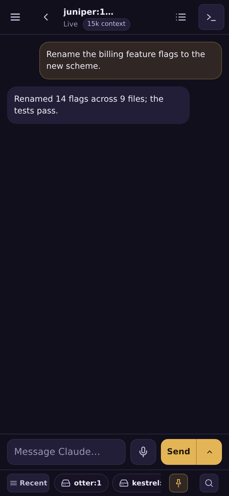
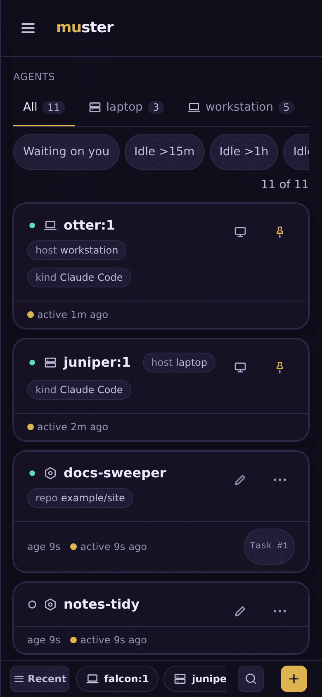
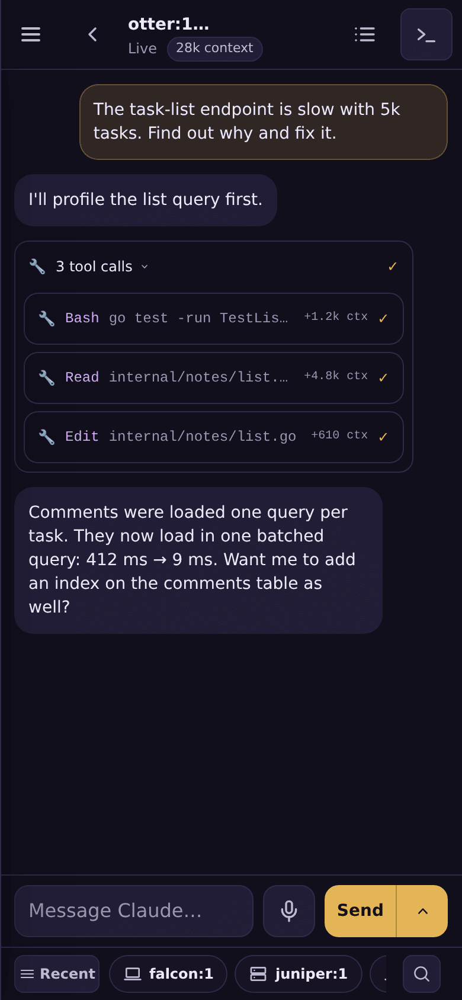
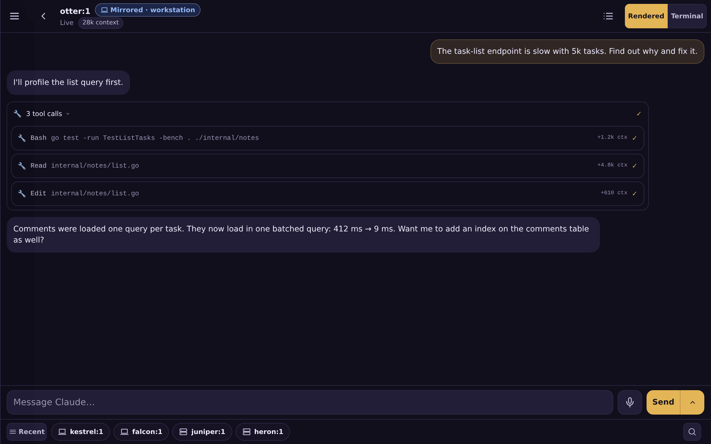
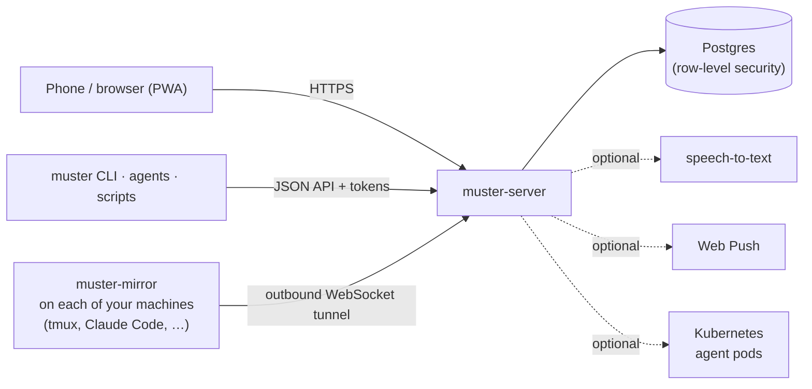

# muster

**Scale your agent sessions with Claude Code and others, use them across multiple
machines, and use them easily from your phone with your voice and one hand.**

Self-hosted: one Go binary and Postgres. The UI installs as a PWA. Each of your
machines dials out to muster, so nothing on them is exposed and no inbound port
is opened to them.

<p align="center">
  
  
  
</p>

## Why muster

- **Run more sessions without losing track of them.** Every tmux window on every
  machine becomes a card, newest activity first. A bar at the bottom of the
  screen switches between sessions in one tap, and its search finds one by
  codename, title, repository or kind as you type.
- **Every machine, nothing exposed.** A small host agent, `muster-mirror`, runs
  on each machine and opens an outbound tunnel to your muster server. Your
  laptop, workstation and build box show up side by side, and none of them
  accepts a connection.
- **Your phone, your voice, one hand.** muster is designed for a phone first.
  The controls sit at the bottom of the screen, within reach of your thumb. Tap
  the mic, speak, and the transcript lands in the message box. You read it, then
  press Send. Notifications tell you when something is waiting on you.
- **Agent-agnostic.** Claude Code sessions render as a chat. opencode and Hermes
  sessions have their own read views. Anything else, such as Codex or a plain
  shell, is a live terminal. If it runs in a tmux pane, muster can show it.

## Quickstart

**(a) Let your agent install it.** Paste this one prompt into your coding agent:

```text
Set up muster for me: read https://raw.githubusercontent.com/ZacxDev/muster/main/INSTALL.md and follow it. Ask me anything you need up front.
```

**(b) Install it yourself.** Follow [INSTALL.md](https://github.com/ZacxDev/muster/blob/main/INSTALL.md).

To hack on muster, [docs/development.md](docs/development.md) runs it from source
against a throwaway database.

## Features

### Core

- **Mirrored sessions.** Each tmux window on your machines is shown live. A
  Claude Code window renders as a chat, and the Terminal view is one tap away.
  Viewing a window never moves your own terminal. → [docs/mirroring.md](docs/mirroring.md)
- **Session switcher and search.** A bottom bar with Recent, Pins and All. Its
  search opens with the magnifier or `/`. → [docs/mirroring.md](docs/mirroring.md)
- **Message box and step-up.** Send text into any mirrored pane or agent. Typing
  into a mirrored session needs a recent sign-in, which you confirm with a
  passkey or a password. → [docs/sending-and-step-up.md](docs/sending-and-step-up.md)
- **Dictation.** A mic on every message box, transcribed by a speech-to-text
  service you choose (an OpenAI-style transcription endpoint). The transcript is
  never sent by itself. → [docs/dictation.md](docs/dictation.md)
- **Push and PWA.** Web Push notifications, plus an installable app with a share
  target, shortcuts and a badge. → [docs/push.md](docs/push.md)
- **Asks.** A single queue of everything waiting on you. An agent can ask you a
  question and wait for your answer instead of stopping. → [docs/attention.md](docs/attention.md)
- **Context badges.** Each tool call in a Claude Code session shows how much
  context it added. → [docs/mirroring.md](docs/mirroring.md)
- **Task board.** Tasks have statuses, comments, attachments, tags and a review
  queue. People and agents share the board. → [docs/tasks.md](docs/tasks.md)

### Advanced / optional

These are optional, and most are off until you configure them.

- **Agent dispatch on Kubernetes.** Start an agent on a task in its own pod.
  → [docs/provisioner.md](docs/provisioner.md)
- **Chief.** One agent that reports on the rest of the fleet.
  → [docs/chief.md](docs/chief.md)
- **Connectors.** Agents use your stored HTTP credentials through muster's
  proxy, and never see the secret. → [docs/connectors.md](docs/connectors.md)
- **Browser flows.** A queue of scripted browser jobs, run by a runner you host,
  each approved by its owner. → [docs/browser-flows.md](docs/browser-flows.md)
- **Memo relay.** Delivers [cairn](https://github.com/ZacxDev/cairn) memos to
  dispatched agents. → [docs/memo-relay.md](docs/memo-relay.md)
- **GitHub App.** muster's own GitHub identity, and tokens scoped to one
  repository for agents. → [docs/github-app.md](docs/github-app.md)
- **File attachments.** Attach files in the message box. They are stored in
  S3-compatible storage. → [docs/uploads.md](docs/uploads.md)
- **Accounts.** Per-user accounts through GoTrue, with passkeys, invites, roles
  and API tokens, kept apart by row-level security. → [docs/auth.md](docs/auth.md)
- **CLI.** `muster`, a client for agents and scripts. → [docs/cli.md](docs/cli.md)

<p align="center">
  
</p>

## Architecture



[docs/architecture.md](docs/architecture.md) covers the binaries, the
listeners, and what each component trusts. The full documentation index is
[docs/README.md](docs/README.md).

## Status and limits

- **Run one replica.** Some background loops and the mirror tunnel keep their
  state in memory.
- **An interactive mirror is a shell on that host.** Anyone who can type into
  that host's Terminal view (after a recent sign-in) can run commands as the
  user `muster-mirror` runs as.
- **Agent dispatch is opt-in and only lightly proven.** The repository ships no
  Kubernetes manifests.

The full list is in [docs/limits.md](docs/limits.md).

## Licence

MIT. See [LICENSE](LICENSE).

*To muster is to assemble a force for duty. A muster roll is the register of who
is present and what each is assigned.*
