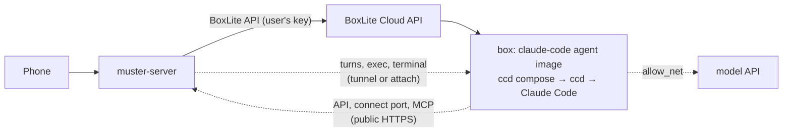
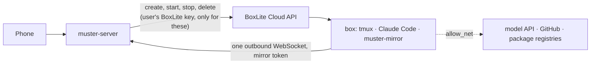

# Design: BoxLite as a runtime for muster

**Status: proposed.** Nothing on this page is built. It is a design proposal
for review: two shapes for running muster's agents in
[BoxLite](https://docs.boxlite.ai) microVMs, each with its user flow,
architecture, security, failure modes, cost and phased slices, and
[open questions](#9-open-questions-for-the-operator) with a recommendation
each. The [recommendation](#10-recommendation) is to build
[shape B](#5-shape-b-a-cloud-computer) first.

Where this page says how muster works today, it cites `file:line` at muster
commit `be827a86` (origin/main when written), and the code is the authority
([decisions.md](../decisions.md)). A claim about BoxLite cites its public
documentation as published for v0.13.1; BoxLite releases often (that was the latest
when this was written), so re-read it before building. A claim nothing confirmed is
marked **UNVERIFIED**. Every figure in the [cost model](#7-cost-model) is
marked **measured**, **documented** (quoted from BoxLite's public price list)
or **estimated**. Hostnames are placeholders: muster is
`muster.example.com`.

## Contents

- [Summary](#summary)
- [1. What BoxLite offers, from its public docs](#1-what-boxlite-offers-from-its-public-docs)
- [2. What muster assumes today](#2-what-muster-assumes-today)
- [3. Goals and non-goals](#3-goals-and-non-goals)
- [4. Shape A: agents run in BoxLite](#4-shape-a-agents-run-in-boxlite)
- [5. Shape B: a cloud computer](#5-shape-b-a-cloud-computer)
- [6. Security, compared with the Kubernetes driver](#6-security-compared-with-the-kubernetes-driver)
- [7. Cost model](#7-cost-model)
- [8. Phased slices](#8-phased-slices)
- [9. Open questions for the operator](#9-open-questions-for-the-operator)
- [10. Recommendation](#10-recommendation)
- [Appendix: a local spike](#appendix-a-local-spike)

## Summary

- **Shape A, agents in BoxLite.** A new provisioner driver,
  `MUSTER_AGENT_PROVISIONER=boxlite`, starts `claude-code` agents as BoxLite
  boxes in the user's own BoxLite account, the way the `kubernetes` driver
  starts pods. Every lifecycle call has a BoxLite counterpart (the
  [mapping](#the-driver-mapped-method-by-method)). Two things are hard: muster
  must **reach into** each box (turns, exec, terminal) and each box must
  **reach muster**, so a self-hosted muster behind Tailscale needs a public
  path both ways; and muster-server must hold the user's BoxLite API key,
  which BoxLite documents as **fleet-wide with no narrower scope**.
- **Shape B, a cloud computer.** One box runs Claude Code in tmux plus
  `muster-mirror`, and appears in muster as one more of the user's computers.
  It needs **no change to the mirror wire**: a host already dials out over
  one WebSocket and muster never dials in
  ([internal/mirror/wire.go:16-22](../../internal/mirror/wire.go)). The chief
  starts agents on it with the existing host spawn
  ([mirroring.md](../mirroring.md#starting-agents-for-the-chief--agent-spawn)).
  One-tap creation is the only new muster code.
- **Where it beats today's driver.** BoxLite filters egress **by host name**
  and can keep a credential **out of the VM** (a placeholder the host-side
  proxy swaps for the real value). muster's Kubernetes driver does neither
  today ([limits.md:34-58](../limits.md)).
- **Where it falls short.** No restart policy, no webhooks, no REST logs
  endpoint, a 15-minute idle auto-stop that ignores work inside the box, and
  an org-wide API key. Each is an [ask](#what-wed-need-from-boxlite).
- **Beside the managed network.** Shape B's box is a remote machine, so it
  reaches a self-hosted server exactly as phase 3 of
  [managed-network.md](managed-network.md#phase-3-machines-through-the-relay)
  plans for any machine: through the relay with the `muster-mirror/1` ALPN.
  Until then: Tailscale in the box, or a server with a public HTTPS URL.

## 1. What BoxLite offers, from its public docs

| fact | source |
|---|---|
| Two products: an **embeddable library** (no daemon, no root) and **BoxLite Cloud**, a managed pool behind the same SDK with a URL and an API key; an optional local REST server, `boxlite serve` | [getting-started](https://docs.boxlite.ai/getting-started/index), [cloud vs open source](https://docs.boxlite.ai/cloud/vs-opensource) |
| Hardware isolation: KVM on Linux, Hypervisor.framework on macOS (Apple Silicon), through a libkrun fork; user-mode networking | [networking](https://docs.boxlite.ai/architecture/networking), the GitHub repository |
| SDKs: Python, Node, Rust (the core), Go (a CGO binding), C; a CLI | [installation](https://docs.boxlite.ai/getting-started/installation) |
| Licence: runtime and SDKs Apache-2.0; the cloud stack (`apps/`) AGPL-3.0 | the repository's `NOTICE` |
| Cloud auth: a bearer API key, "a fleet-level credential… There is no narrower key to issue", no expiry by default | [api-keys](https://docs.boxlite.ai/cloud/api-keys) |
| Lifecycle: create, start, stop, remove, get-or-create by name; a crashed main command **stops the box** (no restart policy) | [lifecycle](https://docs.boxlite.ai/manage-sandbox/lifecycle), the Python reference |
| Exec: streamed stdout/stderr, stdin, exit code, kill, signal; a PTY with resize; over REST a WebSocket attach carrying stdin, stdout, stderr and resize/signal/exit, one attach at a time | [pseudo-terminal](https://docs.boxlite.ai/agent-tools/pseudo-terminal), the OpenAPI spec |
| Logs: `boxlite logs -f` in the CLI; **no REST logs endpoint found** in the OpenAPI spec | [CLI reference](https://docs.boxlite.ai/reference/cli) |
| Cloud idle: `auto_stop` 900 s by default, measured from outside the box ("work running inside the box does not count — a long job can be stopped mid-run"); `auto_resume` on; a stopped box keeps its disk but **not process memory** | [box lifecycle](https://docs.boxlite.ai/cloud/box-lifecycle) |
| Persistence on Cloud: the root disk across stop and start; managed volumes on the Team plan only; host bind mounts "accepted and ignored"; checkpoints (disk and config, no memory) instead of snapshots | [volumes](https://docs.boxlite.ai/cloud/volumes), [checkpoints](https://docs.boxlite.ai/cloud/checkpoints) |
| Egress: on or off; `allow_net` takes exact hosts or `*.` wildcards, other names resolve to a sinkhole; fixed at creation on Cloud | [network access](https://docs.boxlite.ai/manage-sandbox/network-access), [network policy](https://docs.boxlite.ai/cloud/network-policy) |
| Ingress on Cloud: private by default; a box can be made public, get per-port preview URLs or signed preview URLs; an SDK `tunnel(port)` carries TCP, one connection per tunnel; "inbound.allow_net is not supported yet" | [network policy](https://docs.boxlite.ai/cloud/network-policy), [tunnels](https://docs.boxlite.ai/cloud/tunnels) |
| Secrets: a placeholder in the box that the host-side HTTPS proxy replaces with the real value for allowed hosts only ("real values never enter the VM"); "not an authorization boundary" | [secrets and security](https://docs.boxlite.ai/manage-sandbox/secrets-and-security), [cloud secrets](https://docs.boxlite.ai/cloud/secrets) |
| Images on Cloud: the docs say any image on a public registry boots; the product FAQ says only the aliases `base`, `python`, `node`. **The two disagree** | [images](https://docs.boxlite.ai/cloud/images), the product site's FAQ |
| Webhooks or events for box state: **none found** | the OpenAPI spec |
| Regions: **none documented** | — |
| Plan ceilings per box: pay-as-you-go 1 vCPU / 2 GiB / 10 GiB and 2 running at once; Starter 2 / 4 / 20 and 4; Team 16 / 32 / 100 and 1,000 | [plans](https://docs.boxlite.ai/cloud/plans) |

## 2. What muster assumes today

| fact | where |
|---|---|
| The lifecycle switch is `MUSTER_AGENT_PROVISIONER`: `none`, `noop`, `kubernetes` | [provisioner.md:18-26](../provisioner.md) |
| The driver interface: `Driver`, `Capabilities`, `Create`, `Update`, `Scale`, `Destroy`, `List`, `Get`, `Endpoint`, `StreamLogs`; `Exec`, `ExecContainer`, `ExecTTY` optional and gated by `Capabilities.Exec` | [internal/provision/provision.go:107-301](../../internal/provision/provision.go) |
| Four driver rules: a blind driver errors, never returns an empty set; `Destroy` is nil only if the instance is gone; `Create` is idempotent and refuses a divergent spec; capabilities are branched on in one place | [provisioner.md:778-801](../provisioner.md), [internal/provision/provisiontest/contract.go:76](../../internal/provision/provisiontest/contract.go) |
| Isolation is an ordered enum, `none` < `process` < `container` < `namespace`; nothing reads it yet | [internal/provision/capabilities.go:10-31](../../internal/provision/capabilities.go), [:61-68](../../internal/provision/capabilities.go) |
| The adapter's lifecycle: `Dispatch` (`Create`), `Start` (`Update` then `Scale` 1), `Stop` (`Scale` 0), `Destroy`, `StreamLogs`, `AttachTerminal` (`ExecTTY`, then a second `Exec` to release the client) | [internal/agentprovision/agentprovision.go:677](../../internal/agentprovision/agentprovision.go), [:784-848](../../internal/agentprovision/agentprovision.go), [:875-896](../../internal/agentprovision/agentprovision.go), [:932-947](../../internal/agentprovision/agentprovision.go), [:1024](../../internal/agentprovision/agentprovision.go), [:1046-1095](../../internal/agentprovision/agentprovision.go) |
| A `claude-code` agent: `ccd` serves turns on port 18789; the Claude subscription token is `CLAUDE_CODE_OAUTH_TOKEN` in the agent's own Secret; API-key variables are refused | [internal/agentspec/agentspec.go:149](../../internal/agentspec/agentspec.go), [internal/agentspec/claudecode.go:43](../../internal/agentspec/claudecode.go), [images/claude-code-agent/credentials.sh:52](../../images/claude-code-agent/credentials.sh) |
| Its budget: 250m CPU and 512Mi requested, 3Gi memory limit; a `/data` volume, 10Gi by default | [internal/agentspec/claudecode.go:63](../../internal/agentspec/claudecode.go), [provisioner.md:259-260](../provisioner.md) |
| Its network on Kubernetes: ingress only from muster; egress to cluster DNS, TCP 443 on public IPv4, and muster's connect port; **no egress by name** | [provisioner.md:259-268](../provisioner.md), [limits.md:34-58](../limits.md), [internal/provision/types.go:337-404](../../internal/provision/types.go) |
| GitHub credentials never enter the pod: git goes through muster's connector proxy | [provisioner.md:310-314](../provisioner.md) |
| The compose mode of the agent image: `ccd compose` reads a spec file every 2 s, supervises the CLI as uid 1000, keeps the spec's secrets unreadable by it, and restarts the child with backoff | [provisioner.md:354-427](../provisioner.md) |
| The silence watchdog and the stopped-agent reaper run in muster and read the driver's `List` | [provisioner.md:600-628](../provisioner.md), [provisioner.md:683-745](../provisioner.md) |
| A host dials out over one WebSocket; muster holds no address, key or inbound route to it; at most 64 hosts per server | [internal/mirror/wire.go:16-22](../../internal/mirror/wire.go), [internal/mirror/wire.go:125](../../internal/mirror/wire.go) |
| `muster-mirror` refuses plain http to another machine | [internal/mirrorhost/client.go:183-189](../../internal/mirrorhost/client.go) |
| The chief's dispatch targets are `pod/claude-code` and `host/<host>/<runtime>` | [internal/api/agent_dispatch.go:255](../../internal/api/agent_dispatch.go), [:297](../../internal/api/agent_dispatch.go) |

## 3. Goals and non-goals

### Goals

- Agents that keep working when the user's laptop is closed, without the user
  running a Kubernetes cluster.
- Everything driven from the phone: start a computer, watch it, answer it,
  stop it.
- The chief can start work on a BoxLite-backed machine like any other.
- Credentials stay where they are today or move further from the agent,
  never closer.

### Non-goals

- muster reselling compute. The user's own BoxLite account pays BoxLite.
- Replacing the Kubernetes or compose drivers.
- A new isolation model for mirrored hosts. A cloud computer is the user's
  machine, as trusted as their laptop.

## 4. Shape A: agents run in BoxLite

### User flow

On the phone, in plain words:

1. **Account → Agents → Run agents in the cloud.** "muster can start your
   agents on BoxLite, a service that runs each one in its own small virtual
   computer. You pay BoxLite for the time they run."
2. "Connect your BoxLite account": paste a key from BoxLite's console (with a
   link straight to the page that makes one). muster checks it at once and
   shows the plan's limits: "Your plan runs up to 2 agents at a time."
3. From then on, the chief starts agents there: "Start an agent on the
   upload bug" works as before, and the agent's card says **In the cloud**.
4. The card shows what it costs while it runs ("about 10¢ an hour") and a
   **Stop** button. A stopped agent costs almost nothing and keeps its work.

### Architecture

- **The driver**, `internal/provision/boxlite`, speaks BoxLite's REST API
  with the standard library (the Go SDK is a CGO binding, and
  `internal/provision` imports nothing outside the standard library,
  [provisioner.md:765-767](../provisioner.md)).
- **Inside the box: the compose mode, not the Kubernetes mode.** The agent
  image's `ccd compose` already does what a box lacks: it supervises the CLI
  and restarts it with backoff (BoxLite has no restart policy), runs it as
  uid 1000 so it cannot read its own spec's secrets, and takes its
  configuration as a file. The driver writes `spec.json` and the managed
  files with BoxLite's files API instead of a shared volume, and the box's
  main command is `ccd compose`, which never exits on its own.
- **muster → box.** Turns go to `ccd` on port 18789; terminal and exec use
  BoxLite's exec and its WebSocket attach. The box is private by default, so
  turns need BoxLite's `tunnel(port)` (one TCP connection per tunnel) or a
  REST equivalent (**UNVERIFIED** that the REST tunnel route serves this).
  A public preview URL is the fallback and is not recommended: it puts
  `ccd` on the internet behind only its bearer.
- **box → muster.** The agent calls `MUSTER_AGENT_API_URL` and
  `MUSTER_AGENT_CONNECT_URL` (connectors, MCP, approvals). From a public
  cloud these must be public HTTPS names. A tailnet-only server has none, so
  shape A needs either a public URL or the managed network; and whether the
  managed network's tunnel listener would serve the agent route families is
  a question for that design ([which routes the tunnel listener serves](managed-network.md#which-routes-the-tunnel-listener-serves)).

### The driver, mapped method by method

| muster call | driver method | BoxLite | notes |
|---|---|---|---|
| — | `Driver()` | — | `"boxlite"` |
| — | `Capabilities()` | — | see the next table |
| Dispatch | `Create` | `get_or_create` by name, then files PUT of `spec.json` | Idempotence by name; the spec's fingerprint must be stored with the box. Whether a box carries labels or metadata to hold it and an ownership mark is **UNVERIFIED**; without them, muster's own row is the record |
| Start | `Update`, then `Scale(1)` | files PUT (new generation), start | Image, size and egress are fixed at creation, so an `Update` that changes them is a **recreate**, which loses the disk unless a checkpoint carries it |
| Stop | `Scale(0)` | stop | Disk kept, memory not: the next start resumes the conversation by id from the transcript, as a restarted pod does |
| Delete, reaper | `Destroy` | remove (`force`) | Ownership is checked before anything is removed (rule 2): a box under the name that muster did not create is `ErrNotManaged` |
| status, reaper, agent list | `List`, `Get` | list and get boxes | An unreachable API is `ErrBlind`, never an empty list (rule 1). No webhooks, so state is polled |
| turns | `Endpoint` | tunnel to 18789 | see muster → box above |
| Logs | `StreamLogs` | **no REST logs endpoint**; an exec of `tail -F` on `ccd`'s log file | **UNVERIFIED** that the console log is reachable any other way over REST |
| Terminal | `ExecTTY`, then `Exec` | exec with a PTY, attach WebSocket, resize; a second exec releases the tmux client | BoxLite allows one attach per execution, which matches one terminal per exec |
| (key holder) | `ExecContainer` | — | not offered: one VM, one container (below) |

### Capabilities it would declare

| capability | value | why |
|---|---|---|
| `Isolation` | a new level above `namespace`, say `vm` | a microVM per agent with its own kernel; the enum is ordered and has no such level yet, and nothing reads it ([capabilities.go:61-68](../../internal/provision/capabilities.go)) |
| `Secrets` | true | the compose-mode spec file, 0640 in a group the CLI's uid is not in, as on the compose install |
| `Files` | true | the files API |
| `Persistence` | true | the root disk survives stop and start |
| `ResourceLimits` | true | vCPU and memory are set at creation |
| `Scale` | false | 0 and 1 only |
| `Exec` | true | exec, PTY, attach |
| `NetworkIsolation` | **only with a new `Network` field** | BoxLite allows by **host name**, while `Network` speaks ports and address blocks ([types.go:337-404](../../internal/provision/types.go)). "TCP 443 on any public address" cannot be said in `allow_net`, and saying nothing opens every port. So the driver refuses `Isolate` until `Network` gains a host allowlist, which is the control [limits.md:34-38](../limits.md) says muster lacks |
| `Sidecar`, `KeyHolder`, `ImagePullSecret` | false | one container per box; refused rather than dropped (a private-repository pool's deploy key is therefore refused on this driver) |

### Credentials and where they live

| credential | today on Kubernetes | in a box |
|---|---|---|
| the user's BoxLite API key | — | muster's encrypted connector store, as a member's own credential ([auth.md](../auth.md)); **fleet-wide**: anyone holding it can run, read and delete every box in the account |
| Claude subscription token | env var from the agent's Secret | a BoxLite **secret placeholder** scoped to the model API's host: the real value never enters the VM. **UNVERIFIED** that Claude Code accepts a placeholder token (it may inspect it locally); if not, the compose spec file, as today |
| the agent's muster token and turn bearer | the agent's Secret | the compose spec file, unreadable by the CLI's uid; the muster token could also be a placeholder scoped to muster's host |
| GitHub | never in the pod; muster's connector proxy | unchanged: git goes through the connect URL |

### Repository checkout, persistence and the watchdog

- **Checkout:** unchanged. `ccd` clones into `/data/workspace/<name>` through
  muster's proxy ([provisioner.md:302-314](../provisioner.md)); `/data` is the
  box's root disk.
- **Persistence between turns:** the box keeps running between turns; across
  a Stop it keeps its disk. The driver must create every box with
  `auto_stop` **off**, because BoxLite's idle clock ignores work inside the
  box and would stop an agent mid-turn. With `auto_stop` off, a forgotten
  agent bills until the stopped-agent reaper or the user stops it, so the
  card must show that it is running and what it costs.
- **The silence watchdog** is muster's and does not change. A box BoxLite
  stopped underneath an agent reads as stopped in `List`, its turn fails as a
  connection to a restarting instance (not a failure,
  [provisioner.md:529-538](../provisioner.md)), and the watchdog marks it
  `stuck` after 30 minutes. The driver should report the BoxLite reason in
  `Instance.Reason` so the push says why.

### Egress

Recommended allowlist for an agent box, all by name: muster's public host,
the model API, and `github.com` (anonymous fetches for jobs at a commit,
[provisioner.md:338-347](../provisioner.md)). Everything else resolves to the
sinkhole. That is the officer instance's lock
([officers.md](../officers.md#the-instances-network)) without needing a
cluster with an FQDN-aware network plugin. An agent that must install
packages needs its registries added, by the user, by name.

### Failure modes

| failure | what the user sees | handling |
|---|---|---|
| BoxLite API unreachable | cards keep their last status | `ErrBlind`; nothing rewritten (rule 1) |
| plan's concurrency ceiling reached | "Your BoxLite plan runs 2 agents at once; stop one or upgrade" | refuse at dispatch with BoxLite's error, before a row is created |
| key revoked or expired | "muster can no longer reach your BoxLite account" | every call `ErrBlind` with the auth reason; a banner on Account |
| box crashed | agent `stuck`, then Start | `ccd compose` restarts the CLI; only a crash of `ccd compose` itself stops the box |
| BoxLite stopped the box (idle, plan) | `stuck` with the reason | `auto_stop` off at create; report the reason |
| muster unreachable from the box | kickoff never delivered → `failed` after 15 min | the doctor line checks the public URL from outside before the first dispatch |
| a recreate on `Update` | the agent's files are gone | refuse a size or egress change on a box with work in it unless the user confirms; later, a checkpoint |

### What shape A would need changed in muster

- the driver and its contract run (`provisiontest.RunContract` against a fake
  BoxLite API, with blind and restricted variants);
- a `vm` isolation level;
- a host-name allowlist in `provision.Network`, rendered by this driver and
  refused by drivers that cannot enforce it;
- the compose-mode spec delivered by a files API rather than a shared volume;
- a BoxLite credential kind in the connector store.

## 5. Shape B: a cloud computer

### User flow

1. **Computers → Add a computer → A computer in the cloud.** "Get a computer
   that stays on, so your agents keep working while you sleep."
2. Connect the BoxLite account (as in shape A, once), pick a size ("Small:
   about $58 a month if it is always on"), tap **Create**.
3. Within a few seconds the computer appears in the list, **online**.
4. Open it. The first time, it asks you to sign in to Claude, in its
   terminal, the same way as on a laptop.
5. From then on it is one of your computers: its sessions are listed, you
   read and answer them from your phone, and the chief can start work on it
   ("start an agent on the upload bug on your cloud computer").
6. Its ⋯ menu has **Turn off** (keeps everything, costs a little for
   storage), **Turn on**, and **Delete** (two steps).

### Architecture

- **The image**, `images/cloud-computer` (new): tmux, Claude Code, git, `gh`,
  and `muster-mirror` started with `-interactive -agent-spawn`
  ([mirroring.md](../mirroring.md#starting-agents-for-the-chief--agent-spawn)).
  Its main command is a small supervisor that restarts `muster-mirror` and
  keeps the tmux server up, because BoxLite stops a box whose main command
  exits.
- **Connecting back is outbound only, today's wire.** `muster-mirror` dials
  `wss://muster.example.com/mirror/connect` with its mirror token
  ([mirroring.md:90-120](../mirroring.md)); terminals and rendered views are
  multiplexed down that one connection. muster needs **no** inbound route to
  the box, so the box stays private and needs no tunnel, preview URL or
  public port.
- **Reaching a self-hosted server,** in order of preference:
  1. **The managed network** once its phase 3 ships: the box is a remote
     machine, connecting through the relay with the `muster-mirror/1` ALPN
     ([managed-network.md](managed-network.md#phase-3-machines-through-the-relay)).
     Nothing in this design changes the relay.
  2. **A server with a public HTTPS URL** (behind its own proxy).
  3. **Tailscale inside the box**, joined with an ephemeral, tagged auth key.
     **UNVERIFIED** that `tailscaled` runs in a box: without a TUN device it
     needs userspace networking, and `muster-mirror` would then dial through
     its proxy.
- **One-tap creation** is the only new muster code: muster mints a mirror
  token for a new host name, then calls BoxLite to create a box from the
  image, by digest, with `auto_stop` off, the egress allowlist, and the token
  and server URL in its environment. BoxLite's API key is used for create,
  start, stop and delete only; a running computer needs nothing from muster
  but its own token.
- **The chief** dispatches to `host/<box>/claude`
  ([agent_dispatch.go:297](../../internal/api/agent_dispatch.go)), under the
  host's own spawn rate limit and repository allowlist.

### Credentials

A cloud computer is **the user's machine**: what is in it is what they put
there. The Claude sign-in, a `gh` login and the user's git identity live in
the box, as on a laptop. That is a different promise from shape A, where the
agent never holds a GitHub credential, and the UI must not blur the two.

- **The mirror token** could be a BoxLite secret placeholder scoped to
  muster's host, so it never enters the VM. ⚠ That requires BoxLite's proxy
  to terminate TLS to muster to substitute the header, so BoxLite would see
  the mirror tunnel in the clear. Against the managed network's
  end-to-end, blind-relay decision
  ([managed-network.md](managed-network.md#operator-decisions), decision 1),
  that is the wrong trade: **keep the token in the box** (0600, as on any
  host) and the tunnel end to end.
- **The BoxLite key** is in muster's connector store, as in shape A, and is
  never sent into the box.

### Failure modes

| failure | what the user sees | handling |
|---|---|---|
| box stopped by BoxLite | the computer goes **offline**, as a laptop does | `auto_stop` off at create; show the reason from BoxLite's status on the ⋯ menu |
| `muster-mirror` crashes | offline for seconds | the image's supervisor restarts it; it reconnects with backoff (1 s to 60 s) |
| server unreachable | offline | the doctor line; nothing is lost in the box |
| token revoked | offline; the computer stays in BoxLite | the ⋯ menu offers **Reconnect**, which mints a new token and writes it with the files API |
| BoxLite key revoked | the computer keeps working; Turn on/off and Delete fail | a banner on Account; turning it off in BoxLite's own console still works |
| 64 hosts per server | Add a computer refused with the reason | the existing ceiling ([wire.go:125](../../internal/mirror/wire.go)) |

## 6. Security, compared with the Kubernetes driver

| property | Kubernetes driver today | shape A | shape B |
|---|---|---|---|
| isolation | a container per agent, a namespace each; shares the node's kernel | a microVM per agent, own kernel | a microVM per computer; every session in it shares it |
| egress | public TCP 443 by address range; no name filter; depends on the cluster's network plugin | allowlist by name, enforced by BoxLite | allowlist by name, chosen by the user |
| model token | in the pod's environment | a placeholder, if Claude Code accepts one (**UNVERIFIED**) | in the box, as on a laptop |
| GitHub | never in the pod | never in the box | in the box, the user's own |
| muster's credential for the backend | a ServiceAccount, narrowed by RoleBindings | the user's BoxLite key: **whole account** | the same key, used for four calls only |
| reach into the agent | cluster network, ingress only from muster | a BoxLite tunnel; the box is private | none: the box dials out |
| who else sees traffic | the cluster | BoxLite, for every substituted secret (its proxy terminates TLS for those hosts) | BoxLite only if a placeholder is used; otherwise the tunnel is end to end |
| prompt-injected agent's reach | any public HTTPS host | the allowlisted names | the allowlisted names, plus anything the user signed in to |

Two points matter most:

- **BoxLite's key is the weakest link in both shapes.** It is fleet-wide and
  does not expire by default. muster-server holding it means a muster
  compromise is a BoxLite-account compromise. Shape B uses it far less, and
  could drop it entirely (the user creates the box in BoxLite's console and
  pastes a one-line setup), at the cost of the one-tap flow.
- **A secret placeholder is not an authorization boundary** (BoxLite says so):
  code in the box can still use the credential against the allowed host. It
  keeps the token from being copied out, not from being used.

## 7. Cost model

| figure | value | how obtained |
|---|---|---|
| vCPU | $0.0504 per vCPU-hour | **documented**, [pricing](https://docs.boxlite.ai/cloud/pricing) |
| memory | $0.0144 per GiB-hour | **documented** |
| disk | $0.00018 per GiB-hour; a stopped box pays disk only | **documented** |
| network, API calls, boot time | no charge; no minimum duration | **documented** |
| Small, 1 vCPU / 1 GiB / 10 GiB | $0.0666/h; $47.95 per 30 days on, $1.30 stopped | **documented**, [box costs](https://docs.boxlite.ai/cloud/box-costs) |
| Medium, 2 / 4 / 20 | $0.1620/h; $116.64 per 30 days on, $2.59 stopped | **documented** |
| a `claude-code` agent's ceiling today | 3Gi memory limit, 250m CPU requested | read from code ([claudecode.go:63](../../internal/agentspec/claudecode.go)) |
| one agent, 1 vCPU / 3 GiB / 10 GiB | ~$0.095/h; ~$69 per 30 days always on | **estimated** from the unit rates; **UNVERIFIED** that Cloud accepts a size between the standard ones, and it exceeds pay-as-you-go's 2 GiB ceiling |
| one agent, 1 / 2 / 10 (pay-as-you-go's largest) | ~$0.081/h; ~$58 per 30 days always on | **estimated**; whether Claude Code with a repository's tooling fits in 2 GiB is **UNVERIFIED** |
| one agent working 8 h a day, stopped otherwise | ~$19-23 a month | **estimated**: 240 h at the two rates above, plus disk |
| a cloud computer, Medium, always on | ~$117 a month | **documented** size, **estimated** usage |
| model usage | not included | the user's own Claude subscription in both shapes |

## 8. Phased slices

Each slice is tested before the next.

### Shape B first

- **B0, spike (no product change).** Boot a box on BoxLite Cloud from a
  candidate image, start `muster-mirror` against a test server with a public
  URL, and measure the time from the create call to the host being listed.
  Check the egress allowlist with a **negative control** (a host not on the
  list must fail to resolve) and a positive one. Check whether `auto_stop=0`
  holds overnight. *Closing check:* a results page like
  [previews-spike.md](previews-spike.md) with the measured numbers.
- **B1, the image and a manual guide.** `images/cloud-computer`, published
  by digest, and a guide that creates the box with BoxLite's own CLI.
  *Closing check:* CI builds the image, runs it under the open-source
  BoxLite runtime (on a runner with KVM; **UNVERIFIED** that the CI runners
  have it, otherwise under Docker) against the compose stack's muster, and
  asserts the host's windows appear in the host list.
- **B2, one tap.** Account → Computers → **Add a computer in the cloud**: the
  BoxLite credential kind, token minting, create, and the computer's ⋯ menu
  (on, off, delete, reconnect). *Closing check:* an e2e test against a fake
  BoxLite API (`httptest`) asserting the create request's image digest,
  egress list and `auto_stop`, plus a negative control (a refused key leaves
  no host row and no token).
- **B3, through the managed network.** Depends on that design's phase 3.
  *Closing check:* a cloud computer with no public route to the server
  connects through the relay and is listed.

### Shape A after

- **A0, the driver against a fake.** `internal/provision/boxlite` passing
  `provisiontest.RunContract` with its blind and restricted drivers.
  *Closing check:* the contract green, and red with `Destroy` changed to
  return nil when the box survives.
- **A1, a live agent.** A `claude-code` agent dispatched to BoxLite, its
  kickoff delivered, its terminal attached, stopped and started with its
  checkout intact. *Closing check:* `make test-liveenv` against a BoxLite
  account, recorded.
- **A2, egress by name.** The host allowlist in `provision.Network`, refused
  by drivers that cannot enforce it. *Closing check:* from an agent box, a
  name off the list fails and the model API succeeds; the Kubernetes driver
  refuses a spec asking for it.
- **A3, the token out of the VM.** The Claude token as a placeholder, if B0
  or A1 shows Claude Code accepts one. *Closing check:* the token's value is
  absent from the box (`/proc/*/environ` and the disk) while a turn
  succeeds.

### What we'd need from BoxLite

1. **A scoped API key**: create, stop and delete only boxes it created (or
   carrying a label), with an expiry. This is the largest risk in both
   shapes.
2. **Labels or metadata on a box**, to hold muster's ownership mark and spec
   fingerprint.
3. **A restart policy**, or a documented guarantee about the main command.
4. **An idle clock that counts work inside the box**, or a documented
   always-on mode.
5. **Webhooks** for box state, so muster need not poll.
6. **A REST logs endpoint.**
7. **Images on Cloud:** confirm any public OCI image by digest boots (the docs
   and the FAQ disagree).
8. **A multi-connection tunnel over REST**, or an inbound allowlist, so
   muster can reach a private box's port without making it public.
9. **Secrets:** state which TLS terminations the proxy does and allow named
   hosts to bypass it.
10. **Regions and data location.**
11. **A connect flow** (OAuth or similar) so a non-technical user never
    copies an API key.

## 9. Open questions for the operator

1. **Which shape first?** **Recommendation: B** ([§10](#10-recommendation)).
2. **Hold the user's BoxLite key in muster, or not?** **Recommendation:
   yes, for B's four lifecycle calls only**, with a plain warning on the
   connect page that the key reaches the whole BoxLite account. Revisit once
   a scoped key exists (ask 1).
3. **Is `auto_stop` off the default?** **Recommendation: yes**, with the
   running cost on the card and a push after 24 hours with no session
   activity. Agents that stop mid-turn are worse than a visible bill.
4. **Shape B's default size?** **Recommendation: the smallest that runs
   Claude Code with a repository's tooling**, measured in B0; until then
   1 vCPU / 2 GiB.
5. **Tailscale inside the box before the managed network ships?**
   **Recommendation: no.** Support public-URL servers in B1-B2 and wait for
   the relay. Tailscale in a box is another credential and an unverified
   network setup.
6. **Shape A's egress default?** **Recommendation: the name allowlist** in
   [§ egress](#egress), not open egress, from the first release.
7. **Whose image?** **Recommendation: muster's own, by digest**, never a
   BoxLite alias, so the image is the same one CI tests.

## 10. Recommendation

**Build shape B first.**

- **It reuses a wire that exists.** A host dialling out over one WebSocket is
  muster's core path; a cloud computer is one more host. Shape A needs muster
  to reach into each box and each box to reach muster's agent routes.
- **It needs almost nothing from BoxLite.** Boxes stay private, there are no
  tunnels, logs or webhooks to depend on, and the BoxLite key is used four
  ways rather than for every turn.
- **It delivers what users ask for at once:** a computer that stays on,
  driven from the phone, where the chief can start work.
- **It sits beside the managed network**, as one of its remote machines.
- **Shape A is better isolation**, and egress by name would close a gap
  muster has today. It comes next, on the driver seam, once the asks that
  bite it hardest (a scoped key, a restart policy, labels, logs) are answered.

## Appendix: a local spike

The open-source runtime was run on one Linux x86_64 workstation with KVM,
through the Python SDK (`pip install boxlite`, v0.13.1), with `alpine:latest`.
No account was needed. These numbers describe that machine and the local
runtime only; **BoxLite Cloud was not measured**.

| measurement | samples | median |
|---|---|---|
| image pull, cold | 1127, 7322, 1038 ms | 1127 ms |
| first box after the pull, create and start to the first output | 5669, 18103, 3505 ms | 5669 ms |
| a new box, image cached (create, start, exec) | per-run medians 1159, 1001, 1176, 1022 ms | ~1.0-1.2 s |
| a stopped box started again (start, exec) | per-run medians 516, 350, 482, 452 ms | ~0.35-0.5 s |
| stop | 111-275 ms | — |
| `exec echo` in a running box | first 16-23 ms, then 3-5 ms | ~3-4 ms |

**Measured** besides: a file written before a stop was there after the
start. Under an allowlist, a DNS query to a public resolver and an HTTP
request to an address literal both failed, while both worked with egress
open; the allowed-name positive case could not be checked, because name
resolution inside the box failed on this workstation in every mode (most
likely its local resolver setup, not BoxLite: **UNVERIFIED**). On a
distribution whose dynamic loader is not at the standard path, three of the
runtime's bundled helper binaries need their interpreter patched before a box
starts.
