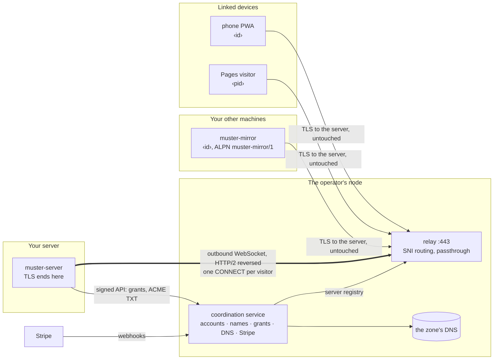

# Design: a managed muster network

**Status: proposed, revised after round 0.** Nothing on this page is built. It
is a design proposal for review; the operator decisions it works within are
listed below, the [changes after round 0](#changes-after-round-0) say what
moved and why, and the [open questions](#11-open-questions-for-the-operator)
end with a recommendation each.

This page proposes an **alternative to Tailscale** for reaching a self-hosted
muster: once the server runs, its owner opens it in a browser, turns on the
managed network, and opens the server's address on their phone. The phone
shows a short code, the owner types it on the screen they are already signed
in on, and the phone is connected, with nothing to install but the page
itself. The server and its own machines connect free, one linked phone or
browser is free forever, and more linked devices are a paid subscription.

Where this page says how muster works today, it cites `file:line` at muster
commit `2a2dde21` (origin/main when revised), and the code is the authority
([decisions.md](../decisions.md)). A claim nothing confirmed is marked
**UNVERIFIED**. Every figure in the [cost model](#7-cost-model) is marked
**measured** or **estimated**. Hostnames are placeholders: the product domain
is `example-muster.net`, a server's name is `<id>.example-muster.net`. No real
hostname, address or price list appears here.

## Contents

- [Operator decisions](#operator-decisions)
- [Changes after round 0](#changes-after-round-0)
- [Summary](#summary)
- [What muster assumes today](#what-muster-assumes-today)
- [1. Goals, non-goals and user flows](#1-goals-non-goals-and-user-flows)
- [2. Architecture](#2-architecture)
- [3. Linking a device](#3-linking-a-device)
- [4. Device counting](#4-device-counting)
- [5. Billing and account recovery](#5-billing-and-account-recovery)
- [6. Abuse](#6-abuse)
- [7. Cost model](#7-cost-model)
- [8. Threat model](#8-threat-model)
- [9. Interaction with the existing pieces](#9-interaction-with-the-existing-pieces)
- [10. Phased slices](#10-phased-slices)
- [11. Open questions for the operator](#11-open-questions-for-the-operator)

## Operator decisions

Already made; the design works inside them.

1. **Privacy: end to end, relay blind.** The relay routes encrypted connections
   it cannot read: it routes on the TLS server name (SNI) and passes the TLS
   stream through untouched. Each user's server holds its own certificate and
   private key. The README's promise, "everything stays on your machines"
   ([README.md:32-38](../../README.md)), stays true of content; its words
   "reached only over Tailscale" change ([§9](#9-interaction-with-the-existing-pieces)).
2. **Hosting: one public Kubernetes node to start**, the one the operator
   already runs, under a **new product domain** separate from the operator's
   personal domain.
3. **Pricing:** the server and its own machines connect free; **one linked
   phone or browser is free forever**; more linked devices is a paid
   subscription, billed through Stripe.
4. **Output:** this proposal only, as phased slices with open questions.
5. **Separately decided:** muster gets a **no-Tailscale localhost mode** (a
   server reachable on `http://localhost` with no TLS). The managed network is
   designed as **the step from that localhost install to a phone**, alongside
   Tailscale, not instead of it.

Answered in round 0 (the `audit-premise-answers` block on the PR):

6. **Q1, counting: the server counts its own devices, for v1.** **One name per
   server.** The server counts its own linked devices. A modified server that
   links more than its plan allows is **accepted** for a convenience tier;
   relay-side enforcement can follow later if abuse appears.
7. **Q2, password mode: allowed on the network, hardened.** A per-name login
   bucket (not process-wide), the machine-token, hook and service-token routes
   never served through the tunnel, a minimum password length, and a recent
   sign-in to link a device.
8. **Q3, addressing: share the node's public IP and its Traefik for now**;
   move the relay to a dedicated IP when usage grows ([§6](#shared-ip-and-the-move-to-a-dedicated-one)).
9. **Q4, operator: Innovation Upstream Inc.** It carries the terms of service,
   the privacy policy, GDPR controller duties (export, deletion), sales tax and
   VAT through Stripe, and abuse and legal-request handling.
10. **Q5, Pages: offered**, as a **separate, rate-limited name kind that does
    not count as a device** ([§2](#names)).

## Changes after round 0

Round 0 ([the audit comment on PR #701](https://github.com/ZacxDev/muster/pull/701))
found 1 🔴 and 13 🟡 at `8cf94474`. Q1's answer removed the per-device names,
and with them most of the hard parts. Finding by finding:

| finding | status | where |
|---|---|---|
| **F1 🔴 DNS wildcard below an existing name** | **fixed.** No top-level wildcard at all: each server gets explicit `A`/`AAAA` (a CNAME is impossible beside CAA), `CAA` and transient TXT; records counted against provider limits; a phase-1 test resolves through public resolvers on a staging zone | [DNS](#dns) |
| **F2** tunnel cap and windows are constants | **fixed.** Reuse **with changes**: a configurable cap and windows, no offer stream; capacity re-derived from the real windows | [the relay's tunnel](#the-tunnel-reuse-with-changes), [§7](#node-capacity-estimated) |
| **F3** memory exhaustion by a non-reading client | **fixed.** A per-server buffer budget (the connection window), a per-address stream cap, a write-stall timeout on the visitor's socket, a pod memory limit, a slow-reader test | [the relay's tunnel](#the-tunnel-reuse-with-changes), [phase 1](#phase-1-internal-relay-coordination-and-the-tunnel) |
| **F4** coalescing and machine names | **fixed, smaller.** Machine names are gone. `muster-mirror` offers the ALPN token `muster-mirror/1`; machine routes are served only on connections that negotiated it; a Host/SNI mismatch gets 421; the Pages name has its own certificate, so no browser coalesces onto it | [listeners](#which-routes-the-tunnel-listener-serves) |
| **F5** QR redeem race | **fixed by redesign.** The QR holds only the server's address; the **phone shows a code and the owner types it** on the screen that is already signed in. There is no secret to race for. The race cases are in the Playwright tests | [§3](#3-linking-a-device), [phase 2](#phase-2-link-device-the-first-user-visible-release) |
| **F6** password mode on the network | **fixed** per Q2: a per-name login bucket, a route allowlist on the tunnel listener, a 16-character minimum there, a recent sign-in to link | [password mode](#password-mode-on-the-network) |
| **F7** one DNS token writes TXT and CAA | **fixed (stated).** CAA's claim is scoped to "a bug in the challenge endpoint"; against the operator or a node compromise only after-the-fact CT detection protects users, up to 24 h; the aggregator is named | [§8](#8-threat-model) |
| **F8** PSL timing, CA rate limits | **fixed.** PSL justified on cookie isolation (still needed with one name per server); the PSL entry or a CA rate-limit increase is a **launch gate** | [names](#names), [launch gates](#launch-gates) |
| **F9** iOS cookie jars and push | **fixed in the flow, measured in phase 0.** On iOS the phone is linked **from inside the installed app**, so the device session lands in the app's own jar whichever way the jars behave; push needs the installed app; re-linking keeps the same name | [§3](#ios), [phase 0](#phase-0-spikes-no-product-change) |
| **F10** background-built links need a fixed name | **moot** for the UI (one fixed name per server); Pages links use the Pages name | [§9](#9-interaction-with-the-existing-pieces) |
| **F11** billing and recovery gaps | **fixed.** Server list and Retire, re-key by email, refund and dispute webhooks, deletion with an active subscription, email change and email loss | [§5](#5-billing-and-account-recovery) |
| **F12** 1 TB transfer unverified | **fixed.** Read from the provider's API for the only plan matching the node's size and region: 1 TiB included, **outbound only** counted (provider billing FAQ); the cap counts what the relay sends | [§7](#7-cost-model) |
| **F13** shared IP | **fixed** per Q3: recorded, with its reputation risk and a move trigger | [§6](#shared-ip-and-the-move-to-a-dedicated-one) |
| PROXY header | **stated:** safe only because the tunnel listener has no network socket | [the relay](#the-relay) |
| Q4 legal | **added:** Innovation Upstream Inc. as operator; open questions 12-14 on illegal-content reporting, law-enforcement requests and data export | [§11](#11-open-questions-for-the-operator) |
| **D1** typed short code + rendezvous + apex `/link` | **done.** Gone: copy or share the server's address; the code the phone shows is typed on the owner's own screen | [§3](#3-linking-a-device) |
| **D2** doctor link-code QR | **done.** Dropped; doctor's QR stays the plain address | [§9](#9-interaction-with-the-existing-pieces) |
| **D3** phase 1 standalone | **done.** Phase 1 is **internal** (behind a build flag, never announced); phase 2 is the first release | [§10](#10-phased-slices) |

**Moot under Q1**, from the round-0 design: per-device origins, and with them
the passkey-per-origin spike, the per-origin push subscriptions, the
per-request `MUSTER_PUBLIC_URL`, the re-install on every re-link, the
`d-`/`h-` labels, the label allowlist and its pushes, shared-label detection,
the rendezvous table, and the wildcard certificate.

**Citation fixes:** `web/static/sw.js` notification click is
[`:370-386`](../../web/static/sw.js); the `CreatePairingCode` store is
[`internal/devices/devices.go:401`](../../internal/devices/devices.go), the
handler [`internal/api/devices.go:206-236`](../../internal/api/devices.go);
`docs/auth.md` re-pinned after #700 (+7 lines past its Teams section); password
mode's lack of Sign out everywhere is [auth.md:527-530](../auth.md).
⚠ **One audit citation was re-checked and not applied:** the `internal/mirror/wire.go`
constants are at **84, 109, 122, 125** at both `4b087718` and `2a2dde21`
(`grep -n '^const Max'`), not 85/110/123/126, so those links are unchanged.

## Summary

The design in one line each:

- **Three parts.** A **relay** (SNI-routing TLS passthrough, one public
  `:443`), a **coordination service** (accounts, the server registry, names,
  DNS, device grants, Stripe), and **muster-server's own network client** (an
  outbound tunnel, its own ACME client, a listener fed by the tunnel).
- **The server dials out; the relay never dials in.** muster-server keeps one
  outbound WebSocket to the relay carrying HTTP/2 with the roles reversed: the
  relay opens one `CONNECT` stream per inbound TCP connection, carrying the
  visitor's **raw TLS bytes**. This is the transport muster ships for previews
  (`internal/preview/tunnel`), **reused with changes**: a configurable stream
  cap and windows, and no offer stream.
- **One name per server**, `<id>.example-muster.net`, random, never re-issued.
  Every linked device, and every remote machine, reaches the server there.
  An optional second name, the **Pages name**, serves only Pages share links,
  rate-limited and uncounted.
- **The server terminates TLS itself**, with a certificate for its name that
  **its own ACME client** obtains through DNS-01. The coordination service only
  writes the `_acme-challenge` TXT record the server asks for. The private key
  never leaves the server.
- **Link device, reversed.** The phone opens the server's address (a QR code
  of it, or the link copied or shared), shows a short code, and the owner
  types that code on a screen that is already signed in, with a recent
  sign-in. The phone gets a **revocable browser device session**, stored
  hashed and checked on every request.
- **The server counts its own devices; the service signs the grants.** A stock
  server links a device only with a **device grant** the coordination service
  signed for its account, so stock servers count correctly. A modified server
  can skip that, and the page says so: that is accepted for v1 (Q1).
- **On the network, a full session exists only as a linked device.** The
  tunnel listener serves no sign-in that creates a session; a password or
  passkey there only steps up a device already linked.
- **Billing never touches the user's server.** Stripe Checkout and the
  Customer Portal run on the coordination service's own pages.
- **A lapse never strands the owner.** When payment lapses, grants beyond the
  free one are suspended; the server, its machines and the first device keep
  working.
- **Leaving is a button.** Turn the network off and go back to Tailscale
  ([INSTALL.md:349-372](../../INSTALL.md)) or your own proxy; names are never
  re-issued to anyone else.

## What muster assumes today

The managed network changes how muster is reached, so these are the facts it
has to fit.

| fact | where |
|---|---|
| The core needs Tailscale; HTTPS comes from `tailscale serve` | [README.md:150-157](../../README.md), [README.md:211](../../README.md), [INSTALL.md:349-372](../../INSTALL.md) |
| The README says the server "is reached only over Tailscale" | [README.md:32-38](../../README.md) |
| `muster doctor` FAILs a server URL that is not `https` | [cmd/muster/doctor.go:438-441](../../cmd/muster/doctor.go) |
| `muster-mirror` refuses a plain `http://` URL unless `-allow-http` ("tests and local development only") | [internal/mirrorhost/client.go:176-182](../../internal/mirrorhost/client.go), [cmd/muster-mirror/main.go:219](../../cmd/muster-mirror/main.go) |
| INSTALL sets `MUSTER_SECURE_COOKIES=1`; the cookie is Secure only when set (gotrue mode: always) | [INSTALL.md:454](../../INSTALL.md), [internal/api/auth.go:73-77](../../internal/api/auth.go), [internal/api/login.go:210](../../internal/api/login.go), [internal/api/push_routes.go:351](../../internal/api/push_routes.go) |
| A host dials **out** over one WebSocket to `GET /mirror/connect`; muster never dials in | [internal/mirror/wire.go:16-22](../../internal/mirror/wire.go), [internal/mirror/wire.go:73](../../internal/mirror/wire.go) |
| Tunnel protocol v2, accepts v1 hosts | [internal/mirror/wire.go:43-65](../../internal/mirror/wire.go) |
| A frame is at most 1 MiB; a host registers at most 512 windows, 8 open terminals; at most 64 hosts per muster | [internal/mirror/wire.go:84](../../internal/mirror/wire.go), [:109](../../internal/mirror/wire.go), [:122](../../internal/mirror/wire.go), [:125](../../internal/mirror/wire.go) |
| The hub pings each host every 25 s; the host re-reads its windows every 5 s and polls an open rendered view every 300 ms | [internal/mirror/hub.go:54](../../internal/mirror/hub.go), [internal/mirrorhost/client.go:270-275](../../internal/mirrorhost/client.go) |
| A host reconnects with jittered backoff, 1 s to 60 s | [internal/mirrorhost/client.go:312-347](../../internal/mirrorhost/client.go) |
| Run **one replica**: the mirror tunnel keeps state in memory | [README.md:215-216](../../README.md) |
| Password mode: one shared `MUSTER_UI_PASSWORD` acting as user 1, at least 12 characters, `POST /login` limited to 10 a minute, a 30-day cookie | [auth.md:7-17](../auth.md) |
| The login bucket is **process-wide**, on purpose (a per-IP bucket is keyed on what the caller picks) | [internal/api/login.go:35-47](../../internal/api/login.go) |
| Password mode's session is a stateless cookie: no Sign out everywhere | [auth.md:527-530](../auth.md) |
| Pairing code: `mdp_…`, single use, 60 s, minted by `POST /account/devices/pair` from any valid signed-in session (no recent-sign-in window, an operator decision), redeemed at `POST /api/device/pair` for an `mdv_…` credential confined to `/api/device/*`; only its sha256 stored; a machine token cannot mint one | [auth.md:515-536](../auth.md), [internal/devices/devices.go:81-91](../../internal/devices/devices.go), [internal/devices/devices.go:401](../../internal/devices/devices.go), [internal/api/devices.go:111](../../internal/api/devices.go), [internal/api/devices.go:206-236](../../internal/api/devices.go) |
| Pairing is throttled at 10 a minute per client address, taken from `CF-Connecting-IP` / `X-Forwarded-For` on the browser listener | [auth.md:578-586](../auth.md) |
| At most 20 paired phones per user | [internal/devices/devices.go:91](../../internal/devices/devices.go) |
| Step-up: a sign-in is fresh for 12 h by default; adding a credential needs one within 5 min | [internal/stepup/stepup.go:48](../../internal/stepup/stepup.go), [internal/stepup/stepup.go:64](../../internal/stepup/stepup.go) |
| `SameSite=Lax` is **not** a CSRF defence against a sibling subdomain; writes are checked by `Origin` | [internal/api/auth.go:313-318](../../internal/api/auth.go) |
| Session cookies are host-only (no `Domain`), named `muster_session` (gotrue: `muster_at`, `muster_rt`) | [internal/api/login.go:200-211](../../internal/api/login.go), [internal/api/auth.go:20](../../internal/api/auth.go), [internal/api/accounts.go:63-64](../../internal/api/accounts.go) |
| Allowed origins for writes and WebSockets: the request's `Host`, plus `MUSTER_PUBLIC_URL`'s host | [internal/api/agents.go:2321-2333](../../internal/api/agents.go) |
| In gotrue mode the browser never talks to GoTrue, and browser sessions are served only on `MUSTER_BROWSER_PORT` | [auth.md:26-30](../auth.md) |
| `MUSTER_HOOK_TOKEN` is enforced only when set; while unset the hook routes are open | [auth.md:420](../auth.md) |
| `GET /metrics` is unauthenticated | [architecture.md:54-55](../architecture.md) |
| Absolute links are built from `MUSTER_PUBLIC_URL` in the background: uploads refuse to start without it, reset and invite links, the attention summary, Pages share links | [cmd/muster-server/uploads.go:69-70](../../cmd/muster-server/uploads.go), [internal/api/admin.go:398](../../internal/api/admin.go), [internal/api/admin.go:504](../../internal/api/admin.go), [internal/api/attention_summary.go:131](../../internal/api/attention_summary.go), [internal/api/pages.go:500](../../internal/api/pages.go) |
| Pages share links are `<MUSTER_PUBLIC_URL>/s/<token>`, open to anyone with the link | [pages.md:93-97](../pages.md) |
| Push: muster POSTs to the push services itself; browser subscriptions only on FCM, Mozilla, Apple, WNS | [push.md:5](../push.md), [push.md:158-170](../push.md) |
| The service worker resolves a notification's URL against **its own origin** | [web/static/sw.js:370-386](../../web/static/sw.js) |
| iOS allows notifications only for an app installed to the Home Screen | [INSTALL.md:1037-1042](../../INSTALL.md) |
| The GitHub App needs no callback, setup or webhook URL | [github-app.md:130-135](../github-app.md) |
| Previews must be on a **different registrable domain** from muster's | [previews.md:346-348](../previews.md) |
| The preview tunnel: one WebSocket, HTTP/2 with roles reversed, one `CONNECT` per upstream connection, flow-control invariant pinned | [internal/preview/tunnel/tunnel.go:1-28](../../internal/preview/tunnel/tunnel.go), [design/previews-spike.md](previews-spike.md) |
| …its stream cap is at most 64 (`wire.MaxConns`), and its windows are package constants: 4 MiB per stream, (64+4+1) × 4 MiB = 276 MiB per tunnel; the windows a caller may set are test-only fields | [internal/preview/wire/wire.go:81](../../internal/preview/wire/wire.go), [internal/preview/tunnel/tunnel.go:66-77](../../internal/preview/tunnel/tunnel.go), [internal/preview/tunnel/tunnel.go:177-188](../../internal/preview/tunnel/tunnel.go), [internal/preview/tunnel/tunnel.go:342-344](../../internal/preview/tunnel/tunnel.go) |
| …a tunnel stream supports no deadlines | [internal/preview/tunnel/tunnel.go:705-707](../../internal/preview/tunnel/tunnel.go) |
| `muster doctor` prints the server URL as a QR code when `qrencode` is installed | [cmd/muster/doctor.go:973-985](../../cmd/muster/doctor.go), [INSTALL.md:1029-1031](../../INSTALL.md) |

## 1. Goals, non-goals and user flows

### Goals

- **A phone in under two minutes from a localhost install**, with no account
  anywhere but the managed network's, and no app but the browser.
- **The relay cannot read anything.** Content, cookies, tokens, terminal bytes
  and transcripts are encrypted end to end between the visitor and the user's
  server.
- **Honest counting where it is cheap.** A stock muster-server counts its
  devices correctly against grants the service signs. A modified one can
  over-link; that is accepted (Q1) and stated, not hidden.
- **Reuse muster's existing models**: the device list and its revocations, the
  step-up windows, the preview tunnel transport, the mirror protocol unchanged.
- **Tailscale stays first-class.** Nothing in this design makes the Tailscale
  path worse or changes it.
- **Leave at any time**, back to Tailscale or a self-run proxy.

### Non-goals

- **Not a VPN.** The relay carries HTTPS to one muster and nothing else. No
  machine-to-machine network, no exit node, no SSH.
- **Not a hosted muster.** No muster code, database or session data runs on
  the operator's node.
- **No relay-side device enforcement in v1** (Q1). The relay cannot tell two
  devices on one name apart, and this version does not try.
- **No vanity names** in the first versions ([§6](#6-abuse)).
- **No relay-side inspection.** The design states plainly what a blind relay
  cannot detect, rather than promising detection it cannot do.
- **Not multi-region at launch.** One relay on one node; the
  [scale-out path](#scale-out) is described, not built.
- **Previews over the network** (`muster-preview`) are out of scope: previews
  need a registrable domain separate from muster's
  ([previews.md:346-348](../previews.md)), so they need a second product zone.

### Flow (a): turn on the managed network from a fresh localhost install

The server runs in the localhost mode (decision 5) and its owner is signed in
at `http://localhost:8105` on the hub machine.

1. **Account → Network** shows two ways to reach this muster from a phone:
   **Tailscale** (a link to INSTALL Step 2) and **muster network**, with the
   free tier stated: "your machines free, one phone or browser free, more
   with a subscription", and the operator named: "run by Innovation Upstream
   Inc.", with its terms and privacy policy linked.
2. The owner presses **Turn on muster network**. It is **refused** while
   `MUSTER_HOOK_TOKEN` is unset (the hook routes are open then,
   [auth.md:420](../auth.md); they are never served on the tunnel anyway, but
   an unset token means the server was configured for a private network), and
   in password mode while `MUSTER_UI_PASSWORD` is shorter than 16 characters
   ([password mode](#password-mode-on-the-network)). Each refusal says which
   variable to set.
3. muster-server generates an **Ed25519 server key** and an **ACME account
   key** and stores them **in its database** (so a backup that restores the
   device sessions restores the key with them; both stay on the server).
4. muster-server calls the coordination service,
   `POST https://api.example-muster.net/v1/servers` with the server key's
   public half and a fresh nonce signed by it. The service answers with a new
   **server id** (`<id>`, random, see [names](#names)) in state `unclaimed`
   and a **claim URL** valid for 15 minutes. Nothing is in DNS yet.
5. The browser opens the claim URL (on `example-muster.net`, the service's own
   site, never in muster's origin). The owner enters an email address,
   confirms it from a one-time link, and accepts the terms of service. The
   server id becomes `claimed` under that account. No password, no card. An
   email that already has an account adds the server to it.
6. The claim page sends the browser back to `http://localhost:8105/account/network`.
   muster-server polls `GET /v1/servers/<id>` (signed) and sees `claimed`.
7. **CAA and address records.** muster-server registers its ACME account with
   the CA and sends the account URI; the service writes the server's records
   ([DNS](#dns)): `A`/`AAAA` to the relay, and
   `CAA 0 issue "<ca>; accounturi=<uri>"` plus `CAA 0 issuewild ";"`, so a
   certificate for the name can only be issued to this server's ACME account,
   and no wildcard at all (see [§8](#8-threat-model) for what that does and
   does not stop).
8. **Certificate.** muster-server's ACME client orders a certificate for
   `<id>.example-muster.net` under **its own ACME account**. For the DNS-01
   challenge it calls `PUT /v1/servers/<id>/acme-challenge` with the TXT value;
   the service writes `_acme-challenge.<id>.example-muster.net` and nothing
   else. The order finalises with a CSR whose key was generated on the server.
9. **Tunnel.** muster-server dials `wss://tunnel.example-muster.net/v1/connect`,
   proves possession of the server key, and starts serving HTTP/2 on the
   connection. The page shows **Connected**, the certificate's expiry, the
   server's address with **Copy** and **Share** buttons and a QR code of it,
   and **Link device**.
10. `muster doctor` gains a `network` line: tunnel up, certificate valid for
    more than 14 days, hook token set, no unknown certificate for the name in
    Certificate Transparency.

### Flow (b): link a device

On the phone:

1. Open `https://<id>.example-muster.net`: scan the QR code on the Network
   page, or open the link the owner copied or shared to themselves (D1). The
   address is **not a secret**: it is in Certificate Transparency anyway.
2. The relay sees SNI `<id>.example-muster.net`, finds a claimed server, and
   opens a stream on its tunnel. The phone completes TLS **with the server**.
3. The phone has no device session, so the server serves only the **link
   page** ([§3](#which-routes-the-tunnel-listener-serves)). It creates a
   **pending link**: a 32-byte secret in a `__Host-muster_link` cookie
   (stored as its sha256), and a **link code**, 8 characters from the
   no-confusables alphabet muster already uses
   ([internal/plugins/pairing.go:45-46](../../internal/plugins/pairing.go)),
   shown large: `K7MP-3QXR`. It lives 10 minutes. On iOS the page first says
   to install the app ([iOS](#ios)).

On the screen the owner is already signed in on (the localhost browser, or an
already-linked device):

4. **Link device** asks for a **recent sign-in** (5 minutes, the credential
   window, [internal/stepup/stepup.go:64](../../internal/stepup/stepup.go)),
   then for the code the phone shows, and an optional name.
5. The server finds the pending link by the code and shows what it knows of
   the waiting device: its user agent ("Chrome on Android"), when it opened
   the page, and its network ("from 203.0.113.0/24, the same network as you"
   or "a different network"). **Link this device?** names it again.
6. On **Link**, muster-server asks the coordination service for a **device
   grant** ([§4](#4-device-counting)): `POST /v1/servers/<id>/grants`. If the
   account is at its limit the service answers `402` with an upgrade URL and
   the flow goes to [flow (d)](#flow-d-the-free-device-limit-is-reached).
   Otherwise it returns a signed grant.
7. In one transaction the server verifies the grant, turns the pending link
   into a **browser device session** bound to that grant, and deletes the
   link code. The phone's page, which waits on the pending link, reloads
   signed in.
8. The phone offers **Install** (Android) as today
   ([INSTALL.md:1037-1042](../../INSTALL.md)); notifications are enabled from
   inside the app as today ([push.md](../push.md)).
9. **Account → Devices** lists the linked browser beside paired phones: its
   name, linked when, last seen, and **Unlink**.

**The native Android app** links the same way: the app opens the server's
address in its WebView and links with the code; then the existing in-app
pairing (`POST /account/devices/pair`) runs from that device session, and the
`mdv_…` credential it yields is recorded **under the same grant**. It counts as
one device, and Unlink ends both.

### Flow (c): another machine joins

1. On **Account → Network → Machines**, the owner presses **Add a machine**.
   The page shows the same `muster-mirror` setup as INSTALL Step 7, with the
   server's address `https://<id>.example-muster.net` and a mirror token
   minted as today ([auth.md:422](../auth.md)). No grant: machines are free.
2. `muster-mirror` needs **one change**: on a network URL it offers the ALPN
   token **`muster-mirror/1`** ahead of `http/1.1`. The server serves the
   machine routes (`GET /mirror/connect` and the mirror token's other routes)
   **only** on a connection that negotiated it, and no browser route there
   ([listeners](#which-routes-the-tunnel-listener-serves)). An older
   `muster-mirror` gets a clear refusal naming the version to upgrade to.
   The URL is `https`, so `-allow-http` is not needed
   ([internal/mirrorhost/client.go:176-182](../../internal/mirrorhost/client.go)),
   and the certificate is publicly trusted.
3. The hub's own machine keeps dialling loopback: a machine on the server's
   own host never needs the relay.

### Flow (d): the free device limit is reached

1. **Link** on an account whose one free grant is in use: the service answers
   `402 {upgrade_url}` (step 6 of flow (b)). The pending link stays, so the
   phone keeps waiting.
2. The page says "Your free device is **Pixel (Chrome)**. Link more devices
   with muster network Plus" and offers **Upgrade** and **Unlink Pixel
   instead**.
3. **Upgrade** opens `upgrade_url` on `example-muster.net` in a new tab. That
   page is the service's own; it creates a Stripe Checkout Session for the
   account and redirects. The person pays on Stripe's page.
4. Stripe calls the service's webhook. The account becomes `plus`; the service
   raises its grant limit.
5. The original tab polls `GET /v1/servers/<id>/entitlement` (signed, by the
   server) every 5 s while the upgrade tab is open, sees the new limit, and
   retries step 6 of flow (b) while the pending link is still alive.

### Flow (e): unlink, cancel, leave

- **Unlink a device** (Account → Devices, or the device's own Account page):
  muster-server deletes the device session (the next request is refused; open
  WebSockets and streams on it are closed) and calls
  `DELETE /v1/servers/<id>/grants/<grant>`, which frees the slot.
- **Unlink all devices** on the Network page: every device session at once.
  In password mode this is the network's Sign out everywhere, which password
  mode otherwise lacks ([auth.md:527-530](../auth.md)).
- **Cancel the subscription:** **Manage subscription** opens the Stripe Customer
  Portal from the service's site. At the period end the account falls back to
  free; grants beyond the first are **suspended** ([§4](#grace-and-overage)),
  not deleted, and come back on re-subscribing.
- **Leave the service:** **Turn off muster network** closes the tunnel,
  retires every grant, deletes the server key and the server's records on the
  service, and keeps the certificate and keys on the server (they expire on
  their own). The account can be deleted on the service's site
  ([§5](#5-billing-and-account-recovery)). The server id is **tombstoned,
  never re-issued**: a re-issued name would receive the old devices' traffic
  and their installed apps' requests.
- **Go back to Tailscale:** follow INSTALL Step 2 as today. Each device moves
  to the tailnet origin once, so it installs the app again and re-enables
  notifications; the page says so before the switch. **Re-linking a device on
  the network reuses the same server name**, so no re-install is needed there.

## 2. Architecture

### The relay

**What it does:** accept TCP on `:443` for the product's server names, read the
TLS ClientHello **without terminating it**, take the server name, look it up,
and splice the connection's bytes (starting with the ClientHello it read) into
a new stream on that server's tunnel.

- **ClientHello parsing** reads only: SNI, ALPN offered, and the record length.
  A name that is not a claimed, unsuspended `<id>` or an issued Pages name
  `<pid>` is refused by closing the connection (there is no certificate to
  send an error page with). A ClientHello split over several TCP segments is
  buffered up to 16 KiB, then refused. A ClientHello with no SNI, or whose ALPN
  list offers none of `h2`, `http/1.1`, `muster-mirror/1`, is refused.
- **ALPN only selects the caps.** A ClientHello offering `muster-mirror/1` is
  counted against the server's machine caps (at most 64, muster's host limit,
  [internal/mirror/wire.go:125](../../internal/mirror/wire.go)); any other
  against its browser caps. The relay does **not** tell the server what kind a
  connection is: the server reads SNI and the negotiated ALPN from its own TLS
  handshake and decides itself.
- **The client address** is sent on the stream as a PROXY protocol v2 header,
  ahead of the TLS bytes. muster-server reads it **only on the tunnel
  listener**, and uses it where it uses `CF-Connecting-IP` today
  ([auth.md:578-586](../auth.md)), so the throttles keep working per visitor
  rather than per relay. 🔴 **This is safe only because the tunnel listener
  has no network socket:** it is an in-process `net.Listener` whose
  connections are streams of the authenticated tunnel, so the only writer of
  that header is the relay, which writes exactly one before any client byte.
  A PROXY header arriving on any real socket (the main or browser listener) is
  never parsed. If the tunnel listener ever gained a socket, the header would
  become a spoofing channel for every throttle.
- **No egress.** The relay never opens a connection on a server's behalf. A
  server cannot use the relay to reach anything.

#### The tunnel transport, compared

| option | WebSocket and SSE inside | through middleboxes | flow control / head-of-line | in muster today |
|---|---|---|---|---|
| **HTTP/2 over a WebSocket, roles reversed** (`CONNECT` per stream) | yes: each visitor connection is an opaque byte stream, so WebSocket upgrades and long SSE responses are just bytes | yes: a WebSocket on `:443` crosses proxies and corporate firewalls | per-stream windows; connection window must exceed `streams × stream window`, a pinned invariant ([tunnel.go:17-28](../../internal/preview/tunnel/tunnel.go)) | **shipped** for previews ([internal/preview/tunnel](../../internal/preview/tunnel/tunnel.go)); spike measured 51-68 µs p50 echo overhead on loopback ([previews-spike.md](previews-spike.md)) |
| yamux over TLS/TCP | yes | yes over raw TLS on `:443`; not through an HTTP-only proxy | no connection-level window, so it cannot fail the paused-reader way; passed the same spike criteria | spike only |
| QUIC (streams over UDP) | yes | **no** on many networks: UDP 443 is often blocked or throttled, and needs a TCP fallback anyway | no TCP head-of-line; best on lossy links | none |

**Recommendation: HTTP/2 over a WebSocket, built on `internal/preview/tunnel`
with the changes below.** The server is the HTTP/2 **server** (the preview
"host" role, `Serve`); the relay holds the HTTP/2 **client** (the "gateway"
role, `NewClient`) and calls `Dial` once per inbound connection. QUIC is a
later optimisation, if ever: it would need a TCP fallback, so it can only add a
second path.

#### The tunnel: reuse with changes

The preview package as shipped **cannot** be the relay's transport unchanged:

- Its stream cap is at most `wire.MaxConns` = 64
  ([internal/preview/wire/wire.go:81](../../internal/preview/wire/wire.go));
  `HostOptions.maxConns` errors above it
  ([tunnel.go:177-188](../../internal/preview/tunnel/tunnel.go)).
- Its windows are package constants: 4 MiB per stream and
  (64+4+1) × 4 MiB = **276 MiB per tunnel** of gateway memory that paused
  readers can hold ([tunnel.go:66-77](../../internal/preview/tunnel/tunnel.go));
  the only other windows are test-only fields
  ([tunnel.go:342-344](../../internal/preview/tunnel/tunnel.go)).
- It carries an offer stream and three answer streams for previews
  (`ControlStreams = 4`, [tunnel.go:58](../../internal/preview/tunnel/tunnel.go)),
  from which the gateway learns the host's cap.

So the relay needs these options in the package, each with the invariant test
extended to read the values `Serve` and `NewClient` actually use:

| option | preview today | relay |
|---|---|---|
| stream cap per tunnel (`C`) | 64, fixed ceiling | **256**, configured on both ends |
| download stream window (`W`, relay's receive window, server → visitor) | 4 MiB | **128 KiB** |
| download connection window | (64+4+1) × 4 MiB = 276 MiB | (`C`+0+1) × `W` = **~32 MiB** |
| upload stream / connection window (server's receive window) | 1 MiB / 69 MiB | 128 KiB / ~32 MiB |
| control streams | 4 (offer + answers) | **0**: no offer stream; the cap is configuration |

The invariant is kept (connection window > every admitted stream × stream
window), so a paused reader still cannot stall the tunnel. The price of a
128 KiB window is per-stream throughput: at most `W / RTT`, about 1.3 MB/s at
100 ms. That is far above a terminal or a chat page, and slows a large upload;
`W` is configuration, so phase 1 measures it.

#### Memory: a client that stops reading

A visitor that opens connections and never reads makes the relay hold bytes.
Bounds, all enforced by the relay:

1. **Per-server buffer budget = the download connection window**, ~32 MiB at
   the numbers above. HTTP/2 flow control means the relay can never hold more
   unread bytes for one tunnel than that, by construction.
2. **Per client address: at most 64 concurrent streams across all servers**, so
   one address can pin at most 64 × 128 KiB = 8 MiB.
3. **A write-stall timeout on the visitor's socket.** A tunnel stream has no
   deadlines ([tunnel.go:705-707](../../internal/preview/tunnel/tunnel.go)),
   so the deadline is on the relay's TCP connection to the visitor: when no
   byte has been accepted for **30 s** while bytes wait, the relay closes the
   connection and resets the stream, which returns its window.
4. **A global gauge** of bytes held for stalled streams; above 1 GiB the relay
   refuses new visitor connections (by closing them) until it falls.
5. **A memory limit on the relay pod** (2 GiB, with `GOMEMLIMIT` at 1.6 GiB),
   so the worst case is the relay restarting, not the node's other services
   starving. Servers reconnect on their own backoff.

A many-address attack can still exhaust the relay: that is a denial of
service of the relay, not a breach, and the per-address and global bounds make
it cost addresses.

**WebSocket and SSE pass through untouched** because the relay never parses
HTTP: the browser's WebSocket upgrade, muster's live streams (heartbeat every
15 s, [internal/ui/live.go:51](../../internal/ui/live.go)) and the mirror's own
WebSocket are bytes inside one TLS session inside one stream. The relay's idle
timeout (120 s) exceeds the longest silence muster allows on a connection: the
hub's 25 s ping ([internal/mirror/hub.go:54](../../internal/mirror/hub.go)) and
the 15 s heartbeat.

#### How the relay authenticates a server's tunnel

1. The server dials `wss://tunnel.example-muster.net/v1/connect`. That one name
   is **not** passthrough: the relay terminates TLS for it with the service's
   own certificate, because it must read the tunnel's control messages.
2. The relay sends a 32-byte nonce. The server answers with its id and an
   Ed25519 signature over `"muster-net tunnel v1" ‖ id ‖ nonce ‖ unix time`.
3. The relay checks the signature against the server key registered with the
   coordination service (cached, refreshed when the registry changes) and that
   the id is `claimed` and not suspended.
4. **One tunnel per server.** A second authenticated tunnel for the same id
   replaces the first (the old one is closed after its streams drain for
   30 s). muster already runs one replica ([README.md:215-216](../../README.md)),
   so two live tunnels can only mean a restarted server or a stolen key; the
   service records every replacement and the server's Network page lists the
   last five tunnel connections with their source addresses.
5. The tunnel's inner payload is still each visitor's own TLS, so the relay
   terminating the **outer** TLS reveals the control messages and the byte
   counts, never content.

### The coordination service

One small Go service with its own Postgres. It owns:

| table | holds |
|---|---|
| `accounts` | email (verified), terms version accepted, Stripe customer id, plan, plan state (`free`, `plus`, `past_due`, `disputed`), created |
| `servers` | id, account, server public key, ACME account URI, Pages name if any, state (`unclaimed`, `claimed`, `suspended`, `tombstoned`), created, last tunnel seen |
| `grants` | id, server, state (`active`, `suspended`, `retired`), created, last confirmed (day granularity) |
| `usage_daily` | per server and name: bytes sent by the relay, connections, distinct client /24s (IPv4) or /48s (IPv6) — counts only, see [retention](#11-open-questions-for-the-operator) |
| `abuse_reports` | reports, decisions, takedowns |

Every server-facing call is signed with the server key (the same scheme as the
tunnel handshake, over the request's method, path, body hash and time), so the
service holds no shared secret for any server. The account-facing pages
(claim, server list, billing, email change, deletion) are the service's own
site, signed in by an emailed one-time link.

#### Names

- **`<id>`**: 10 characters, lowercase base32 (50 bits), random. One per
  server. Never chosen, never re-issued.
- **`<pid>`, the Pages name**: a second random 10-character name, issued only
  when the owner turns on **Pages over the network**. It is a **separate name
  kind**: it does not count as a device, it serves only Pages share links
  ([listeners](#which-routes-the-tunnel-listener-serves)), it is rate-limited
  at the relay ([rate limits](#rate-limits)), and it can be rotated at most
  once a day (rotating retires the old name, which kills every outstanding
  link at once). It is unrelated to `<id>` in the name, and has its own
  certificate, so Certificate Transparency does not link the two and no
  browser coalesces a Pages connection onto the UI's.
- **Flat names only.** Nothing lives below `<id>` but its challenge record, so
  there is no wildcard certificate and no wildcard record ([DNS](#dns)).
- 🔴 **The product domain goes on the Public Suffix List** (private section,
  `example-muster.net`), **for cookie isolation**, and it is still needed with
  one name per server. Without it every `<id>.example-muster.net` is the
  **same site** as every other: a modified server's page can set a cookie with
  `Domain=example-muster.net` that every other user's server receives (cookie
  tossing), `SameSite` does not separate them (muster already notes sibling
  subdomains are same-site, [internal/api/auth.go:313-318](../../internal/api/auth.go)),
  and storage partitioning treats them as one site. Until the entry is
  everywhere, muster's `Origin` check on every write is the CSRF defence, and
  on the network origin the cookie names take the `__Host-` prefix, so a
  sibling cannot toss a cookie over them.
  - **Timing is months, not weeks.** Browsers ship the list in their builds;
    iOS ships it with OS updates, so an old iPhone may never get it.
  - **The CA rate limit before then.** Let's Encrypt allows 50 new
    certificates per registered domain per week; renewals are exempt. Before
    the PSL entry the whole product is one registered domain: 50 new
    certificates a week, which at one certificate per server, plus one per
    Pages name, is 25-50 new servers a week.
  - The PSL does not accept entries made to get around rate limits, so the
    submission is argued on cookie isolation between mutually untrusting
    users, which is what it is for.
  - **Launch gate:** the PSL entry merged (and picked up by the CA), **or** a
    rate-limit increase granted by the CA. See [launch gates](#launch-gates).
- **HSTS**: the apex site sends `Strict-Transport-Security` with
  `includeSubDomains; preload` and the domain is submitted to the preload list,
  covering every server name without muster sending HSTS itself.

#### ACME DNS-01: the server's client, the service's TXT

**Chosen:** the server runs its own ACME client (in-process, a maintained Go
ACME library; which one is a phase 0 choice), under its own ACME account. The
service exposes one narrow write: `PUT/DELETE /v1/servers/<id>/acme-challenge`
(and `/pages-challenge` for the Pages name), which can write only TXT records
at exactly `_acme-challenge.<id>.example-muster.net`, at most 2 values at a
time, removed after 10 minutes.

**Alternative compared: the service issues certificates.**

| | server's ACME + service TXT (chosen) | service runs ACME for a server CSR | service holds the key |
|---|---|---|---|
| private key | on the server | on the server | **on the service: relay not blind** |
| ACME account | the server's own | the service's | the service's |
| CAA `accounturi` can pin the name to this server | **yes** | no: the service's account issues every name | no |
| one bad CSR path can mint for any name | no | yes: the issuing endpoint is a mint for every name | yes |
| service outage blocks renewal | yes (TXT write) | yes | yes |

The CSR variant keeps the key on the server, so it is not fatal to blindness,
but it makes the service an issuer for every name and makes CAA pinning
impossible. **The "service holds the key" variant is rejected outright**: it
is a MITM by design. DNS-01 delegation (the server holds DNS credentials) is
rejected because the zone is shared: no DNS provider scopes a credential to
one TXT name (**UNVERIFIED** across providers; true of the common ones).

#### Certificate renewal

- Renew at one third of lifetime remaining, and follow the CA's ACME Renewal
  Information if offered. Public CAs are shortening certificate lifetimes;
  nothing here depends on 90 days (**UNVERIFIED**: the schedule).
- Retry with backoff; from 14 days before expiry the Network page and
  `muster doctor` warn, and from 7 days a push goes to the owner.
- The relay is blind, so **it cannot tell an expired certificate**; a lapsed
  renewal shows as a browser certificate error on every device. That is why
  the warnings are on the server and on the owner's phone, not at the relay.
- After a renewal, and hourly, the server **checks Certificate Transparency**
  for its names ([§8](#8-threat-model)).

#### DNS

🔴 **No wildcard record.** Once a name exists below the apex, a top-level
`*.example-muster.net` no longer answers for it (RFC 4592: a wildcard
synthesises only for names that do not exist), and `<id>` exists as soon as
its CAA or its `_acme-challenge` child does. So every server's records are
explicit, and an unclaimed id is NXDOMAIN.

| owner | type | value | when |
|---|---|---|---|
| apex, `api`, `tunnel` | `A`, `AAAA` | the relay's addresses | once, zone-wide |
| apex | `CAA` | `0 issue "<ca>"` | once |
| `<id>` | `A`, `AAAA` | the relay's addresses | from claim to tombstone |
| `<id>` | `CAA` | `0 issue "<ca>; accounturi=<server's ACME account>"` | from claim |
| `<id>` | `CAA` | `0 issuewild ";"` | from claim |
| `_acme-challenge.<id>` | `TXT` | the challenge value | ≤ 10 min per order |
| `<pid>` (Pages on) | `A`, `AAAA`, 2 × `CAA` | as for `<id>` | while Pages is on |
| `_acme-challenge.<pid>` | `TXT` | the challenge value | ≤ 10 min per order |

- **Not a CNAME to the relay.** A CNAME cannot share its owner name with any
  other record, and `<id>` must carry its own `CAA`; so `A`/`AAAA`.
- **Record count: 4 per server, 8 with Pages**, plus at most 2 transient TXT.
  Managed DNS providers cap records per zone, and the chosen provider's cap is
  a **phase-0 read** (**UNVERIFIED**). A zone capped at N records holds about
  N / 8 to N / 4 servers; reaching that, or the provider's API write limits, is
  the trigger to run an authoritative DNS server of our own.
- The zone's credential is a provider API token scoped to this zone only; the
  zone has nothing else in it. **The same token writes TXT and CAA**
  ([§8](#8-threat-model) says what that means).
- Phase 1's DNS test resolves every record through two public resolvers on a
  staging zone ([phase 1](#phase-1-internal-relay-coordination-and-the-tunnel)).

### Which routes the tunnel listener serves

muster-server feeds tunnel streams into a **tunnel listener**, a third listener
beside the main and browser listeners. On every connection it reads SNI and
the negotiated ALPN from its own TLS handshake and picks one route set; the
`Host` of every request must equal the SNI, or the answer is **421 Misdirected
Request** (a coalescing browser then opens a new connection for that name).

| SNI and ALPN | serves | never |
|---|---|---|
| `<id>`, `h2`/`http/1.1`, **with** a device session | the full browser UI, as the browser listener does in gotrue mode ([auth.md:26-30](../auth.md)); the device routes for a phone paired under it; step-up sign-in | — |
| `<id>`, `h2`/`http/1.1`, **without** a device session | the link page, its static assets, the pending-link status, and redeeming an invite or reset link ([§3](#invites-and-password-resets)) | any page that needs a session; a sign-in that creates one |
| `<id>`, `muster-mirror/1` | the mirror token's routes only: `GET /mirror/connect`, `/mirror/ask`, `POST /mirror/mcp` ([auth.md:422](../auth.md)) | any browser route |
| `<pid>` | Pages share links (`/s/…`, [pages.md:93-97](../pages.md)), the static assets their shell loads, and the stranger uploads a page accepts | cookies of any kind; any other route |
| any | — | **the hook routes, `MUSTER_SERVICE_TOKEN` routes, personal API tokens, `/metrics`** ([architecture.md:54-55](../architecture.md)), on every name |

The exact route lists are read from the router in phase 1 and pinned by a test
that walks every registered route and fails on one the tables above do not
place (so a new route is placed on purpose, not served by accident).

### Rate limits

| what | limit | where |
|---|---|---|
| new connections per server name (`<id>`) | 120 / min, burst 60 | relay |
| new connections per Pages name (`<pid>`) | 60 / min, burst 30 | relay |
| new connections per client address, all names | 300 / min | relay |
| concurrent streams per client address, all names | 64 | relay |
| concurrent browser connections per server | 128 | relay |
| concurrent machine (`muster-mirror/1`) connections per server | 64 | relay |
| concurrent connections per Pages name | 64 | relay |
| tunnel connects per server | 10 / min, then backoff | relay |
| pending links per server / per client address | 50 live / 10 per min | server |
| link-code entries per signed-in session | 10 / min | server |
| login attempts on the tunnel listener, per name | 10 / min | server |
| grant requests per server | 20 / hour | service |
| Pages name rotations per server | 1 / day | service |
| ACME TXT writes per server | 30 / day | service |
| server registrations per client address | 5 / day | service |
| claim and sign-in emails per address | 5 / hour | service |
| bytes sent by the relay per server per month | free: 50 GB; Plus: 250 GB (**estimated**, revisit after phase 3 measurements) | relay, enforced by the service |

**The byte cap counts bytes the relay sends**, in both directions of the
user's traffic: a byte from a phone goes out to the server's tunnel, and a
byte from the server goes out to the phone, and each is sent once. That is
also what the provider bills ([§7](#7-cost-model)). Over the cap, new browser
and Pages connections are refused for the rest of the month (machine
connections and connections from the first grant's device keep working, throttled to
128 KiB/s), and the owner is told by email and on the Network page.

### What runs where on one node

- **Namespace `muster-net`** on the operator's node: `relay` (Deployment, 1
  replica, memory limit 2 GiB), `coord` (Deployment, 1 replica),
  `coord-postgres` (StatefulSet on local storage, with a daily `pg_dump` to
  object storage), and the DNS provider token and Stripe keys as Secrets.
- **`:443` is shared with the node's other sites** (Q3). The node's Traefik TCP
  router matches `HostSNI` for the product's names with TLS **passthrough**
  and sends the TCP stream, with PROXY protocol, to the relay. Because the
  per-server names are explicit, the router matches a regex on the zone (or
  every name under the zone), not one fixed host. `tunnel.example-muster.net`
  and the apex site and API are ordinary TLS-terminated routes. The move to a
  dedicated IP is in [§6](#shared-ip-and-the-move-to-a-dedicated-one).
- The relay holds per-tunnel state in memory, like muster's own hub, so it
  runs **one replica** until the scale-out below.

### Scale-out

1. **Two relays, each server keeps two tunnels.** Each server's `A`/`AAAA`
   answer both relays; every server dials both; either relay can forward any
   name. Nothing shared at runtime but the server registry.
2. **Regional relays.** Geo DNS sends a visitor to the nearest relay; a server
   keeps a tunnel to the relay nearest it plus one other, and relays forward
   between themselves for a name whose server is not attached locally.
3. The coordination service stays single-writer; it is off the data path, so
   its scale is the number of accounts, not the traffic.

## 3. Linking a device

### Why the phone shows the code

Round 0's flow put a secret in a QR code on the owner's screen and let the
phone redeem it. That made the code a bearer secret: whoever photographed it
and redeemed first won, and a second redeem had to cancel a pending confirm.
Reversed, **the secret never leaves the phone**: the phone holds the pending
link's cookie, and the owner's own signed-in screen picks the phone by a code
the phone shows. Nothing an onlooker sees is enough to link a device.

| property | pairing code today | link code |
|---|---|---|
| shown on | the signed-in screen | **the device being linked** |
| entered on | the phone app | **the owner's signed-in screen** |
| minted by | any valid signed-in browser session | anyone who opens the server's address (it creates only a pending link) |
| accepted from | — | a signed-in session with a **sign-in in the last 5 minutes** (Q2) |
| lifetime | 60 s | 10 min |
| use | single | single |
| stored | sha256 | the code's sha256 and the pending link's cookie sha256, together |
| yields | `mdv_…`, confined to `/api/device/*` | a **browser device session**, the full signed-in UI, bound to a grant |
| revocable | yes, deleted on Remove, disable, password reset, Sign out everywhere | the same set, plus Unlink all devices |

### The browser device session

- A new credential kind: an opaque 32-byte token in a `__Host-muster_dev`
  cookie (`HttpOnly`, `Secure`, `SameSite=Lax`, host-only), **stored as its
  sha256** in a `device_sessions` table with: owner, grant id, name, user
  agent, linked at, last seen, the linking session's sign-in time, last
  step-up.
- **Checked against the database on every request**, with nothing cached, the
  same "second wall" paired phones have ([auth.md:573-576](../auth.md)): a
  session whose linking sign-in is at or before the account's session cutoff
  or latest Sign out everywhere, or whose account is disabled, or whose grant
  is suspended, is refused.
- **Valid only on the tunnel listener, on `<id>`.** A device session never
  works on the localhost origin, and the localhost session cookie is never
  honoured on the tunnel listener.
- **Lifetime:** 90 days sliding, renewed on use; unlinking deletes it.

### Password mode on the network

Per Q2, password mode is allowed, hardened:

- **No password sign-in creates a session on the tunnel.** The address is
  public (it is in CT), so the tunnel listener shows a stranger only the link
  page, never a password form. The password on the network is used only to
  **step up** a linked device (typing into a session after the 12 h window,
  [internal/stepup/stepup.go:48](../../internal/stepup/stepup.go)), and that
  step-up records on the device session row; it never mints the stateless
  password cookie.
- **A per-name login bucket.** Today's bucket is process-wide
  ([internal/api/login.go:35-47](../../internal/api/login.go)), which on a
  public name would let anyone lock the operator out of their own localhost
  sign-in. The tunnel listener gets its **own** bucket per name, 10 a minute,
  so guessing through the network cannot lock out the localhost or Tailscale
  sign-in, and the other way round. The reason the code comment gives for
  avoiding per-IP buckets still holds, so it is per name, not per address.
- **A minimum length: 16 characters** for turning the network on (today's
  floor is 12, [auth.md:7-17](../auth.md)).
- **A recent sign-in to link** (5 minutes): the link code is accepted only from
  a session that signed in that recently.
- **The routes it never serves:** hook, service-token, personal API tokens and
  `/metrics` ([listeners](#which-routes-the-tunnel-listener-serves)).
- Device sessions are stateful in both modes, so password mode gains
  revocation for every linked device, and **Unlink all devices** gives it the
  Sign out everywhere it otherwise lacks ([auth.md:527-530](../auth.md)).

### GoTrue mode

- The device session acts as the user who linked it; its linking sign-in time
  ties it to Sign out everywhere and the session cutoff, exactly as
  `paired_signin_at` does for phones.
- **Passkeys on the network origin.** With one origin per server, the RP id is
  `<id>.example-muster.net` and the origin is one fixed string to add to
  GoTrue's `GOTRUE_WEBAUTHN_RP_ORIGINS` ([auth.md:405-410](../auth.md)); the
  Network page tells the owner the exact value. A passkey registered on the
  tailnet origin has a different RP id and does not work on the network
  origin; the device registers one there.

### Invites and password resets

Reset and invite links are built on `MUSTER_PUBLIC_URL`
([internal/api/admin.go:398](../../internal/api/admin.go),
[internal/api/admin.go:504](../../internal/api/admin.go)). When that is the
network name, the person who opens one has no device session. **Redeeming an
invite or a reset on the tunnel listener is a link:** it takes a grant like
any device (or shows that the owner's plan is full), and yields a device
session, never a plain session cookie. That keeps the rule whole: on the
network, a full session exists only as a linked device.

### iOS

- **Safari and an installed Home Screen app may keep separate cookie jars**
  (**UNVERIFIED** on current iOS), so a session linked in Safari may not exist
  in the installed app. Push needs the installed app
  ([INSTALL.md:1037-1042](../../INSTALL.md)).
- So on iOS the link page **does not offer a code in Safari**. It says: Share →
  **Add to Home Screen**, then open muster from the icon. The installed app
  opens the server's address, creates its own pending link with its own
  cookie, and shows the code there. The device session lands in the app's jar
  whichever way the jars behave.
- Phase 0 measures the jars anyway, on a current iOS and the oldest supported
  one, because the answer decides whether a Safari tab can ever be linked.

### Threat model of linking

| threat | what stops it |
|---|---|
| **Shoulder-surfing the code** on the phone | the code alone links nothing: only the owner's signed-in, recently-signed-in screen can accept it, and it links **the phone that showed it**, whose cookie the onlooker does not have |
| **An attacker opens the address and asks the owner to type their code** (social engineering) | the confirm names the waiting device's user agent and network, and says "a different network" when it is; the Network page says plainly to type only a code on a device in your hand |
| **Guessing a code** | there is nothing to gain: a guessed code is accepted only on the owner's own screen. Codes are 8 characters of a 30-letter alphabet (~39 bits) against at most 50 live pending links per server, so a typo matching another pending link is negligible; 10 entries a minute per session |
| **Flooding pending links** (the address is public) | 10 a minute per address, 50 live per server, 10-minute lifetime |
| **Two devices waiting at once; the same code entered twice; a code entered as it expires** | each code names one pending link; the turn into a device session is one transaction with a uniqueness check, so exactly one session results, a second entry says "already linked", and an expired one says "expired" (all in the Playwright tests) |
| **A stale session linking** | the 5-minute recent sign-in (Q2), [internal/stepup/stepup.go:56-64](../../internal/stepup/stepup.go). Pairing a phone over Tailscale keeps today's operator decision, no window ([internal/api/devices.go:211-219](../../internal/api/devices.go)) |
| **A copied device cookie** | valid only on `<id>` through the tunnel; checked against the database on every request; Unlink ends it |

## 4. Device counting

Per Q1: **the server counts its own linked devices.** The relay cannot help:
with one name per server, every device's connections look alike to it.

### Device grants: honest counting for stock servers

- A grant is a record the coordination service signs with its own Ed25519 key:
  `{grant id, server id, account, issued at}`. Stock muster-server pins the
  service's public key (shipped in the binary, rotatable through a signed
  key list).
- **A stock server links a device only with a valid grant** (flow (b) step 6),
  stores the grant with the device session, and returns it on Unlink. The
  service's count for an account is its grants in state `active`.
- **Daily confirmation.** Once a day the server sends the list of grant ids
  it holds (signed). The service answers which are `suspended` (after a
  downgrade, below), and a stock server refuses those device sessions until
  they come back. A grant the service holds as active but the server no
  longer lists is retired after 7 days (a lost Unlink call).
- The count is per **account**, across all of its servers and, in GoTrue mode,
  all of their users' devices: one free linked device per account. Per-server
  limits would let one person run ten servers for ten free devices.

### What a modified server can do, plainly

A modified muster-server can link any number of devices without asking for
grants, reuse one grant for many devices, and send a confirmation list that
says whatever it likes. The service cannot tell, and the relay cannot either.
**This is accepted for v1** (Q1): the free tier is a convenience, and the
people who would modify their own server to avoid a few currency units a
month are not the market. What the modified server **cannot** do: get more
names than its one (and its Pages name), exceed its byte cap or rate limits,
or affect any other server. If abuse appears, relay-side enforcement can
follow later (per-device names again, with their costs), and the grant records
are already the data it would need.

### What the relay can see without decrypting

| visible | not visible |
|---|---|
| the client address and port; time; the SNI name (so the server, or its Pages name); ALPN offered (so browser or machine); the ClientHello's fingerprint; bytes and packet timing in each direction; connection duration and count | the URL, headers, cookies, tokens, request or response bodies, WebSocket messages, which user, which device, which muster page, the server's certificate (encrypted in TLS 1.3) |

### Privacy trade-off

The service learns: the account's email; how many servers and grants it has,
and when each grant was created and last confirmed (by day); each
connection's client address, time, duration and byte counts; and the names.
**It never learns content, and never a device's name or user agent**: those
stay on the server. Retention is in open question 5.

### Grace and overage

- **Over the limit after a downgrade:** the oldest **active** grant stays
  active (the owner can choose a different one on the service's account page);
  the rest become `suspended`. A stock server shows those devices as
  "Suspended — upgrade or unlink" on Account → Devices and refuses their
  sessions.
- **Payment past due:** Stripe's retry schedule plus 7 days of grace, then the
  account falls back to free as above.

## 5. Billing and account recovery

- **Stripe products:** one product, `muster network Plus`, with a monthly and a
  yearly price (open question 3). Free is the absence of a subscription. The
  seller is Innovation Upstream Inc. (Q4).
- **Checkout:** hosted Stripe Checkout in subscription mode, created by the
  service for the account's Stripe customer. **No card detail ever reaches the
  user's server**, and none reaches the service either beyond Stripe's ids.
- **Customer Portal** for cancel, payment method and invoices, linked from the
  service's account page and from the server's Network page (as a link to the
  service, which mints a portal session).
- **Tax:** Stripe Tax on the Checkout Session (Q4: sales tax and VAT through
  Stripe; the registrations themselves are the operator's, **UNVERIFIED**).

### Webhooks

Signed, verified, idempotent on the event id. The entitlement is derived from
the subscription's status, never from a redirect's query string.

| event | effect |
|---|---|
| `checkout.session.completed` | attach the subscription |
| `customer.subscription.created` / `updated` / `deleted` | plan and status |
| `invoice.paid` | clear past-due |
| `invoice.payment_failed` | start the grace clock; email |
| `charge.refunded` (full) | end Plus at once (the account becomes free; grants beyond the first suspended) and cancel the subscription; a partial refund changes nothing |
| `charge.dispute.created` | mark the account `disputed`: Plus continues until the dispute closes, but no new grants beyond the free one; email the owner |
| `charge.dispute.closed` | won: clear `disputed`. Lost: as a full refund, and the account may subscribe again only with a new payment method |

None of these ever suspends the server, its machines or the first device.

### The account page: servers, recovery and deletion

- **Servers list.** The service's account page lists every server of the
  account: id, created, last tunnel seen, active grants. **Retire** tombstones
  a server and retires its grants. This is how a **lost server key** stops
  holding the free slot: a reinstalled server with a new database registers a
  new id, and the owner retires the old one.
- **Re-key by email.** A server whose key is lost but whose database is not
  (the key is stored with the device sessions, so this is rare) can be
  re-attached to its id: the server registers a new key with
  `POST /v1/servers/<id>/rekey`; the service emails the account; on the
  emailed confirmation, after a **24-hour delay** during which the old key can
  cancel it, the new key replaces the old and the devices keep their name.
- **Email change.** From the account page: a link to the new address confirms
  it; the old address is told, and can revert the change for 7 days.
- **Email loss.** A signed request from any of the account's servers can set
  a new email (the server key proves control of the server; the owner must be
  signed in on it with a recent sign-in). The change waits 7 days, and the old
  address is told and can cancel it. With no server and no email, an account
  cannot be recovered, and the terms say so.
- **Deletion with an active subscription.** Deleting the account first cancels
  the subscription at once (refund policy: open question 3), then tombstones
  every server, retires every grant, deletes the account's DNS records, and
  closes its tunnels. Stripe's own records are kept as the law requires.
  Deletion waits while a dispute is open.

### Failure modes

- payment lapses → past due → grace → free: extra devices suspended, **the
  server, its machines and the first device keep working**;
- a webhook missed → a nightly reconcile lists subscriptions and fixes any
  account that disagrees;
- Stripe down → nothing changes for existing devices; only upgrades wait;
- the service down → the relay keeps forwarding from its last registry (in
  memory and on disk), but no new device can be linked (no grant) and no
  certificate TXT can be written. Every existing connection keeps working.

## 6. Abuse

A free public HTTPS name per user invites two abuses: **phishing** (a
convincing page on a trustworthy-looking name) and a **free tunnel** for
traffic that is not muster. With one public name per server, in CT, a
modified server can serve a website to anyone.

| mitigation | against | under a blind relay |
|---|---|---|
| **Only muster's tunnel protocol on the server side.** The relay never dials out | using the relay as an outbound proxy or VPN | fully enforced: there is no egress path |
| **ALPN allowlist** (`h2`, `http/1.1`, `muster-mirror/1`) and SNI required | non-HTTP protocols on the names | weak: any client can offer `h2` |
| **Per-name and per-server connection, stream and byte caps** | bulk transfer, video hosting, a public site | enforced |
| **Many-networks flag**: a server name seen from more than 200 distinct client networks (/24 or /48) in a day is flagged for review (Pages names are excluded; they are public by design and have their own lower caps) | a muster name used as a public website or a phishing campaign | enforced as a signal; a human decides |
| **Name rules**: random names only, no vanity names, no user-chosen words | lookalike names (`login-yourbank.example-muster.net`) | enforced |
| **No user content on the product's own names**: the apex site and the API host serve only the service's own pages | the product's own origin being used for hosting | enforced |
| **Terms of service and an abuse contact** (`abuse@` on the apex, and a report form), with a takedown flow: report → review → server or Pages name suspended at the relay within minutes → owner told with the reason → appeal | everything the relay cannot see | process, run by Innovation Upstream Inc. (Q4) |
| **Safe-browsing checks** of reported URLs before takedown | false reports | process |

**What a blind relay cannot detect, stated plainly:** what a server serves. A
modified muster-server could serve any website on its name; the relay sees only
that the name is used, from how many networks, and how much. Phishing **to one
victim at a time** is indistinguishable from a linked phone until someone
reports it. The design limits the blast radius (caps, random names, the
many-networks flag, fast takedown) and relies on reports for the rest. That is
the cost of the relay being blind, and the operator chose it.

### Shared IP, and the move to a dedicated one

Per Q3 the relay shares the node's public IP and Traefik with the operator's
other public services.

- **The risk:** IP reputation is shared both ways. If a user's name is used for
  phishing or malware and the IP lands on a blocklist (corporate firewalls and
  some mail and web filters block by IP), the operator's other sites on that
  IP are blocked too; and an incident on another site reaches muster users.
  The PSL entry limits **domain**-level spillover between servers, not IP
  spillover. A relay overload also shares Traefik with the other sites.
- **The trigger to move to a dedicated IP**, whichever comes first: the first
  abuse report that is upheld; the IP appearing on any blocklist the operator
  monitors; **200 claimed servers**; or the relay's traffic exceeding half the
  node's outbound traffic in a month.
- **The move** is DNS only (each server's `A`/`AAAA` and the zone-wide
  records), done by the service, with a short TTL (300 s) on those records
  from day one so it takes minutes. Servers need no change.

## 7. Cost model

Every figure is **measured** (with what and where) or **estimated** (with the
assumption). The measurements are from the operator's own deployment and are
reported here as numbers only.

### Inputs

| figure | value | how obtained |
|---|---|---|
| Node size | 2 vCPU, ~7.6 GiB RAM; 13% CPU and 50% memory in use | **measured**: the node's capacity and `kubectl top nodes`, at the time of first writing |
| Included transfer | **1 TiB a month, outbound only** counted; overage about one currency unit per TB | **read, not measured**: the provider's public API lists 1 TiB included for the only plan of the node's size (2 dedicated vCPU, 8 GB) in the node's region (2026-11-15); the provider's billing FAQ says only outgoing traffic is billed, incoming and internal free. The node's own plan was not read (the provider token on hand does not reach that account), so this is the plan its size and region imply |
| Node traffic already used | ~387 GB out, ~128 GB in, over 30 days | **measured**: `increase(node_network_transmit_bytes_total[30d])` on the node's public interface |
| One busy host's mirror tunnel (80 tmux windows, interactive, through a CDN edge) | **host → server 7.6-15.2 KB/s**: 2,294,364 B in 301 s (7.6 KB/s), then 9,163,757 B in a later 601 s (15.2 KB/s); server → host 7-17 B/s | **measured**: the `muster-mirror` socket's `bytes_sent`/`bytes_received` (`ss -tin`), two windows (301 s and 601 s) on the same connection. Whether any view was open during them is not known |
| A quieter host tunnel (second server, same machine) | host → server ~6 B/s; server → host ~151 B/s, the same in both windows | **measured**, the same way, the same two windows |
| Why the busy host sends that much | the window list, re-read every 5 s, is re-sent when a window's activity time moves ([internal/mirrorhost/client.go:1097-1130](../../internal/mirrorhost/client.go)); 80 windows of JSON per send would fit the rate | **UNVERIFIED hypothesis**: not attributed by measurement |
| Keepalives | 25 s ping each way on a tunnel ([internal/mirror/hub.go:54](../../internal/mirror/hub.go), [internal/mirrorhost/client.go:1226](../../internal/mirrorhost/client.go)); 15 s live-stream heartbeat in an open page ([internal/ui/live.go:51](../../internal/ui/live.go)) | read from code |
| An idle open PWA | ~100-200 B per heartbeat on the wire, every 15 s → **~0.6-1.2 MB/day** while open | **estimated** from the heartbeat interval; phones suspend background pages, so real open time is a fraction of the day |
| A phone actively viewing | ~10 KB/s while a Rendered or Terminal view is open, 1 h/day → **~36 MB/day, ~1.1 GB/month** | **estimated**: assumption, to be replaced by phase 3's relay byte counters |
| App shell | the largest static asset is ~290 KB (xterm.js), the CSS ~63 KB; the service worker caches them | **measured**: file sizes in `web/static/` |

**What the provider counts.** Every byte the relay carries comes in once and
goes out once, and only the outgoing copy is billed. So the relay's billed
traffic equals the user traffic it carries, both directions summed, which is
what the [byte cap](#rate-limits) counts. A mirrored session viewed on a
phone, with the host and the phone both away from the server, crosses the
relay twice (host → relay → server, then server → relay → phone); a host on the
server's own machine skips the relay.

### Per server, per month (estimated)

| profile | relay outbound | how |
|---|---|---|
| server + 1 busy remote host, no phone | ~20-40 GB | 7.6-15.2 KB/s × 30 days: the measured range, extrapolated |
| server + 1 quiet remote host | well under 1 GB | the quiet tunnel's measured rate, extrapolated |
| + one linked phone, 1 h/day active | +~1.1 GB | the phone estimate above |

### Node capacity (estimated)

- **Bandwidth is the limit.** 1 TiB included (~1.1 TB) less the ~0.39 TB the
  node already sends leaves **~0.7 TB a month**: about **18-35 busy servers or
  ~600 quiet ones** before overage. Past that, cost grows linearly at about one
  currency unit per TB, so a busy 40 GB server costs a few hundredths of a unit
  a month.
- **Memory, from the real windows** ([the tunnel](#the-tunnel-reuse-with-changes)):
  a reading connection holds two goroutines, a 32 KiB copy buffer and its
  kernel socket buffers, ~64-100 KiB; a **stalled** one adds up to one 128 KiB
  window. Under the pod's 1.6 GiB `GOMEMLIMIT`: ~16,000-26,000 reading
  connections, or ~7,000 stalled ones, and the global 1 GiB stall gauge stops
  admission before that. At ~4-6 connections per server (1 tunnel, a remote
  host or two, an open device), that is **~3,000 servers by memory**, far past
  the bandwidth limit.
  With the preview package's own windows (4 MiB per stream, 276 MiB per
  tunnel), **six** tunnels with paused readers would exhaust the same memory,
  which is why the windows must change.
- **CPU**: the relay decrypts and re-encrypts only the tunnel's outer TLS
  (AES-GCM at hundreds of MB/s per core); visitor TLS passes through. At 2
  vCPU this is not the limit before bandwidth is.

### Per device

At ~1.1 GB/month, a linked phone's traffic costs well under one cent a month
at overage prices. **The real per-device costs are not bandwidth**: they are
Stripe's fixed per-charge fee (which dominates a small monthly price, so a
yearly price is offered), abuse handling, and support. That is why one free
device forever is affordable and the paid tier is priced on value, not cost.

## 8. Threat model

| attacker | can | cannot | mitigation |
|---|---|---|---|
| **The relay compromised** (alone) | see metadata ([§4](#what-the-relay-can-see-without-decrypting)); drop, delay or misroute connections | read or change content: TLS ends at the server and the relay holds no certificate for any server name; a misrouted visitor sees a certificate error | blindness by construction; the relay process holds no DNS or CA credential; tunnel replacement is logged and shown on the server |
| **The operator, or a compromise of the node** (relay, coordination service and the DNS token together) | 🔴 **obtain a certificate for a user's name and MITM its devices.** One zone-scoped provider token writes **both** TXT and CAA, so whoever holds it can rewrite the CAA pin and pass DNS-01; with the relay, they can then route a device to themselves. Also: suspend accounts, issue grants | read past traffic (no keys); prevent detection by CT | **only after-the-fact detection protects users**: Certificate Transparency. muster-server queries **Cert Spotter's issuance API** (SSLMate) hourly and after each renewal for its names, with crt.sh as a fallback, and any certificate whose public key is not its own raises a red banner, a push to the owner and a doctor FAIL. Detection takes **up to 24 h** (a CT log's maximum merge delay, plus the hourly poll); it does not prevent the interception in that window. Open-sourcing the service ([open question 2](#11-open-questions-for-the-operator)) makes the rest checkable |
| **A bug in the challenge endpoint** (it writes a TXT for the wrong name or value) | ask a CA to issue for a name it should not | issue: **CAA with `accounturi`** pins issuance to the server's own ACME account, and the endpoint never writes CAA. This is the case CAA covers, and **only** this one | CAA; the endpoint writes only `_acme-challenge.<id>` from a signed server request |
| **DNS hijack** (registrar or provider account) | the same as the node compromise for issuance; or point names elsewhere | — | registrar lock, hardware-key 2FA on registrar and DNS accounts, CT monitoring as above, DNSSEC on the zone |
| **A modified user server** | serve anything on its own name; lie to its own users; over-link devices (accepted, [§4](#what-a-modified-server-can-do-plainly)) | read another server's traffic; get more names; reach the relay's network | [§6](#6-abuse); the PSL keeps it a different site from its neighbours |
| **A stranger on the internet** (the name is in CT) | open the link page; create pending links (rate-limited); try a mirror token on the machine routes | sign in with a password (no form is served without a device session); reach hook, service-token, API-token routes or `/metrics` | [listeners](#which-routes-the-tunnel-listener-serves); per-name login bucket; pending-link limits |
| **Device theft** | use the linked session until revoked | type into sessions after the step-up window | Unlink, or Unlink all devices, from any other signed-in browser or the localhost one; Sign out everywhere (GoTrue); the device session is checked on every request |
| **Replay** of a link code, a tunnel handshake, a grant or a signed API call | — | reuse: link codes are single use and bound to the phone's cookie; handshakes sign a fresh nonce; API signatures cover the time (±2 min) and the body hash, with a nonce cache; a grant is bound to one server id and one device session | as stated |
| **An on-path observer** (café Wi-Fi) | learn the server's name from SNI | read anything | names are not secrets; Encrypted Client Hello, with the relay as the client-facing server, would hide them later |

## 9. Interaction with the existing pieces

- **Tailscale** stays supported and documented as it is. The Network page
  offers both; nothing in this design runs when the network is off.
- **The README** changes with phase 2: "reached only over Tailscale"
  ([README.md:32-38](../../README.md)) becomes "over Tailscale, or the optional
  muster network, whose relay cannot read your traffic".
- **The localhost mode** is the starting point (decision 5). The hub's own
  browser stays on localhost.
- **The Android app**: links like a browser (flow (b)), then pairs from that
  device session with the existing `POST /account/devices/pair`, under the same
  grant; its push and signed actions are unchanged. The app's server switcher
  holds the server's address as a tenant ([design/multi-tenant.md](multi-tenant.md)).
- **Multi-tenant clients**: a server on the network is just another origin; the
  CLI's tenant file, `muster-mirror`'s targets and the web server switcher
  ([push.md:276-300](../push.md)) hold `https://<id>.example-muster.net`.
- **Push**: unchanged. muster sends to the push services directly from the
  server ([push.md:5](../push.md)) and the phone receives from them directly;
  neither passes through the relay. With one fixed origin per server, a
  subscription and the service worker's notification URL
  ([web/static/sw.js:370-386](../../web/static/sw.js)) work as they do on a
  tailnet name. Web push needs HTTPS, which the network gives.
- **`MUSTER_PUBLIC_URL` and background-built links.** Uploads refuse to start
  without it ([cmd/muster-server/uploads.go:69-70](../../cmd/muster-server/uploads.go)),
  and reset links, invite links and the attention summary are built from it
  ([internal/api/admin.go:398](../../internal/api/admin.go),
  [internal/api/admin.go:504](../../internal/api/admin.go),
  [internal/api/attention_summary.go:131](../../internal/api/attention_summary.go)).
  One fixed name per server is what these need: when the network is on and
  `MUSTER_PUBLIC_URL` is unset, the network name is used; when it is set (to a
  tailnet name, say), the Network page says which name links are written on
  and offers to switch. Invite and reset links opened on the network name are
  links ([§3](#invites-and-password-resets)). The allowed origins for writes
  already include the request's `Host`
  ([internal/api/agents.go:2321-2333](../../internal/api/agents.go)), which on
  the tunnel listener equals the SNI (or 421).
- **Pages** (Q5): with **Pages over the network** on, share links are written
  on the Pages name instead of `MUSTER_PUBLIC_URL`
  ([internal/api/pages.go:500](../../internal/api/pages.go)): a different
  registrable domain (with the PSL) from muster's UI, carrying no session
  cookie, so a page a stranger opens never shares an origin with the
  operator's session. Off, share links on the network are not offered.
- **Previews**: not over the network; they need a second product zone
  ([previews.md:346-348](../previews.md)).
- **The GitHub App**: unaffected; it uses no callback, setup or webhook URL
  ([github-app.md:130-135](../github-app.md)).
- **Cookies and HSTS on the network origin**: cookies stay host-only, take the
  `__Host-` prefix and are always `Secure` (the tunnel listener sets it
  regardless of `MUSTER_SECURE_COOKIES`); HSTS comes from the product domain's
  preload entry. Writes keep their `Origin` check.
- **`muster doctor`**: the `server` check's `https` requirement
  ([cmd/muster/doctor.go:438-441](../../cmd/muster/doctor.go)) passes on a
  network URL; a new `network` line reports the tunnel, the certificate's days
  left, the hook token, and the CT check. Its QR code
  ([cmd/muster/doctor.go:973-985](../../cmd/muster/doctor.go)) stays the plain
  server address, which on the network is the name the phone opens to link
  (D2: no link code in doctor; a machine token cannot mint one anyway,
  [auth.md:531-532](../auth.md)).
- **The mirror** is unchanged on the wire; `muster-mirror` only adds the
  `muster-mirror/1` ALPN token on a network URL.

## 10. Phased slices

Each slice is tested before the next. **Repositories:** the muster side (the
tunnel listener, the ACME client, linking, device sessions, grants, the
Network page, doctor, the `muster-mirror` ALPN, the tunnel package options) is
in this **public** repository. The relay and the coordination service are a
**separate repository** (open source or not is
[open question 2](#11-open-questions-for-the-operator)); the operator's
deployment manifests, the DNS and Stripe credentials and the abuse tooling
stay in the operator's **private** infrastructure repository.

### Phase 0: spikes (no product change)

- SNI passthrough through the node's Traefik TCP router (matching the zone's
  names, ALPN preserved) into a relay built on `internal/preview/tunnel` with
  the configurable cap and windows; a test zone; a real phone: WebSocket and
  SSE through it; idle survival past 10 minutes; added latency vs. Tailscale;
  throughput at `W` = 128 KiB.
- **iOS cookie jars:** on a current iOS and the oldest supported one, does a
  session set in Safari exist in the installed Home Screen app, and the other
  way round? Does push work from the installed app on the network origin?
- DNS-01 with a staging CA through a scoped TXT endpoint, with CAA
  `accounturi`: issuance succeeds for the right account and **fails** for
  another (the negative control).
- The DNS provider's per-zone record limit and API write limits, read from its
  documentation.
- The CT aggregator's API terms and rate limits for hourly polling per server.
- PSL submission opened for the product domain; CA rate-limit request filed.
- **Exit:** a written results page like [previews-spike.md](previews-spike.md).

### Phase 1 (internal): relay, coordination and the tunnel

Behind a build flag, never announced (D3). It has no user-visible flow; phase
2 is the first release.

- The tunnel package: the cap, window and control-stream options, with the
  invariant test reading the configured values.
- Service: register, claim by email, the server's DNS records, TXT and CAA
  writes, the server registry. Relay: SNI routing, ALPN caps, tunnel auth,
  PROXY header, caps, the write-stall timeout, the stall gauge.
- muster: `MUSTER_NETWORK=1`, the ACME client and renewal, the tunnel
  listener with its route sets and the Host/SNI 421, the refusals (hook token,
  password length).
- **Tests:**
  - unit: ClientHello parsing (fuzzed, split records, no SNI, an unknown name,
    an ALPN list with nothing allowed); the PROXY header honoured **only** on
    the tunnel listener (a request on the main listener carrying one is not
    believed); a request whose `Host` differs from the SNI gets 421;
    the route walk (every registered route placed in the tunnel table; hook,
    service-token, API-token routes and `/metrics` answer 404 there, and a
    route added to the router without placement fails the test); the
    handshake's nonce and time window; the refusals.
  - **slow reader**: a client opens `C` streams to one server and reads
    nothing while the server writes; the relay's held bytes stay at or under
    the per-server budget, a second server's streams keep their throughput
    (the control), the stalled streams are reset after the 30 s write-stall
    timeout, and a 65th stream from the same address is refused.
  - **DNS, through public resolvers, on a staging zone:** after a claim,
    `<id>` `A`, `AAAA` and both `CAA` resolve through two public resolvers;
    during an order, `_acme-challenge.<id>` `TXT` resolves; and an unclaimed id
    is NXDOMAIN (the negative control). This is the test that would have
    caught round 0's 🔴.
  - **e2e in CI** (docker-compose): a CA test server (Pebble) with its DNS
    challenge server, the coordination service, the relay, muster with
    Postgres; the test turns the network on, waits for the certificate, and
    fetches the link page through the relay by name, **and** fetches an
    unclaimed name and asserts it is refused (the positive and negative
    controls together).

### Phase 2: Link device (the first user-visible release)

- Account → Network (turn on/off, status, copy/share/QR of the address); the
  link page and pending links; the link code entered on the signed-in screen
  with the recent sign-in; device grants and their daily confirmation; browser
  device sessions; Unlink and Unlink all devices; every revocation; invites and
  resets as links; the iOS install-first page; password-mode hardening (the
  per-name bucket, the 16-character floor); the README change. Hard cap of one
  grant per account (no billing yet).
- **Tests:** unit: a link code is single use and expires; it is accepted only
  from a session signed in within 5 minutes; a stock server refuses to link
  without a valid grant signature (a grant signed by another key is refused,
  the negative control); every revocation (unlink, unlink all, disable,
  password reset, Sign out everywhere, cutoff, a suspended grant) refuses the
  next request; the per-name bucket locks the tunnel login and not the
  localhost one. **Playwright** in the compose stack: context A (localhost,
  signed in) and context B (with a host-resolver rule sending the zone to the
  relay) — B opens the address and shows a code; A types it and links; B lands
  signed in and is listed. **The races:** contexts B and C both wait; A types
  C's code; only C is linked and B still waits. A submits the same code twice
  at once; exactly one device session exists and the second says "already
  linked". A types B's code just after it expires; "expired", nothing linked.
  A wrong code links nothing. A stale A (signed in 6 minutes ago) is asked to
  sign in again.

### Phase 3: machines through the relay

- The `muster-mirror/1` ALPN in `muster-mirror` and on the tunnel listener,
  Account → Network → Machines, the `network` doctor line, relay byte counters
  per name (which replace this page's estimates).
- **Tests:** e2e: a `muster-mirror` in the compose stack connects through the
  server's name with the ALPN and its windows appear on the board; the same
  connection **without** the ALPN is refused the machine routes (the negative
  control); a browser connection is refused `GET /mirror/connect`; doctor's
  `network` line PASSes, then FAILs when the tunnel is cut.

### Phase 4: billing and recovery

- Stripe product and prices, Checkout, the Customer Portal, every webhook in
  [§5](#webhooks), grace, suspension, choosing the free device, the nightly
  reconcile; the account page's server list and Retire, re-key, email change
  and email loss, account deletion.
- **Tests:** unit: webhook signature verification (a bad signature refused),
  idempotency (a replayed event changes nothing), entitlement derived from
  subscription status; a full refund and a lost dispute each end Plus, a
  partial refund does not. **e2e:** with the limit at 1, linking a second
  device shows the upgrade; a signed test webhook marking the subscription
  active lets the link proceed; a `customer.subscription.deleted` webhook
  suspends the second grant, and the stock server refuses that device while
  the first device and the mirror still connect (the control); a retired
  server's grants free the slot; a re-key cancelled by the old key within 24 h
  does not happen. Stripe test mode or a local mock; no live keys in CI.

### Phase 5: abuse, trust and Pages

- CT monitoring on the server (Cert Spotter, banner, push, doctor FAIL); the
  byte caps; the many-networks flag; the takedown tooling; the terms, privacy
  policy and abuse contact; **Pages over the network** (the Pages name, its
  certificate and records, its route set, its rate limits, rotation).
- **Tests:** a CT fixture with a foreign key raises the banner, and one with
  the server's own key does not; the relay refuses a server's browser
  connections over its byte cap while its machine connection continues; a
  Pages name serves `/s/<token>` and refuses every UI route and any cookie;
  a rotated Pages name is refused at the relay; the Pages name's 61st new
  connection in a minute is refused.

### Phase 6: polish and leaving

- Turn off and leave; INSTALL gains "Step 2, alternative: muster network";
  re-linking after a server restore.
- **Tests:** turning off retires every grant and removes the server's records
  (an unclaimed-style NXDOMAIN through a public resolver); a tombstoned id can
  never be registered again.

### Later

Two relays and dual tunnels; regional relays; ECH; relay-side device
enforcement if abuse appears (Q1).

### Launch gates

Before phase 2 is announced, all of:

1. The PSL entry merged and picked up by the CA, **or** a CA rate-limit
   increase granted (F8).
2. Phase 0's iOS jar measurement done and the iOS flow matching it (F9).
3. The DNS public-resolver test green on the production zone (F1).
4. The terms of service and privacy policy published by Innovation Upstream
   Inc. (Q4), with the abuse contact staffed.

## 11. Open questions for the operator

Each has a recommendation.

1. **The product domain.** A new, short, registrable domain used for nothing
   else. **Recommendation:** buy it on a TLD that is already HSTS-preloaded
   (such as `.app`), so plain-http is impossible from day one, submit it to the
   PSL's private section at phase 0, and buy a second one for previews later.
   Keep it separate from the marketing site's domain.
2. **Is the relay and coordination code open source?** **Recommendation: yes**,
   MIT like muster, in its own public repository. "The relay is blind" is a
   claim users should be able to check. Keep deployment, credentials and abuse
   tooling private.
3. **The paid price and refunds.** **Recommendation:** one tier, **muster
   network Plus**, up to **10 linked devices**, at about **4 a month or 40 a
   year** in the operator's currency; refunds pro rata on deletion within the
   first 14 days of a period, none after. Revisit after phase 3 measures real
   traffic.
4. **A free trial on top of the free device?** **Recommendation: no**, not at
   launch. The free device forever is the trial.
5. **Data retention.** **Recommendation:** connection records (client address,
   name, time, bytes) **14 days**, for abuse handling; daily aggregates per
   server and name (counts only, no addresses) **13 months**, for billing
   disputes and capacity; grant records for the account's life; the account's
   email until the account is deleted, then 30 days; Stripe's records as the
   law requires; **never any content**, which the relay cannot see anyway.
   Publish this on the service's privacy page.
6. **Require an email at signup?** **Recommendation: yes**, verified by a
   one-time link, no password. It is the abuse contact, the billing identity
   and a recovery path.
7. **May a new browser sign in directly on the network name** (with a
   password or passkey, taking a grant), rather than only by linking?
   **Recommendation: no, for v1**: no sign-in form on a public name is the
   strongest part of Q2's hardening, and linking from an already signed-in
   screen is one extra step. Revisit for GoTrue mode with passkeys only.
8. **The free device count:** **Recommendation:** per **account**, across all
   its servers and, in GoTrue mode, all their users' devices.
9. **Vanity names?** **Recommendation: no**, not in any first version. Random
   names are the main phishing control a blind relay has.
10. **Remote machines through the relay, or ask people to keep Tailscale for
    them?** **Recommendation: through the relay** (free, as decided), with the
    hub's own machine on loopback; the measured busy-host rate (~20-40 GB a
    month) is affordable, and reducing what the mirror re-sends every 5 s is
    worth a separate look regardless of the network.
11. **Who operates abuse reports at launch?** **Recommendation:** Innovation
    Upstream Inc.'s operator, with a response target of 24 hours, and the
    many-networks flag so the common case is found without a report.
12. **Illegal-content reporting duties.** As the provider of a service that
    carries user traffic and serves Pages links to the public, what does
    Innovation Upstream Inc. owe, in its jurisdiction and its users', when a
    report or a takedown review gives it actual knowledge of illegal content
    (for example child sexual abuse material, which providers under US law
    must report to NCMEC), given that the relay cannot see content? **Recommendation:** ask counsel before launch; write
    the duty and the procedure into the takedown runbook; preserve the report
    and the connection records for the period the law requires once a report
    is filed.
13. **Law-enforcement requests for connection logs.** The service holds client
    addresses, names, times and byte counts for 14 days. **Recommendation:**
    require valid legal process, notify the user unless legally barred, keep
    the 14-day retention short so there is little to hand over, and publish a
    yearly transparency count.
14. **User data export.** GDPR (Q4) gives users a right to their data.
    **Recommendation:** an **Export my data** button on the account page that
    returns the account, its servers, grants, daily usage aggregates, the
    connection records still held, and invoice links, as JSON, within the
    statutory deadline; device names stay on the user's own server, which the
    service never holds.
