# Design: a managed muster network

**Status: proposed.** Nothing on this page is built. It is a design proposal for
review; the operator decisions it works within are listed below, and the
[open questions](#11-open-questions-for-the-operator) end with a recommendation
each.

This page proposes an **alternative to Tailscale** for reaching a self-hosted
muster: once the server runs, its owner opens it in a browser, turns on the
managed network, presses **Link device**, and scans a QR code with their phone.
The phone is then connected, with nothing to install but the page itself. The
server and its own machines connect free, one linked phone or browser is free
forever, and more linked devices are a paid subscription.

Where this page says how muster works today, it cites `file:line` at muster
commit `4b087718` (origin/main when written), and the code is the authority
([decisions.md](../decisions.md)). A claim nothing confirmed is marked
**UNVERIFIED**. Every figure in the [cost model](#7-cost-model) is marked
**measured** or **estimated**. Hostnames are placeholders: the product domain
is `example-muster.net`, a server's name is `<id>.example-muster.net`. No real
hostname, address or price list appears here.

## Contents

- [Operator decisions](#operator-decisions)
- [Summary](#summary)
- [What muster assumes today](#what-muster-assumes-today)
- [1. Goals, non-goals and user flows](#1-goals-non-goals-and-user-flows)
- [2. Architecture](#2-architecture)
- [3. Browser pairing](#3-browser-pairing)
- [4. Device counting and enforcement](#4-device-counting-and-enforcement)
- [5. Billing](#5-billing)
- [6. Abuse](#6-abuse)
- [7. Cost model](#7-cost-model)
- [8. Threat model](#8-threat-model)
- [9. Interaction with the existing pieces](#9-interaction-with-the-existing-pieces)
- [10. Phased slices](#10-phased-slices)
- [11. Open questions for the operator](#11-open-questions-for-the-operator)

## Operator decisions

Already made; the design works inside them.

1. **Privacy: end to end, relay blind.** The relay routes encrypted connections
   it cannot read: it routes on the TLS server name (SNI) and passes the TLS
   stream through untouched. Each user's server holds its own certificate and
   private key. The README's promise, "everything stays on your machines"
   ([README.md:32-38](../../README.md)), stays true of content.
2. **Hosting: one public Kubernetes node to start**, the one the operator
   already runs, under a **new product domain** separate from the operator's
   personal domain.
3. **Pricing:** the server and its own machines connect free; **one linked
   phone or browser is free forever**; more linked devices is a paid
   subscription, billed through Stripe.
4. **Output:** this proposal only, as phased slices with open questions.
5. **Separately decided:** muster gets a **no-Tailscale localhost mode** (a
   server reachable on `http://localhost` with no TLS). The managed network is
   designed as **the step from that localhost install to a phone**, alongside
   Tailscale, not instead of it.

## Summary

The design in one line each:

- **Three parts.** A **relay** (SNI-routing TLS passthrough, one public
  `:443`), a **coordination service** (accounts, the server registry, names,
  DNS for certificates, device entitlements, Stripe), and **muster-server's
  own network client** (an outbound tunnel, its own ACME client, a listener fed
  by the tunnel).
- **The server dials out; the relay never dials in.** muster-server keeps one
  outbound WebSocket to the relay carrying HTTP/2 with the roles reversed: the
  relay opens one `CONNECT` stream per inbound TCP connection, and the stream
  carries the visitor's **raw TLS bytes**. This is the transport muster already
  ships for previews (`internal/preview/tunnel`), so it is reuse, not new code.
- **The server terminates TLS itself**, with a certificate for
  `<id>.example-muster.net` and `*.<id>.example-muster.net` that **its own ACME
  client** obtains through DNS-01. The coordination service only writes the
  `_acme-challenge` TXT record the server asks for. The private key never
  leaves the server.
- **Every linked device gets its own name**, `d-<label>.<id>.example-muster.net`,
  where `<label>` is random. That name is the **only thing a blind relay can
  see** that tells devices apart, so it is how devices are counted and
  enforced. The relay forwards a name only when the coordination service has
  issued it; a server cannot mint one itself.
- **Machines get names too** (`h-<label>.<id>…`), issued free, so the server's
  machine-token routes are never reachable through a guessable name.
- **Link device** extends the existing pairing code
  ([auth.md:513-529](../auth.md)): a single-use, short-lived code minted only
  by a signed-in session, carried in a QR code (or typed), redeemed for a
  **revocable browser device session** stored hashed, confirmed on the screen
  that showed the code.
- **Billing never touches the user's server.** Stripe Checkout and the
  Customer Portal run on the coordination service's own pages; the server
  only learns "this name is allowed" from the relay's behaviour.
- **A lapse never strands the owner.** When payment lapses, devices beyond the
  free one stop connecting; the server, its machines and the first device
  keep working.
- **Leaving is a button.** Turn the network off and go back to Tailscale
  ([INSTALL.md:349-372](../../INSTALL.md)) or your own proxy; names are never
  re-issued to anyone else.

## What muster assumes today

The managed network changes how muster is reached, so these are the facts it
has to fit.

| fact | where |
|---|---|
| The core needs Tailscale; HTTPS comes from `tailscale serve` | [README.md:150-157](../../README.md), [README.md:211](../../README.md), [INSTALL.md:349-372](../../INSTALL.md) |
| `muster doctor` FAILs a server URL that is not `https` | [cmd/muster/doctor.go:438-441](../../cmd/muster/doctor.go) |
| `muster-mirror` refuses a plain `http://` URL unless `-allow-http` ("tests and local development only") | [internal/mirrorhost/client.go:176-182](../../internal/mirrorhost/client.go), [cmd/muster-mirror/main.go:219](../../cmd/muster-mirror/main.go) |
| INSTALL sets `MUSTER_SECURE_COOKIES=1`; the cookie is Secure only when set (gotrue mode: always) | [INSTALL.md:454](../../INSTALL.md), [internal/api/auth.go:73-77](../../internal/api/auth.go), [internal/api/login.go:210](../../internal/api/login.go), [internal/api/push_routes.go:351](../../internal/api/push_routes.go) |
| A host dials **out** over one WebSocket to `GET /mirror/connect`; muster never dials in | [internal/mirror/wire.go:16-22](../../internal/mirror/wire.go), [internal/mirror/wire.go:73](../../internal/mirror/wire.go) |
| Tunnel protocol v2, accepts v1 hosts | [internal/mirror/wire.go:43-65](../../internal/mirror/wire.go) |
| A frame is at most 1 MiB; a host registers at most 512 windows, 8 open terminals; at most 64 hosts per muster | [internal/mirror/wire.go:84](../../internal/mirror/wire.go), [:109](../../internal/mirror/wire.go), [:122](../../internal/mirror/wire.go), [:125](../../internal/mirror/wire.go) |
| The hub pings each host every 25 s; the host re-reads its windows every 5 s and polls an open rendered view every 300 ms | [internal/mirror/hub.go:54](../../internal/mirror/hub.go), [internal/mirrorhost/client.go:270-275](../../internal/mirrorhost/client.go) |
| A host reconnects with jittered backoff, 1 s to 60 s | [internal/mirrorhost/client.go:312-347](../../internal/mirrorhost/client.go) |
| Run **one replica**: the mirror tunnel keeps state in memory | [README.md:215-216](../../README.md) |
| Pairing code: `mdp_…`, single use, 60 s, minted by `POST /account/devices/pair` from any valid signed-in session (no recent-sign-in window, an operator decision) and redeemed at `POST /api/device/pair` for an `mdv_…` credential confined to `/api/device/*`; only its sha256 stored | [auth.md:513-529](../auth.md), [internal/devices/devices.go:81-91](../../internal/devices/devices.go), [internal/api/devices.go:111](../../internal/api/devices.go), [internal/api/devices.go:206-236](../../internal/api/devices.go) |
| Pairing is throttled at 10 a minute per client address, taken from `CF-Connecting-IP` / `X-Forwarded-For` on the browser listener | [auth.md:571-579](../auth.md) |
| At most 20 paired phones per user | [internal/devices/devices.go:91](../../internal/devices/devices.go) |
| Step-up: a sign-in is fresh for 12 h by default; adding a credential needs one within 5 min | [internal/stepup/stepup.go:48](../../internal/stepup/stepup.go), [internal/stepup/stepup.go:64](../../internal/stepup/stepup.go) |
| `SameSite=Lax` is **not** a CSRF defence against a sibling subdomain; writes are checked by `Origin` | [internal/api/auth.go:313-318](../../internal/api/auth.go) |
| Session cookies are host-only (no `Domain`), named `muster_session` (gotrue: `muster_at`, `muster_rt`) | [internal/api/login.go:200-211](../../internal/api/login.go), [internal/api/auth.go:20](../../internal/api/auth.go), [internal/api/accounts.go:63-64](../../internal/api/accounts.go) |
| Allowed origins for writes and WebSockets: the request's `Host`, plus `MUSTER_PUBLIC_URL`'s host | [internal/api/agents.go:2321-2333](../../internal/api/agents.go) |
| In gotrue mode the browser never talks to GoTrue, and browser sessions are served only on `MUSTER_BROWSER_PORT` | [auth.md:26-30](../auth.md) |
| `MUSTER_HOOK_TOKEN` is enforced only when set; while unset the hook routes are open | [auth.md:413](../auth.md) |
| `GET /metrics` is unauthenticated | [architecture.md:54-55](../architecture.md) |
| Push: muster POSTs to the push services itself; browser subscriptions only on FCM, Mozilla, Apple, WNS | [push.md:5](../push.md), [push.md:158-170](../push.md) |
| The service worker resolves a notification's URL against **its own origin** | [web/static/sw.js:105](../../web/static/sw.js) |
| The GitHub App needs no callback, setup or webhook URL | [github-app.md:130-135](../github-app.md) |
| Previews must be on a **different registrable domain** from muster's | [previews.md:346-348](../previews.md) |
| The preview tunnel: one WebSocket, HTTP/2 with roles reversed, one `CONNECT` per upstream connection, flow-control invariant pinned | [internal/preview/tunnel/tunnel.go:1-28](../../internal/preview/tunnel/tunnel.go), [design/previews-spike.md](previews-spike.md) |
| `muster doctor` prints the server URL as a QR code when `qrencode` is installed | [cmd/muster/doctor.go:973-985](../../cmd/muster/doctor.go), [INSTALL.md:1029-1031](../../INSTALL.md) |

## 1. Goals, non-goals and user flows

### Goals

- **A phone in under two minutes from a localhost install**, with no account
  anywhere but the managed network's, and no app but the browser.
- **The relay cannot read anything.** Content, cookies, tokens, terminal bytes
  and transcripts are encrypted end to end between the visitor and the user's
  server.
- **Enforceable pricing without trusting the server.** A modified
  muster-server must not be able to link more devices than its plan allows.
- **Reuse muster's existing models**: the pairing code, the device list and
  its revocations, the preview tunnel transport, the mirror protocol unchanged.
- **Tailscale stays first-class.** Nothing in this design makes the Tailscale
  path worse or changes it.
- **Leave at any time**, back to Tailscale or a self-run proxy.

### Non-goals

- **Not a VPN.** The relay carries HTTPS to one muster and nothing else. No
  machine-to-machine network, no exit node, no SSH.
- **Not a hosted muster.** No muster code, database or session data runs on
  the operator's node.
- **No vanity names** in the first versions ([§6](#6-abuse)).
- **No relay-side inspection.** The design states plainly what a blind relay
  cannot detect, rather than promising detection it cannot do.
- **Not multi-region at launch.** One relay on one node; the
  [scale-out path](#scale-out) is described, not built.
- **Previews over the network** (`muster-preview`) are out of scope until a
  later slice: previews need a registrable domain separate from muster's
  ([previews.md:346-348](../previews.md)), so they need a second product zone.

### Flow (a): turn on the managed network from a fresh localhost install

The server runs in the localhost mode (decision 5) and its owner is signed in
at `http://localhost:8105` on the hub machine.

1. **Account → Network** shows two ways to reach this muster from a phone:
   **Tailscale** (a link to INSTALL Step 2) and **muster network**, with the
   free tier stated: "your machines free, one phone or browser free, more
   with a subscription".
2. The owner presses **Turn on muster network**. muster-server generates an
   **Ed25519 server key** and an **ACME account key** and stores them in its
   state (both stay on the server).
3. muster-server calls the coordination service,
   `POST https://api.example-muster.net/v1/servers` with the server key's
   public half and a fresh nonce signed by it. The service answers with a new
   **server id** (`<id>`, random, see [names](#names)) in state `unclaimed`
   and a **claim URL** valid for 15 minutes.
4. The browser opens the claim URL (on `example-muster.net`, the service's own
   site, never in muster's origin). The owner enters an email address,
   confirms it from a one-time link, and accepts the terms of service. The
   server id becomes `claimed` under that account. No password, no card.
5. The claim page sends the browser back to `http://localhost:8105/account/network`.
   muster-server polls `GET /v1/servers/<id>` (signed) and sees `claimed`.
6. **CAA.** muster-server registers its ACME account with the CA and sends the
   account URI; the service writes
   `<id>.example-muster.net CAA 0 issue "<ca>; accounturi=<uri>"`, so a
   certificate for the name can only be issued to this server's ACME account
   (see [§8](#8-threat-model) for what that does and does not stop).
7. **Certificate.** muster-server's ACME client orders a certificate for
   `<id>.example-muster.net` and `*.<id>.example-muster.net` from that CA
   under **its own ACME account**. For each DNS-01 challenge it calls
   `PUT /v1/servers/<id>/acme-challenge` with the TXT value; the service writes
   `_acme-challenge.<id>.example-muster.net` and nothing else. The order
   finalises with a CSR whose key was generated on the server.
8. **Tunnel.** muster-server dials `wss://tunnel.example-muster.net/v1/connect`,
   proves possession of the server key, and starts serving HTTP/2 on the
   connection. The page shows **Connected** with a green dot, the
   certificate's expiry, and the **Link device** button.
9. `muster doctor` gains a `network` line: tunnel up, certificate valid for
   more than 14 days, hook token set (below), no unknown certificate for the
   name in Certificate Transparency.

🔴 **Refused while the hook token is unset.** The hook routes are open when
`MUSTER_HOOK_TOKEN` is unset ([auth.md:413](../auth.md)). Today that is safe
only because the server is reachable from the tailnet alone. The network
switch refuses to turn on until the hook token is set, and says so.

### Flow (b): Link device

From any signed-in session (the localhost browser, or an already-linked
device):

1. **Link device** asks for a recent sign-in (see
   [open question 7](#11-open-questions-for-the-operator)), then for an
   optional device name.
2. muster-server asks the coordination service for a **device label**:
   `POST /v1/servers/<id>/labels {kind: "device"}`. The service checks the
   account's entitlement ([§4](#4-device-counting-and-enforcement)). If the
   account is at its limit it answers `402` with an upgrade URL and the flow
   goes to [flow (d)](#flow-d-the-free-device-limit-is-reached). Otherwise it
   returns `d-<label>` in state `pending`, and pushes it to the relay's
   allowlist.
3. muster-server mints a **link code** bound to that label: 128 random bits,
   single use, 120 s, stored as its sha256 with the minting session's user and
   sign-in time (exactly as `CreatePairingCode` stores a pairing code,
   [internal/api/devices.go:219-225](../../internal/api/devices.go)).
4. The page shows a **QR code** of
   `https://d-<label>.<id>.example-muster.net/link#c=<code>`, the device URL in
   text, a **short code** for typing (below), and a countdown. The code is in
   the fragment, so it is never sent in a request line or logged by anything
   between the browser and the server.
5. The phone's camera opens the URL. The relay sees SNI `d-<label>.<id>…`, finds
   it allowed, and opens a stream to the server's tunnel. The phone completes
   TLS **with the server** (the wildcard certificate).
6. The `/link` page's script reads the fragment, clears it from history, and
   POSTs `{code, name, user agent}` to `POST /api/link/redeem`. The server
   checks that the code's label equals the request's SNI (and `Host`), so a
   code cannot be redeemed through another device's name.
7. **Confirm on the screen that showed the code.** The redeem creates the
   device session in state `unconfirmed` and both screens show the same two
   emoji (derived from the session's hash). The originating page asks
   "Allow **Pixel (Chrome)** to sign in to this muster?". Allow activates the
   session; Deny, or 120 s with no answer, deletes it and releases the label.
   This is what defeats a stolen or shoulder-surfed code ([§3](#3-browser-pairing)).
8. The phone lands on muster's board, signed in, and offers **Install**
   (Android) or the Share → Add to Home Screen instructions (iOS), as today
   ([INSTALL.md:1037-1042](../../INSTALL.md)). Notifications are enabled from
   inside the installed app as today ([push.md](../push.md)).
9. **Account → Devices** lists the linked browser beside paired phones: its
   name, its device URL, linked when, last seen, and **Unlink**. The
   coordination service marks the label `active`.

**Manual entry.** For a device without a camera, or a desktop browser:

- The page also shows a short code, `XXXX-XXXXXX`, from the no-confusables
  alphabet muster already uses ([internal/plugins/pairing.go:45-46](../../internal/plugins/pairing.go)).
- The person opens `https://example-muster.net/link` and types it. The first
  four characters are a **rendezvous id** the server registered with the
  coordination service along with the label; the service answers only the
  device URL. The remaining six are the **secret**, which the apex page's
  script puts in the fragment of the redirect it builds:
  `https://d-<label>.<id>.example-muster.net/link#s=<secret>`. The service never
  sees the secret.
- Six characters from a 30-letter alphabet is about 29 bits, so the short form
  is burned after **5 wrong attempts** (each attempt goes to the server, which
  counts them per code) and lives 5 minutes, not 120 s. The confirm in step 7
  still applies.

**The native Android app** links the same way: the app scans the QR code,
opens the device URL in its WebView, and pairs with the existing
`POST /api/device/pair` over that name. It counts as one device.

### Flow (c): another machine joins

1. On **Account → Network → Machines**, the owner presses **Add a machine**.
   muster-server asks the service for a host label:
   `POST /v1/servers/<id>/labels {kind: "host"}` (free; capped at 64, muster's
   own host limit, [internal/mirror/wire.go:125](../../internal/mirror/wire.go)).
2. The page shows the same `muster-mirror` setup as INSTALL Step 7, with the
   URL `https://h-<label>.<id>.example-muster.net` and a mirror token minted as
   today ([auth.md:415](../auth.md)).
3. `muster-mirror` needs **no change**: the URL is `https`, so it does not need
   `-allow-http` ([internal/mirrorhost/client.go:176-182](../../internal/mirrorhost/client.go)),
   and the certificate is publicly trusted. It dials `GET /mirror/connect`
   through the relay; the relay forwards on SNI; TLS ends at the server.
4. The hub's own machine keeps dialling loopback directly: a machine on the
   server's own host never needs the relay.

### Flow (d): the free device limit is reached

1. **Link device** on an account with one active device: the service answers
   `402 {upgrade_url}` (step 2 of flow (b)).
2. The page says "Your free device is **Pixel (Chrome)**. Link more devices
   with muster network Plus" and offers **Upgrade** and **Unlink Pixel
   instead**.
3. **Upgrade** opens `upgrade_url` on `example-muster.net` in a new tab. That
   page is the service's own; it creates a Stripe Checkout Session for the
   account and redirects. The person pays on Stripe's page.
4. Stripe calls the service's webhook. The account becomes `plus`; the service
   raises its device limit.
5. The original tab has been polling `GET /v1/servers/<id>/entitlement`
   (signed, by the server) every 5 s while the upgrade tab is open; it sees the
   new limit and resumes the link at step 2.

### Flow (e): unlink, cancel, leave

- **Unlink a device** (Account → Devices, or the device's own Account page):
  muster-server deletes the device session (the next request is refused) and
  calls `DELETE /v1/servers/<id>/labels/<label>`. The relay drops the name from
  its allowlist and **closes open streams on it**. The label is retired, never
  re-issued.
- **Cancel the subscription:** **Manage subscription** opens the Stripe Customer
  Portal from the service's site. At the period end, the account falls back to
  free; the devices beyond the first are **suspended** (see
  [§5](#5-billing)), not deleted, and come back if the person re-subscribes.
- **Leave the service:** **Turn off muster network** closes the tunnel, deletes
  every label and the server key on the service, and keeps the certificate and
  keys on the server (they expire on their own). The account can be deleted
  on the service's site. The server id is **tombstoned, never re-issued**: a
  reissued name would receive the old devices' traffic and their installed
  apps' requests.
- **Go back to Tailscale:** follow INSTALL Step 2 as today. Every device moves
  to a new origin, so each installs the app again and re-enables
  notifications; the page says so before the switch.

## 2. Architecture

```mermaid
flowchart LR
  subgraph you["Linked devices"]
    phone["phone PWA<br/>d-‹label›.‹id›"]
  end
  subgraph machines["Your other machines"]
    mm["muster-mirror<br/>h-‹label›.‹id›"]
  end
  subgraph node["The operator's node"]
    relay["relay :443<br/>SNI routing, passthrough"]
    coord["coordination service<br/>accounts · names · DNS · Stripe"]
    dns[("the zone's DNS")]
  end
  subgraph hub["Your server"]
    ms["muster-server<br/>TLS ends here"]
  end
  phone -- "TLS to the server, untouched" --> relay
  mm -- "TLS to the server, untouched" --> relay
  ms == "outbound WebSocket, HTTP/2 reversed<br/>one CONNECT per visitor" ==> relay
  ms -- "signed API: labels, ACME TXT" --> coord
  coord --> dns
  coord -- "allowlist push" --> relay
  stripe["Stripe"] -- webhooks --> coord
```

### The relay

**What it does:** accept TCP on `:443` for `*.example-muster.net`, read the TLS
ClientHello **without terminating it**, take the server name, look it up, and
splice the connection's bytes (starting with the ClientHello it read) into a
new stream on that server's tunnel.

- **ClientHello parsing** reads only: SNI, ALPN offered, and the record length.
  A name that is not exactly one allowed label under one known `<id>` is
  refused by closing the connection (there is no certificate to send an error
  page with). A ClientHello split over several TCP segments is buffered up to
  16 KiB, then refused.
- **The client address** is sent on the stream as a PROXY protocol v2 header,
  ahead of the TLS bytes. muster-server reads it **only on the tunnel
  listener**, and uses it where it uses `CF-Connecting-IP` today
  ([auth.md:571-579](../auth.md)), so the pairing and device throttles keep
  working per visitor rather than per relay.
- **No egress.** The relay never opens a connection on a server's behalf. A
  server cannot use the relay to reach anything.

#### The tunnel transport, compared

| option | WebSocket and SSE inside | through middleboxes | flow control / head-of-line | in muster today |
|---|---|---|---|---|
| **HTTP/2 over a WebSocket, roles reversed** (`CONNECT` per stream) | yes: each visitor connection is an opaque byte stream, so WebSocket upgrades and long SSE responses are just bytes | yes: a WebSocket on `:443` crosses proxies and corporate firewalls | per-stream windows; connection window must exceed `streams × stream window`, a pinned invariant ([tunnel.go:17-28](../../internal/preview/tunnel/tunnel.go)) | **shipped** for previews ([internal/preview/tunnel](../../internal/preview/tunnel/tunnel.go)); spike measured 51-68 µs p50 echo overhead on loopback ([previews-spike.md](previews-spike.md)) |
| yamux over TLS/TCP | yes | yes over raw TLS on `:443`; not through an HTTP-only proxy | no connection-level window, so it cannot fail the paused-reader way; passed the same spike criteria | spike only |
| QUIC (streams over UDP) | yes | **no** on many networks: UDP 443 is often blocked or throttled, and needs a TCP fallback anyway | no TCP head-of-line; best on lossy links | none |

**Recommendation: HTTP/2 over a WebSocket, reusing `internal/preview/tunnel`.**
The server is the HTTP/2 **server** (the preview "host" role), the relay holds
the HTTP/2 **client** (the preview "gateway" role) and calls `Dial` once per
inbound connection. The relay's stream windows are set small (256 KiB) because
it only splices bytes, and the pinned invariant is kept with the relay's own
numbers. QUIC is a later optimisation, if ever: it would need a TCP fallback,
so it can only add a second path.

**WebSocket and SSE pass through untouched** because the relay never parses
HTTP: the browser's WebSocket upgrade, muster's live streams (heartbeat every
15 s, [internal/ui/live.go:51](../../internal/ui/live.go)) and the mirror's own
WebSocket are bytes inside one TLS session inside one stream. The relay's idle
timeout must exceed the longest silence muster allows on a connection: the
hub's 25 s ping ([internal/mirror/hub.go:54](../../internal/mirror/hub.go)) and
the 15 s heartbeat both stay well under a 120 s relay idle timeout.

#### How the relay authenticates a server's tunnel

1. The server dials `wss://tunnel.example-muster.net/v1/connect`. That one name
   is **not** passthrough: the relay terminates TLS for it with the service's
   own certificate, because it must read the tunnel's control messages.
2. The relay sends a 32-byte nonce. The server answers with its id and an
   Ed25519 signature over `"muster-net tunnel v1" ‖ id ‖ nonce ‖ unix time`.
3. The relay checks the signature against the server key registered with the
   coordination service (cached, refreshed on every allowlist push) and that
   the id is `claimed` and not suspended.
4. **One tunnel per server.** A second authenticated tunnel for the same id
   replaces the first (the old one is closed after its streams drain for
   30 s). muster already runs one replica ([README.md:215-216](../../README.md)),
   so two live tunnels can only mean a restarted server or a stolen key; the
   service records every replacement and the server's Network page lists the
   last five tunnel connections with their source addresses.
5. The tunnel's inner payload is still each visitor's own TLS, so the relay
   terminating the **outer** TLS reveals the control messages and the byte
   counts, never content.

### The coordination service

One small Go service with its own Postgres. It owns:

| table | holds |
|---|---|
| `accounts` | email (verified), terms version accepted, Stripe customer id, plan, created |
| `servers` | id, account, server public key, ACME account URI, state (`unclaimed`, `claimed`, `suspended`, `tombstoned`), created |
| `labels` | server, label, kind (`device`/`host`), state (`pending`, `active`, `suspended`, `retired`), created, first used, last used (day granularity) |
| `rendezvous` | short-lived manual-entry ids → label (5 min) |
| `usage_daily` | per server and label: bytes in/out, connections, distinct client /24s (IPv4) or /48s (IPv6) — counts only, see [retention](#11-open-questions-for-the-operator) |
| `abuse_reports` | reports, decisions, takedowns |

Every server-facing call is signed with the server key (the same scheme as the
tunnel handshake, over the request's method, path, body hash and time), so the
service holds no shared secret for any server. The account-facing pages (claim,
billing, account deletion) are the service's own site, signed in by an emailed
one-time link.

#### Names

- **`<id>`**: 10 characters, lowercase base32 (50 bits), random. Never chosen,
  never re-issued.
- **`d-<label>` / `h-<label>`**: 16 characters of lowercase base32 (80 bits)
  each, random, under `<id>`. One label per device or machine.
- **Only labels the service issued are routable.** The bare
  `<id>.example-muster.net` is **not** forwarded by the relay, so a visitor who
  knows only the id (for example from Certificate Transparency) reaches
  nothing.
- **The certificate is a wildcard**, so device and host labels **never appear in
  Certificate Transparency logs**. A per-label certificate would publish every
  device's name.
- 🔴 **The product domain goes on the Public Suffix List** (private section,
  `example-muster.net`). Then each `<id>.example-muster.net` is its own
  registrable domain, which means: another user's server is a **different
  site** (cookies, `SameSite`, storage partitioning; muster already notes
  sibling subdomains are same-site, [internal/api/auth.go:313-318](../../internal/api/auth.go));
  no one can set a cookie on `example-muster.net` for every user (cookie
  tossing); and CA rate limits apply per server, not to the whole product.
  Until the entry lands, muster's existing `Origin` check on every write is the
  CSRF defence, and the cookie names gain the `__Host-` prefix on the network
  origin so a sibling cannot toss a cookie with a `Domain` attribute.
  Whether a CA's rate limits already follow the PSL entry, and how long PSL
  review takes, are **UNVERIFIED**.
- **HSTS**: the apex site sends `Strict-Transport-Security` with
  `includeSubDomains; preload` and the domain is submitted to the preload list,
  covering every server name without muster sending HSTS itself.

#### ACME DNS-01: the server's client, the service's TXT

**Chosen:** the server runs its own ACME client (in-process, a maintained Go
ACME library; which one is a phase 0 choice), under its own ACME account. The
service exposes one narrow write: `PUT/DELETE /v1/servers/<id>/acme-challenge`,
which can write only TXT records at exactly `_acme-challenge.<id>.example-muster.net`,
at most 4 values at a time, removed after 10 minutes.

**Alternative compared: the service issues certificates.**

| | server's ACME + service TXT (chosen) | service runs ACME for a server CSR | service holds the key |
|---|---|---|---|
| private key | on the server | on the server | **on the service: relay not blind** |
| ACME account | the server's own | the service's | the service's |
| CAA `accounturi` can pin the name to this server | **yes** | no: the service's account issues every name | no |
| one bad CSR path can mint for any name | no | yes: the issuing endpoint is a mint for every name | yes |
| CA rate limits | per server (with PSL) | central, shared by every user | central |
| service outage blocks renewal | yes (TXT write) | yes | yes |

The CSR variant keeps the key on the server, so it is not fatal to blindness,
but it makes the service an issuer for every name and makes CAA pinning
impossible. **The "service holds the key" variant is rejected outright**: it
is a MITM by design. DNS-01 delegation (the server holds DNS credentials) is
rejected because the zone is shared: no DNS provider scopes a credential to
one TXT name (**UNVERIFIED** across providers; true of the common ones).

#### Certificate renewal

- Renew at one third of lifetime remaining (day 60 of 90), and follow the CA's
  ACME Renewal Information if offered. Public CAs are shortening certificate
  lifetimes; nothing here depends on 90 days (**UNVERIFIED**: the schedule).
- Retry with backoff; from 14 days before expiry the Network page and
  `muster doctor` warn, and from 7 days a push goes to the owner.
- The relay is blind, so **it cannot tell an expired certificate**; a lapsed
  renewal shows as a browser certificate error on every device. That is why
  the warnings are on the server and on the owner's phone, not at the relay.
- After a renewal the server **checks Certificate Transparency** for its names
  ([§8](#8-threat-model)).

#### DNS

A wildcard `A`/`AAAA` record `*.example-muster.net` → the relay, plus per
server: one `CAA` record, and transient `_acme-challenge` TXT records. Phase 1
uses a DNS provider's API with a token scoped to this zone only; the zone has
nothing else in it. Running an authoritative DNS server of our own (so record
counts are not a provider limit) is a later option, not needed to start.

### Rate limits

| what | limit | where |
|---|---|---|
| new visitor connections per label | 120 / min, burst 60 | relay |
| new connections per client address, all labels | 300 / min | relay |
| concurrent connections per device label | 32 | relay |
| concurrent connections per host label | 4 (a mirror holds 1) | relay |
| concurrent connections per server | 512 | relay |
| tunnel connects per server | 10 / min, then backoff | relay |
| label creates per server | 20 / hour | service |
| ACME TXT writes per server | 30 / day | service |
| server registrations per client address | 5 / day | service |
| claim emails per address | 5 / hour | service |
| bytes per server per month | free: 50 GB; Plus: 250 GB (estimates to revisit after phase 3 measurements) | relay, enforced by the service |

Over a byte cap, new connections to **device** labels are refused for the rest
of the month (host labels and the first device keep working at a throttled
rate, 128 KiB/s), and the owner is told by email and on the Network page.

### What runs where on one node

- **Namespace `muster-net`** on the operator's node: `relay` (Deployment, 1
  replica), `coord` (Deployment, 1 replica), `coord-postgres` (StatefulSet on
  local storage, with a daily `pg_dump` to object storage), and the DNS
  provider token and Stripe keys as Secrets.
- **`:443` is already taken** by the node's ingress controller. Two ways in:
  (1) the ingress controller's TCP router matches `HostSNI` for
  `*.example-muster.net` with TLS **passthrough** and sends the TCP stream, with
  PROXY protocol, to the relay (Traefik's TCP routers can do this); or (2) a
  second public IPv4 address for the relay alone. **Recommendation: (1) to
  start**, (2) once the relay's traffic should not share a failure domain with
  the node's other sites. `tunnel.example-muster.net` and the apex site and API
  are ordinary TLS-terminated routes.
- The relay holds per-tunnel state in memory, like muster's own hub, so it
  runs **one replica** until the scale-out below.

### Scale-out

1. **Two relays, each server keeps two tunnels.** DNS answers both relays for
   `*.example-muster.net`; every server dials both; either relay can forward
   any name. Nothing shared at runtime but the allowlist pushes.
2. **Regional relays.** Geo DNS sends a visitor to the nearest relay; a server
   keeps a tunnel to the relay nearest it plus one other, and relays forward
   between themselves for a name whose server is not attached locally (a
   relay-to-relay link carrying the same opaque streams).
3. The coordination service stays single-writer; it is off the data path, so
   its scale is the number of accounts, not the traffic.

## 3. Browser pairing

The link code is the existing pairing code
([auth.md:513-529](../auth.md)) extended from "a phone app" to "a browser":

| property | pairing code today | link code |
|---|---|---|
| minted by | any valid signed-in browser session | the same, **plus a recent sign-in** (recommended, open question 7) |
| lifetime | 60 s | 120 s (QR), 5 min (typed short form) |
| use | single | single; the short form burns after 5 wrong attempts |
| stored | sha256 | sha256, with the label it is bound to |
| redeemed at | `POST /api/device/pair` (public, code is the authority) | `POST /api/link/redeem`, only on the label's own name |
| yields | `mdv_…`, confined to `/api/device/*` | a **browser device session**, the full signed-in UI |
| revocable | yes, deleted on Remove, disable, password reset, Sign out everywhere | the same set |

### The browser device session

- A new credential kind: an opaque 32-byte token in a `__Host-muster_dev`
  cookie (`HttpOnly`, `Secure`, `SameSite=Lax`, host-only), **stored as its
  sha256** in a `device_sessions` table with: owner, label, name, user agent,
  linked at, last seen, the minting session's sign-in time, confirmed at.
- **Checked against the database on every request**, with nothing cached, the
  same "second wall" paired phones have ([auth.md:566-569](../auth.md)): a
  session whose minting sign-in is at or before the account's session cutoff or
  latest Sign out everywhere, or whose account is disabled, is refused.
- **Valid only on its own label.** The session's label must equal the
  request's SNI and `Host`. A copied cookie is useless on another device's
  name, and a device's session never works on the localhost origin.
- **Lifetime:** 90 days sliding, renewed on use; unlinking deletes it.

### How it composes with the two auth modes

- **Password mode.** Today the session is a stateless cookie with no
  server-side revocation ([auth.md:520-523](../auth.md)). The device session
  is **stateful** in both modes, so password mode gains revocation for linked
  devices. It acts as user 1, like the password session. The password still
  works on a linked device's name (someone who has the password and a linked
  device URL can sign in there), which is the same trust as today.
- **GoTrue mode.** The device session acts as the user who linked it; its
  minting sign-in time ties it to Sign out everywhere and the session cutoff,
  exactly as `paired_signin_at` does for phones. It is served on the **browser
  listener** (below), where the shared hook and service secrets are already
  refused ([auth.md:28-30](../auth.md)).
- **Which listener.** The tunnel listener maps names to muster's two
  listeners: `d-*` names to the browser listener (in password mode, the single
  main listener), `h-*` names to the main listener's machine-token routes
  only. `/metrics`, which is unauthenticated
  ([architecture.md:54-55](../architecture.md)), is **never** served on the
  tunnel listener.

### Step-up on a linked PWA

Typing into a session needs a fresh sign-in (12 h by default,
[internal/stepup/stepup.go:48](../../internal/stepup/stepup.go)). A linked
device session records **its link time as a sign-in**, so a just-linked phone
can type at once; after the window it steps up as today: the password again in
password mode, a passkey in GoTrue mode.

- ⚠ **Passkeys on per-device origins (GoTrue mode) are UNVERIFIED.** WebAuthn
  allows an RP id that is a registrable suffix of the origin, so
  `<id>.example-muster.net` can serve every `d-*` origin once the product
  domain is on the PSL. But GoTrue checks the origin against a static
  `GOTRUE_WEBAUTHN_RP_ORIGINS` list ([auth.md:398-403](../auth.md)), and
  whether it can match a pattern rather than a list of exact origins is not
  known. Phase 0 measures it; if it cannot, linked devices in GoTrue mode step
  up with the password flow until phase 6.
- **Later (phase 6):** a **device-bound step-up key**, the PWA's analogue of the
  Android app's Keystore key ([auth.md:531-539](../auth.md)): a WebAuthn
  platform credential created at link time and verified by muster itself, so
  step-up on a linked phone is a fingerprint in either mode.

### Threat model of the code

| threat | what stops it |
|---|---|
| **Shoulder-surfing the QR** (a camera or a person photographs it, and redeems first) | the code alone does not activate a session: the **confirm on the originating screen** (flow (b) step 7) names the device and shows the emoji; the owner's own phone, arriving second, gets "this code was already used", and the page shows an unexpected confirm instead of the owner's device. Single use, 120 s. |
| **Code interception in transit** | the code is in the URL **fragment**, never in a request line; it travels only inside the TLS session to the server. The relay sees only the label. |
| **The short code typed on the apex page** | the service sees only the rendezvous id, never the secret; the secret is checked by the server and burned after 5 failures. |
| **Brute force of the long code** | 128 bits, 120 s, plus the per-address throttle on redeem (10 / min, as pairing). |
| **A redeemed code replayed** | single use, deleted on redeem; a redeemed session is unconfirmed until the originating screen allows it. |
| **A stale session minting codes** | recent sign-in required (recommended). Today any valid session may pair a phone, an operator decision ([internal/api/devices.go:211-219](../../internal/api/devices.go)); a browser device session is a stronger credential (the full UI), which is why this page recommends the 5-minute credential window ([internal/stepup/stepup.go:57-64](../../internal/stepup/stepup.go)). |
| **A label reused for a second browser** | possible (the label is a name, not a secret); counted in [§4](#4-device-counting-and-enforcement). |

## 4. Device counting and enforcement

**A self-hosted server can lie**, so a count it reports is worth nothing. The
count is enforced where the server cannot reach: **the coordination service
issues every routable name, and the relay forwards only issued names.**

- A server cannot create a device label; it can only ask for one, and the
  service refuses past the account's limit.
- A server can serve its UI on any name it has, but every name it has was
  counted.
- The count is per **account**, across all of its servers and, in GoTrue mode,
  all of their users' devices (the recommendation in open question 8).

### What the relay can see without decrypting

| visible | not visible |
|---|---|
| the client address and port; time; the SNI name (so the server and the device or host label); ALPN offered; the ClientHello's fingerprint; bytes and packet timing in each direction; connection duration and count | the URL, headers, cookies, tokens, request or response bodies, WebSocket messages, which user, which muster page, the server's certificate (encrypted in TLS 1.3) |

### What that buys and what it does not

- **Counting is exact for names**, honest about people: one label shared by two
  browsers is one device to the relay. The relay flags a label seen from more
  than **3 distinct client networks** (/24 or /48) at the same time, or more
  than 20 in a day, as shared, and the service suspends it after a warning to
  the owner. A phone moving between Wi-Fi and mobile data is 2 networks.
- **Host labels are free**, so the relay checks they behave like a mirror: at
  most 4 concurrent connections, long-lived, reconnecting on the mirror's own
  backoff ([internal/mirrorhost/client.go:312-347](../../internal/mirrorhost/client.go)).
  A modified server could serve its UI on a host label; the per-label caps make
  that one browser at a time, at best. This is **economic friction against
  casual sharing, not a security boundary**, and the page says so.

### Privacy trade-off

The service learns: the account's email; how many servers, devices and
machines it has, and when each label was created and last used (by day); each
connection's client address, time, duration and byte counts; and the names.
**It never learns content.** It also learns a device's name only if the owner
types it into the service's own pages; the names on Account → Devices stay on
the server. Retention is in open question 5.

### Grace and overage

- **Pending labels** (minted, code never redeemed) expire after 10 minutes and
  free their slot.
- **Over the limit after a downgrade:** the oldest **active** device label stays
  active (the owner can choose a different one on the Network page); the rest
  become `suspended`. The relay refuses suspended names; the server shows them
  as "Suspended — upgrade or unlink" on Account → Devices.
- **Payment past due:** Stripe's retry schedule plus 7 days of grace, then the
  account falls back to free as above.

## 5. Billing

- **Stripe products:** one product, `muster network Plus`, with a monthly and a
  yearly price (open question 3). Free is the absence of a subscription.
- **Checkout:** hosted Stripe Checkout in subscription mode, created by the
  service for the account's Stripe customer. **No card detail ever reaches the
  user's server**, and none reaches the service either beyond Stripe's ids.
- **Customer Portal** for cancel, payment method and invoices, linked from the
  service's account page and from the server's Network page (as a link to the
  service, which mints a portal session).
- **Webhooks** (signed, verified, idempotent on the event id):
  `checkout.session.completed` (attach the subscription), 
  `customer.subscription.created|updated|deleted` (plan and status),
  `invoice.paid` (clear past-due), `invoice.payment_failed` (start the grace
  clock and email). The service's entitlement is derived from the
  subscription's status, never from a redirect's query string.
- **Tax:** Stripe Tax on the Checkout Session where the operator must collect
  it (**UNVERIFIED**: the operator's obligations).
- **Failure modes:**
  - payment lapses → past due → grace → free: extra devices suspended, **the
    server, its machines and the first device keep working**;
  - a webhook missed → a nightly reconcile lists subscriptions and fixes any
    account that disagrees;
  - Stripe down → nothing changes for existing devices; only upgrades wait;
  - the service down → the relay keeps forwarding from its last allowlist (it
    holds the allowlist in memory and on disk) but no new device can be linked
    and no certificate TXT can be written. Every existing connection keeps
    working.

## 6. Abuse

A free public HTTPS name per user invites two abuses: **phishing** (a
convincing page on a trustworthy-looking name) and a **free tunnel** for
traffic that is not muster.

| mitigation | against | under a blind relay |
|---|---|---|
| **Only muster's tunnel protocol on the server side.** The server end is the authenticated HTTP/2-over-WebSocket tunnel; the relay never dials out | using the relay as an outbound proxy or VPN | fully enforced: there is no egress path |
| **Only issued labels are routable; the bare id is not** | a phishing page reachable by anyone who learns the name | enforced: a phishing link must be a device label, and each costs a device slot |
| **Shared-label detection** (distinct client networks per label) | one device label handed to many victims, or used as a public site | enforced, heuristic: a phishing campaign looks like a "device" seen from hundreds of networks, and is suspended automatically |
| **ALPN check**: refuse a ClientHello that offers neither `h2` nor `http/1.1` | non-HTTP protocols (raw TLS tunnels) on device and host labels | weak: any client can offer `h2` |
| **Per-server bandwidth and connection caps** | bulk transfer, video hosting | enforced |
| **Name rules**: random ids and labels only, no vanity names, no user-chosen words | lookalike names (`login-yourbank.example-muster.net`) | enforced |
| **No wildcard user content** on the product domain: the apex site and the API host serve only the service's own pages; nothing a user uploads is served under the product domain except by their own server | the product's own origin being used for hosting | enforced |
| **Terms of service and an abuse contact** (`abuse@` on the apex, and a report form), with a takedown flow: report → review → label or server suspended at the relay within minutes → owner told with the reason → appeal | everything the relay cannot see | process |
| **Safe-browsing checks** of reported URLs before takedown | false reports | process |

**What a blind relay cannot detect, stated plainly:** what a server serves. A
modified muster-server could serve any website on its device labels; the relay
sees only that a label is used, from how many networks, and how much. Phishing
**to one victim at a time** (a label sent to one person) is indistinguishable
from a linked phone until someone reports it. The design limits the blast
radius (labels cost slots, shared labels are suspended, there are no vanity
names) and relies on reports for the rest. That is the cost of the relay being
blind, and the operator chose it.

## 7. Cost model

Every figure is **measured** (with what and where) or **estimated** (with the
assumption). The measurements are from the operator's own deployment and are
reported here as numbers only.

### Inputs

| figure | value | how obtained |
|---|---|---|
| Node size | 2 vCPU, ~7.6 GiB RAM; 13% CPU and 50% memory in use | **measured**: the node's capacity and `kubectl top nodes`, at the time of writing |
| Node traffic already used | ~387 GB out, ~128 GB in, over 30 days | **measured**: `increase(node_network_transmit_bytes_total[30d])` on the node's public interface |
| One busy host's mirror tunnel (80 tmux windows, interactive, through a CDN edge) | **host → server 7.6-15.2 KB/s**: 2,294,364 B in 301 s (7.6 KB/s), then 9,163,757 B in a later 601 s (15.2 KB/s); server → host 7-17 B/s | **measured**: the `muster-mirror` socket's `bytes_sent`/`bytes_received` (`ss -tin`), two windows (301 s and 601 s) on the same connection. Whether any view was open during them is not known |
| A quieter host tunnel (second server, same machine) | host → server ~6 B/s; server → host ~151 B/s, the same in both windows | **measured**, the same way, the same two windows |
| Why the busy host sends that much | the window list, re-read every 5 s, is re-sent when a window's activity time moves ([internal/mirrorhost/client.go:1097-1130](../../internal/mirrorhost/client.go)); 80 windows of JSON per send would fit the rate | **UNVERIFIED hypothesis**: not attributed by measurement |
| Keepalives | 25 s ping each way on a tunnel ([internal/mirror/hub.go:54](../../internal/mirror/hub.go), [internal/mirrorhost/client.go:1226](../../internal/mirrorhost/client.go)); 15 s live-stream heartbeat in an open page ([internal/ui/live.go:51](../../internal/ui/live.go)) | read from code |
| An idle open PWA | ~100-200 B per heartbeat on the wire (SSE event + TLS record + TCP/IP), every 15 s → **~0.6-1.2 MB/day** while open | **estimated** from the heartbeat interval; phones suspend background pages, so real open time is a fraction of the day |
| A phone actively viewing | ~10 KB/s while a Rendered or Terminal view is open (comparable to the busy host's tunnel), 1 h/day → **~36 MB/day, ~1.1 GB/month** | **estimated**: assumption, to be replaced by phase 3's relay byte counters |
| App shell | the largest static asset is ~290 KB (xterm.js), the CSS ~63 KB; the service worker caches them, so a reload costs little | **measured**: file sizes in `web/static/` at this commit |

**A relay doubles a hosted byte.** A mirrored session viewed on a phone, with
both the host and the phone outside the server's machine, crosses the relay
twice: host → relay → server (mirror tunnel), then server → relay → phone. A
host on the server's own machine skips the relay (flow (c) step 4).

### Per server, per month (estimated)

| profile | relay traffic | how |
|---|---|---|
| server + 1 busy remote host, no phone | ~20-40 GB in + the same out | 7.6-15.2 KB/s × 30 days: the measured range, extrapolated |
| server + 1 quiet remote host | well under 1 GB | the quiet tunnel's measured rate, extrapolated |
| + one linked phone, 1 h/day active | +~1.1 GB each way | the phone estimate above |

**Bandwidth price** depends on the node's plan: included traffic and the
overage price per TB vary by provider and region (**UNVERIFIED** for this
node's plan; check the plan's included transfer before sizing). At a typical
overage price of about one currency unit per TB, a busy 40 GB server costs a
few hundredths of a unit a month in traffic.

### Node capacity (estimated)

- **Memory per connection** at the relay: one goroutine pair, a TCP buffer and
  one HTTP/2 stream with a 256 KiB window, ~64-128 KiB worst case. With 2 GiB
  set aside: **~16,000-32,000 concurrent connections**.
- **Connections per server**: 1 tunnel + 1 per remote host + ~1-3 per open
  device (HTTP/2 multiplexes a page's requests) → ~4-6 typical →
  **~3,000-5,000 servers by memory**.
- **CPU**: the relay decrypts and re-encrypts only the tunnel's outer TLS
  (AES-GCM at hundreds of MB/s per core); visitor TLS passes through. At 2
  vCPU this is not the limit before bandwidth is.
- **Bandwidth is the limit.** If the plan includes ~1 TB/month and the node
  already uses ~0.4 TB, the remaining ~0.6 TB carries **~15-30 busy servers or
  ~500 quiet ones** before overage; past that, cost scales linearly and cheaply,
  and a second IP or node is the next step.

### Per device

At ~1.1 GB/month each way, a linked phone's traffic costs well under one cent a
month at overage prices. **The real per-device costs are not bandwidth**: they
are Stripe's fixed per-charge fee (which dominates a small monthly price, so a
yearly price is offered), abuse handling, and support. That is why one free
device forever is affordable and the paid tier is priced on value, not cost.

## 8. Threat model

| attacker | can | cannot | mitigation |
|---|---|---|---|
| **The relay compromised** | see metadata ([§4](#4-device-counting-and-enforcement)); drop, delay or misroute connections; route a name to a different tunnel | read or change content: TLS ends at the server and the relay holds no certificate for any server name; a misrouted visitor sees a certificate error | blindness by construction; the relay holds no DNS or CA credential; tunnel replacement is logged and shown on the server |
| **The coordination service compromised** | **obtain a certificate for a user's name** through DNS-01, since it writes the zone; then, with the relay, MITM that user's devices. Also: change CAA, suspend accounts, issue labels | read past traffic (no keys) | (1) **CAA with `accounturi`** pins issuance to the server's own ACME account: this stops an attacker who can write TXT records but not CAA (a stolen narrow credential, a bug in the challenge endpoint); it does **not** stop a full takeover of the zone, which can rewrite CAA. (2) **Certificate Transparency monitoring by the server itself**: muster-server polls CT logs for its names daily and after each renewal, and any certificate whose public key is not its own raises a red banner, a push to the owner and a doctor FAIL. This detects, it does not prevent. (3) Keep the DNS credential and the relay on separate service accounts, so a relay compromise does not yield DNS. (4) Open-source the service ([open question 2](#11-open-questions-for-the-operator)) so the claim is checkable. |
| **DNS hijack** (registrar or provider account) | the same as a service compromise for issuance; or point names elsewhere | — | registrar lock, hardware-key 2FA on registrar and DNS accounts, CAA and CT monitoring as above, DNSSEC on the zone |
| **Device theft** | use the linked session until revoked | step up (typing into sessions) after the step-up window | Unlink from any other signed-in browser or the localhost one; Sign out everywhere (GoTrue); the device session is checked on every request; phase 6's device-bound step-up key |
| **Replay** of a link code, a tunnel handshake or a signed API call | — | reuse: link codes are single use; handshakes sign a fresh nonce; API signatures cover the time (±2 min) and the body hash, with a nonce cache | as stated |
| **A malicious user server** | serve anything on its own names; lie to its own users | read another server's traffic; mint names; reach the relay's network | [§6](#6-abuse); PSL keeps it a different site from its neighbours |
| **An on-path observer** (café Wi-Fi) | learn the device's name from SNI | read anything | names are not secrets; Encrypted Client Hello, with the relay as the client-facing server, would hide them later (the relay decrypts only the inner ClientHello, still not content) |

## 9. Interaction with the existing pieces

- **Tailscale** stays supported and documented as it is. The Network page
  offers both; nothing in this design runs when the network is off.
- **The localhost mode** is the starting point (decision 5). The managed
  network needs nothing from Tailscale, and the hub's own browser stays on
  localhost.
- **The Android app**: links like a browser (flow (b)), then pairs over its
  device name with the existing `POST /api/device/pair`; its push and signed
  actions are unchanged. The app's server switcher holds the device URL as a
  tenant ([design/multi-tenant.md](multi-tenant.md)).
- **Multi-tenant clients**: a server on the network is just another origin. The
  CLI's tenant file and `muster-mirror`'s targets hold the `h-…` URL; the web
  server switcher holds the `d-…` URL ([push.md:276-300](../push.md)).
- **Push**: unchanged. muster sends to the push services directly from the
  server ([push.md:5](../push.md)) and the phone receives from them directly;
  neither passes through the relay. A subscription belongs to the device's own
  origin, and the service worker resolves a notification's URL against that
  origin ([web/static/sw.js:105](../../web/static/sw.js)), so a tap opens the
  right device's app. Web push needs HTTPS, which the network gives.
- **Previews**: not over the network in the first slices; they need a second
  product zone ([previews.md:346-348](../previews.md)).
- **The GitHub App**: unaffected; it uses no callback, setup or webhook URL
  ([github-app.md:130-135](../github-app.md)).
- **Cookies and HSTS on a new origin**: cookies stay host-only; on network
  names they take the `__Host-` prefix and are always `Secure` (the tunnel
  listener sets it regardless of `MUSTER_SECURE_COOKIES`); HSTS comes from the
  product domain's preload entry. Writes keep their `Origin` check, and the
  allowed origins already include the request's `Host`
  ([internal/api/agents.go:2321-2333](../../internal/api/agents.go)), which on
  the tunnel listener is pinned to the SNI.
- **`MUSTER_PUBLIC_URL`**, used for absolute links (invites, the attention
  summary), has no single value when every device has its own origin. On the
  network it becomes a **per-request** value (the request's own origin), and an
  emailed invite (GoTrue mode) mints a device label for the invitee, counted
  like any device.
- **`muster doctor`**: the `server` check's `https` requirement
  ([cmd/muster/doctor.go:438-441](../../cmd/muster/doctor.go)) passes on a
  network URL; a new `network` line reports the tunnel, the certificate's days
  left, the hook token, and the CT check; the QR code it prints
  ([cmd/muster/doctor.go:973-985](../../cmd/muster/doctor.go)) becomes a link
  code QR when the network is on, after the same recent sign-in.
- **The mirror** is unchanged on the wire; only its URL differs.

## 10. Phased slices

Each slice ships alone and is tested before the next. **Repositories:** the
muster side (the tunnel listener, the ACME client, the link flow, device
sessions, the Network page, doctor) is in this **public** repository. The relay
and the coordination service are a **separate repository** (open source or not
is [open question 2](#11-open-questions-for-the-operator)); the operator's
deployment manifests, the DNS and Stripe credentials and the abuse tooling stay
in the operator's **private** infrastructure repository.

### Phase 0: spikes (no product change)

- SNI passthrough through the node's ingress TCP router into a relay built on
  `internal/preview/tunnel`, a test zone, a real phone: WebSocket and SSE
  through it; idle survival past 10 minutes; added latency vs. Tailscale.
- GoTrue / go-webauthn: does a passkey with RP id `<id>.<zone>` verify from
  `d-<label>.<id>.<zone>` without listing every origin?
- DNS-01 with a staging CA through a scoped TXT endpoint, with CAA
  `accounturi`: issuance succeeds for the right account and **fails** for
  another (the negative control).
- PSL submission opened for the product domain.
- **Exit:** a written results page like [previews-spike.md](previews-spike.md).

### Phase 1: relay, coordination and the tunnel (one device, no billing)

- Service: register, claim by email, labels (hard cap 1 device), TXT and CAA
  writes, allowlist push. Relay: SNI routing, tunnel auth, PROXY header, caps.
- muster: `MUSTER_NETWORK=1`, Account → Network (turn on/off, status), the ACME
  client and renewal, the tunnel listener with its name-to-listener mapping,
  `/metrics` excluded, refusal while the hook token is unset.
- **Tests:** unit: ClientHello parsing (fuzzed, split records, no SNI, an
  unknown name), label rules, the PROXY header honoured **only** on the tunnel
  listener (a request on the main listener carrying one is not believed),
  `/metrics` 404 on the tunnel listener, the handshake's nonce and time window,
  the hook-token refusal. **e2e in CI** (docker-compose): a CA test server
  (Pebble) with its DNS challenge server, the coordination service, the relay,
  muster with Postgres; the test turns the network on, waits for the
  certificate, and fetches `/health` through the relay by name, **and** fetches
  an unissued name and the bare id and asserts both are refused (the positive
  and negative controls together).

### Phase 2: Link device

- The link code, the QR code and short code, the redeem, the confirm on the
  originating screen, browser device sessions, Unlink, the revocations, the
  apex manual-entry page.
- **Tests:** unit: code single use, expiry, the label-equals-SNI check, the
  5-failure burn, every revocation (unlink, disable, password reset, Sign out
  everywhere, cutoff) refusing the next request. **Playwright** in the
  compose stack: context A (localhost, signed in) presses Link device and reads
  the QR's payload from the page; context B (with a host-resolver rule sending
  the zone to the relay) opens it, lands signed in after A allows, and the
  device is listed; a second redeem of the same code fails; a code redeemed
  through another label's name fails; Deny leaves B signed out; the typed short
  code path end to end.

### Phase 3: machines through the relay

- Host labels, Account → Network → Machines, the `network` doctor line, relay
  byte counters per label (which replace this page's estimates).
- **Tests:** e2e: a `muster-mirror` in the compose stack connects through its
  `h-` name and its windows appear on the board; the host label refuses a fifth
  concurrent connection; doctor's `network` line PASSes, then FAILs when the
  tunnel is cut.

### Phase 4: billing and enforcement

- Stripe product and prices, Checkout, the Customer Portal, webhooks, grace,
  suspension, choosing the free device, the nightly reconcile.
- **Tests:** unit: webhook signature verification (a bad signature refused),
  idempotency (a replayed event changes nothing), entitlement derived from
  subscription status. **e2e:** with the device limit at 1, linking a second
  device shows the upgrade; a signed test webhook marking the subscription
  active lets the link proceed; a `customer.subscription.deleted` webhook
  suspends the second device, whose next connection the relay refuses, while
  the first device and the mirror still connect (the control). Stripe test
  mode or a local mock; no live keys in CI.

### Phase 5: abuse and trust controls

- Shared-label detection, byte caps, the takedown tooling, ToS and the abuse
  contact, CT monitoring on the server (banner, push, doctor FAIL).
- **Tests:** the relay suspends a label seen from more than 3 networks at once
  (simulated source addresses through the PROXY path in a test build) and does
  not suspend one seen from 2; a CT fixture with a foreign key raises the
  banner, and one with the server's own key does not.

### Phase 6: polish and leaving

- Device-bound WebAuthn step-up key on a linked PWA; Turn off and leave;
  INSTALL gains "Step 2, alternative: muster network"; previews over a second
  zone if wanted.
- **Tests:** turning off removes every label (the relay refuses each); a
  tombstoned id can never be registered again.

### Later

Two relays and dual tunnels; regional relays; ECH.

## 11. Open questions for the operator

Each has a recommendation.

1. **The product domain.** A new, short, registrable domain used for nothing
   else. **Recommendation:** buy it on a TLD that is already HSTS-preloaded
   (such as `.app`), so plain-http is impossible from day one, submit it to the
   PSL's private section at phase 0, and buy a second one for previews later.
   Keep it separate from the marketing site's domain, so a problem with a
   user's name never touches the brand's own pages.
2. **Is the relay and coordination code open source?** **Recommendation: yes**,
   MIT like muster, in its own public repository. "The relay is blind" is a
   claim users should be able to check, and the server-side half is public
   anyway. Keep deployment, credentials and abuse tooling private.
3. **The paid price.** **Recommendation:** one tier, **muster network Plus**, up
   to **10 linked devices**, at about **4 a month or 40 a year** in the
   operator's currency. Bandwidth per device costs well under a cent
   ([§7](#7-cost-model)); the price is set by value and by Stripe's fixed
   per-charge fee, which is why the yearly price exists. Revisit after phase 3
   measures real traffic.
4. **A free trial on top of the free device?** **Recommendation: no**, not at
   launch. The free device forever is the trial: a person sees the whole flow
   before paying. Add a 14-day Plus trial without a card later only if the data
   shows people stopping at the limit.
5. **Data retention.** **Recommendation:** connection records (client address,
   name, time, bytes) **14 days**, for abuse handling; daily aggregates per
   server and label (counts only, no addresses) **13 months**, for billing
   disputes and capacity; the account's email until the account is deleted,
   then 30 days; Stripe's records as the law requires; **never any content**,
   which the relay cannot see anyway. Publish this on the service's privacy page.
6. **Require an email at signup?** **Recommendation: yes**, verified by a
   one-time link, no password. It is the abuse contact, the billing identity
   and the only recovery path for an account.
7. **Recent sign-in to Link device?** Pairing a phone today needs no recent
   sign-in, by operator decision. **Recommendation: require one (5 minutes, the
   credential window) for Link device**, because it mints a full browser
   session reachable from the public internet, not one confined to
   `/api/device/*`. Keep pairing as it is.
8. **What does the device limit count?** **Recommendation:** per **account**,
   across all its servers and, in GoTrue mode, all their users' devices: one
   free linked device per account. Per-server limits would let one person run
   ten servers for ten free devices.
9. **Vanity names?** **Recommendation: no**, not in any first version. Random
   names are the main phishing control a blind relay has. Reconsider only as a
   paid feature with review, much later.
10. **Remote machines through the relay, or ask people to keep Tailscale for
    them?** **Recommendation: through the relay** (free, as decided), with the
    hub's own machine on loopback; the measured busy-host rate (~20-40 GB/month)
    is affordable, and reducing what the mirror re-sends every 5 s is worth a
    separate look regardless of the network.
11. **Who operates abuse reports at launch?** **Recommendation:** the operator,
    with a response target of 24 hours, and automatic suspension for the
    shared-label heuristic so the common case needs no human.
