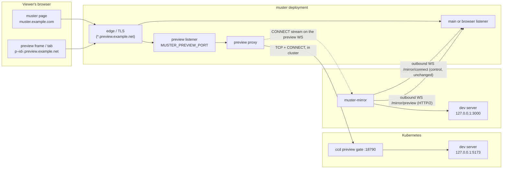

# Design: previews — serving an agent's local web server to its owner

**Status: proposed; the four framing decisions are made** (by the operator; see
[decisions](#decisions)). **Nothing here is implemented.** Every other section
is the recommended design, and its [open questions](#open-questions) are for
the operator.

This page proposes letting work running under muster — a dispatched agent in a
**pod**, or a Claude Code session **mirrored from a bare host** — start a server
or web app on its own localhost (a Vite or Next dev server, a docs site, a
Storybook) and have muster serve it to the owner, inside muster, through a
tunnel. Each such exposure is a **preview**.

Where this page says how muster works today, it cites `file:line` at commit
`0df73e27`, and the code is the authority ([decisions.md](../decisions.md)).
A claim that nothing in the code confirmed is marked **UNVERIFIED**.

## Summary

The design in one line each:

- **Origin: one wildcard subdomain per preview,** `p-<id>.<preview zone>`,
  served by a **new listener of its own** (`MUSTER_PREVIEW_PORT`) that serves
  nothing of muster's own routes. muster's session cookies never reach it, and
  a preview host is refused on muster's own listeners. The zone **should be a
  separate registrable domain** from muster's, not a sub-zone of it
  ([why](#the-preview-zone-a-separate-site)).
- **Auth: a short-lived, host-only, signed cookie per preview,** minted from
  the owner's muster session by a one-time hand-off through
  `/__muster/enter`, re-checked against the owner's session on every request
  and every 30 s on a long-lived connection.
- **Exposure: the agent asks, the machine allowlists.** One MCP tool set,
  `preview_open{port, label}`, `preview_list`, `preview_close{id}`, on both of
  muster's MCP doors (`POST /mcp` for pod agents, `POST /mirror/mcp` for
  mirrored sessions). No per-preview approval; the preview appears in the
  session's view at once. The side that owns the machine — the host's
  `previews.json` behind `-preview`, or the pod's `ccd` gate — enforces a port
  allowlist and dials **loopback only**.
- **Pods need no tunnel.** muster is in the cluster. It opens a TCP connection
  to a small **preview gate in `ccd`** on one new declared port, which splices
  it to `127.0.0.1:<port>` inside the pod. The NetworkPolicy gains exactly
  that one ingress port, from muster's pods only.
- **Hosts get a second outbound WebSocket,** `/mirror/preview`, dedicated to
  previews, carrying **HTTP/2** (`golang.org/x/net/http2`, already a
  dependency) so that each upstream TCP connection is one HTTP/2 `CONNECT`
  stream with real per-stream flow control. The existing control tunnel, its
  terminals and its views are untouched, and the control protocol stays v2.
- **muster's side is one reverse proxy** (`httputil.ReverseProxy`, WebSocket
  upgrades and streaming included) whose dialer is either "the pod's gate" or
  "a stream on the host's preview connection". It rewrites `Host` to
  `localhost:<port>`, sets `X-Forwarded-*`, strips muster's own credentials,
  and treats everything the app returns as untrusted.
- **Audience: the owner by default; share links in phase 3.** A share link is
  minted by the owner only, from the browser, behind step-up; it expires
  (default 1 h, at most 24 h), is revocable, is audited, reaches exactly one
  preview's origin, and works for a viewer with no muster account.
- **Phases:** 1, the shared core plus pods, owner-only; 2, the host tunnel;
  3, share links ([phased plan](#phased-plan)).

## Goals

- An agent that has started a server on a port can say "show this to my owner"
  with one tool call, and the owner sees it in that session's view in muster,
  on a phone or at a desk, within a second or two.
- The same tool, with the same arguments and errors, for a dispatched
  `claude-code` agent in a pod and for a Claude Code session mirrored from a
  host.
- **Dev servers work as they do on localhost:** WebSockets (Vite and Next hot
  module reload), server-sent events, streaming responses, long-lived
  connections, uploads of a reasonable size.
- The preview runs on an origin that cannot reach muster's session, muster's
  routes, or another preview's cookies.
- The machine bounds what is exposed. A compromised muster, or a stolen muster
  session, can reach only loopback ports the host's own file (or the pod's
  gate) allows. muster never becomes a proxy into a host's LAN or into the
  cluster.
- The owner can show a preview to someone else, briefly and revocably, without
  giving them a muster account (phase 3).

## Non-goals

- **A general port-forwarder or VPN.** Only HTTP(S)-speaking servers, on
  loopback, on allowlisted ports. No raw TCP, no UDP, no non-loopback address
  ever.
- **Production hosting.** Previews are for looking at work in progress. They
  close when the agent or session goes away, and they are capped.
- **Gateway-kind agents, the compose driver and opencode sessions in the first
  phases** ([pods](#pod-no-tunnel), [the tools](#the-mcp-tools)).
- **Making untrusted preview content safe.** The app an agent runs is
  untrusted. The design keeps it away from muster; it does not sanitise it.
- **TLS to the upstream.** The upstream is a loopback dev server; muster
  speaks plain HTTP to it. TLS is between the viewer and the edge.

## What exists today

### The host's one tunnel

- `muster-mirror` holds **one** outbound WebSocket to `/mirror/connect`
  (`internal/mirror/wire.go:73`), authenticated by the host's `mmt_` mirror
  token (`internal/mirror/wire.go:78`), and the hub refuses a hello that names
  another host than the token's (`internal/mirror/hub.go:720-730`). muster
  never dials in to a host ([decisions.md](../decisions.md#mirroring-outbound-only-and-never-move-the-operators-window)).
- The tunnel is protocol v2, and a v2 muster accepts v1 hosts
  (`internal/mirror/wire.go:43-65`). Newer capabilities are announced as hello
  fields without a version bump ([mirroring.md](../mirroring.md#rolling-upgrades));
  `resumeSpawn` and `agentSpawn` are the latest (`internal/mirror/wire.go:392,396`,
  read at `internal/mirror/hub.go:760-764`).
- Terminal bytes travel as binary frames tagged with a stream id
  (`EncodeData`/`DecodeData`, `internal/mirror/wire.go:877,885`), JSON control
  messages as text frames, each at most `MaxFrame` = 1 MiB
  (`internal/mirror/wire.go:84`).
- **There is no flow control per stream.** The host read loop hands each
  binary frame to `hostConn.deliver` (`internal/mirror/hub.go:914-918`), which
  puts it on the stream's channel of `streamBuffer` = 256 frames, and **ends
  the stream with `ErrOverrun`** when that channel is full
  (`internal/mirror/hub.go:57-60`, `:1192-1203`), because the one read loop
  serves every stream on that host. Views do the same with `ErrViewOverrun`
  (`internal/mirror/transcript.go:38,272`). At most `MaxStreamsPerHost` = 8
  terminals are open per host (`internal/mirror/wire.go:121-122`, checked at
  `internal/mirror/hub.go:1364`).
- A live connection's token is re-read every `TokenRecheck` = 30 s, and a
  revoked one ends it (`internal/mirror/service.go:22-29`).

That overrun rule is right for a terminal (a reconnect redraws the screen). It
is wrong for HTTP: a 4 MB JavaScript bundle to a slow phone would be **cut off
mid-response**, and a slower drop rule would instead block the read loop, and
with it every terminal and view on the host. That is the case for a second
connection ([options](#host-transport)).

### The host's MCP door

A mirrored Claude Code session reaches muster's tools through the host's
loopback-only MCP endpoint (`-mcp-listen`, refused unless a literal loopback
address, `internal/mirrorhost/mcpproxy.go:443-452`), which forwards each call
to `POST /mirror/mcp` (`internal/api/mirror_mcp.go:92`) with the mirror token
and the calling Claude session id. The server believes the session only when
that host is connected and lists a window running it
(`internal/api/mirror_mcp.go:71-78`, `mirrorSessionOf` at `:172`). The tool set
is `mirrorTools` (`internal/api/mirror_mcp.go:219-274`).

### The pod's MCP door and network

- A `claude-code` agent reaches muster's tools at `POST /mcp`
  (`internal/api/connectors.go:89`), served on the connect listener among
  `ConnectSurfacePrefixes` (`internal/api/connectors.go:60`). Which tools are
  on it is the `mcp` flag of each `agentTool` (`internal/api/agent.go:317`).
  **A tool already exists on both doors:** `agent_report_done`
  (`internal/api/agent.go:361` and `internal/api/mirror_mcp.go:269-271`). The
  preview tools copy it.
- **The claude-code NetworkPolicy restricts ingress by port.** It allows
  ingress from muster's pods (one namespace-AND-pod-label peer) on **the
  spec's declared ports only** (`internal/provision/k8s/network.go:194-224`),
  and a claude-code spec declares one: the gateway port, 18789
  (`internal/agentspec/claudecode.go:548`, `internal/agentspec/agentspec.go:149`).
  So muster **cannot** reach an arbitrary port in the pod today, and the
  design must add one. The Service exposes the same declared ports and no
  others (`internal/provision/k8s/render.go:533-562`).
- Egress is DNS plus public TCP 443 (`internal/agentspec/claudecode.go:102-104,261`);
  an egress-locked officer instance has neither, only muster's connect port
  (`internal/agentspec/claudecode.go:126-139`;
  [officers.md](../officers.md#the-instances-network)). Ingress is the same for
  both.
- A `gateway`-kind agent gets **no NetworkPolicy at all**, and the compose
  driver's container is not confined (`internal/agentspec/claudecode.go:128-130`;
  [limits.md](../limits.md#agents)).
- muster reaches an agent at its provisioner `Endpoint`, by default
  `{{.Name}}.{{.Group}}.svc` (`internal/provision/k8s/render.go:227`,
  `internal/provision/k8s/driver.go:1509-1539`).
- Inside the pod, `ccd` already accepts a per-agent bearer,
  `MUSTER_GATEWAY_BEARER`, minted at random per agent
  ([configuration.md](../configuration.md#ccd-inside-the-claude-code-agent-image)).

### The dial guard

`internal/safedial` is the one rule for "may muster-server connect to this
address", checked on the resolved address
(`internal/safedial/safedial.go:1-16`). The HTTP connector proxy always uses
it; the postgres connector only with `MUSTER_DIAL_DENY_PRIVATE=1`
(`cmd/muster-server/config.go:355`), which is **off on the live deployment**
(operator's statement; not checked from this tree).

### Cookies, origins and framing

- The session cookies are `muster_session` (password mode,
  `internal/api/auth.go:20`) and `muster_at`/`muster_rt` (gotrue mode,
  `internal/api/accounts.go:63-64`). All are `HttpOnly`, `SameSite=Lax`, and
  set with **no `Domain` attribute**, so they are host-only
  (`internal/api/login.go:196-213`, `internal/api/accounts.go:879,889`). None
  carries the `__Host-` prefix.
- **muster already records the sibling-subdomain hazard:** SameSite=Lax is not
  a CSRF defence against a sibling subdomain, because "site" is the registrable
  domain; `requireSameOrigin` checks `Origin` instead
  (`internal/api/auth.go:313-331`).
- 🔴 **`wsAllowedOrigins` trusts `r.Host`** as one of muster's own origins
  (`internal/api/agents.go:2026-2045`). A request that reached muster's mux
  with `Host: p-x.<zone>` and `Origin: https://p-x.<zone>` would pass the
  same-origin check. So preview hosts must never reach muster's mux
  ([the listener](#which-listener-serves-previews)).
- Every response carries `frame-ancestors 'none'` and `X-Frame-Options: DENY`,
  except the Rendered/Terminal swap pages, which allow `'self'`
  (`internal/api/middleware.go:105-143`). The CSP has `default-src 'self'` and
  no `frame-src`, so **muster's pages cannot frame another origin today**.
- Uploaded files are the nearest precedent for serving untrusted content: a
  sandbox CSP on every served file (`internal/uploads/sniff.go:71-91`) and an
  HMAC-signed, expiring link ([uploads.md](../uploads.md#serving-uploaded-files)).

## Topologies



### Pod: no tunnel

muster-server is in the cluster, so it can open a TCP connection to the pod.
What it cannot do today is reach a port the NetworkPolicy does not declare, or
a server bound to the pod's loopback (Vite binds `localhost` by default, and on
Node 17 and later `localhost` may resolve to `::1` first: **UNVERIFIED** for
every dev server; it is the common case the design must handle).

**Recommended: a preview gate in `ccd`.** `ccd` listens on one more port,
18790 (`CCD_PREVIEW_LISTEN`), declared in the claude-code spec as a named port
`preview`, so the existing NetworkPolicy builder emits it as ingress from
muster's pods only (`internal/provision/k8s/network.go:194-224`) and the
Service gains it (`internal/provision/k8s/render.go:533-562`). muster opens a
TCP connection to `<endpoint host>:18790` and sends one HTTP/1.1 request:

```http
CONNECT 127.0.0.1:5173 HTTP/1.1
Host: 127.0.0.1:5173
Proxy-Authorization: Bearer <the agent's MUSTER_GATEWAY_BEARER>
```

`ccd` checks the bearer, takes **only the port** from the target (the address
part is ignored, never dialled), checks it against `CCD_PREVIEW_PORTS`, dials
`127.0.0.1:<port>` and then `[::1]:<port>` if that is refused, answers
`200 Connection established`, and splices the two connections. Kernel TCP gives
it flow control. The gate always refuses its own port and the gateway port.

| option | reaches a loopback-bound server | allowlist on the machine | new RBAC | traffic path | verdict |
|---|---|---|---|---|---|
| **ccd gate on one declared port** | ✓ (ccd dials loopback) | ✓ `CCD_PREVIEW_PORTS` | none | muster → pod, direct | **recommended** |
| Dial `podIP:<port>` directly, open a port range in the policy | ✗ only `0.0.0.0`-bound servers; every agent must remember `--host 0.0.0.0` | ✗ muster only | none | direct | ✗ a range in the policy (`endPort`, CNI-dependent, **UNVERIFIED** on the live CNI), and the common default does not work |
| Kubernetes `pods/portforward` | ✓ (the runtime dials the pod's localhost) | ✗ muster only | `pods/portforward` create | through the API server and kubelet | ✗ preview bandwidth through the control plane; no machine-side check; a new verb in the RBAC muster's ServiceAccount needs ([provisioner.md](../provisioner.md#kubernetes-rbac)) |

The address the server connects to is **never agent-supplied**: it is the
provisioner's `Endpoint` host for that agent row. The agent supplies a port,
and that port is checked twice, by muster and by the gate.

**Gateway-kind agents** get no preview: there is no muster-owned process in
their pod to enforce loopback and the allowlist, and their runtime is not
muster's image. They are not offered the tools. **Officers** run the
claude-code image and the same ingress rule, so the gate would work for them;
the recommendation is still to leave the tools off an officer
([open question 6](#open-questions)). **The compose driver** is out of the
first phases: how muster reaches its container's ports is **UNVERIFIED**.

**Older images.** A `ccd` without the gate does not listen on 18790, and the
connection is refused. `preview_open` probes once before it answers, so the
agent gets `gate_unavailable` rather than a preview that never loads.

### Bare host: a second outbound connection

#### Host transport

| option | flow control | effect on terminals and views | new code | compatibility | verdict |
|---|---|---|---|---|---|
| Extend the existing tunnel with preview frames | none today; would need credit-based windows added to the hub and host loops | shares the one TCP connection and read loop: a bulk download delays keystrokes (head-of-line), and the overrun rule truncates responses | a hand-written flow-control protocol inside the v2 framing, plus a version bump | old hosts need the bump negotiated | ✗ re-implements HTTP/2 inside JSON and binary frames, in the loop that serves every terminal |
| **A second WebSocket, `/mirror/preview`, carrying HTTP/2** | per stream (HTTP/2 `WINDOW_UPDATE`), plus per connection | none: its own TCP connection and its own goroutines | `x/net/http2` (already in `go.mod`), `websocket.NetConn` (coder/websocket v1.8.14) | announced in hello; the control protocol is unchanged | **recommended** |
| A second WebSocket carrying yamux | per stream | none | a new dependency (`hashicorp/yamux`, MPL-2.0) | as above | acceptable fallback if the HTTP/2 spike fails |
| One dial-back WebSocket per upstream connection | kernel TCP, per connection | none | small: muster asks on the control tunnel, the host dials a fresh `/mirror/preview/<n>` | as above | fallback; costs one TLS and WebSocket handshake per connection, which a page load opens six or more of |

**The recommended shape:**

1. A host with `-preview` and a valid `previews.json`
   ([host configuration](#host-configuration-previewsjson)) announces
   `hello.preview: true` on its control connection, and sends a
   `preview-offer` message (`{ports: ["3000", "5173", "8000-8099"], maxConns}`
   or `{disabled: "<reason>"}`) after `welcome` and whenever the file changes,
   like the proposed `spawn-offer`
   ([host-sessions.md](host-sessions.md#host-configuration-spawnjson)). An older
   muster ignores both (the hub's read loop has no `default` case for an
   unknown type, `internal/mirror/hub.go:925`).
2. It then dials `GET /mirror/preview` with the same `mmt_` token, a header
   `X-Muster-Preview-Version: 1`, and its host name. The server applies the
   same token check, the same host-name binding and the same 30 s recheck as
   `/mirror/connect`. A version it does not speak is refused with the range it
   does; an older muster answers 404, and the host logs once and retries with
   backoff, without touching its control connection.
3. After the upgrade both ends wrap the WebSocket as a `net.Conn`
   (`websocket.NetConn(ctx, c, websocket.MessageBinary)`). **The roles are
   reversed from the dial:** the host runs `http2.Server.ServeConn` on it, and
   muster holds an `http2.ClientConn` (`http2.Transport.NewClientConn`). So
   the host never opens a listener, and muster still never dials in.
4. Each upstream TCP connection muster needs is one HTTP/2 `CONNECT` stream
   (RFC 9113 §8.5) with `:authority` `127.0.0.1:<port>`. The host takes **only
   the port**, applies [its checks](#what-the-host-checks-before-it-dials),
   dials loopback, answers `200`, and copies bytes both ways; or answers `403`
   (`port_not_allowed`, `foreign_listener`), `502` (`refused`) or `429`
   (`max_conns`). The host sets `MaxConcurrentStreams` to its `maxConns`.
5. muster's reverse proxy speaks HTTP/1.1 over that stream, exactly as it does
   over the pod gate's connection. WebSocket upgrades are a byte stream like
   any other.

⚠ **UNVERIFIED, and the first thing phase 2 measures:** that `x/net/http2`'s
server handler for `CONNECT` is full duplex (reads the request body while
writing the response) with no buffering that defeats an interactive
WebSocket, and that `websocket.NetConn` sustains it. If either fails, yamux
on the same second connection is the fallback; nothing else in the design
changes.

**What the second connection does not fix:** both connections share the
host's uplink. A large download still competes with terminal bytes for
bandwidth, though no longer in one TCP stream or one read loop. A per-host
bandwidth cap is listed under [limits](#limits-and-quotas) as optional.

**Tenants.** A `muster-mirror@<tenant>` unit has its own token and its own
control connection; it opens its own preview connection the same way.

#### What the host checks before it dials

- **The port is allowlisted** in `previews.json`, and is not one the host
  always refuses: its own `-mcp-listen` port, and the local opencode server's
  port(s) it already talks to. Exposing either would hand a preview viewer
  muster's tools or an opencode session's shell.
- **Loopback only.** It dials the literal `127.0.0.1:<port>`, then
  `[::1]:<port>` if refused, never a name and never the address in the
  request.
- **The listener belongs to this user (Linux).** The listening socket's uid,
  read from `/proc/net/tcp` and `/proc/net/tcp6`, must equal muster-mirror's
  own uid, so an allowlisted port that another local user (or a system
  service) happens to listen on is refused with `foreign_listener`. On macOS
  the equivalent (`lsof`) is **UNVERIFIED**, and the check is off there, which
  the offer says.
- **Its own caps:** `maxConns` concurrent streams, and `maxOpen` previews.

It does **not** check that the listener belongs to the calling session's
process tree. Any session on the host may expose any allowlisted port its user
listens on. Tying a port to a pane (socket inode → pid → the pane's process
tree, the walk `internal/mirrorhost` already does for `claude`) is possible,
and is [open question 4](#open-questions).

## Which listener serves previews

| option | isolation from muster's routes | edge routing | verdict |
|---|---|---|---|
| **A new listener, `MUSTER_PREVIEW_PORT`, serving only the preview handler** | structural: muster's mux is not mounted on it | the wildcard host goes to one port | **recommended** |
| The main or browser listener, dispatching on `Host` before the mux | one `if` in front of everything | one port | ✗ `wsAllowedOrigins` trusts `r.Host` (`internal/api/agents.go:2031`): a dispatch bug turns into a same-origin bypass |
| The connect listener | — | — | ✗ it is the agents' surface; previews are a browser surface |

- The preview listener answers 404 to any `Host` that is not
  `p-<id>.<MUSTER_PREVIEW_DOMAIN>` for an open preview. It serves `/health`.
- **muster's main and browser listeners refuse any `Host` under
  `MUSTER_PREVIEW_DOMAIN`** with 421, before the mux, as a second wall.
- The browser listener's rules carry over: the client address is
  `CF-Connecting-IP` or the first `X-Forwarded-For` entry, trusted only
  because an edge is in front.

## The preview zone: a separate site

Decision 1 fixes a wildcard subdomain. What the subdomain sits under matters:

| zone | example | preview is to muster | consequence |
|---|---|---|---|
| **A separate registrable domain** | `p-<id>.muster-preview.example.net` | **cross-site** | Recommended. A preview cannot set a cookie muster's origin receives, and is not same-site to it. Embedding needs a third-party (partitioned) cookie, below. |
| A sub-zone of muster's domain | `p-<id>.preview.example.com` | **same-site** | Works with plain `SameSite=Lax` cookies in a frame, but: preview script can set `Domain=example.com` cookies that muster's origin then receives (cookie tossing: a forced sign-in or a fixed session); it is same-site for CSRF, so every muster write rests on the `Origin` check alone; and it receives every parent-domain cookie an SSO proxy sets for `example.com`. |

muster cannot stop preview **script** from setting a parent-domain cookie; the
proxy can strip `Domain` only from the upstream's `Set-Cookie` headers. Moving
muster's own cookies to `__Host-` names would close cookie tossing against
muster, and would sign everyone out once. The recommendation is the separate
domain. The server logs a `previews:` boot warning when
`MUSTER_PREVIEW_DOMAIN` shares muster's registrable domain, and does not
refuse it.

**Label shape.** `p-<id>` is a single label directly under the zone, with
`<id>` 26 characters of lowercase base32 (128 random bits). A single label is
deliberate: a wildcard certificate covers one level only, and an edge's
default certificate commonly covers `*.<zone>` and not `*.<sub>.<zone>`
(Cloudflare's Universal SSL, per its documentation: **UNVERIFIED** here). The
id is unguessable, but it is **not** a credential; the cookie is.

### What the deployment must provide

- **DNS:** a wildcard record `*.<preview zone>` pointing at the edge.
- **TLS:** a wildcard certificate for `*.<preview zone>`. From an ACME CA this
  needs the DNS-01 challenge (HTTP-01 cannot issue a wildcard).
- **The edge:** route `*.<preview zone>` to `MUSTER_PREVIEW_PORT`, pass `Host`
  through unchanged, pass WebSocket upgrades, do not buffer streaming
  responses, and set `CF-Connecting-IP` or `X-Forwarded-For`. An edge with a
  response idle timeout (Cloudflare's is about 100 s, **UNVERIFIED** here)
  ends a quiet SSE stream; that is the app's heartbeat to send, not muster's.
- **No single sign-on proxy in front of the preview zone.** The preview origin
  does its own authentication, and a share-link viewer has no SSO account.
  `/mirror/preview` must bypass an auth proxy, as `/mirror/connect` does
  ([mirroring.md](../mirroring.md#how-it-connects)).
- `MUSTER_PREVIEW_SIGNING_KEY`, 32 random bytes.

## Data path

### An HTTP request

```mermaid
sequenceDiagram
  participant B as Browser (preview origin)
  participant E as Edge
  participant P as muster preview listener
  participant D as dialer (pod gate | host stream)
  participant U as dev server (loopback)
  B->>E: GET https://p-id.zone/src/main.ts (cookie __Host-mp)
  E->>P: Host p-id.zone
  P->>P: look up preview id, verify cookie (sig, exp, preview id, owner session)
  P->>D: dial(preview) — pod: TCP + CONNECT 127.0.0.1:5173; host: HTTP/2 CONNECT stream
  D->>U: 127.0.0.1:5173 (or [::1])
  P->>U: GET /src/main.ts, Host: localhost:5173, X-Forwarded-Host: p-id.zone
  U-->>P: 200 (streamed)
  P-->>B: 200, Set-Cookie rewritten, CSP frame-ancestors added
```

1. The edge terminates TLS and forwards to the preview listener.
2. The listener parses the label, finds the preview (an open row whose owner,
   kind and target are known), and authenticates the request
   ([auth](#auth-the-owner)). No cookie: a 302 to muster's
   `/previews/<id>/launch`, which mints a hand-off for a signed-in owner.
3. The dialer opens one upstream connection. The reverse proxy keeps a small
   per-preview pool of idle upstream connections (HTTP/1.1 keep-alive), so a
   page load does not open a stream per asset.
4. **Request rewriting** (the upstream sees a localhost request):
   - `Host: localhost:<port>`. Dev servers allow `localhost` by default
     (Vite's `server.allowedHosts`, webpack-dev-server's `allowedHosts`), so no
     configuration is needed in the app. The public host goes in
     `X-Forwarded-Host`, with `X-Forwarded-Proto: https`.
   - Removed: muster's preview cookie, and any `muster_session`, `muster_at`
     or `muster_rt` cookie (none should arrive on a separate zone; stripped
     anyway), `Forwarded`, every inbound `X-Forwarded-*`, `X-Real-IP`,
     `CF-*`, `True-Client-IP`, and `X-Muster-*`. **The viewer's address is not
     forwarded**: the app does not learn a share-link viewer's IP.
     `X-Forwarded-For` is not set.
   - Kept: everything else, the app's own cookies and its own
     `Authorization` header included. They are the app's.
5. **Response rewriting:**
   - `Location` pointing at `http(s)://localhost:<port>`, `127.0.0.1:<port>`
     or `[::1]:<port>` is rewritten to the preview origin. Other absolute URLs
     are left alone.
   - `Set-Cookie`: the `Domain` attribute is removed (every app cookie is
     host-only to its preview), and a cookie named like muster's preview
     cookie is dropped.
   - An extra `Content-Security-Policy: frame-ancestors <muster's origin>`
     header is added. Several CSP headers are intersected by the browser, so
     an app that refuses framing still refuses it; the panel then offers the
     new tab.
   - `X-Content-Type-Options: nosniff` is added; `Strict-Transport-Security`
     from the app is dropped (it would pin the whole zone from one preview).
6. **Streaming:** the proxy flushes as the upstream writes
   (`ReverseProxy.FlushInterval = -1`), so SSE and chunked responses arrive as
   they are produced. No response size limit: a slow reader slows its own
   upstream through HTTP/2 or TCP flow control, and nothing else.

### A WebSocket upgrade

`httputil.ReverseProxy` passes an `Upgrade: websocket` request through and,
on `101`, hijacks both sides and copies bytes. So:

1. Steps 1–4 above, with the request's `Origin` header **rewritten** to
   `http://localhost:<port>` when it equals the preview origin: a dev server
   that checks the WebSocket's origin (Vite's HMR does, **UNVERIFIED** for its
   exact rule) sees its own. Any other `Origin` is passed as is and the app
   decides.
2. The upstream answers `101`; muster copies both directions until either
   side closes.
3. **Long-lived connections are re-checked:** every 30 s (the mirror token's
   interval) muster re-verifies the cookie's preview, the owner's session and
   (phase 3) the share link, and closes the connection on a failure. A
   revocation therefore reaches an open HMR socket within 30 s, not at its
   next reconnect.
4. HMR clients connect to `location.host`, which is the preview origin; an
   app configured with an explicit HMR host or port (`server.hmr.clientPort`)
   bypasses the preview and fails. The tool's description says so.

## The MCP tools

Three tools, offered on `POST /mcp` to `claude-code` agents (`mcp: true`,
`notChief: true`, not `officerOnly`; see `internal/api/agent.go:317-330`) and
in `mirrorTools` to mirrored sessions, when previews are on. The chief does not
get them: the chief does not run dev servers, and its tool list is pinned
(`TestTheChiefsToolListIsPinned`).

| tool | arguments | result | errors |
|---|---|---|---|
| `preview_open` | `port` (integer, 1–65535), `label` (string, at most 60 characters, optional; defaults to `:<port>`), `path` (string starting with `/`, at most 512 bytes, optional; where the panel opens) | `{id, port, label, state: "open", view: "<the muster URL of the session's view>"}` | `previews_off`, `port_not_allowed`, `not_listening`, `gate_unavailable` (pod), `host_unsupported` (host has no `preview` capability), `host_offline`, `foreign_listener` (host), `max_open` |
| `preview_list` | none | `[{id, port, label, state, opened_at, last_request_at}]` of **the calling session's** previews | `previews_off` |
| `preview_close` | `id` | `{closed: true}` | `not_found` (also for another session's preview) |

- **The caller is the binding.** A pod agent's preview belongs to its agent
  row. A mirrored session's belongs to `(host, Claude session id)` as
  `mirrorSessionOf` proves it at each call
  (`internal/api/mirror_mcp.go:71-78`). Only that caller can list or close
  it; the owner can close any of theirs from the UI.
- **Idempotent per `(caller, port)`:** opening a port that the caller already
  has open returns the same id, with the new label and path. An HMR reload or
  a retried call does not mint a second origin.
- **`preview_open` probes before it answers:** one upstream connection, and a
  `HEAD /` with a 5 s budget. Refused connection: `not_listening`, so the
  agent starts the server first. Any HTTP answer, even a 404 or 500, opens the
  preview.
- **The preview URL is not returned to the agent.** It is no secret (the
  cookie is the credential), but the agent has no use for it and a link that
  only works for the owner, pasted into a commit or a chat, invites
  confusion. `view` points at muster's session view.
- **opencode sessions get none of this yet:** opencode has no muster tool
  ([mirroring.md](../mirroring.md)). An owner-initiated open from the UI would
  cover them, and is [open question 5](#open-questions).

## Host configuration: `previews.json`

Patterned on `-spawn` and `spawn.json`
([host-sessions.md](host-sessions.md#host-configuration-spawnjson)) and on the
shipped `-agent-spawn` flags ([mirroring.md](../mirroring.md)): off by default,
an explicit flag, and an allowlist that is **empty, meaning nothing**, until
the operator writes one.

| flag | env | default | |
|---|---|---|---|
| `-preview` | `MUSTER_MIRROR_PREVIEW` | off | turn it on: announce the capability and open `/mirror/preview` |
| `-preview-file` | `MUSTER_MIRROR_PREVIEW_FILE` | `~/.config/muster-mirror/previews.json` | the allowlist |

```json
{
  "ports": ["3000", "4173", "5173", "6006", "8000-8099"],
  "maxOpen": 8,
  "maxConns": 64
}
```

- **`ports`:** single ports or inclusive ranges, each within 1024–65535. A
  port below 1024 refuses to load. An empty list, a missing file or an invalid
  file disables previews, says why in the `preview-offer`, logs it, and is
  never fatal.
- **Always refused, whatever the file says:** the host's own `-mcp-listen`
  port and the opencode server port(s) muster-mirror is configured with.
- **`maxOpen`:** previews open on this host at once (default 8, at most 32).
- **`maxConns`:** concurrent upstream streams across all of them (default 64,
  at most 256).
- **Not tied to `-interactive`.** Exposing a loopback server is not typing
  into a pane, so a read-only host may run `-preview`. Whether it should
  require `-interactive` anyway is [open question 3](#open-questions).
- The file is re-read on change, and a new `preview-offer` is sent; previews
  open on a port that left the list are closed with reason `host_policy`.

The pod's equivalent is the server's `MUSTER_PREVIEW_POD_PORTS` (same syntax,
default empty: no pod previews), which muster passes to every new claude-code
agent as `CCD_PREVIEW_PORTS`. The gate refuses its own port and the gateway
port whatever the list says.

## Lifecycle

Previews are rows, not hub state, so a muster restart does not close them and
phase 3's share links have something to reference. A new migration adds
`previews` (`id`, `owner_id`, `kind` `pod`|`host`, `agent_id` or
`host`+`claude_session`, `port`, `label`, `path`, `opened_at`,
`last_request_at`, `closed_at`, `closed_reason`), under row-level security on
the owner like every user-data table ([schema.md](../schema.md)).
`last_request_at` is written at most once a minute.

| event | what happens | `closed_reason` |
|---|---|---|
| `preview_open` | probe, insert (or return the open row for that caller and port), push the panel update | — |
| `preview_close`, or **Close** in the panel | row closed; open connections ended; cookies stop working at the next request | `closed` |
| **The agent is destroyed** or reaped ([provisioner.md](../provisioner.md#destroying-an-agent)) | its previews close in the same teardown | `agent_gone` |
| **The pod restarts** (new IP, same agent) | nothing: the next request dials the endpoint again; until the server is back up, the viewer gets muster's "not answering" page (502) | — |
| **The upstream stops listening** | 502 "not answering" page per request; the preview stays open | — |
| **The host disconnects** | requests get muster's "host offline" page (503); the preview stays open | — |
| The host stays offline past 24 h (the hub's `offlineRetention`, `internal/mirror/hub.go:61-63`) | closed | `host_gone` |
| **The mirrored session's window is gone** (no listed window runs that Claude session) for 10 minutes | closed | `session_gone` |
| The port leaves the host's or the pod's allowlist | closed | `host_policy` |
| **Idle**: no request for `MUSTER_PREVIEW_IDLE` (default 2 h) | closed | `idle` |
| **TTL**: open longer than `MUSTER_PREVIEW_TTL` (default 24 h) | closed; the agent may open it again, which mints a new id | `ttl` |
| The owner is disabled, or their mirror token is revoked (host previews) | closed | `owner_disabled` / `token_revoked` |

One reaper loop runs the idle, TTL and session-gone checks every minute. Like
the existing reapers it claims each row with a conditional update, so a second
replica duplicates work rather than effects ([limits.md](../limits.md#deployment)).
Closed rows are kept for 30 days for the audit trail, then deleted by the
daily retention pass.

## UI

- **The session's view gets a Previews strip** on both a mirrored window's
  view (`/mirror/view`) and an agent's page (`/agents/{name}`): one chip per
  open preview, `label · :port`, with **Open** (new tab), **Show here** (the
  embedded frame), **Copy share link** (phase 3) and **Close**. It updates
  over the page's existing live stream when a preview opens or closes, so it
  appears without a reload. Nothing is drawn when there are none, so the
  page's layout does not shift for sessions without previews (the
  `cls.spec.ts` gate, [testing.md](../testing.md#the-browser-suite-e2e)).
- **Show here** opens a panel over the view with an iframe:
  - `src` is `https://p-<id>.<zone>/__muster/enter?t=<hand-off>`;
  - `sandbox="allow-scripts allow-same-origin allow-forms allow-popups allow-downloads allow-modals"`,
    with **no** `allow-top-navigation`, so preview script cannot navigate
    muster's tab (to a look-alike sign-in page, for example).
    `allow-same-origin` is safe here because the frame's origin is not
    muster's;
  - `allow=""` (no camera, microphone or geolocation for preview content);
  - `referrerpolicy="no-referrer"`.
  The view pages that host it get `frame-src https://*.<zone>` added to their
  CSP; every other page keeps `default-src 'self'`
  (`internal/api/middleware.go:119-131`).
- **Open** is a top-level navigation to the same hand-off URL, in a new tab.
  It always works, because the cookie is then first-party.
- **Notification on open.** The strip updating is the notification while the
  owner is looking. When they are not, phase 1 raises **no push and no
  Attention item**: the owner asked the agent for the work, and a preview
  opening is progress, not something waiting on them. An Attention notice
  (the existing `notice` kind, [attention.md](../attention.md#notices)) or a
  push is [open question 7](#open-questions).

### Embedding and cookies

On a separate zone the frame is **cross-site**, so its cookie is a third-party
cookie:

- The cookie is `__Host-mp`: `Secure`, `HttpOnly`, `Path=/`, no `Domain`
  (host-only to `p-<id>.<zone>`), `SameSite=None`, `Partitioned` (CHIPS; Go's
  `http.Cookie` has the field). Partitioned means it is keyed to muster's
  top-level site, so it works in the frame where third-party cookies are
  otherwise blocked, and is a different cookie from the one a new tab gets.
- Chromium supports partitioned cookies; Firefox partitions third-party
  cookies by default; **Safari and the Android app's WebView are
  UNVERIFIED**. The Android WebView refuses third-party cookies unless the app
  calls `CookieManager.setAcceptThirdPartyCookies` (an app change,
  [open question 8](#open-questions)).
- **The failure is detected, not silent:** `/__muster/enter` sets the cookie
  and redirects to `/__muster/check`, which redirects on to the preview's
  `path` if the cookie arrived, and otherwise renders "This browser blocks
  embedded previews. Open it in a new tab." with the button.

## Auth: the owner

- **The hand-off.** `POST /previews/{id}/launch` on muster's own origin (a
  signed-in, same-origin request; the owner's row-level-security scope finds
  only their own previews) returns a one-time token: 32 random bytes, stored
  hashed with the preview id, the owner and the browser session it came from,
  valid for 60 s, single use. `/__muster/enter?t=…` on the preview origin
  consumes it, sets `__Host-mp`, and redirects with `Referrer-Policy:
  no-referrer`. A replayed, expired, or other preview's token is refused with
  the same 403.
- **The cookie** holds `{preview id, owner id, session ref, issued, expires}`,
  HMAC-SHA256 with `MUSTER_PREVIEW_SIGNING_KEY`, valid 1 h. The frame
  re-enters through a fresh hand-off when it expires (the panel re-mints on
  `/__muster/check` failure).
- **Every request checks**, in this order: the signature and expiry; that the
  cookie's preview id is this host's preview (a cookie can only arrive at its
  own host, but the check does not rely on the browser); that the preview is
  open; and that the session it came from is still good — in gotrue mode not
  signed out, not before Sign out everywhere or the session cutoff, the
  account not disabled (the same second wall device credentials get,
  [auth.md](../auth.md#paired-devices)), read with at most 30 s of caching. In
  password mode the session is a stateless cookie whose key is derived from
  `MUSTER_UI_PASSWORD`, so rotating the password is what revokes it
  (`internal/api/auth.go:206-221`). The preview cookie's key is therefore
  derived from both `MUSTER_PREVIEW_SIGNING_KEY` and that session key, so the
  same rotation revokes every preview cookie too.
- **No step-up for the owner.** Viewing one's own preview is like opening a
  view, which is not step-up gated. It reaches a dev server, not a shell.
- **muster's own credentials never reach the preview origin**: they are
  host-only to muster's host, on another site, and stripped if present.

## Share links (phase 3)

| question | design |
|---|---|
| **Who can mint** | The owner only, from the browser, behind step-up (`MUSTER_STEPUP_WINDOW`, [sending-and-step-up.md](../sending-and-step-up.md#step-up-confirm-its-you)). No MCP tool, no `mst_` route, no device action in phase 3: an agent that could share its own preview could publish a host's loopback app with no human in between. A test pins the tool ledger. |
| **TTL** | Chosen at mint: 15 min, **1 h (default)**, 8 h, 24 h. Never past the preview's own TTL. `MUSTER_PREVIEW_SHARE_MAX_TTL` (default 24 h) caps it. |
| **What it is** | `https://p-<id>.<zone>/__muster/share/<token>`; the token is 32 random bytes, stored hashed in `preview_shares` (`id`, `owner_id`, `preview_id`, `token_hash`, `label`, `created_at`, `expires_at`, `revoked_at`, `first_used_at`, `uses`), RLS on the owner. |
| **Redeeming** | The share route sets a different cookie, `__Host-mps`, signed, bound to the share id and the preview id, expiring with the link, `SameSite=Lax` (a viewer opens it top-level). The token leaves the URL by redirect. Any number of viewers and redemptions until it expires or is revoked; `uses` counts them. |
| **What a link-holder can reach** | Exactly that one preview's origin, every path and method the app serves, WebSockets included. Nothing on muster's origin: no session, no muster page, not the panel. A read-only (GET/HEAD) mode is possible and is [open question 9](#open-questions). |
| **Unauthenticated viewers** | Yes. That is the point of a link. The viewer needs no muster account, and the preview zone has no SSO proxy in front of it ([deployment](#what-the-deployment-must-provide)). |
| **Revocation** | **Revoke** on the chip's share list, or `DELETE /previews/{id}/shares/{share}`. Closing the preview revokes all its links. So does disabling the owner, and a password reset. Every request re-reads the share row (30 s cache at most), and the 30 s recheck closes open WebSockets. |
| **Audit** | `audit_log` rows: `preview_share.created` (preview, TTL, label), `preview_share.redeemed` (the first redemption only, and the client address as the edge reports it), `preview_share.revoked`, `preview_share.expired` (written by the reaper). Viewing as the owner writes no audit row, as viewing a session does not. |
| **Rate limits** | Per link: 600 requests a minute and 32 concurrent connections, then 429. Redeeming an unknown or revoked token: 30 a minute per client address, then 429. Per owner: at most 20 live links. |
| **What the owner sees** | Each chip lists its live links with expiry, uses and **Revoke**. |

The share cookie and the owner cookie are both accepted on a preview's origin.
The owner's is checked first; a request with neither is redirected to the
owner launch flow, which a stranger cannot complete.

## Limits and quotas

Following [limits.md](../limits.md#mirroring), stated as numbers:

| scope | limit | default | where enforced |
|---|---|---|---|
| per calling session (agent or mirrored session) | open previews | 4 | server |
| per owner | open previews | 16 | server |
| per host | open previews | 8 (`maxOpen`, at most 32) | host and server |
| per host | concurrent upstream streams | 64 (`maxConns`, at most 256) | host (`MaxConcurrentStreams`) |
| per pod | concurrent upstream connections | 64 | gate |
| per preview | concurrent client connections | 64 | server |
| per server | open previews | 256 | server |
| request body | size | 32 MiB (`MUSTER_PREVIEW_MAX_BODY`) | server; larger answers 413 |
| response body | size | none; flow-controlled | — |
| request headers | time to first byte of the upstream's headers | 60 s | server; then 504 page |
| HTTP connection | idle | 5 min | server |
| WebSocket | lifetime | none while rechecks pass; ends on revocation, preview close or cookie expiry at the next recheck | server |
| per host, optional | bandwidth | off | host (`maxBytesPerSec`), if the second connection still hurts terminals |
| share links | see [share links](#share-links-phase-3) | | server |

## Configuration

New variables. Each gets a row in [configuration.md](../configuration.md) when
the code reads it, or `TestEveryEnvVarTheCodeReadsIsDocumentedAndViceVersa`
fails.

| variable | binary | default | what it does |
|---|---|---|---|
| `MUSTER_PREVIEWS` | server | off | Turns previews on. Needs the next three; a partial set leaves previews off and says why in the boot banner, never refusing to boot (like attachments). |
| `MUSTER_PREVIEW_DOMAIN` | server | none | The preview zone. Each preview is `p-<id>.<this>`. A zone that shares muster's registrable domain logs a warning. |
| `MUSTER_PREVIEW_PORT` | server | none | The preview listener. It serves only preview hosts and `/health`. |
| `MUSTER_PREVIEW_SIGNING_KEY` | server | none | 32 random bytes, base64: signs the preview and share cookies. |
| `MUSTER_PREVIEW_POD_PORTS` | server | empty: no pod previews | Ports pod agents may expose, passed to each new claude-code agent as `CCD_PREVIEW_PORTS`. |
| `MUSTER_PREVIEW_TTL` | server | `24h` | A preview's longest life. |
| `MUSTER_PREVIEW_IDLE` | server | `2h` | A preview with no request for this long is closed. |
| `MUSTER_PREVIEW_MAX_BODY` | server | `32MiB` | The largest request body forwarded. |
| `MUSTER_PREVIEW_SHARES` | server | off | Phase 3: turns share links on. |
| `MUSTER_PREVIEW_SHARE_MAX_TTL` | server | `24h` | Phase 3: the longest a share link may live. |
| `MUSTER_MIRROR_PREVIEW` | muster-mirror | off | `-preview`. |
| `MUSTER_MIRROR_PREVIEW_FILE` | muster-mirror | `~/.config/muster-mirror/previews.json` | `-preview-file`. |
| `CCD_PREVIEW_LISTEN` | ccd | `:18790` when `CCD_PREVIEW_PORTS` is set | The gate's listener. |
| `CCD_PREVIEW_PORTS` | ccd | empty: gate off | The ports the gate dials on loopback. Set by muster. |

`MUSTER_DIAL_DENY_PRIVATE` **does not cover previews, and must not be read as
if it did.** The pod path connects to a private in-cluster address by design;
routing it through `safedial` would refuse every pod preview when the guard is
on. What keeps the pod path from being a proxy into the cluster is that the
address is the provisioner's endpoint for that agent row, never a value the
agent or the request supplies, and that the gate dials loopback only. The
host path makes no connection from muster at all. The `MUSTER_DIAL_DENY_PRIVATE`
row in configuration.md gets a sentence saying so.

**Enabling previews changes the claude-code spec** (a new declared port and
two environment variables). Whether that rolls existing agents' pods at their
next reconcile, or applies only to new agents, is **UNVERIFIED**
(the pod template carries a spec fingerprint annotation, `internal/provision/k8s/render.go:57-66`); phase 1
must measure it before turning it on live.

## Telemetry

Following [telemetry.md](../telemetry.md):

- **Spans:** `preview.request` on the preview listener (attributes
  `preview.kind` = `pod`|`host`, `preview.auth` = `owner`|`share`, status
  class; never the path or query); a child `preview.dial` (`pod.gate` or
  `host.stream`, with outcome); on the host, `host.preview.dial` with the
  check that refused, if one did. A WebSocket gets `preview.ws` from upgrade
  to close, with its close reason.
- **Metrics:**
  - `muster_previews_open{kind}` (gauge);
  - `muster_preview_requests_total{kind,auth,code_class}`;
  - `muster_preview_dial_seconds{kind,outcome}` (histogram);
  - `muster_preview_bytes_total{kind,direction}`;
  - `muster_preview_ws_open{kind}` (gauge);
  - `muster_preview_refusals_total{reason}` (`port_not_allowed`,
    `not_listening`, `foreign_listener`, `max_open`, `max_conns`,
    `bad_cookie`, `revoked`, …);
  - `muster_preview_share_redemptions_total{outcome}` (phase 3).
- **Log lines:** one per preview open and close (owner, kind, port, reason),
  one per refused request with its reason, none per successful request.
- **Privacy:** no preview path, query, header or body is logged, traced or
  labelled. A hand-off or share token never appears in a log, span or metric;
  the access log writes the preview listener's paths with the token segment
  replaced.

## Threat model

| threat | who | control | residual |
|---|---|---|---|
| Preview script reads muster's session | any preview content | separate origin (and recommended separate site); muster's cookies host-only and `HttpOnly`; stripped by the proxy if present | none on a separate site |
| Preview script acts on muster as the owner (CSRF) | preview content | cross-site: `SameSite=Lax` withholds muster's cookies from its POSTs; `requireSameOrigin` refuses its `Origin` (`internal/api/auth.go:313-331`) | on a same-site zone, only the `Origin` check (UNVERIFIED that every write route has it) |
| Preview host reaches muster's routes | an attacker choosing `Host` | separate listener with no muster mux; main and browser listeners refuse preview hosts | none |
| Cookie tossing into muster | preview script | separate site | on a same-site zone: open, until muster's cookies are `__Host-` |
| Clickjacking or top-navigation of muster's tab | preview content in the frame | `sandbox` without `allow-top-navigation`; muster keeps `frame-ancestors 'none'` for itself | the preview can still draw a look-alike inside its own frame |
| One preview steals another's cookie | preview A's script | each preview is its own host; cookies host-only; the cookie names its preview and is checked | none |
| muster or a stolen session used as a proxy into the host's LAN | compromised muster, stolen owner session | the host dials loopback only, ignores the requested address, allowlist in its own file | reaches whatever listens on allowlisted loopback ports as this user |
| An allowlisted port is held by another user or a system service | another local user | `foreign_listener` uid check (Linux) | macOS: no check |
| Exposing muster-mirror's MCP or opencode's server | an agent asking for that port | always refused by the host, whatever the file says | a control port muster-mirror does not know about, if allowlisted |
| Proxy into the cluster | an agent naming an address | the address is the agent's own endpoint; the agent names only a port; the gate dials loopback | none beyond that pod's own loopback |
| A prompt-injected agent exposes something sensitive in its pod or host | the agent | allowlisted ports only; owner-only by default; no agent-minted share links | the owner can be shown anything that listens on an allowed port; it is still only shown to them |
| A leaked mirror token | anyone holding `mmt_` | it already reaches that host's tunnel ([auth.md](../auth.md#machine-credentials)); for previews it adds opening previews **as that host's sessions** on allowlisted ports and the preview connection; viewing still needs the owner's session | revoke the token: the preview connection ends within 30 s |
| A leaked share link | whoever it was sent to | expiry, revocation, rate limits, audit of first use, one preview only | until revoked or expired, anyone with it sees that app |
| A stolen preview cookie | malware on the viewer's machine | 1 h expiry, bound to one preview and the owner's session; revoked with it | up to 1 h, or 30 s after the session is revoked |
| The app learns about its viewers | the agent's app | viewer address and edge headers stripped | the app still sees what the viewer's browser sends it |
| Resource exhaustion on host or server | an agent, a share-link viewer | the [limits](#limits-and-quotas) | bandwidth is not capped by default |
| DNS rebinding against the dev server | a third-party page | the proxy always sends `Host: localhost:<port>` from loopback, so the dev server's host check passes for muster and still refuses rebinding pages that reach it directly | the dev server's own rule applies to everything else |

## Phased plan

The operator's suggested order is kept. **Phase 1 builds everything the two
topologies share** (the zone, listener, cookie, proxy, WebSocket and
streaming, panel, rows, tools) on the path with no tunnel, so the risky
browser-facing parts are proven before the transport is.

| phase | what | depends on |
|---|---|---|
| **1: core + pods, owner-only** | `previews` table and reaper; the preview listener, `MUSTER_PREVIEW_*` core variables and Host refusal on the other listeners; hand-off and cookie; the reverse proxy with its rewrites, WebSockets and streaming; the three MCP tools on `POST /mcp`; the `ccd` gate and the spec's `preview` port; the panel and frame with the CSP change; telemetry; docs (configuration rows, a `previews.md` user page, a decisions entry) | — |
| **2: host tunnel** | `-preview`, `previews.json`, `preview-offer`, `/mirror/preview` with HTTP/2 `CONNECT` (after the spike), the host's checks (loopback, uid, refused ports), the tools in `mirrorTools`, host lifecycle (offline, session gone, token revoked) | 1 |
| **3: share links** | `preview_shares`, mint behind step-up, redeem, revoke, audit rows, rate limits, the chip's link list, `MUSTER_PREVIEW_SHARES` | 1 (2 for host previews) |

If mirrored hosts turn out to be where previews are wanted first, phases 1 and
2 can swap their transport halves: the core is the same
([open question 1](#open-questions)). Engineer-day estimates are left for the
revision after the operator answers the open questions, as host-sessions.md
did.

### Test plan

Per [testing.md](../testing.md), each guard below is listed with the change
that must turn it **red**, and must be watched going red before it counts.

**Phase 1**

- **Credentials never reach the upstream.** An upstream that records its
  request headers receives a request sent with `muster_session`, `muster_at`,
  `muster_rt`, `__Host-mp`, `CF-Connecting-IP`, `X-Forwarded-For` and
  `X-Muster-Foo`, and sees none of them; it sees the app's own cookie and
  `Authorization`. Red with a plain `httputil.ReverseProxy` director.
- **Preview hosts never reach muster's mux.** A state-changing request to the
  main and browser listeners with `Host` and `Origin` both
  `p-<id>.<zone>` is answered 421 before any handler runs. Red today: it
  would pass `requireSameOrigin` through `wsAllowedOrigins`'s `r.Host`
  (`internal/api/agents.go:2031`). And the preview listener answers 404 to
  `/`, `/login` and `/mirror/connect` under muster's own host.
- **The cookie is bound to its preview.** Preview A's valid cookie sent to
  preview B's host is refused. Red when the check of the cookie's preview id
  is removed. A replayed hand-off, an expired one and one minted for B are
  each refused; a tampered signature is refused.
- **Revocation reaches an open WebSocket.** With an upstream echo socket
  open, closing the preview (and, in gotrue mode, Sign out everywhere) ends
  the socket within the recheck interval. Red without the periodic recheck.
  Use a short interval through a test seam, and a positive control: the
  socket stays open across several intervals when nothing is revoked.
- **WebSockets and streaming pass through.** A fake HMR server pushes a
  message after the upgrade and the browser side receives it; an SSE upstream
  that writes one event and then waits delivers that event before it
  finishes. Red with `FlushInterval` 0 for an unknown-length response, and
  red if the proxy strips `Upgrade`.
- **Large responses are not truncated.** A 50 MB body to a reader that
  pauses for 2 s arrives byte-exact. Red with a bounded channel and drop
  rule, which is the existing hub's behaviour.
- **The gate dials loopback only and checks the port itself.** `CONNECT
  <another address>:80` to the gate reaches a loopback listener on 80 when 80
  is allowed, and nothing else (red if the gate dials the authority); a port
  muster allows but `CCD_PREVIEW_PORTS` does not is refused (red if only
  muster checks); 18789 and 18790 are refused even when listed; a missing or
  wrong bearer is refused. A `::1`-only listener is reached after `127.0.0.1`
  is refused.
- **The policy opens exactly one port.** The rendered NetworkPolicy and
  Service of a claude-code agent with previews on gain port 18790 from the
  controller peer, and nothing else; with previews off they are byte-identical
  to today's. Red if the port is added to egress, or if a preview-on spec with
  no port renders an ingress rule with an empty `ports` list (which would open
  every port, `internal/provision/k8s/network.go:208-210`).
- **Lifecycle:** destroying an agent closes its previews; idle and TTL close
  them; `preview_open` on the same port is idempotent; `not_listening` when
  nothing listens, and a 500 from the upstream still opens.
- **Tool ledger:** the MCP tool sets on `POST /mcp` (and, in phase 2,
  `mirrorTools`) gain exactly the three tools, the chief's pinned list does
  not change, and a gateway-kind agent is not offered them.
- **Browser (Playwright, 390×844 and 1280×800):** an agent's `preview_open`
  makes the strip appear on its page without a reload; **Show here** loads
  the fake app in the frame with its partitioned cookie (Chromium) and its
  HMR message arrives; **Open** works in a new tab; with third-party cookies
  blocked, the frame shows the "open in a new tab" page (red if the check
  page is skipped). The page with no previews passes `cls.spec.ts`.

**Phase 2**

- **The reason for the second connection, measured.** On one host, a
  terminal echo round trip is timed while a preview streams 100 MB to a
  reader that pauses; it stays within a bound set from a baseline with no
  preview, and no terminal ends with `ErrOverrun`. Run it once against a
  build that carries preview bytes on the control tunnel, to show it red
  there; keep that build out of the tree.
- **The spike:** full-duplex HTTP/2 `CONNECT` over `websocket.NetConn`, with
  an interactive WebSocket echo through it (the UNVERIFIED point above).
- **Host checks:** an unlisted port, a port below 1024 in the file, the
  `-mcp-listen` port and the opencode port are refused with their codes; the
  authority's address is ignored; a listener owned by another uid gives
  `foreign_listener` (through a seam for the `/proc/net/tcp` read, plus a
  parser test against captured `/proc/net/tcp` and `tcp6` lines); `maxConns`
  answers 429.
- **Compatibility:** an older muster's 404 on `/mirror/preview` leaves the
  control connection up; an older host (no `preview` in hello) gets
  `host_unsupported`; a `preview-offer` reaching an older muster is ignored.
- **Revocation:** a revoked mirror token ends the preview connection within
  30 s; a host disconnect gives the 503 page, and reconnecting resumes the
  same preview id.
- **Binding:** a session on host A cannot close or list host B's previews,
  nor another session's on the same host.

**Phase 3**

- A share link opens its preview with no muster session, and is refused on
  another preview's host (red without the preview check).
- Minting with a stale step-up is refused before any row is written; there is
  no MCP, `mst_` or device route that mints (the tool and route ledgers).
- A revoked or expired link is refused at the next request, and its open
  WebSocket closes within 30 s.
- The rate limits answer 429 at their numbers, and junk tokens from one
  address do not lock a valid link out.
- Audit rows are written for create, first redemption, revoke and expiry, and
  the token appears in none of them.

**What these tests will not prove:** a real edge's wildcard certificate and
WebSocket pass-through, Safari's and the Android WebView's handling of the
partitioned cookie, and a live CNI enforcing the new ingress port. Each needs
one manual check on the live deployment, written into the phase's PR.

## Risks

- **Third-party cookie policy moves.** The embedded frame depends on
  partitioned cookies; the new tab does not. The check page keeps the failure
  visible.
- **Dev servers with their own host or origin rules** beyond `localhost`
  (a custom `allowedHosts`, an explicit HMR host) will not work until the app
  is configured for the preview origin. The tool description says so.
- **HTTP/2 over a WebSocket is unproven here** (the phase 2 spike).
- **A spec change on enabling previews** may roll every claude-code agent
  (UNVERIFIED).
- **One replica.** The host's preview connection is in-process state, like the
  control tunnel.
- **Loopback is shared by every local user**; the uid check covers Linux only.

## Open questions

1. **Order of phases:** pods first (as suggested), or mirrored hosts first if
   that is where previews will mostly be used? The core is the same either
   way.
2. **The preview zone for the live deployment:** a separate registrable
   domain (recommended), or a sub-zone of muster's domain with the
   cookie-tossing and SSO-cookie exposure that brings? And does the
   deployment's edge certificate cover `*.<zone>` at one level?
3. **Should `-preview` require `-interactive`?** The design says no: exposing
   a loopback server is not typing into a pane. But a read-only host's owner
   may expect "read-only" to mean nothing on it is reachable through muster.
4. **Should a port be tied to the calling session's process tree** (socket
   inode → pid → pane), so a session can expose only a server it started? It
   is a stronger bound, Linux-only, and refuses a server started outside the
   pane (a `docker compose up` in another window).
5. **Owner-initiated previews from the UI** (pick a host, type an allowlisted
   port), which would also cover opencode sessions, which have no muster
   tools: wanted, or agent-asked only as decided?
6. **Officers:** offer the tools to officer instances (they run the same
   image and could), or keep them off as recommended?
7. **Notification on open when the owner is not looking:** nothing (as
   recommended), a push, or an Attention notice?
8. **Android app:** enable third-party cookies in its WebView for the embedded
   frame, or rely on "Open" (which the app would open in the browser, since
   the preview zone is another origin)?
9. **Share links: full access, or a read-only (GET/HEAD) option** that refuses
   writes to the app? Dev servers' own APIs often need POST.
10. **Default ports** to suggest in the docs for `previews.json` and
    `MUSTER_PREVIEW_POD_PORTS` (the example lists Vite, Vite preview,
    Storybook, Next/Express, and 8000–8099).

## Decisions

The operator made each of these decisions. The rest of this page follows
them.

1. **Origin: a wildcard subdomain.** Each preview is served at
   `p-<id>.<zone>`, gated by a short-lived signed cookie minted from the
   owner's muster session. The app never runs on muster's own origin, and
   muster's session cookie must be unreachable from preview content. This
   page recommends that the zone be a separate registrable domain
   ([why](#the-preview-zone-a-separate-site)); which one is
   [open question 2](#open-questions).
2. **Exposure: the agent asks, the host allowlists.** An agent calls an MCP
   tool (`preview_open` / `preview_close`), the same surface for pod agents and
   mirrored sessions. A host-side configuration (an opt-in flag and an
   allowlist file, patterned on `-spawn` and `spawn.json`) bounds which ports
   may be exposed. There is no per-preview approval step, and the preview
   appears in the session's view at once.
3. **Audience: the owner, plus share links.** Owner-only by default; expiring,
   signed, revocable share links for others are part of the design
   ([share links](#share-links-phase-3)).
4. **Deliverable: this design document only.** No code.
