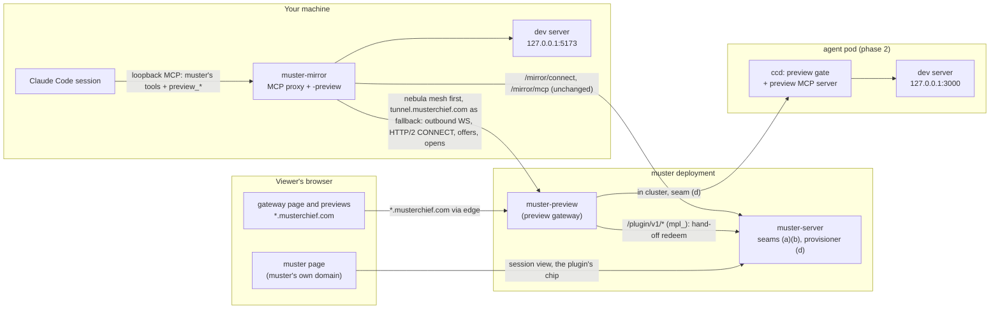

# Design: previews — serving an agent's local web server to its owner

**Status: proposed; the operator's decisions are made** (see
[decisions](#decisions)). **Nothing here is implemented.** Every other section
is the recommended design, and its [open questions](#open-questions) are for
the operator.

This page proposes letting work running under muster — a Claude Code session
**mirrored from a bare host**, and later a dispatched agent in a **pod** —
start a server or web app on its own localhost (a Vite or Next dev server, a
docs site, a Storybook) and have it served to the owner, in a view inside
muster, through a tunnel. Each such exposure is a **preview**.

**Previews are a plugin, plus code on the machines.** A separate process, the
**preview gateway** (`muster-preview`), owns the preview domain and every
preview byte; muster-server proxies none of it, and gains three small,
**reusable plugin seams**, with previews as their first consumer
([the seams](#the-plugin-seams)). The parts that must run **on the machine
being previewed** — the allowlist, the loopback dial, the listener reports and
the agent's tools — live in muster's own host and pod binaries
([what lands in muster's binaries](#what-lands-in-musters-own-binaries)).

Where this page says how muster works today, it cites `file:line` at commit
`0df73e27`, and the code is the authority ([decisions.md](../decisions.md)).
A claim that nothing in the code confirmed is marked **UNVERIFIED**.

## Summary

- **Shape: gateway, narrow seams, machine-side code.** `muster-preview` is a
  plugin in the sense of [plugins.md](../plugins.md): its own process and
  deployment, holding an `mpl_` plugin token. It serves the preview domain,
  holds the host tunnels, proxies to pods, sets the preview cookie and issues
  share links. muster-server gains only the seams and the provisioner
  configuration; `muster-mirror` (phase 1) and `ccd` (phase 2) gain the
  machine side.
- **The seams**, each designed for any plugin:
  - **(a) viewer hand-off:** muster mints a one-time code for a signed-in
    owner; the plugin redeems it by **calling muster**. There is no liveness
    check: the preview cookie's 8-hour TTL bounds a revoked session instead;
  - **(b) one chip per plugin on every session view,** linking to the plugin's
    page for that session (for previews: that window's offers and open
    previews);
  - **(d) a provisioner ingress seam:** muster's agent NetworkPolicy and
    Service gain a configured ingress peer and port, for the pod path
    (phase 2).
  (The previous revision's seam (c), plugin-contributed MCP tools relayed
  through muster, is **dropped**; the letters are kept so references stay
  stable.)
- **The agent's tools are served on the machine:** on a host,
  `muster-mirror`'s loopback MCP listener serves `preview_open`,
  `preview_list` and `preview_close` as a **second MCP server** on its own
  path, answered by `muster-mirror` itself; in a pod, `ccd` registers a
  **stdio** MCP server. Neither goes through muster, and both appear to the
  agent as `mcp__preview__preview_*`.
- **No seam makes muster call out.** Every request between muster and the
  plugin is the plugin's ([reconciliation](#plugins-pull-muster-never-calls-out-reconciled)).
- **Preview zone:** `musterchief.com`, a separate registrable domain from
  muster's. Previews are `p-<id>.musterchief.com`, one label under the zone,
  so a single-level wildcard certificate covers them.
- **Hosts first.** `muster-mirror -preview` opens a **second outbound
  WebSocket, to the gateway** (never to muster), carrying HTTP/2 `CONNECT`
  streams, one per upstream TCP connection. It reports new loopback listeners
  on allowlisted ports so the gateway's page can **offer** one; nothing is
  exposed until the owner clicks it. The host dials loopback only and enforces
  its own allowlist.
- **Openers:** the agent's `preview_open` tool, and the owner's click on an
  offered listener. There is no UI for typing a port.
- **Pods second:** a loopback gate in `ccd` on one new declared port, reached
  by the gateway in-cluster through seam (d).
- **Share links third:** owner-minted behind step-up, expiring, revocable,
  audited; **full access** (any method, WebSockets).
- **Phase 1 starts with a spike** with a written go/no-go: HTTP/2 `CONNECT`
  over a WebSocket through the real edge path, with yamux as the fallback
  ([phased plan](#phased-plan)).

## Goals

- An agent that has started a server can show it to its owner with one tool
  call; a server a session starts is offered to the owner without one.
  Either way the owner reaches it from that session's view in muster, through
  the plugin's chip, on a phone or at a desk.
- The same tools, arguments and errors for a mirrored session and (phase 2) a
  dispatched `claude-code` agent.
- **Dev servers work as on localhost:** WebSockets (Vite and Next hot module
  reload), server-sent events, streaming, long-lived connections, uploads of a
  reasonable size.
- Preview content cannot reach muster's session, muster's routes, the
  gateway's credentials, or another preview's cookies.
- The machine bounds what is exposed. A compromised gateway, a compromised
  muster, or a stolen session reaches only loopback ports the host's own file
  (or the pod's gate) allows. Nothing becomes a proxy into a host's LAN or the
  cluster.
- **muster-server carries no preview traffic.** Its own changes are the seams
  and the provisioner configuration; the preview code it ships is confined to
  the host and pod binaries, which must run on the machine anyway.
- The owner can show a preview to someone without a muster account, briefly
  and revocably (phase 3).

## Non-goals

- **A general port-forwarder or VPN.** HTTP(S) servers on loopback, on
  allowlisted ports, only.
- **Production hosting.** Previews close when their session goes away, and are
  capped.
- **An owner-typed port.** Openers are the agent's tool and the host's offer
  ([decision 9](#decisions)).
- **Gateway-kind agents, the compose driver, opencode sessions** as agent
  openers: no in-pod gate for the first two, and opencode has no muster tools
  ([mirroring.md](../mirroring.md)). An opencode window's listeners are still
  **offered** (decision 9 needs no tool).
- **Making preview content safe.** It is untrusted, and is kept away.
- **TLS to the upstream.** Plain HTTP on loopback; TLS ends at the edge.

## What exists today

### The host's one tunnel to muster

- `muster-mirror` holds **one** outbound WebSocket to `/mirror/connect`
  (`internal/mirror/wire.go:73`), authenticated by the host's `mmt_` token
  (`internal/mirror/wire.go:78`); the hub refuses a hello naming another host
  (`internal/mirror/hub.go:720-730`). muster never dials a host
  ([decisions.md](../decisions.md#mirroring-outbound-only-and-never-move-the-operators-window)).
- Protocol v2; v1 hosts accepted (`internal/mirror/wire.go:43-65`). New
  capabilities are hello fields, no version bump
  ([mirroring.md](../mirroring.md#rolling-upgrades); latest:
  `internal/mirror/wire.go:391,395`, read at `internal/mirror/hub.go:760-764`).
- **No per-stream flow control.** The host read loop hands each binary frame to
  `hostConn.deliver` (`internal/mirror/hub.go:914-918`), which queues it on a
  stream channel of `streamBuffer` = 256 frames and **ends the stream with
  `ErrOverrun`** when it is full (`internal/mirror/hub.go:57-60`,
  `:1192-1203`), because that one loop serves every stream on the host.
  Frames are at most `MaxFrame` = 1 MiB (`internal/mirror/wire.go:84`); at most
  8 terminals per host (`internal/mirror/wire.go:121-122`, `hub.go:1364`).
- A live connection's token is re-read every 30 s (`internal/mirror/service.go:22-29`).
- The host refreshes its window listing every 5 s by default
  (`internal/mirrorhost/client.go:245`).

That overrun rule is right for a terminal and wrong for HTTP: a 4 MB bundle to
a slow phone would be **cut off mid-response**, and a gentler rule would block
the loop that serves every terminal on the host. So preview bytes do not ride
this tunnel, and under the plugin shape they do not go to muster at all.

### The plugin contract

- Plugins are off unless `MUSTER_PLUGINS=1` ([configuration.md](../configuration.md#muster-server-optional-features)).
  An owner mints an `mpl_` token on `/plugins`, from a signed-in session
  (`internal/api/plugins.go:54-56`); only its sha256 is stored.
- **An `mpl_` token opens `/plugin/v1/*` and nothing else**, acting as its
  owner through `authz.ViaPlugin`, so row-level security confines it
  (`internal/api/plugins.go:115-140`, `PluginTokenElsewhere` at `:51`). Every
  other credential is refused on those routes ([plugins.md](../plugins.md#two-ways-in)).
- **A token has no scopes today.** The record is `{id, owner, name, label,
  data scope, …}` (`internal/plugins/plugins.go:106-117`), and the data scope is
  an advisory sentence for the chief ([plugins.md](../plugins.md#when-a-message-asks-for-work)),
  not an access control.
- **Work flows to a plugin through claim queues it long-polls**:
  `POST /plugin/v1/drafts/claim` and `POST /plugin/v1/task-writes/claim`, each
  a lease of 2 minutes and a result route
  ([plugins.md](../plugins.md#post-pluginv1draftsclaim-collect-an-approved-reply),
  [task writes](../plugins.md#post-pluginv1task-writesclaim)). Revision 2's seam
  (c) copied them; it is dropped.
- **"Plugins pull; muster never calls out"**
  ([decisions.md](../decisions.md#plugins-pull-muster-never-calls-out)):
  muster holds no address or credential for anything outside it.
- In-repo precedent for a plugin binary: `cmd/muster-clankmail`
  ([configuration.md](../configuration.md#muster-clankmail-the-clankmail-plugin)).

### The MCP doors

- **Mirrored sessions** reach muster's tools through the host's loopback MCP
  proxy (`-mcp-listen`, loopback-only, `internal/mirrorhost/mcpproxy.go:443-452`),
  which requires a per-host secret and refuses any request carrying an
  `Origin` (`mcpproxy.go:336-350`), and forwards to `POST /mirror/mcp`
  (`internal/api/mirror_mcp.go:92`).
- **The proxy already resolves the caller itself.** A session names itself by
  the caller-supplied `X-Muster-Pane` and `X-Muster-Tmux` headers
  (`mcpproxy.go:47-58`), and the proxy maps that pane, on a fresh window
  listing, to the Claude session running in it (`session`, `mcpproxy.go:132-160`).
  Only a `tools/call` is bound to a session; `initialize` and `tools/list` are
  forwarded unbound (`mcpproxy.go:369-394`). The proxy also answers a caller
  from another tmux server **itself**, with an empty tool list
  (`answerOutsider`, `mcpproxy.go:225-286`), so it already speaks enough MCP to
  serve tools of its own. muster then re-checks the session against the host's
  listing (`internal/api/mirror_mcp.go:71-78`, `mirrorSessionOf` at `:172`).
  The `X-Muster-Tmux` header is routing, not enforcement: anything running as
  this user can name any pane (`mcpproxy.go:240-242`).
- **Agents** reach muster at `POST /mcp` (`internal/api/connectors.go:60,89`).
  A pod can also run a local MCP server of its own: `ccd seed` registers the
  stdio server `hq mcp` for the chief when `CCD_HQ_MCP=1`
  (`internal/podagent/hqmcp.go:8-45`, `cmd/ccd/hqmcp.go`). That is the
  precedent for the pod's preview tools.
- **Claude Code reads a tools list once, at connect**
  (`internal/api/mirror_mcp.go:213-217`; [attention.md](../attention.md#stale-tool-definitions)).

### The pod's network

- **The claude-code NetworkPolicy restricts ingress by port.** It admits
  muster's pods (one namespace-AND-pod-label peer) on **the spec's declared
  ports only** (`internal/provision/k8s/network.go:194-224`), and a claude-code
  spec declares one, the gateway port 18789 (`internal/agentspec/claudecode.go:548`,
  `internal/agentspec/agentspec.go:149`). A rule with an empty port list would
  admit every port, which the builder avoids (`network.go:211-213`). The
  Service exposes the declared ports only (`internal/provision/k8s/render.go:533-562`).
  So **nothing, muster included, can reach another port of the pod today**,
  and no peer but muster's pods is admitted at all. Seam (d) changes that.
- Egress is DNS plus public TCP 443 (`internal/agentspec/claudecode.go:102-104,261`);
  an egress-locked officer has neither (`:126-139`). A `gateway`-kind agent
  has no NetworkPolicy; the compose container is not confined
  ([limits.md](../limits.md#agents)).
- `ccd` accepts a per-agent bearer for its chat gateway, `MUSTER_GATEWAY_BEARER`
  ([configuration.md](../configuration.md#ccd-inside-the-claude-code-agent-image)).

### Cookies, origins and framing

- muster's cookies (`muster_session`, `internal/api/auth.go:20`;
  `muster_at`/`muster_rt`, `internal/api/accounts.go:63-64`) are `HttpOnly`,
  `SameSite=Lax`, host-only (no `Domain`) (`internal/api/login.go:196-213`,
  `internal/api/accounts.go:879,889`).
- muster records that SameSite=Lax is no CSRF defence against a **sibling
  subdomain** (`internal/api/auth.go:313-331`). `musterchief.com` is another
  site, so this does not arise.
- 🔴 **`wsAllowedOrigins` trusts `r.Host`** as one of muster's own origins
  (`internal/api/agents.go:2026-2045`). A request reaching muster's mux with
  `Host` and `Origin` both a preview host would pass the same-origin check. The
  edge must never route the preview zone to muster, and seam (b)'s
  configuration lets muster refuse such hosts itself ([below](#configuration)).
- Every response carries `frame-ancestors 'none'`, `X-Frame-Options: DENY`,
  and a CSP with `default-src 'self'` and no `frame-src`, except the
  Rendered/Terminal swap pages, which allow `'self'` as an ancestor
  (`internal/api/middleware.go:105-143`, used at `internal/api/agents.go:1403`).
  **muster's pages cannot frame another origin today.**
- In password mode the session cookie's key is derived from
  `MUSTER_UI_PASSWORD`, so rotating the password revokes every session
  (`internal/api/auth.go:206-221`).

## Topology



Arrows point from the side that opens the connection. muster opens none to
the gateway, the host or the viewer's preview origin, and no preview tool call
passes through muster.

### What lands in muster's own binaries

The previous revision said muster's code changes were only the seams. That was
not true, and is corrected here. Previews ship code in four places:

| binary | what it gains | phase |
|---|---|---|
| `muster-server` | seams (a) and (b), the plugin capability and origin columns, `MUSTER_PLUGIN_ORIGINS` and its 421 refusal; seam (d)'s provisioner configuration (`MUSTER_AGENT_PLUGIN_INGRESS`, `MUSTER_AGENT_PREVIEW_PORTS`) and the `agent_targets` read | 1; (d) in 2 |
| `muster-mirror` | `-preview`: `previews.json`, the tunnel to the gateway, the loopback dial and its checks, listener reports, and the three `preview_*` tools answered in its MCP proxy | 1 |
| `ccd` (agent image) | the preview gate on its own declared port, and a stdio preview MCP server registered by `ccd seed` | 2 |
| `muster-preview` | the gateway itself, a new binary in this module, as `muster-clankmail` is | 1 |

**Why that is acceptable.** Decision 2 puts the bound on the machine: only the
side that owns the machine can dial its loopback, check who owns a listening
socket, and refuse a port whatever a compromised muster or gateway asks. Those
checks must therefore run in a process already on the host and in the pod, and
`muster-mirror` and `ccd` are those processes; the code is behind an opt-in
flag and empty-by-default allowlists. muster-server itself still proxies no
preview byte and stores no preview, offer or process name.

**The alternative** is a separate host binary (`muster-preview host`) and a
sidecar container in the agent pod. It keeps every preview line out of
muster's own binaries, at the cost of a second install and unit per host,
duplicating `muster-mirror`'s tmux and `/proc` walks and its MCP proxy, and a
second container in every agent pod (which still needs seam (d)). **The
operator rejected it** ([decision 18](#decisions)): the preview code lives
inside `muster-mirror` and `ccd`, for the reasons above.

## The plugin seams

Each is generic: it names a plugin, not previews. A plugin uses a seam only
with the **capability** its owner granted it. (Revision 2's seam (c),
plugin-contributed MCP tools relayed through a claim queue, is **dropped**:
the tools are served on the machine instead, [below](#the-mcp-tools).)

### Capabilities on a plugin token

A new column on the plugin record, `capabilities`, a set:

| capability | opens | granted by |
|---|---|---|
| `messages` (legacy) | every route a plugin token opens today | **every existing token, by migration**; the default on the create form |
| `viewer` | seams (a) and (b): the plugin's chip on session views, and redeeming hand-off codes | the owner, at mint, on `/plugins` |

`handoff` and `embeds` were one capability in all but name: neither is usable
without the other, and both need the same origin. `agent_targets` (seam d) is
added with the pod path, in [phase 2](#d-provisioner-ingress-seam-phase-2).

- **Backward compatible:** existing tokens get `messages`, so every route they
  open today still opens; a route checks its capability in
  `requirePluginToken`'s admitted context. The preview gateway's token has
  `viewer` (and `agent_targets` from phase 2) and **not** `messages`, so it
  cannot post to the chief.
- **Granting:** checkboxes on the create form; widening an existing token's set
  needs a fresh sign-in (step-up), narrowing does not.
- **Origin and entry URL:** a `viewer` token also carries **one origin
  pattern** (e.g. `https://*.musterchief.com`), chosen by the owner from the
  deployment's allowlist `MUSTER_PLUGIN_ORIGINS`, and **one entry URL** under
  it (e.g. `https://w.musterchief.com/__muster/enter`). The allowlist is the
  admin's because it widens the CSP of muster's pages for everyone.

### (a) Viewer hand-off

How a plugin learns, without its own sign-in, that a browser belongs to a
signed-in owner, and which session view they came from.

1. The owner clicks the plugin's chip (seam b). muster's page `POST`s
   `/plugin-handoffs` on muster's own origin (signed-in, same-origin) with the
   plugin id. muster mints a **code**: 32 random bytes, stored hashed, bound to
   the owner, the plugin, the **target** (the session view it was clicked on,
   as muster knows it: `{"mirror": {host, window}}` or `{"agent": {id}}`),
   whether the browser session's **step-up** was fresh at that moment, and a
   purpose (`view`); valid 60 s, single use.
2. muster answers with the token's entry URL plus
   `?muster_code=<code>&muster_plugin=<plugin id>`. The page navigates the
   frame or a new tab there. `muster_plugin` lets a plugin that holds several
   owners' tokens pick the one to redeem with; it is not a credential (a code
   redeemed with another plugin's token is refused).
3. The plugin's entry route **calls muster**:
   `POST /plugin/v1/handoffs/redeem {code}` → `200 {owner, target, purpose,
   stepped_up, minted_at}`. A code minted for another plugin, used, expired or
   unknown is one `404`. The plugin removes the code from the address bar
   at once: a plugin that sets a cookie redirects; a plugin that holds no
   cookie (the preview gateway's session page) renders the page directly from
   the entry route and strips the code with `history.replaceState`. Either way
   the response carries `Referrer-Policy: no-referrer`.

**No liveness check** (revision 2's `POST /plugin/v1/handoffs/check` is
dropped). A plugin bounds what a code buys with its own expiring cookie,
renewed only by a fresh hand-off. **The cost:** signing out of muster, Sign out
everywhere, a disabled account or a password rotation reach an already-open
preview only when its cookie expires, not within 30 s. For previews that TTL is
**8 hours** ([auth](#auth-on-preview-origins)).

**The stepped-up hand-off** (for actions a plugin wants behind a fresh
sign-in, such as minting a share link in phase 3). The plugin sends the owner,
top-level, to `GET /plugin-handoffs/confirm?plugin=<id>&target=<…>&purpose=<word>`
on muster. muster shows a page naming the plugin and the purpose; if the
session's step-up is stale it runs muster's own step-up dialog there
([sending-and-step-up.md](../sending-and-step-up.md#step-up-confirm-its-you)).
Its **Continue** button is a same-origin `POST` that mints a code with
`stepped_up: true` and that purpose, and answers `303` to the entry URL with
the code. The `GET` changes nothing, so a third-party page that navigates the
owner there gains nothing without the owner's click. `purpose` is a word
(`^[a-z_]{1,32}$`) muster shows and returns but does not interpret; the target
must be one of the owner's own hosts' windows or agents.

### (b) One chip per plugin on every session view

How a plugin gets a way in from a session's view.

- For each of the owner's `viewer` plugins, the session view pages
  (`/mirror/view`, `/agents/{name}`) draw **one static chip**: the plugin's
  label, with **Open** (new tab) and **Show here** (frame). Both mint a
  hand-off (seam a) at click time, targeted at the session being viewed.
  **Open** is a `target="_blank"` link with `rel="noopener noreferrer"`, so the
  plugin's page gets no `window.opener` handle on muster's tab. The
  chip is the same on every session; the plugin's page decides what to show
  for the target.
- **No per-session rows, no states, nothing the plugin writes:** muster draws
  the chip from the token row alone. A revoked token's chip disappears.
- **The frame:** `sandbox="allow-scripts allow-same-origin allow-forms
  allow-popups allow-downloads allow-modals"` with **no**
  `allow-top-navigation` (so plugin content cannot navigate muster's tab),
  `allow=""` (no camera, microphone, location), `referrerpolicy="no-referrer"`.
  `allow-same-origin` is safe because the frame's origin is not muster's.
- **CSP:** the session view pages add `frame-src` with the origins in
  `MUSTER_PLUGIN_ORIGINS`; every other page is unchanged
  (`internal/api/middleware.go:119-131`).
- **The chip's placement is fixed**, so it does not shift the page's layout
  when it appears (the `cls.spec.ts` gate,
  [testing.md](../testing.md#the-browser-suite-e2e)).

**The cost:** muster renders **no per-preview chip**. An open preview or a new
offer is not visible in muster's own view until the owner opens the plugin's
chip, and muster raises no notice when one appears. In exchange muster stores
nothing about previews, offers or the processes behind them.

For previews, the chip opens the gateway's **session page** at
`w.musterchief.com`, which lists that window's offers and open previews
([the gateway's session page](#the-gateways-session-page)).

### (d) Provisioner ingress seam (phase 2)

What the pod path needs from muster, which owns the agent's policy. It is
configuration, not plugin code.

- `MUSTER_AGENT_PLUGIN_INGRESS`: one peer `{namespace, podLabels, port}`. With
  it set, each new `claude-code` spec gets:
  - a declared port named `plugin` (so the Service gains it,
    `internal/provision/k8s/render.go:533-562`). It stays a **separate** port
    from the chat gateway's 18789 ([decision 15](#decisions)), so the
    gateway's peer is admitted to the preview gate and not to the chat
    gateway;
  - a **second ingress rule** admitting that peer (namespace AND labels, as
    the controller peer is written) on that port only. **The builder must
    change for this:** today the muster-pod rule is built from **every**
    declared port (`network.go:194-224`), so a plain extra declared port would
    also open the gate to muster's pods. The `plugin` port is marked as such
    in the spec and left out of the muster-pod rule;
  - `CCD_PREVIEW_LISTEN`, `CCD_PREVIEW_PORTS` (from `MUSTER_AGENT_PREVIEW_PORTS`)
    and `CCD_PREVIEW_BEARER`, a random per-agent secret distinct from the chat
    gateway's bearer.
- **The `agent_targets` capability** (added in phase 2):
  `GET /plugin/v1/agents/{id}/target` answers `{host, port, bearer}` for one
  of the owner's agents provisioned with the gate, and
  `GET /plugin/v1/agents?gate=true` lists them, so the gateway knows which
  pods to connect to. Another owner's agent, or one without the gate, is
  `404`.
- `provision.Network` gains a generic `ExtraIngress` list for this. A peer
  with no port is refused at spec validation, so an empty port list can never
  render (the rule `network.go:211-213` already states).
- **UNVERIFIED:** whether adding a port to the spec rolls existing agents'
  pods at the next reconcile (the pod template carries a spec fingerprint,
  `internal/provision/k8s/render.go:57-66`). Phase 2 measures it.

### Plugins pull; muster never calls out, reconciled

| interaction | who opens the connection |
|---|---|
| hand-off redeem | the plugin → muster |
| agent list and target read (phase 2) | the plugin → muster |
| the browser opening the plugin's origin, and the stepped-up confirm page | the **browser**, on the owner's click, to an origin the admin allowed and the owner chose |
| the agent's preview tools | the session → its own machine (`muster-mirror`'s proxy, or `ccd`); never muster |
| the host tunnel, offers and opens | the host → the gateway |
| the pod gate, offers and opens | the gateway → the pod |

**No seam needs an exception.** muster holds no plugin address it connects
to: the origin and entry URL it stores are used only to build a link and a
CSP entry, so the decision's worry ("a URL an owner can set is a way to make
muster send requests wherever that owner chooses") does not arise, because
muster sends none. A code that a stranger's origin received is useless
without that plugin's token.

## The preview gateway

### Zone and deployment

The preview zone is **`musterchief.com`** ([decision 7](#decisions)), a
different registrable domain from muster's, so previews are cross-site to
muster: a preview cannot set a cookie muster receives, cannot ride muster's
`SameSite=Lax` cookies, and receives no cookie an SSO proxy sets on muster's
parent domain.

| name | serves |
|---|---|
| `p-<id>.musterchief.com` | one preview each; `<id>` is 26 lowercase base32 characters (128 random bits) |
| `w.musterchief.com` | the gateway's [session page](#the-gateways-session-page), the target of muster's chip |
| `tunnel.musterchief.com` | the **public fallback** for hosts' outbound tunnel connections ([the mesh path](#host-dial-order-mesh-first-then-public)), nothing else |
| any other label | 404 |

Every name is **one label** under the zone, because the zone's edge
certificate covers the apex and one level only (below). The gateway sets **no
cookie outside the preview hosts**: its session page keeps its credential in
page memory, and host tokens are minted on its CLI, like mirror tokens
([below](#host-tokens)), so no gateway session cookie sits same-site to
preview content.

**What the operator must provide:**

- **The domain is in place.** `musterchief.com` is an active Cloudflare zone
  on the **Free plan** (read from the Cloudflare API by the operator's agent,
  2026-11-09). It may sit in a different Cloudflare account from muster's own
  domain, so nothing here assumes shared zone settings, rules or origin
  certificates between the two.
- **What the Free plan fixes:**
  - **Universal SSL covers `musterchief.com` and `*.musterchief.com` only.**
    There is no Advanced Certificate Manager, so a deeper name
    (`<id>.p.musterchief.com`) would get no edge certificate. Every name here
    is one label: `p-<id>`, `tunnel`.
  - **Proxied WebSockets work, and Cloudflare cuts an idle one at about
    125 s** (measured on the real edge, [PR #548](https://github.com/ZacxDev/muster/pull/548); WebSocket ping frames count
    as activity, and the same idle WebSocket sent straight to the origin was
    still open at 300 s). So every
    long-lived connection the gateway serves is kept from going quiet for that
    long:
    - the host tunnel pings every 30 s (both ends);
    - a preview WebSocket is relayed **message by message** (the gateway
      terminates the browser leg and the upstream leg, with coder/websocket
      on both) rather than as raw bytes after the `101`, so the gateway can
      ping the browser leg every 30 s without corrupting the app's framing.
      The cost is per-message copying and the app's ping frames being
      answered by the gateway on each leg;
    - a `text/event-stream` response that has been quiet for 30 s gets an SSE
      comment line (`:\n\n`) injected **only at an event boundary** (after a
      blank line), which every conforming client ignores. Any other quiet
      streaming response is the app's to keep alive.
- **DNS records, none of which exist yet** (to be created by the operator, not
  by this work):

  | name | type | target | proxied |
  |---|---|---|---|
  | `*.musterchief.com` | `CNAME` (or `A`/`AAAA`) | the deployment's public ingress for the gateway | yes |
  | `tunnel.musterchief.com`, `w.musterchief.com` | covered by the wildcard; an explicit record only if one must differ | — | yes |
  | `musterchief.com` (apex) | optional; the gateway answers 404 there | — | yes |

  A proxied wildcard record is available on the Free plan (per Cloudflare's
  documentation; **UNVERIFIED** in this zone until created).
- **Between Cloudflare and the gateway**, the deployment's own path, like its
  other public services (for example the edge, then the deployment's relay
  into the cluster). It must pass `Host` through, pass WebSocket upgrades, not
  buffer streaming responses, and set `CF-Connecting-IP` or `X-Forwarded-For`.
  Its TLS (an origin certificate, or the relay's own) is the deployment's
  choice, and is separate from the edge certificate.
- **No single sign-on proxy** in front of the zone: the gateway does its own
  authentication, and a share-link viewer has no account.
- **In cluster** (for phase 2): the gateway's pods carry the labels named in
  `MUSTER_AGENT_PLUGIN_INGRESS`, and can reach muster's main listener.
- **On muster:** `MUSTER_PLUGINS=1`, `MUSTER_PLUGIN_ORIGINS=https://*.musterchief.com`,
  and an `mpl_` token with the gateway's capabilities.

### Owners and tokens

An `mpl_` token is one owner's. The gateway reads a file of them
(`PLUGIN_TOKENS_FILE`, one per line) and serves those owners; it learns each
token's plugin id and owner at start from a new route, `GET /plugin/v1/self`
(no plugin route answers that today, `internal/api/plugins.go:54-91`). A hand-off names its plugin in `muster_plugin`, so the gateway knows
which token redeems it. On a single-operator deployment that is one token. A
deployment-wide plugin credential for many owners is
[open question 1](#open-questions).

### Host tokens

`muster-preview host-token create <owner> <host>` prints an `mpt_` token
once; the gateway stores its sha256; `ls` and `revoke` as for mirror tokens
([mirroring.md](../mirroring.md#how-it-connects)). A token registers only its
own host name, and the gateway re-checks it every 30 s on a live tunnel. The
host name must equal the one the host's mirror token is minted for, because a
hand-off's target names the host as muster knows it, and the gateway matches
that to the tunnel by `(owner, host)`. **The owner is the admin's assertion:**
`<owner>` is typed on the gateway's CLI, and nothing proves the host belongs to
that owner. On a single-owner deployment that is the operator asserting their
own host, as with mirror tokens on the server's CLI; with several owners, a
mistyped owner would route one owner's host into another's previews. Proving
it is [open question 9](#open-questions).

### The host tunnel

| option | flow control | effect on terminals | new code | verdict |
|---|---|---|---|---|
| **A WebSocket to the gateway, carrying HTTP/2** | per stream (`WINDOW_UPDATE`) and per connection | none: a different connection, to a different process | `x/net/http2` (already in `go.mod`), `websocket.NetConn` (coder/websocket v1.8.14) | **chosen** (the spike's recommendation) |
| The same, carrying yamux | per stream | none | `hashicorp/yamux` (new, MPL-2.0) | passed the spike too, but adds a dependency and measured no better |
| One dial-back WebSocket per upstream connection | kernel TCP | none | small | second fallback; one TLS and WebSocket handshake per connection |
| Preview frames on the existing mirror tunnel | none today | the `ErrOverrun` rule truncates; bulk delays keystrokes | — | ✗ and, as a plugin, ruled out: muster carries no preview bytes |

1. With `-preview` and a valid `previews.json`, the host dials its
   [endpoints in order](#host-dial-order-mesh-first-then-public) (mesh, then
   `wss://tunnel.musterchief.com/v1/host`) with `Authorization: Bearer mpt_…`,
   its host name and `X-Muster-Preview-Version: 1`. A version the gateway does
   not speak is refused with the range it does; the host logs it and retries
   with backoff, never touching the mirror tunnel.
2. Both ends wrap the WebSocket as a `net.Conn`
   (`websocket.NetConn(ctx, c, websocket.MessageBinary)`). **Roles reverse:**
   the host runs `http2.Server.ServeConn`, the gateway holds an
   `http2.ClientConn`. The host opens no listener.
3. **Control:** the gateway's first stream is `GET /v1/offer`, a long-lived
   response on which the host writes newline-delimited JSON: its allowlist and
   caps, its **window listing** (the tmux window ids it currently mirrors, sent
   on change from its 5 s refresh, so the gateway can tell a closed window from
   a window with no listener), [listener reports](#listener-reports), and the agent tools'
   `open`/`close` requests, each with a request id
   ([the MCP tools](#the-mcp-tools)). The gateway answers a request with
   `POST /v1/opened` or `POST /v1/closed` on the same connection (it is the
   HTTP/2 client), within 5 s.
4. **Data:** each upstream TCP connection is one `CONNECT` stream (RFC 9113
   §8.5) with `:authority` `127.0.0.1:<port>`. The host takes **only the
   port**, applies [its checks](#what-the-host-checks-before-it-dials), dials,
   answers `200` and copies bytes; or `403` (`port_not_allowed`,
   `foreign_listener`), `502` (`refused`), `429` (`max_conns`).
   `MaxConcurrentStreams` is the host's `maxConns`.

Both connections share the host's uplink, so a large download still competes
with terminal bytes for bandwidth, though not for a TCP stream or a read loop.

**The transport is HTTP/2 `CONNECT`**, on the phase-0 spike's recommendation
([`docs/design/previews-spike.md`](https://github.com/ZacxDev/muster/blob/spike/preview-tunnel/docs/design/previews-spike.md), [PR #548](https://github.com/ZacxDev/muster/pull/548), at `3ab86932`): it met criteria (1)–(3) on
loopback with no new dependency. yamux also passed them, but adds a dependency
and measured no better.

🔴 **Pinned invariant: connection window > `maxConns` × stream window.** The
spike found that `x/net/http2`'s client returns **connection-level** flow
credit only when a stream's body is read, so a paused reader keeps its whole
stream window out of the connection window until it resumes. Once paused
streams × stream window ≥ connection window, **every other stream on the
tunnel stalls**: with an 8 MiB connection window and a 4 MiB stream window,
1 paused reader left 62/62 assets and the echo working, and 3 paused readers
left **0/62** assets complete and the echo WebSocket unable to open. That is
the head-of-line failure the design rejected `ErrOverrun` for, returning by
configuration. So the gateway's `http2.Transport` sets
`MaxReceiveBufferPerConnection` above `maxConns × MaxReceiveBufferPerStream`.
With the stream window at 4 MiB and this page's host caps:

| `maxConns` | connection window must exceed | gateway memory held by paused streams, worst case per host |
|---|---|---|
| 64 (default) | 256 MiB | 256 MiB |
| 256 (the cap) | 1 GiB, so `x/net`'s 1 GiB default is **not** enough | 1 GiB |

The gateway creates the client connection before the host announces its own
`maxConns`, so it sizes the window from the cap: (256 + 1) × 4 MiB = 1028 MiB.
The host's `MaxConcurrentStreams` (its `maxConns`) is what keeps the number of
paused streams within that bound. The memory column is a real cost of a large
`maxConns`, paid only while readers are paused.

**Real-edge results** ([PR #548](https://github.com/ZacxDev/muster/pull/548), measured through Cloudflare →
prod relay → nebula → homelab relay → a gateway pod, with the host and the
client on one workstation on the homelab LAN): (4) and (5) **pass**, (1)
**fails on p50 for both transports**. The tunnel itself costs about 0.1 ms;
what fails (1) is the host's tunnel crossing the public path a second time,
about +90–118 ms at p50 on that topology. So hosts reach the gateway over the
mesh ([below](#host-dial-order-mesh-first-then-public)), and only the
browser leg goes through Cloudflare.

### Host dial order: mesh first, then public

Decided by the operator after the real-edge results ([decisions 20 and 21](#decisions)).

- **Two endpoints, one protocol.** The gateway serves the host tunnel on two
  listeners: a **mesh** listener, reached at the gateway's nebula mesh address
  (for this deployment, the homelab relay on the nebula interface, below), and
  the **public** one, `wss://tunnel.musterchief.com/v1/host`. Both take the
  same `mpt_` token, the same host-name binding, the same version header and
  the same 30 s recheck. Nothing about a tunnel differs by path except its
  latency.
- **Dial order.** `-preview-urls` is an ordered list, mesh first:
  `ws://<mesh address>:<port>/v1/host,wss://tunnel.musterchief.com/v1/host`.
  The host tries each in order and takes the first whose TCP connect, WebSocket
  upgrade and the gateway's version answer all complete within **3 s**. A host
  off the mesh fails the first in at most 3 s and falls back to the public
  endpoint. If both fail, it retries the list with backoff, as today.
- **Returning to the mesh.** While on the public path the host re-tries the
  mesh endpoint every 5 minutes. When it connects, the gateway (which keeps
  one tunnel per `(owner, host)`, the newer replacing the older) sends new
  streams over the mesh tunnel and closes the public one when its last stream
  ends, or after 60 s.
- **Which path a host is on** is decided by the **gateway**, from the listener
  the connection arrived on, never from anything the host says. It is shown as
  **"slow path (via Cloudflare)"** beside the host's previews on the gateway's
  session page, and labelled `path="mesh"|"public"` on
  `muster_preview_tunnels` and the `preview.request` span. The host also logs
  which endpoint it took.
- **Criterion (1) applies to the mesh path.** The public path's measured
  +90–118 ms p50 is an **accepted degraded mode** for a host off the mesh: a
  preview works there, HMR included, about 100 ms slower per round trip.
- **Plain `ws://` on the mesh.** Nebula encrypts and authenticates the hop, so
  the mesh endpoint does not repeat TLS. The `mpt_` token therefore crosses the
  homelab relay in the clear inside the mesh, as tokens on the public path
  already do after the edge terminates TLS.

**What the mesh endpoint needs on the deployment** (from the deployment's own
recipe for mesh-facing relay listeners, which lives in the deployment's
repository, not this one):

- A **new port on the homelab relay only**: an nginx block that listens on the
  relay's nebula address (as the deployment's other relayed services do) and proxies to
  the gateway's mesh listener, with the streaming settings the spike used: an
  empty-default `Connection` map, `proxy_buffering off`, `proxy_read_timeout
  3600s`. **No prod relay block, no Traefik route and no Authelia rule**: the
  mesh endpoint is never public, so the prod host firewall's relay port list
  is not involved.
- **Who can reach it:** every nebula mesh member, because the relay listens on
  the mesh interface. Whether the deployment's nebula firewall can narrow that
  port to a group of muster hosts is **UNVERIFIED**; if it can, it should.
  Either way the endpoint is **token-gated**: a mesh member without an `mpt_`
  token gets nothing but a refusal.
- **The gateway's own failed-token throttle** applies on both listeners (for
  example 10 bad tokens a minute per peer, then 429, as muster's mirror
  connect does, [mirroring.md](../mirroring.md#tokens-revocation-rate-limits)),
  because the mesh listener has no edge in front of it.
- The gateway's listeners are also reachable from the LAN wherever its
  Service is exposed as a NodePort (the relay proxies to a LAN address). That
  is token-gated too, and is noted, not designed around.

### What the host checks before it dials

- **The port is allowlisted** in `previews.json`, and is not one it always
  refuses: its own `-mcp-listen` port and the opencode server port(s) it talks
  to (either would hand a viewer muster's tools or an opencode session's
  shell).
- **Loopback only:** `127.0.0.1:<port>`, then `[::1]:<port>` if refused (Node 17
  and later may bind `localhost` to `::1` only; **UNVERIFIED** per dev server).
  Never a name, never the requested address.
- **The listener is this user's (Linux):** the listening socket's uid in
  `/proc/net/tcp` and `/proc/net/tcp6` equals muster-mirror's, else
  `foreign_listener`. On macOS the check is **UNVERIFIED** and off, and the offer
  says so.
- **Its caps:** `maxConns` streams, `maxOpen` previews.

### Listener reports

How the host offers servers to the owner ([decision 9](#decisions)).

- **Poll:** every 5 s (the window refresh's interval), read `/proc/net/tcp` and
  `tcp6` for `LISTEN` sockets bound to loopback or the wildcard address, on an
  allowlisted port, owned by this uid. Only for those, find the owning pid
  (socket inode → `/proc/<pid>/fd`) and walk its parents to a tmux pane, as
  `internal/mirrorhost` already walks a pane's tree to find `claude`.
- **Sent, only on change, on the `/v1/offer` stream:** `{port, process: <comm,
  at most 15 bytes>, window: <tmux window id>, first_seen}`. **Not** the argv,
  working directory, environment, pid, or any listener outside a tmux pane:
  a listener with no pane has no session to show it in, and is not offered.
- **The gateway lists each report as an offer** on that window's
  [session page](#the-gateways-session-page): `<process> · :<port>`, with
  **Open**. A report that disappears removes the offer, unless a preview of
  that port is open.
- **Nothing is exposed until the click.** **Open** on the session page is
  what opens the preview (one `CONNECT` probe); only then does its `p-<id>`
  host serve anything. An offer never accepts traffic.
- **Privacy:** the process name and port reach the gateway and its page, and
  **never muster**: muster stores nothing about offers. `"offer": false` in
  `previews.json` turns reports off; the agent tool still works.
- macOS: **UNVERIFIED** (`lsof` would be the source); reports are off there.

### Host configuration: `previews.json`

Patterned on `-spawn` and `spawn.json`
([host-sessions.md](host-sessions.md#host-configuration-spawnjson)) and the
shipped `-agent-spawn` flags: off by default, an explicit flag, and an
allowlist that is empty, meaning nothing, until written.

| flag | env | default | |
|---|---|---|---|
| `-preview` | `MUSTER_MIRROR_PREVIEW` | off | turn it on |
| `-preview-urls` | `MUSTER_MIRROR_PREVIEW_URLS` | none | the gateway's tunnel endpoints, **in dial order**, comma-separated: the mesh endpoint, then `wss://tunnel.musterchief.com/v1/host` ([dial order](#host-dial-order-mesh-first-then-public)) |
| `-preview-token-file` | `MUSTER_MIRROR_PREVIEW_TOKEN_FILE` | none | the host's `mpt_` token |
| `-preview-file` | `MUSTER_MIRROR_PREVIEW_FILE` | `~/.config/muster-mirror/previews.json` | the allowlist |

```json
{
  "ports": ["3000", "4173", "5173", "6006", "8000-8099"],
  "offer": true,
  "maxOpen": 8,
  "maxConns": 64
}
```

- **`ports`:** single ports or inclusive ranges within 1024–65535. A missing,
  empty or invalid file disables previews, says why on the offer stream and in
  the log, and is never fatal.
- **`offer`:** listener reports on (default) or off.
- **`maxOpen`** (default 8, at most 32) and **`maxConns`** (default 64, at most
  256).
- **Not tied to `-interactive`:** exposing a loopback server is not typing
  into a pane. Re-read on change; previews on a port that left the list close.

### The pod path (phase 2)

The gateway runs in the cluster, so no tunnel. Through seam (d) it lists the
owner's agents that have a gate, reads each one's target, and holds a
long-lived `GET /v1/offer` on each gate, the same stream a host serves:
listener reports and the agent's tool requests, answered by `POST /v1/opened`
and `POST /v1/closed` to the gate. For data it opens a TCP connection to
`<host>:<port>`:

```http
CONNECT 127.0.0.1:5173 HTTP/1.1
Host: 127.0.0.1:5173
Proxy-Authorization: Bearer <CCD_PREVIEW_BEARER>
```

`ccd`'s gate checks the bearer, takes only the port, checks `CCD_PREVIEW_PORTS`,
always refuses its own port and 18789, dials loopback (`127.0.0.1` then
`::1`), and splices.

| option | reaches a loopback-bound server | allowlist on the machine | new RBAC | verdict |
|---|---|---|---|---|
| **ccd gate on one declared port** | ✓ | ✓ | none | **recommended** |
| Dial `podIP:<port>`, open a port range | ✗ only `0.0.0.0`-bound servers | ✗ | none | ✗ the common default fails; a range (`endPort`) is CNI-dependent |
| `pods/portforward` | ✓ | ✗ | the gateway would need it | ✗ preview bandwidth through the API server, and a powerful verb in a plugin's ServiceAccount |

The address is never agent-supplied: it is the provisioner's endpoint for
that agent row, read by the plugin from muster. `MUSTER_DIAL_DENY_PRIVATE`
(the postgres connector's guard, `cmd/muster-server/config.go:355`) is not
involved: muster dials nothing on this path.

Officers run the same image and would work; they are left off
([open question 3](#open-questions)). Gateway-kind agents and the compose
driver get no gate.

### The proxy

The gateway's reverse proxy (`httputil.ReverseProxy`, `FlushInterval = -1`),
with the dialer "a `CONNECT` stream on that host's tunnel" or "the pod's gate":

- **Request:** `Host: localhost:<port>` (dev servers allow `localhost` by
  default); the public host in `X-Forwarded-Host`, `X-Forwarded-Proto: https`.
  Removed: the gateway's cookies, any `muster_*` cookie, `Forwarded`, inbound
  `X-Forwarded-*`, `X-Real-IP`, `CF-*`, `True-Client-IP`, `X-Muster-*`. **The
  viewer's address is not forwarded.** The app's own cookies and
  `Authorization` pass.
- **WebSockets:** upgraded on both legs and relayed message by message, with a
  30 s ping on the browser leg ([why](#zone-and-deployment)); an `Origin` equal
  to the preview origin is rewritten to `http://localhost:<port>` for dev servers that check
  it (Vite's exact rule **UNVERIFIED**).
- **Response:** `Location` at `localhost`/`127.0.0.1`/`[::1]:<port>` rewritten
  to the preview origin; `Set-Cookie` loses `Domain`, and a cookie named like
  the gateway's is dropped; an extra `Content-Security-Policy: frame-ancestors
  <MUSTER_PUBLIC_URL's origin>` (intersected with the app's own);
  `X-Content-Type-Options: nosniff`; `Referrer-Policy: no-referrer`,
  **replacing** the app's own, so a preview's `p-<id>` host never leaves in a
  `Referer`; the app's `Strict-Transport-Security` dropped.
- **Long-lived connections** are re-checked every 30 s (cookie not expired,
  preview open, share link live) and closed on a failure; a WebSocket opened
  under an owner cookie is closed when that cookie expires.
- **HMR** clients connect to `location.host`; an app pinned to an explicit HMR
  host or port bypasses the preview. The tool description says so.

### The gateway's session page

What muster's chip opens: `https://w.musterchief.com/__muster/enter?muster_code=…`.

- The entry route redeems the code (seam a), learns the owner and the
  **target** (the window or agent the chip was clicked on, as muster knows
  it), and renders that target's page: its **offers** (`<process> · :<port>`,
  with **Open**) and its **open previews** (label and port, with **Open**,
  **Close**, and in phase 3 **Share**). An offer or preview of another window
  is not shown.
- **No cookie.** The rendered page carries a page token (random, 15 minutes,
  bound to owner and target) in its own script memory, and sends it as a
  header on the page's polls (every 5 s while visible) and its actions. It is
  never a cookie, so preview content on a sibling `p-` host cannot ride it,
  and a reload or an expired token means clicking muster's chip again.
- **Open** asks the gateway (with the page token) for a one-time preview entry
  code, then navigates the frame or a new tab to that preview's host
  ([auth](#auth-on-preview-origins)). Opening an offer is the moment the
  preview is created.
- The page is served with `frame-ancestors <MUSTER_PUBLIC_URL's origin>`,
  `Referrer-Policy: no-referrer` and the same security headers as muster's own
  pages, and renders every label as text.

### Auth on preview origins

- **Owner:** the owner reaches a preview only from the gateway's session
  page, which was itself entered through a muster hand-off (seam a). **Open**
  there sends the browser (frame or tab) to
  `p-<id>.musterchief.com/__muster/enter?g=<code>`, where `<code>` is a
  **gateway-minted** one-time code (60 s, single use, bound to that preview and
  owner). The entry route sets `__Host-mp`: `Secure`, `HttpOnly`, `Path=/`,
  host-only, HMAC-signed `{preview id, owner, expires}` with the gateway's
  key, and with a `SameSite` chosen by how the preview is being opened
  ([below](#previews-are-same-site-with-each-other)). It then redirects to
  `/__muster/check`, which goes on to the preview if the cookie arrived, and
  otherwise says "This browser blocks embedded previews. Open it in a new
  tab."
- **The cookie is bound to its preview:** another preview's cookie is refused
  even if a browser sent it.
- **TTL: 8 hours, never renewed by itself** ([decision 19](#decisions)). With
  no liveness check ([seam a](#a-viewer-hand-off)), the TTL is the only bound
  on how long a signed-out or disabled owner, or a stolen cookie, keeps
  reaching an open preview, so **a sign-out, a disabled account or a stolen
  cookie reach an open preview for up to 8 hours**. In exchange an owner is
  sent back through muster's chip about once a working day rather than every
  hour. Because of that reach, closing a preview (which ends its cookies at the
  next request, [lifecycle](#lifecycle)) is the way to cut a preview off at
  once. On expiry the next
  request (and any open WebSocket, at its next 30 s check) gets the gateway's
  "session expired: open the preview again from muster" page, and a fresh chip
  click renews it.
- In a frame the cookie is third-party (`SameSite=None; Partitioned`); partitioned cookies work in Chromium,
  and Firefox partitions by default. **Safari and the Android app's WebView are
  UNVERIFIED** (the WebView refuses third-party cookies unless the app enables
  them, [open question 4](#open-questions)). **Open** in a new tab always
  works.
- No step-up for the owner: viewing reaches a dev server, not a shell.

### Previews are same-site with each other

Every `p-<id>` host is under one registrable domain, so until the zone is a
public suffix, **any two previews are same-site**. Script in preview A can
then send requests that carry preview B's cookie (a form `POST`, a
WebSocket), and can set `Domain=musterchief.com` cookies that every preview
and `w.` receive. Share links (phase 3) make A something a stranger can be
handed. The gateway's answer has five parts, because the first is slow and
the others must hold without it:

1. **Public Suffix List.** Submit `musterchief.com` to the PSL's private
   section, so each `p-<id>.musterchief.com` becomes its own site. Inclusion is
   a reviewed pull request upstream, then a browser release that ships the
   list, so it takes weeks to months, and older browsers never get it. Nothing
   below depends on it.
2. **The owner cookie's `SameSite` follows how the preview was opened.** The
   entry route reads `Sec-Fetch-Dest`:
   - `document` (a new tab): `SameSite=Strict`, not partitioned. A top-level
     preview is then sent its cookie only by its own pages (and same-site
     ones; part 3 covers those);
   - `iframe` (**Show here**, inside muster): `SameSite=None; Partitioned`.
     This cannot be `Lax` or `Strict`: the frame's ancestor is muster, another
     site, so the browser treats every request from the frame as cross-site
     and withholds a `Lax` cookie. Partitioning keys the cookie to muster's
     top-level site, so it is sent only to frames under muster, never to a
     page that a preview opens on its own.
3. **The gateway checks `Sec-Fetch-Site` on every `p-` request that carries an
   owner or share cookie.** Allowed: `same-origin`; `none` (a typed or
   bookmarked URL); and a top-level navigation (`Sec-Fetch-Mode: navigate`,
   `Sec-Fetch-Dest: document`). Refused with a 403 page ("open this preview
   from muster"): `same-site` or `cross-site` subresource, form-`POST` and
   WebSocket requests, which is exactly preview A reaching preview B. The
   `/__muster/enter` route is exempt, because its one-time code is its
   credential, and the cookie is not consulted there. A WebSocket upgrade must
   also carry `Origin` equal to its own preview origin, which covers a browser
   that sends no `Sec-Fetch-*` headers; such a browser's other requests fall
   back to the same `Origin` rule for every non-`GET`. The cost: an app flow
   that comes back to the preview through another site in a frame (an OAuth
   redirect inside **Show here**) is refused, and works in a new tab.
4. **Cookies an app sets are host-only.** The proxy removes `Domain` from every
   upstream `Set-Cookie` ([the proxy](#the-proxy)). It cannot stop preview
   **script** from setting a `Domain=musterchief.com` cookie, so: the gateway's
   own cookies are `__Host-`-prefixed, which a tossed cookie cannot overwrite
   or shadow; `w.` holds no cookie at all; and a request whose `Cookie` header
   exceeds 8 KiB (cookie bombing) gets a page that expires every cookie it
   names, at both the host and `Domain=musterchief.com`. A tossed cookie can
   still reach another preview's **app** as one of its own cookies.
5. **No `Referer`.** Every `p-` and `w.` response sets
   `Referrer-Policy: no-referrer`, replacing the app's, so a preview's id does
   not leave in a `Referer`. It still appears in the `Origin` of the app's own
   cross-origin requests; the id is not a credential.

### Share links (phase 3)

| question | design |
|---|---|
| **Who can mint** | The owner, behind a **fresh sign-in**, through seam (a)'s [stepped-up hand-off](#a-viewer-hand-off): **Share** on the gateway's session page sends the owner, top-level, to muster's `GET /plugin-handoffs/confirm?plugin=<id>&target=<the window>&purpose=share`; muster runs its step-up there if it is stale, and its **Continue** `POST` mints a code with `stepped_up: true` and `purpose: share` and redirects to the gateway's entry URL. The gateway mints a link only on redeeming such a code for that target within the last 5 minutes, and only for a preview of that target. Never an agent: no tool mints one. |
| **Access** | **Full**: every method, and WebSockets ([decision 16](#decisions)). There is no read-only option. |
| **TTL** | 15 min, **1 h (default)**, 8 h, 24 h; never past the preview's own TTL; capped by `PREVIEW_SHARE_MAX_TTL`. |
| **What it is** | `https://p-<id>.musterchief.com/__muster/share/<token>`; 32 random bytes, stored hashed by the gateway with preview, expiry, revocation, first use, use count. |
| **Redeeming** | Sets `__Host-mps` (signed, bound to share and preview, `SameSite=Lax`, expiring with the link) and redirects the token out of the URL. Any number of viewers until expiry or revocation. |
| **Reach** | That one preview's origin. Nothing of muster's. |
| **Unauthenticated viewers** | Yes; that is the point. |
| **Revocation** | On the session page; closing the preview revokes its links; so does the owner's session ending only if [open question 5](#open-questions) says so. Re-checked every request (30 s cache at most) and every 30 s on a WebSocket. |
| **Audit** | The gateway's own log table (created, first redemption with the client address, revoked, expired). muster's `audit_log` is not written by a plugin today; whether a seam should let it is [open question 6](#open-questions). |
| **Rate limits** | Per link: 600 requests a minute and 32 concurrent connections. Unknown or revoked tokens: 30 a minute per client address. Per owner: 20 live links. |

## The MCP tools

Served **on the machine**, never through muster ([decision 11](#decisions)).

| tool | arguments | result | errors |
|---|---|---|---|
| `preview_open` | `port` (1–65535), `label` (≤ 60, optional), `path` (starts with `/`, ≤ 512 bytes, optional) | `{id, port, label, state: "open"}`; it is listed on the gateway's session page for the caller's window | `previews_off`, `port_not_allowed`, `not_listening`, `foreign_listener`, `gateway_not_connected`, `gateway_timeout`, `max_open` |
| `preview_list` | none | the caller's open previews | `previews_off` |
| `preview_close` | `id` | `{closed: true}` | `not_found` (also another caller's) |

**On a host (phase 1).** `muster-mirror`'s loopback MCP listener, when
`-preview` is on and `previews.json` loaded, serves a **second MCP server** at
its own path, `/preview-mcp`, beside the existing `/mcp`, behind the same
per-host secret and the same `Origin` refusal. The session's Claude Code
configuration gains a second entry, `mcpServers.preview`, with the same
headers as the `muster` entry ([attention.md](../attention.md#mirrored-claude-code-sessions)).

**Why a separate server, not an append to muster's list.** When muster cannot be
reached, the proxy answers `/mcp` with a 502 today (`mcpproxy.go:410-418`), so
Claude Code fails the `muster` server loudly. Appending the preview tools to
muster's `tools/list`, and answering with them alone when muster is down,
would hide that outage for the whole session, because the list is read once at
connect. An append would also have to buffer and parse muster's answer, which
may be JSON or an event stream (`Accept` at `mcpproxy.go:406`; copied through
as it arrives at `:421-440`) and today is never parsed. A separate server
leaves `/mcp` exactly as it is: a muster outage still fails `muster` loudly,
and the preview tools work or fail on their own.

`/preview-mcp`:

- answers `initialize` itself (`serverInfo.name` `muster-preview`, the `tools`
  capability, the protocol version negotiated as `answerOutsider` already does
  with `mirror.NegotiateMCPVersion`, `mcpproxy.go:267-276`), `ping`,
  notifications, and `tools/list` with exactly the three tools;
- answers a `tools/call` for `preview_*` **itself**; nothing on this path is
  forwarded to muster.
  It resolves the caller's pane to its window with the same fresh listing it
  uses for muster's tools (`session`, `mcpproxy.go:132-160`), checks the port
  against its own allowlist and listener checks, probes it (a loopback dial
  and `HEAD /`, 5 s), and writes an `open` request on the gateway tunnel's
  offer stream; the gateway's `POST /v1/opened` carries the preview id back.
  `preview_list` is answered from the host's own record of acknowledged
  opens;
- refuses any other method with "method not found". A session without the
  `preview` entry configured has no preview tools; its listeners are still
  offered.

**In a pod (phase 2).** `ccd seed` registers a stdio MCP server,
`ccd preview-mcp`, when `CCD_PREVIEW_PORTS` is set, as it registers `hq mcp`
for the chief (`internal/podagent/hqmcp.go:8-45`). It opens no port: it
talks to the `ccd` gate process over a local socket, and the gate writes the
request on the offer stream the gateway holds open. With the host's separate
server, the tools appear as `mcp__preview__preview_*` on hosts and in pods
alike, with the same arguments and errors.

- **Bound to the caller the machine names:** on a host, the window its pane
  resolves to; in a pod, the agent (the gateway knows which agent's gate it
  is connected to). The gateway believes the host's window as stated: muster
  does not check it ([threat model](#threat-model)).
- **Idempotent per `(caller, port)`**: the same id comes back.
- **Any HTTP answer opens it**; a refused connection is `not_listening`.
- **No preview URL is returned**: the owner finds it through muster's chip.

## Lifecycle

The gateway owns all preview state (its own Postgres or SQLite: `previews`,
`shares`, `host_tokens`). muster holds none: no preview, offer or embed rows.

| event | what happens |
|---|---|
| `preview_open`, or **Open** on an offer | probe; record; listed on the session page |
| `preview_close`, or **Close** on the session page | closed; connections end |
| The host's tunnel drops | requests get a "host offline" page (503) |
| Offline for 24 h | closed |
| The window is gone (absent from the offer stream's window listing) for 10 minutes | closed |
| The port leaves the allowlist | closed |
| No request for `PREVIEW_IDLE` (default 2 h) | closed |
| Open longer than `PREVIEW_TTL` (default 24 h) | closed; reopening mints a new id |
| The host token is revoked | tunnel ends within 30 s; that host's previews close |
| The plugin token is revoked or loses `viewer` | muster's chip disappears and redeems fail; the gateway closes that owner's previews on its next failed call; open owner cookies end within their 8 h |
| The owner signs out, or is disabled, in muster | nothing at once; open owner cookies end within 8 h (the cost of decisions [13](#decisions) and [19](#decisions)); revoking the plugin token (row above) is the faster cut-off for a disabled owner |
| The agent is destroyed (phase 2) | its target read answers `404`; the gateway closes its previews within a minute |
| The upstream stops answering | a "not answering" page (502); the preview stays open |

## Limits and quotas

Following [limits.md](../limits.md#mirroring):

| scope | limit | default | enforced by |
|---|---|---|---|
| per calling session | open previews | 4 | gateway |
| per owner | open previews | 16 | gateway |
| per host | open previews | 8 (`maxOpen`, ≤ 32) | host and gateway |
| per host | concurrent upstream streams | 64 (`maxConns`, ≤ 256) | host |
| per pod | concurrent upstream connections | 64 | gate |
| per preview | concurrent client connections | 64 | gateway |
| request body | size | 32 MiB (`PREVIEW_MAX_BODY`) | gateway |
| response | size | none; flow-controlled | — |
| upstream headers | time | 60 s | gateway |
| HTTP connection | idle | 5 min | gateway |
| per owner (muster) | hand-off codes minted | 60 a minute | muster |
| share links | see [share links](#share-links-phase-3) | | gateway |

## Configuration

Every variable below gets a row in [configuration.md](../configuration.md)
when code reads it, or `TestEveryEnvVarTheCodeReadsIsDocumentedAndViceVersa`
fails (the gateway is in this module, as `cmd/muster-clankmail` is).

| variable | binary | default | what it does |
|---|---|---|---|
| `MUSTER_PLUGIN_ORIGINS` | muster-server | none | Origin patterns (`https://*.example.net`, exact or one wildcard label) a `viewer` plugin may be given; added to `frame-src` on the session views; a `Host` under them is refused with 421 on muster's listeners. Unset: seams (a) and (b) are off. |
| `MUSTER_AGENT_PLUGIN_INGRESS` | muster-server | none | Seam (d), phase 2: `<namespace>/<label>=<value>[,…]:<port>`, the peer and port added to new claude-code agents' policy and Service. |
| `MUSTER_AGENT_PREVIEW_PORTS` | muster-server | empty | Seam (d), phase 2: passed to agents as `CCD_PREVIEW_PORTS`. |
| `MUSTER_MIRROR_PREVIEW`, `MUSTER_MIRROR_PREVIEW_URLS`, `MUSTER_MIRROR_PREVIEW_TOKEN_FILE`, `MUSTER_MIRROR_PREVIEW_FILE` | muster-mirror | off / none / none / `~/.config/muster-mirror/previews.json` | [Host configuration](#host-configuration-previewsjson). |
| `CCD_PREVIEW_LISTEN`, `CCD_PREVIEW_PORTS`, `CCD_PREVIEW_BEARER` | ccd | off | Phase 2: the pod gate and its MCP server; set by muster. |
| `MUSTER_URL` | muster-preview | none | muster's API base URL, for its `/plugin/v1/*` calls; may be an in-cluster address (the name `muster-clankmail` already reads, `cmd/muster-clankmail/main_test.go:81`). |
| `MUSTER_PUBLIC_URL` | muster-preview | none | muster's **public** URL, as browsers see it (the same meaning the server's variable has): the origin in `frame-ancestors` on `p-` and `w.`, and the base of links back to muster (`/plugin-handoffs/confirm`, "open from muster"). Required; it is not derived from `MUSTER_URL`. |
| `PLUGIN_TOKENS_FILE` | muster-preview | none | The owners' `mpl_` tokens, one per line. |
| `PREVIEW_DOMAIN` | muster-preview | none | `musterchief.com`. |
| `PREVIEW_LISTEN` | muster-preview | `:8080` | The public listener, for `p-`, `w.` and `tunnel.`. |
| `PREVIEW_MESH_LISTEN` | muster-preview | none | The mesh listener: the host tunnel only, reached through the relay on the nebula address. A tunnel arriving here is on the `mesh` path. |
| `PREVIEW_DATABASE_URL` | muster-preview | none | Its own state. |
| `PREVIEW_SIGNING_KEY` | muster-preview | none | 32 random bytes: signs its cookies and page tokens. |
| `PREVIEW_TTL`, `PREVIEW_IDLE`, `PREVIEW_MAX_BODY` | muster-preview | `24h`, `2h`, `32MiB` | [Lifecycle](#lifecycle), [limits](#limits-and-quotas). |
| `PREVIEW_SHARES`, `PREVIEW_SHARE_MAX_TTL` | muster-preview | off, `24h` | Phase 3. |

Nothing named `MUSTER_PREVIEW_*` is read by muster-server: it has no preview
listener, proxy or key.

## Telemetry

- **The gateway** ([telemetry.md](../telemetry.md) conventions): spans
  `preview.request` (kind `host`|`pod`, auth `owner`|`share`, status class;
  never path or query), `preview.dial`, `preview.ws`; metrics
  `muster_previews_open{kind}`, `muster_preview_requests_total{kind,auth,code_class}`,
  `muster_preview_dial_seconds{kind,outcome}`, `muster_preview_bytes_total{kind,direction}`,
  `muster_preview_refusals_total{reason}`, `muster_preview_offers{state}`,
  `muster_preview_tunnels{path}`, `muster_preview_share_redemptions_total{outcome}`.
- **The host:** `host.preview.dial` with the refusing check; log one line per
  refused stream.
- **The host's tools:** `host.preview.tool` spans for `preview_*` calls,
  with the outcome code.
- **muster's seams:** `muster_plugin_handoffs_total{purpose,outcome}`.
- **Privacy:** no path, query, header or body is logged, traced or labelled; no
  hand-off code, share token or host token appears anywhere but its hash.

## Threat model

| threat | who | control | residual |
|---|---|---|---|
| Preview script reads muster's session | preview content | another site; muster's cookies host-only, `HttpOnly`; stripped by the proxy | none |
| Preview script acts on muster (CSRF) | preview content | cross-site: `SameSite=Lax` withholds muster's cookies; `requireSameOrigin` checks `Origin` (`internal/api/auth.go:313-331`) | none known |
| A preview host reaches muster's routes | a misrouted edge, a chosen `Host` | the edge routes the zone to the gateway; muster refuses `MUSTER_PLUGIN_ORIGINS` hosts (421), closing the `wsAllowedOrigins` `r.Host` hole (`internal/api/agents.go:2031`) | none |
| Clickjacking or top-navigation of muster's tab | content in the frame | `sandbox` without `allow-top-navigation`; muster keeps `frame-ancestors 'none'` | a look-alike drawn inside the frame |
| Preview A acts on preview B, or on `w.` | script in preview A (an agent's app, or after phase 3 any app a stranger was sent) | [the five same-site measures](#previews-are-same-site-with-each-other): PSL submission (slow, not relied on); `SameSite=Strict` top-level and partitioned in muster's frame; `Sec-Fetch-Site` and `Origin` checks refusing same-site subresource, `POST` and WebSocket requests carrying a cookie; host-only app cookies, `__Host-` gateway cookies, a cookie-bomb reset page; `Referrer-Policy: no-referrer`; `w.` holds no cookie | **not none:** until the PSL entry ships, a top-level navigation from A to B (a link, or a script redirect) is allowed and carries B's cookie, so a state-changing `GET` in B's app can be triggered; so can any `GET` in a browser that sends no `Sec-Fetch-*` headers (its answer stays unreadable to A); A can toss cookies that B's **app** reads as its own; A learns nothing of B's id from the gateway, but can guess nothing either (128 bits) |
| **The gateway is compromised** | an attacker in its pod | it holds owners' `mpl_` tokens with `viewer` only (no `messages`); every host still enforces its allowlist, loopback and uid; muster's session never reaches it | it sees all preview traffic; can open previews on any allowlisted port of connected hosts; can mint share links; can answer the hosts' tool requests with any id (agents are told a preview opened that did not); in phase 2 holds gate bearers for owners' agents |
| **An `mpl_` token is stolen** | anyone with it | `viewer` opens only the redeem route; revocable on `/plugins` | it can redeem codes, but a code exists only after the owner clicks the chip, and goes to the plugin's own origin; with `agent_targets` (phase 2), it can read the owner's agents' gate addresses and bearers |
| Gateway ↔ muster authentication | the network | the gateway presents `mpl_` over muster's TLS URL or in-cluster; muster authenticates nothing of the gateway's because it never connects to it | in-cluster plain HTTP is as safe as the cluster network |
| A hand-off code is intercepted | a log or a referrer | 60 s, single use, bound to plugin and target, redeemable only with that plugin's token; removed from the address bar (a redirect, or `history.replaceState` on `w.`) | none useful without the token |
| **The gateway believes the host's window claim** | a local process on the host | the host's MCP proxy requires its per-host secret and refuses an `Origin` (`mcpproxy.go:336-350`); the window comes from the caller-supplied pane header (`mcpproxy.go:47-58`), mapped on a fresh listing, and muster does **not** re-check it (a tool call relayed through muster would have been re-checked by `mirrorSessionOf`, `internal/api/mirror_mcp.go:172`) | anything running as the host's user that can read the secret can open a preview attributed to any window on that host, on allowlisted ports; it still reaches only the owner's own session page, and the allowlist bounds what is exposed |
| The pod's identity | the gateway | the gateway dialled that agent's gate from muster's target read, so the caller is the agent whose gate it is; no claim is involved | a process inside the pod acts as that agent, as it already can |
| **The mesh endpoint is reachable by every mesh member** (and from the LAN at the gateway's NodePort) | any nebula member, any LAN device | the same `mpt_` token check and host binding as the public endpoint; a failed-token throttle; no prod relay, Traefik or public DNS for it; narrowing the port in the nebula firewall if it supports it (UNVERIFIED) | a mesh member can reach the gateway's tunnel listener and be refused; no edge sits in front of it, so it has no edge-level rate limiting; the token crosses the homelab relay in the clear inside nebula's encrypted hop |
| A host's path is misreported | the host | the path is the listener the connection arrived on, not a host claim | none |
| A host token is stolen | anyone with `mpt_` | it registers only its host name; revocable on the gateway CLI; 30 s recheck | it can impersonate that host's tunnel: answer streams with its own content for that host's previews, and send fake offers and opens (labels only, on the owner's own page) |
| A leaked mirror token | anyone with `mmt_` | as today ([auth.md](../auth.md#machine-credentials)); it reaches **no** preview function, since the preview tools no longer go through muster | — |
| A revoked muster session keeps an open preview | a signed-out owner, a stolen cookie | owner cookie TTL 8 h, no renewal without a fresh hand-off; closing the preview ends its cookies at once | **up to 8 h** after sign-out or disable, and a stolen cookie works for up to 8 h (decisions [13](#decisions), [19](#decisions)) |
| muster used to proxy into a host's LAN or the cluster | compromised muster or gateway | the host dials loopback only and ignores the requested address; the gate likewise; the gateway reads targets from muster, never from an agent | whatever listens on allowlisted loopback ports as this user |
| An allowlisted port held by another user or a system service | another local user | `foreign_listener` (Linux) | macOS: none |
| Exposing muster-mirror's MCP or opencode's server | an agent or a click | always refused by the host | an unknown control port, if allowlisted |
| A prompt-injected agent exposes something | the agent | allowlisted ports; owner-only by default; no agent-minted share links | the owner can be shown it |
| Listener reports leak what runs on a host | the gateway | port and process name only, pane-bound listeners only, `"offer": false`; nothing reaches muster | process names are visible to the gateway |
| A leaked share link | its recipients | expiry, revocation, rate limits, audit | until revoked, they have **full access** to that app, writes and WebSockets included ([decision 16](#decisions)) |
| The app learns about viewers | the agent's app | viewer address and edge headers stripped | what the browser sends |
| DNS rebinding against the dev server | a third-party page | the proxy always sends `Host: localhost:<port>` from loopback | the dev server's own rule |
| Exhaustion | an agent, a viewer, a plugin | [limits](#limits-and-quotas) | bandwidth uncapped |

## Phased plan

| phase | what | depends on |
|---|---|---|
| **0: spike (gates phase 1)** | HTTP/2 `CONNECT` over `websocket.NetConn`, from a host through the real edge path to a gateway, with the go/no-go below | — |
| **1: hosts, owner-only** | muster-server: the `viewer` capability and origin, seams (a) and (b), `MUSTER_PLUGIN_ORIGINS` with the 421 refusal; `muster-preview` with the tunnel, proxy, session page, owner cookie, offers; `muster-mirror -preview` with its checks, listener reports and the `preview_*` tools in its MCP proxy; docs (a `previews.md` page, plugins.md for the seams, configuration rows, a decisions entry) | 0 |
| **2: pods** | seam (d) and the `agent_targets` capability, the `ccd` gate and its stdio MCP server, measuring whether the spec change rolls agents | 1 |
| **3: share links** | the stepped-up hand-off (`/plugin-handoffs/confirm`), Share on the session page, audit, limits | 1 |

**Hosts first** because that is where the operator will use previews
([decision 8](#decisions)), and phase 1 now carries everything the pod path
reuses. Share links stay last: they are the only part that reaches people
without a muster account.

### The spike's go/no-go

Measured from one real host, over the deployment's real edge path to a
gateway in the cluster, 2–3 engineer-days. **Go** if all hold:

1. An interactive WebSocket echo through a `CONNECT` stream adds at most 50 ms
   at p50 and 150 ms at p95 over a bare WebSocket echo on the same path.
2. A 100 MB transfer to a reader that pauses for 10 s arrives byte-exact, and
   the host's memory for that stream stays within twice the HTTP/2 window.
3. 64 concurrent streams (a page load's assets plus HMR) complete with no
   stream stalling another: the paused reader of (2) does not delay the echo
   of (1) beyond (1)'s bound.
4. An idle tunnel and an idle WebSocket stream survive 10 minutes through the
   edge.
5. A server-sent event written by the upstream reaches the browser within
   500 ms (the edge does not buffer).

**Result** ([PR #548](https://github.com/ZacxDev/muster/pull/548)):

| # | loopback (transport) | real edge (host leg through Cloudflare) | verdict |
|---|---|---|---|
| 1 | overhead p50 51–68 µs (h2) | overhead p50 **90–106 ms** (h2), **102–118 ms** (yamux); p95 95–124 ms (h2) | **fails on p50**, both transports: the host leg's second edge crossing, not the tunnel |
| 2, 3 | pass (with the [connection-window invariant](#the-host-tunnel)) | not re-run | pass |
| 4 | pass on a simulator | **pass**: 10 min idle with 30 s pings; without pings Cloudflare cuts at **≈125 s** (4× margin) | pass |
| 5 | pass | **pass**, 7/7 runs: first event p50 96–106 ms, worst **415 ms** against the 500 ms bound | pass, **with a thin margin** |

**Decision (operator):** hosts dial the gateway over the nebula
mesh, with the public tunnel endpoint as their fallback
([dial order](#host-dial-order-mesh-first-then-public)). Criterion (1) is kept
as written and now applies to the **mesh** path; the public path's ~+100 ms is
an accepted degraded mode. **Phase 1 stays gated on re-measuring (1) over the
mesh path**, which is in progress separately.

**If (1)–(3) fail** with `x/net/http2`, repeat with yamux; go if it passes.
**If (4) or (5) fail**, the edge path is the problem: no-go for that path, and
the operator chooses another before phase 1 starts.

### Test plan

Per [testing.md](../testing.md), each guard is listed with the change that must
turn it **red**, and must be watched red before it counts.

**Phase 1 — muster's seams**

- **Capabilities:** a token without `viewer` is refused on the redeem route and
  draws no chip, one without `messages` is refused on `POST /plugin/v1/messages`;
  every existing token after the migration still reaches every route it
  reached before (red if the migration's default is dropped). Widening without
  step-up is refused before any write.
- **Hand-off:** a code is single use, expires at 60 s, and is refused to
  another plugin's token; its target is the session view it was minted on, and
  a mint naming another owner's host or agent is refused. `stepped_up` is true
  only when the step-up was fresh at mint (red if it is copied from the
  request).
- **The chip:** an entry URL outside the token's origin is refused at mint
  (with a look-alike host, `https://evil.example.net/x?.musterchief.com`, and a
  user-info form, as negative controls); the view's CSP has `frame-src` only on
  the session views; a revoked token's chip is gone.
- **The 421:** a request to muster with `Host` and `Origin` both
  `p-x.musterchief.com` is refused before any handler. Red today: it passes
  `requireSameOrigin` through `r.Host`.

**Phase 1 — gateway and host**

- **Credentials never reach the upstream** (an upstream recording headers sees
  no `muster_*`, `__Host-mp`, `CF-*` or `X-Forwarded-For` it was sent; it sees
  the app's own cookie). Red with a plain director.
- **The cookie is bound to its preview**; replayed, expired and other-preview
  codes are refused.
- **Same-site previews:** a request to preview B carrying B's cookie with
  `Sec-Fetch-Site: same-site` and mode `cors`, `no-cors` or `websocket`, or a
  form `POST`, is refused (red without the check), while `same-origin`,
  `none` and a top-level navigation pass; a WebSocket upgrade with another
  preview's `Origin` is refused; the entry route sets `SameSite=Strict` for
  `Sec-Fetch-Dest: document` and `None; Partitioned` for `iframe`; an
  upstream `Set-Cookie` with `Domain=` reaches the browser without it; every
  `p-` and `w.` response carries `Referrer-Policy: no-referrer`, including one
  whose app set another policy.
- **The session page:** the entry route answers the page itself (no
  redirect) and its script calls `history.replaceState` to drop
  `muster_code`; a reload without a code shows "open from muster".
- **Expiry and close reach an open WebSocket** within the recheck (the owner
  cookie's 8 h TTL passing on a test clock, a cookie minted 8 h + 1 s earlier
  refused and one minted 8 h − 1 s earlier accepted, the preview closed), with a positive control that
  stays open across several intervals before expiry.
- **Streaming and WebSockets** pass (SSE first event before the upstream ends,
  red with buffering; HMR echo).
- **Large responses are not truncated** (50 MB to a paused reader, byte-exact).
- **Paused readers cannot stall the tunnel** (modelled on the spike's
  `TestH2_PausedReadersExhaustConnWindow`): hold `maxConns` streams paused on
  one host, with the gateway's real window settings, and require an unrelated
  stream (an asset `GET` and an echo WebSocket) to complete. Negative control,
  measured by the spike: an 8 MiB connection window with a 4 MiB stream window
  and 3 paused readers leaves 0/62 assets complete and the echo unable to
  connect, so the test must go red with that configuration; positive control:
  1 paused reader under the same windows completes 62/62. A second assertion
  pins the invariant itself (connection window > `maxConns` cap × stream
  window), red if either setting moves.
- **Keepalives for the edge's idle timeout:** a quiet relayed WebSocket gets a
  browser-leg ping within the interval and the app's messages arrive
  unchanged; a quiet SSE stream gets a comment line only after a blank line,
  never inside an event (a test that holds the upstream mid-event for longer
  than the interval, red if the injection ignores the boundary).
- **Host checks:** an unlisted port, a port below 1024 in the file, the
  `-mcp-listen` and opencode ports are refused; the requested address is
  ignored (red if the host dials the authority); `foreign_listener` through a
  `/proc` seam plus a parser test against captured lines; `::1` fallback.
- **Offers expose nothing:** with an offer present and no click, a request to
  any `p-` host gets 404 and no stream is opened to the host (red if offers
  create previews).
- **Listener reports** carry only `{port, process, window, first_seen}` (a
  test asserts the exact key set), only for pane-bound listeners.
- **Host token:** registers only its own host; revoked, the tunnel ends within
  30 s.
- **The host's tools:** `/preview-mcp` lists exactly the three `preview_*`
  and `/mcp` lists exactly muster's (unchanged); with muster unreachable,
  `/mcp` still answers 502 (red if the preview path masks it) while
  `/preview-mcp` still works; a `preview_*` call is never forwarded to muster
  (a fake muster counts zero requests for it, with a positive control: a
  muster tool call through `/mcp` counts one); both paths refuse a missing
  secret and an `Origin`; an unlisted port, a refused port and a
  closed port give their codes; the call binds to the window of the caller's
  pane; a gateway that does not answer within 5 s gives `gateway_timeout`.
- **The session page:** shows only the target window's offers and previews;
  its page token is never set as a cookie (a test reads `Set-Cookie` on every
  `w.` response and finds none).
- **Browser (Playwright, 390×844 and 1280×800):** the plugin's chip opens the
  session page; a fake host's listener is listed as an offer there; **Open**
  opens it in the frame with a partitioned cookie and an HMR message arrives;
  an agent's `preview_open` appears on the page at its next poll; third-party
  cookies blocked → the "open in a new tab" page. The view with the chip
  passes `cls.spec.ts`.

**Phase 2**

- The rendered policy and Service gain exactly one port, admitted only from
  the configured peer; with seam (d) unset they are byte-identical to today's;
  a peer with no port is refused at validation (red if it renders an empty
  `ports`).
- The gate dials loopback only, checks its own port list, refuses 18789 and its
  own port, refuses a missing bearer and the chat gateway's bearer.
- `agent_targets` refuses another owner's agent and an agent without the gate.
- `ccd seed` registers the preview MCP server only with `CCD_PREVIEW_PORTS`
  set, and it opens no TCP port.

**Phase 3**

- **Stepped-up confirm:** the `GET` mints nothing (a test counts codes before
  and after); the `POST` with a stale step-up shows the step-up and mints
  nothing; with a fresh one it mints `stepped_up: true` and redirects only to
  the token's entry URL.
- A share link opens its preview without a session, and not another
  preview's, with every method and a WebSocket upgrade; minting without a
  stepped-up hand-off for that window from the last 5 minutes is refused (red
  if `stepped_up` is not read);
  revoked and expired links refused, an open WebSocket closed within 30 s;
  the rate limits answer 429 at their numbers.

**What these tests will not prove:** a real edge's wildcard certificate and
pass-through (the spike measures one path once), Safari and the Android
WebView, and a live CNI enforcing the new ingress rule. Each gets one manual
check, written into its phase's PR.

## Risks

- **The spike fails on the chosen edge.** Then the edge path changes before
  anything is built.
- **Third-party cookie policy.** The frame depends on partitioned cookies; the
  new tab does not.
- **Tools read once.** A session that connected before `-preview` was turned
  on does not see the preview tools until it reconnects.
- **No in-muster sign of a preview.** The owner learns of an offer or an
  agent's preview only by opening the plugin's chip ([decision 12](#decisions)).
- **Dev servers with their own host or HMR settings** need configuring.
- **A spec change** may roll every claude-code agent (phase 2, UNVERIFIED).
- **One gateway replica:** host tunnels are in-process state, as muster's
  mirror tunnel is.
- **Loopback is shared by every local user;** the uid check is Linux-only.

## Open questions

1. **Many owners:** is one `mpl_` token per owner in the gateway's file
   enough, or should muster gain a deployment-wide plugin credential, minted
   by an admin, that acts for any owner who enables a plugin?
2. **Should `-preview` require `-interactive`?** The design says no.
3. **Officers:** offer the tools to officer instances in phase 2, or keep them
   off as recommended?
4. **Android app:** enable third-party cookies in its WebView for the frame,
   or rely on **Open**?
5. **Share links and the owner's session:** should the owner signing out (or
   Sign out everywhere) revoke their share links, or only closing the preview
   and the owner being disabled? (With no liveness check, signing out could
   reach the gateway only at the owner's next hand-off.) The 8-hour owner
   cookie makes this weigh more: today nothing the owner does in muster
   reaches an open preview or its links for up to 8 hours.
6. **Audit in muster:** should a seam let a plugin write `audit_log` rows (for
   share links, and preview opens), or does the gateway's own log suffice?
7. **Offers outside tmux:** listeners not under any pane are never offered.
   Should they be offered on a host-level place (muster has no host page
   today), or stay unoffered?
8. **Default ports** to suggest for `previews.json` and
   `MUSTER_AGENT_PREVIEW_PORTS` (the example lists Vite, Vite preview,
   Storybook, Next/Express, and 8000–8099).
9. **Many owners, host tokens:** `host-token create <owner> <host>` trusts the
   admin's typed owner. Should the binding be proven instead (for example,
   accepted only after a hand-off from that owner whose target names that
   host), or is the admin's assertion enough while one operator runs the
   gateway?

## Decisions

Unless marked otherwise, the operator made each of these; decisions 1–10
were relayed by the coordinating session's briefs, 11–16 are the operator's
answers to the round-0 audit on this pull request, 17–19 are the
operator's answers after the round-1 audit, and 20–21 follow the real-edge
spike results. Where a later
decision changed an earlier one, the earlier one says so.

1. **Origin: a wildcard subdomain.** Each preview at `p-<id>.<zone>`, gated by
   a short-lived signed cookie minted from the owner's muster session; the app
   never runs on muster's origin, and muster's session cookie is unreachable
   from preview content. **The zone is fixed by decision 7.**
2. **Exposure: the agent asks, the host allowlists.** An MCP tool
   (`preview_open` / `preview_close`), the same for pod agents and mirrored
   sessions; a host-side opt-in flag and allowlist file, patterned on `-spawn`
   and `spawn.json`; no per-preview approval; the preview appears in the
   session's view at once. **Widened by decision 9** (offers); **"in the
   session's view" narrowed by decision 12** (through the plugin's chip).
3. **Audience: the owner, plus share links**, expiring, signed and revocable.
   **Access set by decision 16.**
4. **Deliverable: this design document only.** No code.
5. **Plugin shape: gateway plus narrow seams.** A separate preview gateway
   owns the preview domain and all preview traffic — the pod proxy, the host
   tunnel endpoint, the preview cookie, share links. muster proxies no preview
   bytes, and adds reusable plugin seams. The existing plugin contract stays
   backward compatible. **Its seam list is amended by decisions 11–14:** seam
   (a) loses its liveness re-check, seam (b) becomes one static chip, seam (c)
   is dropped, and `agent_targets` moves to phase 2.
6. *(Drafting session, not the operator.)* **This page supersedes its first
   revision**, which put the preview listener, the reverse proxy and the
   preview cookie in muster-server.
7. **Preview zone: `musterchief.com`**, a separate registrable domain from
   muster's, one label per name under it.
8. **Phase order: mirrored hosts first.** Phase 1 is the gateway, the seams
   and the host tunnel, owner-only, gated by the transport spike; pods are
   phase 2, share links phase 3.
9. **Openers: the agent's tool and offered listeners.** The host reports new
   loopback listeners on allowlisted ports (with the ownership check on Linux)
   directly to the gateway, and the owner opens one with one click; nothing is
   exposed until clicked. No owner-typed port.
10. ~~Share links: full access by default, with an optional read-only
    (GET/HEAD) flag at mint.~~ **Corrected by decision 16.** Revision 2
    recorded this as an operator decision because the coordinating session's
    brief listed it among the operator's; the round-0 audit found no operator
    source for it, and the coordinating session has since said it was its own
    choice. The operator settled it in decision 16.
11. **Round 0, D1/Q1: seam (c) is dropped.** `preview_open`, `preview_list`
    and `preview_close` are served on the machine: on a host by
    `muster-mirror`'s loopback MCP listener, which talks to the gateway over
    its own preview tunnel; in a pod by a local MCP server `ccd` registers. No
    tool call goes through muster. (The round-0 wording had the host proxy
    append them to muster's `tools/list`; **decision 17** replaces that with a
    separate server.)
12. **Round 0, D2: seam (b) is one static chip per plugin** on every session
    view, linking to the plugin's page for that session. No per-session embed
    rows, chip states or process names in muster. The cost: muster draws no
    per-preview chip.
13. **Round 0, D3: no liveness check.** `POST /plugin/v1/handoffs/check` is
    dropped; the preview cookie has a TTL (set to 8 h by decision 19),
    renewed only by a fresh hand-off from the chip. The cost: a sign-out
    reaches open previews only within that TTL.
14. **Round 0, D4: `handoff` and `embeds` are one capability** (`viewer`);
    `agent_targets` is deferred to phase 2.
15. **Round 0, D5 declined: the pod gate keeps its own declared port**,
    separate from the chat gateway's 18789, so the gateway's ingress peer is
    never admitted to the chat gateway.
16. **Round 0, D6/Q2: share links have full access** — every method, and
    WebSockets. There is no read-only flag.
17. **The host's preview tools are a separate loopback MCP server**
    (`/preview-mcp` on `muster-mirror`'s loopback listener, prefix
    `mcp__preview__`), not an append to muster's `tools/list`, so a muster
    outage still fails the `muster` server loudly
    ([the MCP tools](#the-mcp-tools)). Proposed by this page after the round-1
    audit; approved by the operator.
18. **The preview code lives inside `muster-mirror` and `ccd`**, not in a
    separate host binary or an agent-pod sidecar. The alternative was rejected
    for its second install per host, its duplicated tmux, `/proc` and MCP
    code, and a second container in every agent pod
    ([what lands where](#what-lands-in-musters-own-binaries)).
19. **The owner preview cookie's TTL is 8 hours** (this page had proposed 1
    hour). It widens how long a sign-out, a disabled account or a stolen
    cookie can reach an open preview to 8 hours.
20. **Hosts dial the gateway over the nebula mesh**: the
    gateway's mesh address, the same tunnel protocol and the same `mpt_`
    token. Only the browser leg goes through Cloudflare. Criterion (1) applies
    to the mesh path, and phase 1 stays gated on its re-measurement.
21. **Off-mesh hosts fall back to the public tunnel endpoint**:
    mesh first, then `tunnel.musterchief.com`, which stays in the design; the
    public path's ~+100 ms is an accepted degraded mode.

Choices this page makes itself, which the operator has not ruled on: the
gateway's session page holding its credential in page memory rather than a
cookie; the stepped-up hand-off's confirm page (`/plugin-handoffs/confirm`);
the open/ack protocol on the offer stream; a stdio (not loopback HTTP) MCP
server in the pod, following `hq mcp`; and the mesh path's details (the 3 s
fallback timeout, the 5-minute mesh re-try, the 60 s drain, plain `ws://`
inside the mesh, and the path decided by listener).
