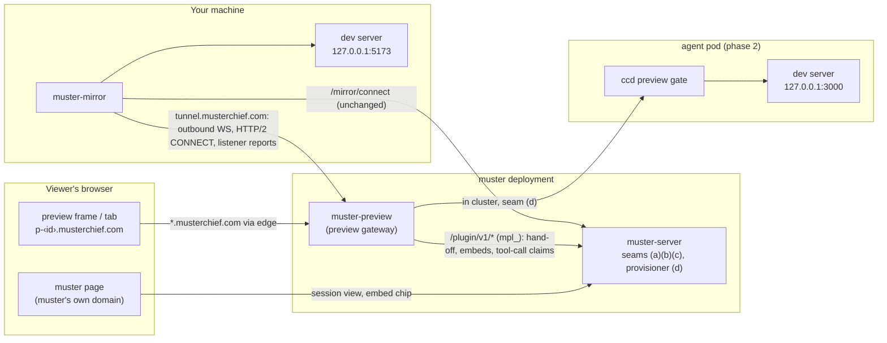

# Design: previews — serving an agent's local web server to its owner

**Status: proposed; the operator's decisions are made** (see
[decisions](#decisions)). **Nothing here is implemented.** Every other section
is the recommended design, and its [open questions](#open-questions) are for
the operator.

This page proposes letting work running under muster — a Claude Code session
**mirrored from a bare host**, and later a dispatched agent in a **pod** —
start a server or web app on its own localhost (a Vite or Next dev server, a
docs site, a Storybook) and have it served to the owner, in a view inside
muster, through a tunnel. Each such exposure is a **preview**.

**Previews are a plugin.** A separate process, the **preview gateway**
(`muster-preview`), owns the preview domain and every preview byte. muster
proxies none of it. muster gains four small, **reusable plugin seams**, and
previews are their first consumer ([the seams](#the-plugin-seams)).

Where this page says how muster works today, it cites `file:line` at commit
`0df73e27`, and the code is the authority ([decisions.md](../decisions.md)).
A claim that nothing in the code confirmed is marked **UNVERIFIED**.

## Summary

- **Shape: gateway plus narrow seams.** `muster-preview` is a plugin in the
  sense of [plugins.md](../plugins.md): its own process and deployment, holding
  an `mpl_` plugin token. It serves the preview domain, holds the host
  tunnels, proxies to pods, sets the preview cookie and issues share links.
  muster's code changes are only the seams.
- **The seams**, each designed for any plugin:
  - **(a) viewer hand-off:** muster mints a one-time code for a signed-in
    owner; the plugin redeems it, and later re-checks that the owner's session
    is still live, by **calling muster**;
  - **(b) a session-view embed slot:** a plugin registers, per session, a
    chip that opens its own origin in a new tab or a sandboxed frame;
  - **(c) plugin-contributed MCP tools:** a plugin declares tools; muster
    offers them on its MCP doors and relays each call through a **claim
    queue** the plugin long-polls, like drafts and task writes;
  - **(d) a provisioner ingress seam:** muster's agent NetworkPolicy and
    Service gain a configured ingress peer and port, for the pod path.
- **No seam makes muster call out.** Every request between muster and the
  plugin is the plugin's ([reconciliation](#plugins-pull-muster-never-calls-out-reconciled)).
- **Preview zone:** `musterchief.com`, a separate registrable domain from
  muster's. Previews are `p-<id>.musterchief.com`, one label under the zone,
  so a single-level wildcard certificate covers them.
- **Hosts first.** `muster-mirror -preview` opens a **second outbound
  WebSocket, to the gateway** (never to muster), carrying HTTP/2 `CONNECT`
  streams, one per upstream TCP connection. It reports new loopback listeners
  on allowlisted ports so the UI can **offer** one; nothing is exposed until the
  owner clicks it. The host dials loopback only and enforces its own
  allowlist.
- **Openers:** the agent's `preview_open` tool, and the owner's click on an
  offered listener. There is no UI for typing a port.
- **Pods second:** a loopback gate in `ccd` on one new declared port, reached
  by the gateway in-cluster through seam (d).
- **Share links third:** owner-minted behind step-up, expiring, revocable,
  audited; **full access by default**, with an optional read-only (GET/HEAD)
  flag at mint.
- **Phase 1 starts with a spike** with a written go/no-go: HTTP/2 `CONNECT`
  over a WebSocket through the real edge path, with yamux as the fallback
  ([phased plan](#phased-plan)).

## Goals

- An agent that has started a server can show it to its owner with one tool
  call; a server a session starts is offered to the owner without one.
  Either way it appears in that session's view in muster within a second or
  two, on a phone or at a desk.
- The same tools, arguments and errors for a mirrored session and (phase 2) a
  dispatched `claude-code` agent.
- **Dev servers work as on localhost:** WebSockets (Vite and Next hot module
  reload), server-sent events, streaming, long-lived connections, uploads of a
  reasonable size.
- Preview content cannot reach muster's session, muster's routes, the
  gateway's credentials, or another preview's cookies.
- The machine bounds what is exposed. A compromised gateway, a compromised
  muster, or a stolen session reaches only loopback ports the host's own file
  (or the pod's gate) allows. Nothing becomes a proxy into a host's LAN or the
  cluster.
- **muster carries no preview traffic** and gains only seams another plugin
  could use.
- The owner can show a preview to someone without a muster account, briefly
  and revocably (phase 3).

## Non-goals

- **A general port-forwarder or VPN.** HTTP(S) servers on loopback, on
  allowlisted ports, only.
- **Production hosting.** Previews close when their session goes away, and are
  capped.
- **An owner-typed port.** Openers are the agent's tool and the host's offer
  ([decision 4](#decisions)).
- **Gateway-kind agents, the compose driver, opencode sessions** as agent
  openers: no in-pod gate for the first two, and opencode has no muster tools
  ([mirroring.md](../mirroring.md)). An opencode window's listeners are still
  **offered** (decision 4 needs no tool).
- **Making preview content safe.** It is untrusted, and is kept away.
- **TLS to the upstream.** Plain HTTP on loopback; TLS ends at the edge.

## What exists today

### The host's one tunnel to muster

- `muster-mirror` holds **one** outbound WebSocket to `/mirror/connect`
  (`internal/mirror/wire.go:73`), authenticated by the host's `mmt_` token
  (`internal/mirror/wire.go:78`); the hub refuses a hello naming another host
  (`internal/mirror/hub.go:720-730`). muster never dials a host
  ([decisions.md](../decisions.md#mirroring-outbound-only-and-never-move-the-operators-window)).
- Protocol v2; v1 hosts accepted (`internal/mirror/wire.go:43-65`). New
  capabilities are hello fields, no version bump
  ([mirroring.md](../mirroring.md#rolling-upgrades); latest:
  `internal/mirror/wire.go:392,396`, read at `internal/mirror/hub.go:760-764`).
- **No per-stream flow control.** The host read loop hands each binary frame to
  `hostConn.deliver` (`internal/mirror/hub.go:914-918`), which queues it on a
  stream channel of `streamBuffer` = 256 frames and **ends the stream with
  `ErrOverrun`** when it is full (`internal/mirror/hub.go:57-60`,
  `:1192-1203`), because that one loop serves every stream on the host.
  Frames are at most `MaxFrame` = 1 MiB (`internal/mirror/wire.go:84`); at most
  8 terminals per host (`internal/mirror/wire.go:121-122`, `hub.go:1364`).
- A live connection's token is re-read every 30 s (`internal/mirror/service.go:22-29`).
- The host refreshes its window listing every 5 s by default
  (`internal/mirrorhost/client.go:245`).

That overrun rule is right for a terminal and wrong for HTTP: a 4 MB bundle to
a slow phone would be **cut off mid-response**, and a gentler rule would block
the loop that serves every terminal on the host. So preview bytes do not ride
this tunnel, and under the plugin shape they do not go to muster at all.

### The plugin contract

- Plugins are off unless `MUSTER_PLUGINS=1` ([configuration.md](../configuration.md#muster-server-optional-features)).
  An owner mints an `mpl_` token on `/plugins`, from a signed-in session
  (`internal/api/plugins.go:54-56`); only its sha256 is stored.
- **An `mpl_` token opens `/plugin/v1/*` and nothing else**, acting as its
  owner through `authz.ViaPlugin`, so row-level security confines it
  (`internal/api/plugins.go:115-140`, `PluginTokenElsewhere` at `:51`). Every
  other credential is refused on those routes ([plugins.md](../plugins.md#two-ways-in)).
- **A token has no scopes today.** The record is `{id, owner, name, label,
  data scope, …}` (`internal/plugins/plugins.go:106-117`), and the data scope is
  an advisory sentence for the chief ([plugins.md](../plugins.md#when-a-message-asks-for-work)),
  not an access control.
- **Work flows to a plugin through claim queues it long-polls**:
  `POST /plugin/v1/drafts/claim` and `POST /plugin/v1/task-writes/claim`, each
  a lease of 2 minutes and a result route
  ([plugins.md](../plugins.md#post-pluginv1draftsclaim-collect-an-approved-reply),
  [task writes](../plugins.md#post-pluginv1task-writesclaim)). Seam (c) copies
  them.
- **"Plugins pull; muster never calls out"**
  ([decisions.md](../decisions.md#plugins-pull-muster-never-calls-out)):
  muster holds no address or credential for anything outside it.
- In-repo precedent for a plugin binary: `cmd/muster-clankmail`
  ([configuration.md](../configuration.md#muster-clankmail-the-clankmail-plugin)).

### The MCP doors

- Mirrored sessions: the host's loopback MCP endpoint (`-mcp-listen`,
  loopback-only, `internal/mirrorhost/mcpproxy.go:443-452`) forwards to
  `POST /mirror/mcp` (`internal/api/mirror_mcp.go:92`), which believes the
  calling session only when that host lists it (`internal/api/mirror_mcp.go:71-78`,
  `mirrorSessionOf` at `:172`). The tool set is `mirrorTools`
  (`internal/api/mirror_mcp.go:219-274`).
- Agents: `POST /mcp` on the connect surface (`internal/api/connectors.go:60,89`);
  each `agentTool` has an `mcp` flag (`internal/api/agent.go:317`).
  `agent_report_done` is already on both doors (`internal/api/agent.go:361`,
  `internal/api/mirror_mcp.go:269-271`).
- **Claude Code reads a tools list once, at connect**
  (`internal/api/mirror_mcp.go:213-217`; [attention.md](../attention.md#stale-tool-definitions)).
  A plugin tool registered after a session connected is not seen by it until
  it reconnects. Seam (c) is built around that.

### The pod's network

- **The claude-code NetworkPolicy restricts ingress by port.** It admits
  muster's pods (one namespace-AND-pod-label peer) on **the spec's declared
  ports only** (`internal/provision/k8s/network.go:194-224`), and a claude-code
  spec declares one, the gateway port 18789 (`internal/agentspec/claudecode.go:548`,
  `internal/agentspec/agentspec.go:149`). A rule with an empty port list would
  admit every port, which the builder avoids (`network.go:208-210`). The
  Service exposes the declared ports only (`internal/provision/k8s/render.go:533-562`).
  So **nothing, muster included, can reach another port of the pod today**,
  and no peer but muster's pods is admitted at all. Seam (d) changes that.
- Egress is DNS plus public TCP 443 (`internal/agentspec/claudecode.go:102-104,261`);
  an egress-locked officer has neither (`:126-139`). A `gateway`-kind agent
  has no NetworkPolicy; the compose container is not confined
  ([limits.md](../limits.md#agents)).
- `ccd` accepts a per-agent bearer for its chat gateway, `MUSTER_GATEWAY_BEARER`
  ([configuration.md](../configuration.md#ccd-inside-the-claude-code-agent-image)).

### Cookies, origins and framing

- muster's cookies (`muster_session`, `internal/api/auth.go:20`;
  `muster_at`/`muster_rt`, `internal/api/accounts.go:63-64`) are `HttpOnly`,
  `SameSite=Lax`, host-only (no `Domain`) (`internal/api/login.go:196-213`,
  `internal/api/accounts.go:879,889`).
- muster records that SameSite=Lax is no CSRF defence against a **sibling
  subdomain** (`internal/api/auth.go:313-331`). `musterchief.com` is another
  site, so this does not arise.
- 🔴 **`wsAllowedOrigins` trusts `r.Host`** as one of muster's own origins
  (`internal/api/agents.go:2026-2045`). A request reaching muster's mux with
  `Host` and `Origin` both a preview host would pass the same-origin check. The
  edge must never route the preview zone to muster, and seam (b)'s
  configuration lets muster refuse such hosts itself ([below](#configuration)).
- Every response carries `frame-ancestors 'none'`, `X-Frame-Options: DENY`,
  and a CSP with `default-src 'self'` and no `frame-src`, except the
  Rendered/Terminal swap pages, which allow `'self'` as an ancestor
  (`internal/api/middleware.go:105-143`, used at `internal/api/agents.go:1403`).
  **muster's pages cannot frame another origin today.**
- In password mode the session cookie's key is derived from
  `MUSTER_UI_PASSWORD`, so rotating the password revokes every session
  (`internal/api/auth.go:206-221`).

## Topology



Arrows point from the side that opens the connection. muster opens none to
the gateway, the host or the viewer's preview origin.

### Where the host side lives

| option | install | knows panes and processes | credentials it holds | verdict |
|---|---|---|---|---|
| **A `-preview` mode inside `muster-mirror`, in its own package** | none new: the host already runs it | ✓ reuses the pane process-tree walk, for listener attribution | its own gateway token `mpt_`, separate from `mmt_`; the preview code never reads the mirror token | **recommended** |
| A separate small binary (`muster-preview host`) | a second unit and config per host | would duplicate the tmux and `/proc` walks | `mpt_` only | acceptable if the operator wants the plugin to ship separately ([open question 1](#open-questions)) |

The preview side runs in the `muster-mirror` process but shares nothing with
the mirror tunnel: its own goroutines, its own connection to the gateway URL,
its own token file. A `muster-mirror@<tenant>` unit runs its own.

## The plugin seams

Each is generic: it names a plugin, not previews. A plugin uses a seam only
with the **capability** its owner granted it.

### Capabilities on a plugin token

A new column on the plugin record, `capabilities`, a set:

| capability | opens | granted by |
|---|---|---|
| `messages` (legacy) | every route a plugin token opens today | **every existing token, by migration**; the default on the create form |
| `handoff` | seam (a)'s redeem and liveness routes | the owner, at mint, on `/plugins` |
| `embeds` | seam (b)'s routes | the owner |
| `tools` | seam (c)'s declare, claim and result routes | the owner |
| `agent_targets` | seam (d)'s agent-target read (phase 2) | the owner |

- **Backward compatible:** existing tokens get `messages`, so every route they
  open today still opens; a route checks its capability in
  `requirePluginToken`'s admitted context. A new token may hold any subset: the
  preview gateway's has `handoff`, `embeds`, `tools` (and `agent_targets` in
  phase 2), and **not** `messages`, so it cannot post to the chief.
- **Granting:** checkboxes on the create form; widening an existing token's set
  needs a fresh sign-in (step-up), narrowing does not. The page lists each
  token's capabilities.
- **Origin:** a token with `handoff` or `embeds` also carries **one origin
  pattern**, e.g. `https://*.musterchief.com`, chosen by the owner from the
  deployment's allowlist `MUSTER_PLUGIN_ORIGINS`. The allowlist is the admin's
  because it widens the CSP of muster's pages for everyone.

### (a) Viewer hand-off

How a plugin learns, without its own sign-in, that a browser belongs to a
signed-in owner.

1. The owner clicks a chip (seam b). muster's page `POST`s
   `/plugin-handoffs` on muster's own origin (signed-in, same-origin) with the
   chip's id. muster mints a **code**: 32 random bytes, stored hashed, bound
   to the owner, the plugin, the chip's **subject** (an opaque string the
   plugin set, e.g. `preview:<id>` or `offer:<id>`), and the browser session
   it came from; valid 60 s, single use.
2. muster answers with the chip's `enter_url` (under the plugin's origin) plus
   `?muster_code=<code>`. The page navigates the frame or a new tab there.
3. The plugin's entry route **calls muster**:
   `POST /plugin/v1/handoffs/redeem {code}` → `200 {owner, subject,
   session_ref, expires_at}`. A code minted for another plugin, used, expired
   or unknown is one `404`. The code leaves the URL by redirect, with
   `Referrer-Policy: no-referrer`.
4. **Liveness:** the plugin calls `POST /plugin/v1/handoffs/check
   {session_refs: [...]}` (up to 500) at least every 30 s for the sessions
   behind its open cookies and connections, and gets back the ones still
   live: not signed out, not before Sign out everywhere or the session cutoff,
   account enabled (the second wall device credentials get,
   [auth.md](../auth.md#paired-devices)); in password mode, issued under the
   current password-derived key. **The plugin must fail closed:** a
   `session_ref` not confirmed live within 90 s is treated as dead.

The `session_ref` is opaque to the plugin (a keyed hash), so the plugin learns
no session identifier muster could be asked to act on.

### (b) Session-view embed slot

How a plugin puts something in a session's view.

- `PUT /plugin/v1/embeds/{key}` with `{target, label, state, enter_url}`:
  - `target`: `{"mirror": {"host", "window"}}` or `{"agent": {"id"}}`,
    checked against the owner's own hosts and agents (a host the owner does not
    have, or an agent of another owner, is `404`);
  - `label`: at most 60 characters, shown as text, never HTML;
  - `state`: `offered` | `open` | `unavailable`, drawn as the chip's style;
  - `enter_url`: must match the token's origin pattern exactly (scheme, host
    under the pattern, no user info), at most 512 bytes.
  `DELETE /plugin/v1/embeds/{key}` removes it. At most 16 per target and 64
  per plugin. Rows are owner-scoped under row-level security.
- **Live:** a change reaches an open session view over the page's existing
  live stream, so a chip appears or changes without a reload. A view with no
  chips draws nothing (the `cls.spec.ts` gate,
  [testing.md](../testing.md#the-browser-suite-e2e)).
- **The chip:** `label`, with **Open** (new tab) and **Show here** (frame).
  Both mint a hand-off (seam a) at click time. muster adds nothing a plugin did
  not register, and offers no plugin-specific buttons: a share or close button
  lives inside the plugin's own page.
- **The frame:** `sandbox="allow-scripts allow-same-origin allow-forms
  allow-popups allow-downloads allow-modals"` with **no**
  `allow-top-navigation` (so plugin content cannot navigate muster's tab),
  `allow=""` (no camera, microphone, location), `referrerpolicy="no-referrer"`.
  `allow-same-origin` is safe because the frame's origin is not muster's.
- **CSP:** the session view pages (`/mirror/view`, `/agents/{name}`) add
  `frame-src` with the origins in `MUSTER_PLUGIN_ORIGINS`; every other page is
  unchanged (`internal/api/middleware.go:119-131`).
- **Stale chips:** an embed whose plugin token is revoked disappears; one whose
  plugin has not called muster for 5 minutes is drawn `unavailable`.

### (c) Plugin-contributed MCP tools

How a plugin offers tools to its owner's sessions and agents.

| option | agent's surface | network | fits "plugins pull" | verdict |
|---|---|---|---|---|
| **muster lists the tool and relays each call through a claim queue** | unchanged: the same MCP doors | none new | ✓ the plugin long-polls | **recommended** |
| The agent calls the plugin's own MCP server | a second MCP server per agent, configured per host and per pod | pods would need egress to the plugin, which their policy forbids (`claudecode.go:102-104`) | ✓ | ✗ two surfaces, new credentials in every session |
| muster calls the plugin per tool call | unchanged | muster → plugin | ✗ needs the exception | ✗ |

- **Declaring:** `PUT /plugin/v1/tools` with up to 8 definitions `{name,
  description, input_schema, callers: ["mirror","agent"], timeout_s}`. A name
  must match `^[a-z][a-z0-9_]{2,39}$`, must not be one of muster's own tool
  names, and must not be another of the owner's plugins' (each `409`).
  Descriptions are capped at 1 KiB and schemas at 8 KiB. Declarations persist.
- **Listing:** `tools/list` on `POST /mirror/mcp` and `POST /mcp` includes the
  owner's plugins' declared tools for that kind of caller, marked in the
  description as from a plugin. The chief gets none (its list is pinned,
  `TestTheChiefsToolListIsPinned`). Because Claude Code reads the list at
  connect, **declarations persist and are listed even while the plugin is
  down**; the call then fails fast.
- **Calling:** muster stores the call (`plugin_tool_calls`: tool, arguments,
  the caller as muster proved it — `{"mirror": {host, window, claude_session}}`
  or `{"agent": {id, name}}` — and a deadline of `timeout_s`, at most 20 s), and
  waits on it.
- **Claiming:** `POST /plugin/v1/tool-calls/claim {"wait_s": 0-25, "limit":
  1-20}` hands out pending calls, each leased until its deadline.
  `POST /plugin/v1/tool-calls/{id}/result {"ok", "content", "error"}` answers
  it, and muster returns it to the waiting caller. The plugin must claim with
  `wait_s` > 0 continuously, so a call is picked up in milliseconds.
- **At most once, like drafts:** a call not claimed by its deadline expires
  and is never handed out; the caller gets "the plugin did not answer". A call
  claimed but answered late is recorded, and the caller has already been told
  it timed out. A tool whose effect matters must be idempotent, as
  `preview_open` is per `(caller, port)`.
- **No plugin tool reaches another owner, and arguments are the model's**:
  the plugin treats them as untrusted input, and muster's proof of the caller
  is the only identity it may rely on.

### (d) Provisioner ingress seam

What the pod path needs from muster, which owns the agent's policy. It is
configuration, not plugin code.

- `MUSTER_AGENT_PLUGIN_INGRESS`: one peer `{namespace, podLabels, port}`. With
  it set, each new `claude-code` spec gets:
  - a declared port named `plugin` (so the Service gains it,
    `internal/provision/k8s/render.go:533-562`);
  - a **second ingress rule** admitting that peer (namespace AND labels, as
    the controller peer is written) on that port only. The muster-pod rule
    keeps its port list and does not gain this port;
  - `CCD_PREVIEW_LISTEN`, `CCD_PREVIEW_PORTS` (from `MUSTER_AGENT_PREVIEW_PORTS`)
    and `CCD_PREVIEW_BEARER`, a random per-agent secret distinct from the chat
    gateway's bearer.
- `GET /plugin/v1/agents/{id}/target` (capability `agent_targets`) answers
  `{host, port, bearer}` for one of the owner's agents provisioned with the
  gate, so the plugin can reach it. Another owner's agent, or one without the
  gate, is `404`.
- `provision.Network` gains a generic `ExtraIngress` list for this. A peer
  with no port is refused at spec validation, so an empty port list can never
  render (the rule `network.go:208-210` already states).
- **UNVERIFIED:** whether adding a port to the spec rolls existing agents'
  pods at the next reconcile (the pod template carries a spec fingerprint,
  `internal/provision/k8s/render.go:57-66`). Phase 2 measures it.

### Plugins pull; muster never calls out, reconciled

| interaction | who opens the connection |
|---|---|
| hand-off redeem and liveness checks | the plugin → muster |
| embed register and delete | the plugin → muster |
| tool declarations, call claims, results | the plugin → muster |
| agent target read | the plugin → muster |
| the browser opening the plugin's origin | the **browser**, on the owner's click, to an origin the admin allowed and the owner chose |
| the host tunnel and listener reports | the host → the gateway |
| the pod gate | the gateway → the pod |

**No seam needs an exception.** muster holds no plugin address it connects
to: the origin it stores is used only to build a link and a CSP entry, and the
decision's worry ("a URL an owner can set is a way to make muster send
requests wherever that owner chooses") does not arise, because muster sends
none; a code that a stranger's origin received is useless without that
plugin's token. The cost of pull is latency, paid only in seam (c), and a
continuous long-poll keeps it to the claim's wake-up.

## The preview gateway

### Zone and deployment

The preview zone is **`musterchief.com`** ([decision 2](#decisions)), a
different registrable domain from muster's, so previews are cross-site to
muster: a preview cannot set a cookie muster receives, cannot ride muster's
`SameSite=Lax` cookies, and receives no cookie an SSO proxy sets on muster's
parent domain.

| name | serves |
|---|---|
| `p-<id>.musterchief.com` | one preview each; `<id>` is 26 lowercase base32 characters (128 random bits) |
| `tunnel.musterchief.com` | hosts' outbound tunnel connections, nothing else |
| any other label | 404 |

Every name is **one label** under the zone, because the zone's edge
certificate covers the apex and one level only (below). The gateway has **no web
UI of its own** beyond preview pages: host tokens are minted on its CLI, like
mirror tokens ([below](#host-tokens)), so no gateway session cookie sits
same-site to preview content.

**What the operator must provide:**

- **The domain is in place.** `musterchief.com` is an active Cloudflare zone
  on the **Free plan** (read from the Cloudflare API by the operator's agent,
  2026-11-09). It may sit in a different Cloudflare account from muster's own
  domain, so nothing here assumes shared zone settings, rules or origin
  certificates between the two.
- **What the Free plan fixes:**
  - **Universal SSL covers `musterchief.com` and `*.musterchief.com` only.**
    There is no Advanced Certificate Manager, so a deeper name
    (`<id>.p.musterchief.com`) would get no edge certificate. Every name here
    is one label: `p-<id>`, `tunnel`.
  - **Proxied WebSockets work, with an idle timeout of about 100 s.** So every
    long-lived connection the gateway serves is kept from going quiet for that
    long:
    - the host tunnel pings every 30 s (both ends);
    - a preview WebSocket is relayed **message by message** (the gateway
      terminates the browser leg and the upstream leg, with coder/websocket
      on both) rather than as raw bytes after the `101`, so the gateway can
      ping the browser leg every 30 s without corrupting the app's framing.
      The cost is per-message copying and the app's ping frames being
      answered by the gateway on each leg;
    - a `text/event-stream` response that has been quiet for 30 s gets an SSE
      comment line (`:\n\n`) injected **only at an event boundary** (after a
      blank line), which every conforming client ignores. Any other quiet
      streaming response is the app's to keep alive.
- **DNS records, none of which exist yet** (to be created by the operator, not
  by this work):

  | name | type | target | proxied |
  |---|---|---|---|
  | `*.musterchief.com` | `CNAME` (or `A`/`AAAA`) | the deployment's public ingress for the gateway | yes |
  | `tunnel.musterchief.com` | covered by the wildcard; an explicit record only if it must differ | — | yes |
  | `musterchief.com` (apex) | optional; the gateway answers 404 there | — | yes |

  A proxied wildcard record is available on the Free plan (per Cloudflare's
  documentation; **UNVERIFIED** in this zone until created).
- **Between Cloudflare and the gateway**, the deployment's own path, like its
  other public services (for example the edge, then the deployment's relay
  into the cluster). It must pass `Host` through, pass WebSocket upgrades, not
  buffer streaming responses, and set `CF-Connecting-IP` or `X-Forwarded-For`.
  Its TLS (an origin certificate, or the relay's own) is the deployment's
  choice, and is separate from the edge certificate.
- **No single sign-on proxy** in front of the zone: the gateway does its own
  authentication, and a share-link viewer has no account.
- **In cluster** (for phase 2): the gateway's pods carry the labels named in
  `MUSTER_AGENT_PLUGIN_INGRESS`, and can reach muster's main listener.
- **On muster:** `MUSTER_PLUGINS=1`, `MUSTER_PLUGIN_ORIGINS=https://*.musterchief.com`,
  and an `mpl_` token with the gateway's capabilities.

### Owners and tokens

An `mpl_` token is one owner's. The gateway reads a file of them
(`PLUGIN_TOKENS_FILE`, one per line) and serves those owners; it learns each
token's owner from its first redeem or claim. On a single-operator deployment
that is one token. A deployment-wide plugin credential for many owners is
[open question 2](#open-questions).

### Host tokens

`muster-preview host-token create <owner> <host>` prints an `mpt_` token
once; the gateway stores its sha256; `ls` and `revoke` as for mirror tokens
([mirroring.md](../mirroring.md#how-it-connects)). A token registers only its
own host name, and the gateway re-checks it every 30 s on a live tunnel. The
host name must equal the one the host's mirror token is minted for, because
seam (c) names the caller's host as muster proved it, and the gateway routes
by `(owner, host)`.

### The host tunnel

| option | flow control | effect on terminals | new code | verdict |
|---|---|---|---|---|
| **A WebSocket to the gateway, carrying HTTP/2** | per stream (`WINDOW_UPDATE`) and per connection | none: a different connection, to a different process | `x/net/http2` (already in `go.mod`), `websocket.NetConn` (coder/websocket v1.8.14) | **recommended, subject to the spike** |
| The same, carrying yamux | per stream | none | `hashicorp/yamux` (new, MPL-2.0) | the spike's fallback |
| One dial-back WebSocket per upstream connection | kernel TCP | none | small | second fallback; one TLS and WebSocket handshake per connection |
| Preview frames on the existing mirror tunnel | none today | the `ErrOverrun` rule truncates; bulk delays keystrokes | — | ✗ and, as a plugin, ruled out: muster carries no preview bytes |

1. With `-preview` and a valid `previews.json`, the host dials
   `wss://tunnel.musterchief.com/v1/host` with `Authorization: Bearer mpt_…`,
   its host name and `X-Muster-Preview-Version: 1`. A version the gateway does
   not speak is refused with the range it does; the host logs it and retries
   with backoff, never touching the mirror tunnel.
2. Both ends wrap the WebSocket as a `net.Conn`
   (`websocket.NetConn(ctx, c, websocket.MessageBinary)`). **Roles reverse:**
   the host runs `http2.Server.ServeConn`, the gateway holds an
   `http2.ClientConn`. The host opens no listener.
3. **Control:** the gateway's first stream is `GET /v1/offer`, a long-lived
   response on which the host writes newline-delimited JSON: its allowlist and
   caps, and [listener reports](#listener-reports).
4. **Data:** each upstream TCP connection is one `CONNECT` stream (RFC 9113
   §8.5) with `:authority` `127.0.0.1:<port>`. The host takes **only the
   port**, applies [its checks](#what-the-host-checks-before-it-dials), dials,
   answers `200` and copies bytes; or `403` (`port_not_allowed`,
   `foreign_listener`), `502` (`refused`), `429` (`max_conns`).
   `MaxConcurrentStreams` is the host's `maxConns`.

Both connections share the host's uplink, so a large download still competes
with terminal bytes for bandwidth, though not for a TCP stream or a read loop.

### What the host checks before it dials

- **The port is allowlisted** in `previews.json`, and is not one it always
  refuses: its own `-mcp-listen` port and the opencode server port(s) it talks
  to (either would hand a viewer muster's tools or an opencode session's
  shell).
- **Loopback only:** `127.0.0.1:<port>`, then `[::1]:<port>` if refused (Node 17
  and later may bind `localhost` to `::1` only; **UNVERIFIED** per dev server).
  Never a name, never the requested address.
- **The listener is this user's (Linux):** the listening socket's uid in
  `/proc/net/tcp` and `/proc/net/tcp6` equals muster-mirror's, else
  `foreign_listener`. On macOS the check is **UNVERIFIED** and off, and the offer
  says so.
- **Its caps:** `maxConns` streams, `maxOpen` previews.

### Listener reports

How the host offers servers to the UI ([decision 4](#decisions)).

- **Poll:** every 5 s (the window refresh's interval), read `/proc/net/tcp` and
  `tcp6` for `LISTEN` sockets bound to loopback or the wildcard address, on an
  allowlisted port, owned by this uid. Only for those, find the owning pid
  (socket inode → `/proc/<pid>/fd`) and walk its parents to a tmux pane, as
  `internal/mirrorhost` already walks a pane's tree to find `claude`.
- **Sent, only on change, on the `/v1/offer` stream:** `{port, process: <comm,
  at most 15 bytes>, window: <tmux window id>, first_seen}`. **Not** the argv,
  working directory, environment, pid, or any listener outside a tmux pane:
  a listener with no pane has no session to show it in, and is not offered.
- **The gateway turns each report into an `offered` embed** (seam b) on that
  window: label `<process> · :<port>`. A report that disappears removes the
  embed, unless a preview of that port is open.
- **Nothing is exposed until the click.** The chip's subject is
  `offer:<id>`; when the owner arrives with a hand-off code for it, the gateway
  opens the preview (one `CONNECT` probe), and only then serves it. An offer
  never accepts traffic.
- **Privacy:** the process name and port reach the gateway and, as the chip's
  label, muster's database. `"offer": false` in `previews.json` turns reports
  off; the agent tool still works.
- macOS: **UNVERIFIED** (`lsof` would be the source); reports are off there.

### Host configuration: `previews.json`

Patterned on `-spawn` and `spawn.json`
([host-sessions.md](host-sessions.md#host-configuration-spawnjson)) and the
shipped `-agent-spawn` flags: off by default, an explicit flag, and an
allowlist that is empty, meaning nothing, until written.

| flag | env | default | |
|---|---|---|---|
| `-preview` | `MUSTER_MIRROR_PREVIEW` | off | turn it on |
| `-preview-url` | `MUSTER_MIRROR_PREVIEW_URL` | none | the gateway's tunnel URL, `wss://tunnel.musterchief.com/v1/host` |
| `-preview-token-file` | `MUSTER_MIRROR_PREVIEW_TOKEN_FILE` | none | the host's `mpt_` token |
| `-preview-file` | `MUSTER_MIRROR_PREVIEW_FILE` | `~/.config/muster-mirror/previews.json` | the allowlist |

```json
{
  "ports": ["3000", "4173", "5173", "6006", "8000-8099"],
  "offer": true,
  "maxOpen": 8,
  "maxConns": 64
}
```

- **`ports`:** single ports or inclusive ranges within 1024–65535. A missing,
  empty or invalid file disables previews, says why on the offer stream and in
  the log, and is never fatal.
- **`offer`:** listener reports on (default) or off.
- **`maxOpen`** (default 8, at most 32) and **`maxConns`** (default 64, at most
  256).
- **Not tied to `-interactive`:** exposing a loopback server is not typing
  into a pane. Re-read on change; previews on a port that left the list close.

### The pod path (phase 2)

The gateway runs in the cluster, so no tunnel. Through seam (d) it reads the
agent's target and opens a TCP connection to `<host>:<port>`:

```http
CONNECT 127.0.0.1:5173 HTTP/1.1
Host: 127.0.0.1:5173
Proxy-Authorization: Bearer <CCD_PREVIEW_BEARER>
```

`ccd`'s gate checks the bearer, takes only the port, checks `CCD_PREVIEW_PORTS`,
always refuses its own port and 18789, dials loopback (`127.0.0.1` then
`::1`), and splices.

| option | reaches a loopback-bound server | allowlist on the machine | new RBAC | verdict |
|---|---|---|---|---|
| **ccd gate on one declared port** | ✓ | ✓ | none | **recommended** |
| Dial `podIP:<port>`, open a port range | ✗ only `0.0.0.0`-bound servers | ✗ | none | ✗ the common default fails; a range (`endPort`) is CNI-dependent |
| `pods/portforward` | ✓ | ✗ | the gateway would need it | ✗ preview bandwidth through the API server, and a powerful verb in a plugin's ServiceAccount |

The address is never agent-supplied: it is the provisioner's endpoint for
that agent row, read by the plugin from muster. `MUSTER_DIAL_DENY_PRIVATE`
(the postgres connector's guard, `cmd/muster-server/config.go:355`) is not
involved: muster dials nothing on this path.

Officers run the same image and would work; they are left off
([open question 5](#open-questions)). Gateway-kind agents and the compose
driver get no gate.

### The proxy

The gateway's reverse proxy (`httputil.ReverseProxy`, `FlushInterval = -1`),
with the dialer "a `CONNECT` stream on that host's tunnel" or "the pod's gate":

- **Request:** `Host: localhost:<port>` (dev servers allow `localhost` by
  default); the public host in `X-Forwarded-Host`, `X-Forwarded-Proto: https`.
  Removed: the gateway's cookies, any `muster_*` cookie, `Forwarded`, inbound
  `X-Forwarded-*`, `X-Real-IP`, `CF-*`, `True-Client-IP`, `X-Muster-*`. **The
  viewer's address is not forwarded.** The app's own cookies and
  `Authorization` pass.
- **WebSockets:** upgraded on both legs and relayed message by message, with a
  30 s ping on the browser leg ([why](#zone-and-deployment)); an `Origin` equal
  to the preview origin is rewritten to `http://localhost:<port>` for dev servers that check
  it (Vite's exact rule **UNVERIFIED**).
- **Response:** `Location` at `localhost`/`127.0.0.1`/`[::1]:<port>` rewritten
  to the preview origin; `Set-Cookie` loses `Domain`, and a cookie named like
  the gateway's is dropped; an extra `Content-Security-Policy: frame-ancestors
  <muster's origin>` (intersected with the app's own); `X-Content-Type-Options:
  nosniff`; the app's `Strict-Transport-Security` dropped.
- **Long-lived connections** are re-checked every 30 s (cookie, preview open,
  owner session live through seam (a)'s check, share link) and closed on a
  failure.
- **HMR** clients connect to `location.host`; an app pinned to an explicit HMR
  host or port bypasses the preview. The tool description says so.

### Auth on preview origins

- **Owner:** the entry route `/__muster/enter?muster_code=…` redeems the code
  (seam a), and sets `__Host-mp`: `Secure`, `HttpOnly`, `Path=/`, host-only,
  `SameSite=None`, `Partitioned`, 1 h, HMAC-signed `{preview id, owner,
  session_ref, expires}` with the gateway's key. It then redirects to
  `/__muster/check`, which goes on to the preview if the cookie arrived, and
  otherwise says "This browser blocks embedded previews. Open it in a new
  tab."
- **The cookie is bound to its preview:** another preview's cookie is refused
  even if a browser sent it.
- In a frame the cookie is third-party; partitioned cookies work in Chromium,
  and Firefox partitions by default. **Safari and the Android app's WebView are
  UNVERIFIED** (the WebView refuses third-party cookies unless the app enables
  them, [open question 6](#open-questions)). **Open** in a new tab always
  works.
- No step-up for the owner: viewing reaches a dev server, not a shell.

### Share links (phase 3)

| question | design |
|---|---|
| **Who can mint** | The owner, on the preview's own page (a `/__muster/share` panel the gateway serves on the preview origin, reached only with the owner cookie), behind a **fresh sign-in**: the panel sends the owner through a hand-off whose code muster mints only with a step-up from the last `MUSTER_STEPUP_WINDOW` ([sending-and-step-up.md](../sending-and-step-up.md#step-up-confirm-its-you)); the redeem answer says so (`stepped_up: true`). Never an agent: no tool mints one. |
| **Access** | **Full by default** ([decision 5](#decisions)); a **read-only** flag at mint refuses every method but `GET` and `HEAD` with 405, and refuses WebSocket upgrades (which can carry writes). |
| **TTL** | 15 min, **1 h (default)**, 8 h, 24 h; never past the preview's own TTL; capped by `PREVIEW_SHARE_MAX_TTL`. |
| **What it is** | `https://p-<id>.musterchief.com/__muster/share/<token>`; 32 random bytes, stored hashed by the gateway with preview, access, expiry, revocation, first use, use count. |
| **Redeeming** | Sets `__Host-mps` (signed, bound to share and preview, `SameSite=Lax`, expiring with the link) and redirects the token out of the URL. Any number of viewers until expiry or revocation. |
| **Reach** | That one preview's origin. Nothing of muster's. |
| **Unauthenticated viewers** | Yes; that is the point. |
| **Revocation** | On the share panel; closing the preview revokes its links; so does the owner's session ending only if [open question 7](#open-questions) says so. Re-checked every request (30 s cache at most) and every 30 s on a WebSocket. |
| **Audit** | The gateway's own log table (created, first redemption with the client address, revoked, expired). muster's `audit_log` is not written by a plugin today; whether a seam should let it is [open question 8](#open-questions). |
| **Rate limits** | Per link: 600 requests a minute and 32 concurrent connections. Unknown or revoked tokens: 30 a minute per client address. Per owner: 20 live links. |

## The MCP tools

Declared by the gateway through seam (c), for `callers: ["mirror"]` in phase 1
and `["mirror","agent"]` from phase 2:

| tool | arguments | result | errors |
|---|---|---|---|
| `preview_open` | `port` (1–65535), `label` (≤ 60, optional), `path` (starts with `/`, ≤ 512 bytes, optional) | `{id, port, label, state: "open"}`; the chip is in the session's view | `port_not_allowed`, `not_listening`, `foreign_listener`, `host_not_connected`, `gate_unavailable` (pod), `max_open`, and muster's own "the plugin did not answer" |
| `preview_list` | none | the calling session's previews | — |
| `preview_close` | `id` | `{closed: true}` | `not_found` (also another session's) |

- **Bound to the caller muster proved** (seam c): a mirrored session's
  `(host, window, claude_session)`, an agent's id. Only that caller lists or
  closes it; the owner closes any from the preview's own page.
- **Idempotent per `(caller, port)`**: the same id comes back.
- **Probes first:** one `CONNECT` and `HEAD /` with a 5 s budget. Refused:
  `not_listening`. Any HTTP answer opens it.
- **No preview URL is returned**: the link works only for the owner, and the
  chip is where they find it.

## Lifecycle

The gateway owns preview state (its own Postgres or SQLite: `previews`,
`shares`, `host_tokens`); muster holds only the embed rows.

| event | what happens |
|---|---|
| `preview_open`, or the owner's click on an offer | probe; record; embed `open` |
| `preview_close`, or **Close** on the preview's page | closed; connections end; embed removed |
| The host's tunnel drops | requests get a "host offline" page (503); embed `unavailable` |
| Offline for 24 h | closed |
| The window is gone (no listing on the offer stream names it) for 10 minutes | closed |
| The port leaves the allowlist | closed |
| No request for `PREVIEW_IDLE` (default 2 h) | closed |
| Open longer than `PREVIEW_TTL` (default 24 h) | closed; reopening mints a new id |
| The host token is revoked | tunnel ends within 30 s; that host's previews close |
| The plugin token is revoked or loses a capability | the gateway's calls fail; it closes that owner's previews; muster drops the embeds |
| The agent is destroyed (phase 2) | its target read answers `404`; the gateway closes its previews within a minute |
| The upstream stops answering | a "not answering" page (502); the preview stays open |

Embeds are muster's, so the gateway re-puts every open preview's embed at
start and deletes the ones it no longer knows; muster also drops embeds of a
plugin silent for 24 h.

## Limits and quotas

Following [limits.md](../limits.md#mirroring):

| scope | limit | default | enforced by |
|---|---|---|---|
| per calling session | open previews | 4 | gateway |
| per owner | open previews | 16 | gateway |
| per host | open previews | 8 (`maxOpen`, ≤ 32) | host and gateway |
| per host | concurrent upstream streams | 64 (`maxConns`, ≤ 256) | host |
| per pod | concurrent upstream connections | 64 | gate |
| per preview | concurrent client connections | 64 | gateway |
| request body | size | 32 MiB (`PREVIEW_MAX_BODY`) | gateway |
| response | size | none; flow-controlled | — |
| upstream headers | time | 60 s | gateway |
| HTTP connection | idle | 5 min | gateway |
| per plugin (muster) | embeds | 16 per target, 64 in all | muster |
| per plugin (muster) | declared tools | 8 | muster |
| per plugin (muster) | pending tool calls | 32 | muster |
| per owner (muster) | hand-off codes minted | 60 a minute | muster |
| share links | see [share links](#share-links-phase-3) | | gateway |

## Configuration

Every variable below gets a row in [configuration.md](../configuration.md)
when code reads it, or `TestEveryEnvVarTheCodeReadsIsDocumentedAndViceVersa`
fails (the gateway is in this module, as `cmd/muster-clankmail` is).

| variable | binary | default | what it does |
|---|---|---|---|
| `MUSTER_PLUGIN_ORIGINS` | muster-server | none | Origin patterns (`https://*.example.net`, exact or one wildcard label) a plugin may be given for hand-offs and embeds; added to `frame-src` on the session views; a `Host` under them is refused with 421 on muster's listeners. Unset: seams (a) and (b) are off. |
| `MUSTER_AGENT_PLUGIN_INGRESS` | muster-server | none | Seam (d): `<namespace>/<label>=<value>[,…]:<port>`, the peer and port added to new claude-code agents' policy and Service. |
| `MUSTER_AGENT_PREVIEW_PORTS` | muster-server | empty | Seam (d): passed to agents as `CCD_PREVIEW_PORTS`. |
| `MUSTER_MIRROR_PREVIEW`, `MUSTER_MIRROR_PREVIEW_URL`, `MUSTER_MIRROR_PREVIEW_TOKEN_FILE`, `MUSTER_MIRROR_PREVIEW_FILE` | muster-mirror | off / none / none / `~/.config/muster-mirror/previews.json` | [Host configuration](#host-configuration-previewsjson). |
| `CCD_PREVIEW_LISTEN`, `CCD_PREVIEW_PORTS`, `CCD_PREVIEW_BEARER` | ccd | off | The pod gate; set by muster. |
| `MUSTER_URL` | muster-preview | none | muster's base URL (the name `muster-clankmail` already reads). |
| `PLUGIN_TOKENS_FILE` | muster-preview | none | The owners' `mpl_` tokens, one per line. |
| `PREVIEW_DOMAIN` | muster-preview | none | `musterchief.com`. |
| `PREVIEW_LISTEN` | muster-preview | `:8080` | The one listener, for preview hosts and `tunnel.`. |
| `PREVIEW_DATABASE_URL` | muster-preview | none | Its own state. |
| `PREVIEW_SIGNING_KEY` | muster-preview | none | 32 random bytes: signs its cookies. |
| `PREVIEW_TTL`, `PREVIEW_IDLE`, `PREVIEW_MAX_BODY` | muster-preview | `24h`, `2h`, `32MiB` | [Lifecycle](#lifecycle), [limits](#limits-and-quotas). |
| `PREVIEW_SHARES`, `PREVIEW_SHARE_MAX_TTL` | muster-preview | off, `24h` | Phase 3. |

Nothing named `MUSTER_PREVIEW_*` is read by muster-server: it has no preview
listener, proxy or key.

## Telemetry

- **The gateway** ([telemetry.md](../telemetry.md) conventions): spans
  `preview.request` (kind `host`|`pod`, auth `owner`|`share`, status class;
  never path or query), `preview.dial`, `preview.ws`; metrics
  `muster_previews_open{kind}`, `muster_preview_requests_total{kind,auth,code_class}`,
  `muster_preview_dial_seconds{kind,outcome}`, `muster_preview_bytes_total{kind,direction}`,
  `muster_preview_refusals_total{reason}`, `muster_preview_offers{state}`,
  `muster_preview_tunnels`, `muster_preview_share_redemptions_total{outcome}`.
- **The host:** `host.preview.dial` with the refusing check; log one line per
  refused stream.
- **muster's seams:** `muster_plugin_handoffs_total{outcome}`,
  `muster_plugin_tool_calls_total{outcome}` and `muster_plugin_tool_call_seconds`
  (claim latency and total), `muster_plugin_embeds`.
- **Privacy:** no path, query, header or body is logged, traced or labelled; no
  hand-off code, share token or host token appears anywhere but its hash.

## Threat model

| threat | who | control | residual |
|---|---|---|---|
| Preview script reads muster's session | preview content | another site; muster's cookies host-only, `HttpOnly`; stripped by the proxy | none |
| Preview script acts on muster (CSRF) | preview content | cross-site: `SameSite=Lax` withholds muster's cookies; `requireSameOrigin` checks `Origin` (`internal/api/auth.go:313-331`) | none known |
| A preview host reaches muster's routes | a misrouted edge, a chosen `Host` | the edge routes the zone to the gateway; muster refuses `MUSTER_PLUGIN_ORIGINS` hosts (421), closing the `wsAllowedOrigins` `r.Host` hole (`internal/api/agents.go:2031`) | none |
| Clickjacking or top-navigation of muster's tab | content in the frame | `sandbox` without `allow-top-navigation`; muster keeps `frame-ancestors 'none'` | a look-alike drawn inside the frame |
| One preview steals another's cookie | preview script | one host per preview; host-only cookies naming their preview | none |
| **The gateway is compromised** | an attacker in its pod | it holds owners' `mpl_` tokens with only the preview capabilities (no `messages`); every host still enforces its allowlist, loopback and uid; muster's session never reaches it | it sees all preview traffic; can open previews on any allowlisted port of connected hosts; can write embeds (chips that link only to its own origin); can answer its tools' calls with misleading text to agents; can mint share links; in phase 2 holds gate bearers for owners' agents |
| **An `mpl_` token is stolen** | anyone with it | capabilities limit it to the seams; revocable on `/plugins` | redeeming needs a fresh code from the owner's browser, so no session is gained; it can register embeds under the token's origin, declare tools whose descriptions every session reads (a prompt-injection channel; descriptions marked as plugin, capped), answer tool calls, read agent targets |
| Gateway ↔ muster authentication | the network | the gateway presents `mpl_` over muster's TLS URL or in-cluster; muster authenticates nothing of the gateway's because it never connects to it | in-cluster plain HTTP is as safe as the cluster network |
| A hand-off code is intercepted | a log or a referrer | 60 s, single use, bound to plugin and subject, redeemable only with that plugin's token; stripped from the URL by redirect | none useful without the token |
| A host token is stolen | anyone with `mpt_` | it registers only its host name; revocable on the gateway CLI; 30 s recheck | it can impersonate that host's tunnel: answer streams with its own content for that host's previews, and send fake listener offers (labels only) |
| muster used to proxy into a host's LAN or the cluster | compromised muster or gateway | the host dials loopback only and ignores the requested address; the gate likewise; the gateway reads targets from muster, never from an agent | whatever listens on allowlisted loopback ports as this user |
| An allowlisted port held by another user or a system service | another local user | `foreign_listener` (Linux) | macOS: none |
| Exposing muster-mirror's MCP or opencode's server | an agent or a click | always refused by the host | an unknown control port, if allowlisted |
| A leaked mirror token | anyone with `mmt_` | as today ([auth.md](../auth.md#machine-credentials)); through seam (c) it can call `preview_open` as that host's sessions on allowlisted ports, and nothing more; viewing needs the owner's browser | revoke it |
| A prompt-injected agent exposes something | the agent | allowlisted ports; owner-only by default; no agent-minted share links | the owner can be shown it |
| Listener reports leak what runs on a host | the gateway, muster's database | port and process name only, pane-bound listeners only, `"offer": false` | process names are visible to the gateway |
| A leaked share link | its recipients | expiry, revocation, read-only option, rate limits, audit | until revoked, they see that app |
| A stolen preview cookie | malware on the viewer | 1 h, one preview, tied to a live session | 90 s after the session ends at most |
| The app learns about viewers | the agent's app | viewer address and edge headers stripped | what the browser sends |
| DNS rebinding against the dev server | a third-party page | the proxy always sends `Host: localhost:<port>` from loopback | the dev server's own rule |
| Exhaustion | an agent, a viewer, a plugin | [limits](#limits-and-quotas) | bandwidth uncapped |

## Phased plan

| phase | what | depends on |
|---|---|---|
| **0: spike (gates phase 1)** | HTTP/2 `CONNECT` over `websocket.NetConn`, from a host through the real edge path to a gateway, with the go/no-go below | — |
| **1: hosts, owner-only** | muster: plugin capabilities and origins, seams (a), (b), (c), `MUSTER_PLUGIN_ORIGINS` with the 421 refusal; `muster-preview` with the tunnel, proxy, owner cookie, tools, offers; `muster-mirror -preview` with its checks and listener reports; docs (a `previews.md` page, plugins.md for the seams, configuration rows, a decisions entry) | 0 |
| **2: pods** | seam (d), the `ccd` gate, `agent_targets`, `callers: ["agent"]`, measuring whether the spec change rolls agents | 1 |
| **3: share links** | the share panel, the step-up hand-off, read-only flag, audit, limits | 1 |

**Hosts first** because that is where the operator will use previews
([decision 3](#decisions)), and phase 1 now carries everything the pod path
reuses. Share links stay last: they are the only part that reaches people
without a muster account.

### The spike's go/no-go

Measured from one real host, over the deployment's real edge path to a
gateway in the cluster, 2–3 engineer-days. **Go** if all hold:

1. An interactive WebSocket echo through a `CONNECT` stream adds at most 50 ms
   at p50 and 150 ms at p95 over a bare WebSocket echo on the same path.
2. A 100 MB transfer to a reader that pauses for 10 s arrives byte-exact, and
   the host's memory for that stream stays within twice the HTTP/2 window.
3. 64 concurrent streams (a page load's assets plus HMR) complete with no
   stream stalling another: the paused reader of (2) does not delay the echo
   of (1) beyond (1)'s bound.
4. An idle tunnel and an idle WebSocket stream survive 10 minutes through the
   edge.
5. A server-sent event written by the upstream reaches the browser within
   500 ms (the edge does not buffer).

**If (1)–(3) fail** with `x/net/http2`, repeat with yamux; go if it passes.
**If (4) or (5) fail**, the edge path is the problem: no-go for that path, and
the operator chooses another before phase 1 starts.

### Test plan

Per [testing.md](../testing.md), each guard is listed with the change that must
turn it **red**, and must be watched red before it counts.

**Phase 1 — muster's seams**

- **Capabilities:** a token without `tools` is refused on the tool routes, one
  without `messages` on `POST /plugin/v1/messages`; every existing token after
  the migration still reaches every route it reached before (red if the
  migration's default is dropped). Widening without step-up is refused before
  any write.
- **Hand-off:** a code is single use, expires at 60 s, and is refused to
  another plugin's token and for another subject; the check route reports a
  signed-out session dead (red without the cutoff read), and in password mode
  a session from before a password rotation dead.
- **Embeds:** an `enter_url` outside the token's origin is refused (with a
  look-alike host, `https://evil.example.net/x?.musterchief.com`, and a
  user-info form, as negative controls); a target of another owner's host is
  `404`; the view's CSP has `frame-src` only on the session views.
- **The 421:** a request to muster with `Host` and `Origin` both
  `p-x.musterchief.com` is refused before any handler. Red today: it passes
  `requireSameOrigin` through `r.Host`.
- **Tools:** a declared tool is listed on both doors for its callers and not
  for the chief (pinned list unchanged); a name colliding with a muster tool is
  `409`; an unclaimed call expires at its deadline and is never handed out
  (red if expiry is lease-lapse-and-retry, as task writes are); the caller in
  a claim is muster's proven one, not the arguments.

**Phase 1 — gateway and host**

- **Credentials never reach the upstream** (an upstream recording headers sees
  no `muster_*`, `__Host-mp`, `CF-*` or `X-Forwarded-For` it was sent; it sees
  the app's own cookie). Red with a plain director.
- **The cookie is bound to its preview**; replayed, expired and other-preview
  codes are refused.
- **Revocation reaches an open WebSocket** within the recheck (owner sign-out,
  preview close), with a positive control that stays open across several
  intervals.
- **Streaming and WebSockets** pass (SSE first event before the upstream ends,
  red with buffering; HMR echo).
- **Large responses are not truncated** (50 MB to a paused reader, byte-exact).
- **Keepalives for the edge's idle timeout:** a quiet relayed WebSocket gets a
  browser-leg ping within the interval and the app's messages arrive
  unchanged; a quiet SSE stream gets a comment line only after a blank line,
  never inside an event (a test that holds the upstream mid-event for longer
  than the interval, red if the injection ignores the boundary).
- **Host checks:** an unlisted port, a port below 1024 in the file, the
  `-mcp-listen` and opencode ports are refused; the requested address is
  ignored (red if the host dials the authority); `foreign_listener` through a
  `/proc` seam plus a parser test against captured lines; `::1` fallback.
- **Offers expose nothing:** with an offer present and no click, a request to
  any `p-` host gets 404 and no stream is opened to the host (red if offers
  create previews).
- **Listener reports** carry only `{port, process, window, first_seen}` (a
  test asserts the exact key set), only for pane-bound listeners.
- **Host token:** registers only its own host; revoked, the tunnel ends within
  30 s.
- **Browser (Playwright, 390×844 and 1280×800):** a fake host's listener
  appears as an offered chip; clicking **Show here** opens it in the frame with
  a partitioned cookie and an HMR message arrives; an agent's `preview_open`
  makes a chip appear without a reload; third-party cookies blocked → the
  "open in a new tab" page. A view without chips passes `cls.spec.ts`.

**Phase 2**

- The rendered policy and Service gain exactly one port, admitted only from
  the configured peer; with seam (d) unset they are byte-identical to today's;
  a peer with no port is refused at validation (red if it renders an empty
  `ports`).
- The gate dials loopback only, checks its own port list, refuses 18789 and its
  own port, refuses a missing bearer and the chat gateway's bearer.
- `agent_targets` refuses another owner's agent and an agent without the gate.

**Phase 3**

- A share link opens its preview without a session, and not another
  preview's; read-only refuses `POST` and a WebSocket upgrade with 405 (red
  without the method check); minting without a stepped-up hand-off is refused;
  revoked and expired links refused, an open WebSocket closed within 30 s;
  the rate limits answer 429 at their numbers.

**What these tests will not prove:** a real edge's wildcard certificate and
pass-through (the spike measures one path once), Safari and the Android
WebView, and a live CNI enforcing the new ingress rule. Each gets one manual
check, written into its phase's PR.

## Risks

- **The spike fails on the chosen edge.** Then the edge path changes before
  anything is built.
- **Third-party cookie policy.** The frame depends on partitioned cookies; the
  new tab does not.
- **Plugin tools read once.** A session that connected before the gateway
  first declared its tools does not see them until it reconnects.
- **Dev servers with their own host or HMR settings** need configuring.
- **A spec change** may roll every claude-code agent (phase 2, UNVERIFIED).
- **One gateway replica:** host tunnels are in-process state, as muster's
  mirror tunnel is.
- **Loopback is shared by every local user;** the uid check is Linux-only.

## Open questions

1. **Host side: inside `muster-mirror` (recommended) or a separate binary?**
   Inside reuses the pane walk and adds no install; separate keeps the plugin
   shippable apart from muster's host agent.
2. **Many owners:** is one `mpl_` token per owner in the gateway's file
   enough, or should muster gain a deployment-wide plugin credential, minted
   by an admin, that acts for any owner who enables a plugin?
3. **Who may grant `tools`:** any owner for their own token (as designed), or
   admin-only, since a plugin's tool descriptions reach every session of that
   owner's and are a prompt-injection channel?
4. **Should `-preview` require `-interactive`?** The design says no.
5. **Officers:** offer the tools to officer instances in phase 2, or keep them
   off as recommended?
6. **Android app:** enable third-party cookies in its WebView for the frame,
   or rely on **Open**?
7. **Share links and the owner's session:** should the owner signing out (or
   Sign out everywhere) revoke their share links, or only closing the preview
   and the owner being disabled?
8. **Audit in muster:** should a seam let a plugin write `audit_log` rows (for
   share links, and preview opens), or does the gateway's own log suffice?
9. **Offers outside tmux:** listeners not under any pane are never offered.
   Should they be offered on a host-level place (muster has no host page
   today), or stay unoffered?
10. **Default ports** to suggest for `previews.json` and
    `MUSTER_AGENT_PREVIEW_PORTS` (the example lists Vite, Vite preview,
    Storybook, Next/Express, and 8000–8099).

## Decisions

The operator made each of these. The rest of this page follows them; where a
later one changed an earlier one, the earlier one says so.

1. **Origin: a wildcard subdomain.** Each preview at `p-<id>.<zone>`, gated by
   a short-lived signed cookie minted from the owner's muster session; the app
   never runs on muster's origin, and muster's session cookie is unreachable
   from preview content. **The zone is fixed by decision 7.**
2. **Exposure: the agent asks, the host allowlists.** An MCP tool
   (`preview_open` / `preview_close`), the same for pod agents and mirrored
   sessions; a host-side opt-in flag and allowlist file, patterned on `-spawn`
   and `spawn.json`; no per-preview approval; the preview appears in the
   session's view at once. **Widened by decision 9** (offers).
3. **Audience: the owner, plus share links**, expiring, signed and revocable.
   **Access default set by decision 10.**
4. **Deliverable: this design document only.** No code.
5. **Plugin shape: gateway plus narrow seams.** A separate preview gateway
   owns the preview domain and all preview traffic — the pod proxy, the host
   tunnel endpoint, the preview cookie, share links. muster proxies no preview
   bytes, and adds reusable plugin seams: (a) a viewer hand-off the gateway
   redeems and re-checks by calling muster; (b) a session-view embed slot;
   (c) plugin-contributed MCP tools relayed through a pull queue; (d) a
   provisioner configuration seam for the pod path's ingress. The existing
   plugin contract stays backward compatible.
6. **Supersedes this page's first revision**, which put the preview listener,
   the reverse proxy and the preview cookie in muster-server.
7. **Preview zone: `musterchief.com`**, a separate registrable domain from
   muster's, one label per name under it.
8. **Phase order: mirrored hosts first.** Phase 1 is the gateway, the seams
   and the host tunnel, owner-only, gated by the transport spike; pods are
   phase 2, share links phase 3.
9. **Openers: the agent's tool and offered listeners.** The host reports new
   loopback listeners on allowlisted ports (with the ownership check on Linux)
   directly to the gateway, and the UI offers a one-click Open; nothing is
   exposed until clicked. No owner-typed port.
10. **Share links: full access by default**, with an optional read-only
    (GET/HEAD) flag at mint.
