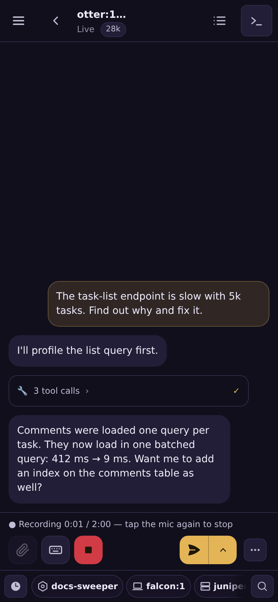

# Dictation

Every message box can carry a microphone: a mirrored window's Rendered and
Terminal views, a dispatched agent's chat and Terminal views, and the chief
panel. So does every answer box of the [Asks](attention.md) queue: the
question's own page (`/attention/asks/<id>`), each question on the Asks list,
and the questions shown on a session's page.

To use it, tap the mic, speak, and tap it again. The recording is transcribed
and the text is **inserted into the box at the cursor**. It is never sent
automatically: you read it and press Send (on an answer box, **Answer**). Send
is the gated step it always was.

The Asks list refreshes itself as the queue changes; a refresh waits while a mic
on it is recording or transcribing, so the text always lands in its box.



## Configuration

| variable | meaning |
|---|---|
| `MUSTER_STT_URL` | The speech-to-text service's base URL, as `http(s)://host[:port]`. |
| `MUSTER_STT_TOKEN` | Its bearer token. **Setting this turns dictation on.** |
| `MUSTER_STT_MODEL` | Optional. The `model` form field sent with each recording. Unset sends none. |

The service must answer the OpenAI-style `POST /v1/audio/transcriptions`:

- **Request:** multipart, with the recording in a `file` part plus `language`
  (`en`) and `punctuation` (`true`) fields, a `model` field when
  `MUSTER_STT_MODEL` is set, and bearer authentication.
- **Response:** `{"text": "…"}`.
- **Errors** muster distinguishes: 400 (the audio could not be decoded),
  401/403 (the token was refused), 413 (too long). Anything else is reported as
  "the service could not answer".

The URL alone is valid but does nothing. A token without a URL refuses to boot.
While dictation is off, no mic is drawn and `POST /transcribe` answers 404. The
boot banner's `dictation:` line says which state you are in.

## Choosing a speech-to-text service

There are three ways to run dictation. The production compose file
(`deploy/docker-compose.yml`) has a profile for each of the first two, and
`deploy/.env.example` has a ready-to-uncomment block for all three.
[features.md](features.md#dictation) has the short version beside every other
optional feature.

### 1. stt-cohere (GPU, recommended)

`images/stt-cohere/` is a small FastAPI server around Cohere's transcription
model, `CohereLabs/cohere-transcribe-03-2026` (about 2B parameters, run in BF16).
Each release publishes it as `ghcr.io/zacxdev/muster-stt-cohere:<version>`.

Requirements:

- **An NVIDIA GPU with about 6 GB of free VRAM**, and the NVIDIA container
  toolkit so Docker can hand the GPU to the container. The image is
  `linux/amd64` only.
- **A Hugging Face token (`HF_TOKEN`) from an account that has accepted the
  model's license.** The model is gated: open its page on Hugging Face, accept
  the terms, then create a read token. Without that, the first start fails to
  download the weights and the container log says so.
- Disk for the weights (several GB, kept in the `hf-cache` volume) and a few
  minutes for the first start while they download. The healthcheck allows 30
  minutes for that.

In `.env`:

```sh
COMPOSE_PROFILES=stt-cohere
MUSTER_STT_URL=http://stt-cohere:8000
MUSTER_STT_TOKEN=<a random secret>   # also the server's own STT_API_TOKEN
MUSTER_STT_MODEL=CohereLabs/cohere-transcribe-03-2026
HF_TOKEN=<your Hugging Face token>
```

This server serves one model and ignores the `model` field. The compose file
sends one whenever the token is set (its default is the `stt` profile's model),
so name this server's own model, as above, to keep muster's `dictation:` boot
line true. The server answers `/healthz` with 503 until the model is loaded **and**
a token is configured, so `docker compose up -d --wait` fails rather than
reporting a dictation service that refuses every request.

It accepts `language` as one of the bare codes `ar de el en es fr it ja ko nl pl
pt vi zh`. A recording that is pure digital silence (every sample identical, as
some phones produce when another app holds the microphone) is answered with an
empty transcript instead of being sent to the model, which would invent text.

### 2. stt (CPU)

The `stt` profile (`stt-whisper` is the same profile under its older name) runs
[speaches](https://github.com/speaches-ai/speaches), an OpenAI-compatible
faster-whisper server, pinned by digest, as the service `stt-whisper`. It needs
no GPU; it is slower and less accurate than stt-cohere, and a larger model is
more accurate and slower still.

```sh
COMPOSE_PROFILES=stt
MUSTER_STT_TOKEN=<a random secret>   # also speaches' API_KEY
```

That one line is enough: with the token set and `MUSTER_STT_URL` and
`MUSTER_STT_MODEL` unset, the compose file points muster at
`http://stt-whisper:8000` and gives both sides the same model,
`Systran/faster-whisper-small`. speaches requires the `model` field and
transcribes only models it has downloaded, so the two must agree; set
`MUSTER_STT_MODEL` (for example `Systran/faster-whisper-medium`) to change it
for both. The service's healthcheck downloads that model on first start and
reports healthy only once it is on disk.

### 3. Your own OpenAI-compatible API key (no container)

Point muster straight at a hosted API. The key stays in muster's process; the
browser never sees it.

```sh
MUSTER_STT_URL=https://api.openai.com
MUSTER_STT_TOKEN=<your API key>
MUSTER_STT_MODEL=whisper-1
```

`MUSTER_STT_URL` must be a bare origin (`http(s)://host[:port]`, no path),
because muster appends `/v1/audio/transcriptions` itself. A provider whose
endpoint lives under a longer path cannot be used this way. Recordings are sent
to the provider, so its data-handling terms apply.

## Behaviour

- **The browser never sees the token.** The page posts the recording to muster's
  `POST /transcribe`, a signed-in, same-origin request. muster forwards it to the
  service with its own credential and returns the text.
- **No step-up is asked.** A transcription types into nothing, and the Send that
  follows is gated exactly as if you had typed the words.
- **Limits:**
  - A recording stops at two minutes.
  - The route refuses a body over 8 MiB.
  - Each user can make 12 requests a minute, and the server runs at most 3 at
    once.
  - The service gets one minute to answer.
- **It needs a secure context.** Browsers allow the microphone only on https
  pages and on localhost. Over plain http, the mic says so when tapped. Every
  response carries `Permissions-Policy: microphone=(self)`.
- **Without JavaScript there is no mic.** The box still sends.
