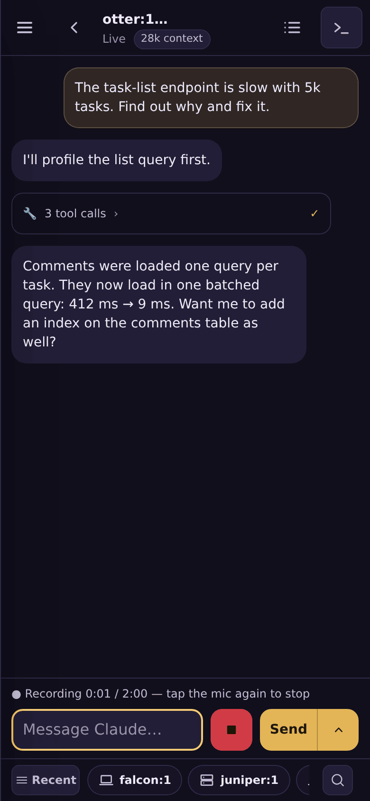

# Dictation

Every message box can carry a microphone: a mirrored window's Rendered and
Terminal views, a dispatched agent's chat and Terminal views, and the chief
panel.

To use it, tap the mic, speak, and tap it again. The recording is transcribed
and the text is **inserted into the box at the cursor**. It is never sent
automatically: you read it and press Send. Send is the gated step it always was.

## Configuration

| variable | meaning |
|---|---|
| `MUSTER_STT_URL` | The speech-to-text service's base URL, as `http(s)://host[:port]`. |
| `MUSTER_STT_TOKEN` | Its bearer token. **Setting this turns dictation on.** |

The service must answer the OpenAI-style `POST /v1/audio/transcriptions`:

- **Request:** multipart, with the recording in a `file` part plus `language`
  and `punctuation` fields, and bearer authentication.
- **Response:** `{"text": "…"}`.

The URL alone is valid but does nothing. A token without a URL refuses to boot.
While dictation is off, no mic is drawn and `POST /transcribe` answers 404. The
boot banner's `dictation:` line says which state you are in.

## Behaviour

- **The browser never sees the token.** The page posts the recording to muster's
  `POST /transcribe`, a signed-in, same-origin request. muster forwards it to the
  service with its own credential and returns the text.
- **No step-up is asked.** A transcription types into nothing, and the Send that
  follows is gated exactly as if you had typed the words.
- **Limits:**
  - A recording stops at two minutes.
  - The route refuses a body over 8 MiB.
  - Each user can make 12 requests a minute, and the server runs at most 3 at
    once.
  - The service gets one minute to answer.
- **It needs a secure context.** Browsers allow the microphone only on https
  pages and on localhost. Over plain http, the mic says so when tapped. Every
  response carries `Permissions-Policy: microphone=(self)`.
- **Without JavaScript there is no mic.** The box still sends.
