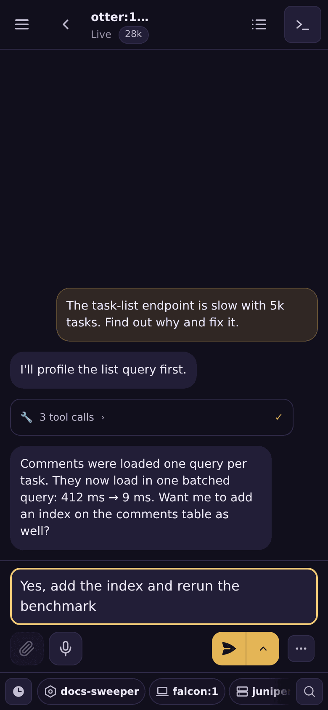
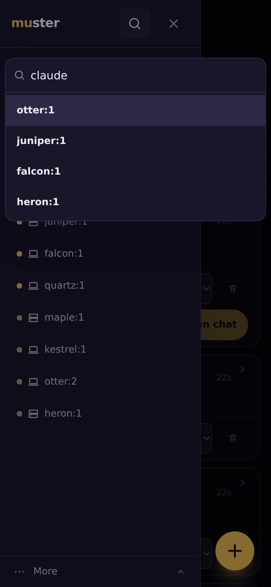
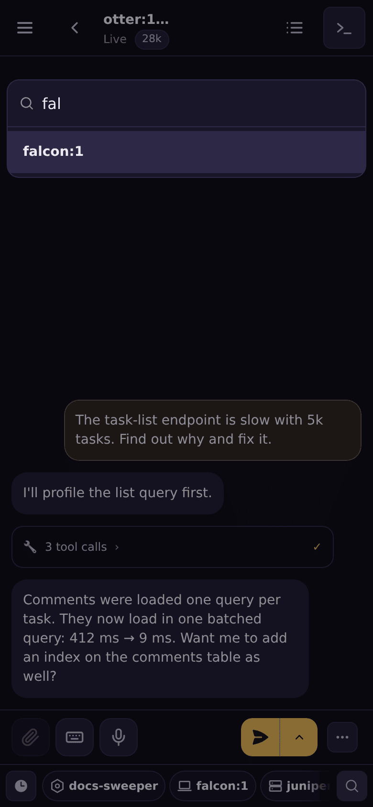
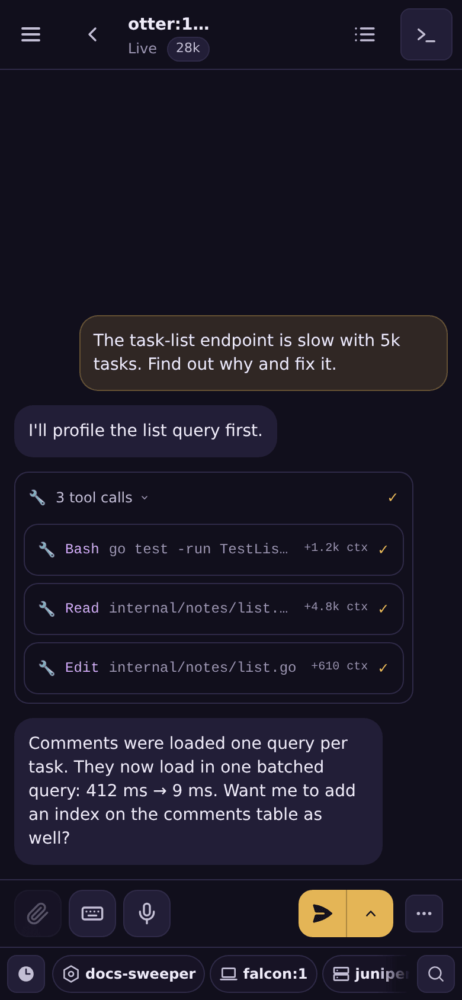
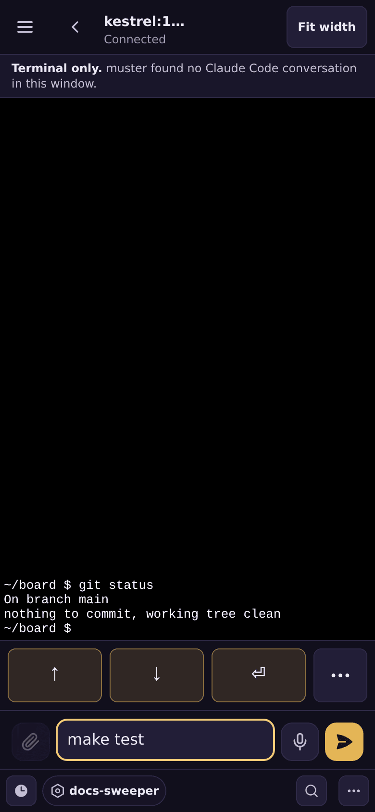

# Mirrored sessions

A **mirrored session** is a tmux window on one of your own machines, listed in
muster's sidebar (and the bottom bar's views). You can watch it, open its terminal, read a Claude
Code conversation as a chat, and send it a message, all from a phone.

Mirroring is off unless the server runs with `MUSTER_MIRROR=1`, and it needs a
database. When it is off, `GET /mirror/connect` and the mirror routes answer
404, and nothing mirrored is drawn.



## Mirrored sessions and dispatched agents

They are easy to confuse, and they behave differently:

| | mirrored session | dispatched agent |
|---|---|---|
| what it is | a session **you** started, in tmux, on your machine | a new session **muster** starts, in a Kubernetes pod |
| a message from muster | is typed into that same session | goes to the agent's own session |
| at your keyboard afterwards | the same session, with everything in it | nothing: it never ran on your machine |
| history | the session's own | its own, separate from yours |
| set up by the one-prompt install | yes | no: opt-in, needs a cluster ([provisioner.md](provisioner.md)) |

A mirrored session is a window onto a session you are already running. muster
starts no process for it, and keeps no copy of the conversation. So when you
answer it from your phone and come back to your machine, the conversation is
already there.

**muster sees only sessions inside tmux.** If you start Claude Code in a plain
terminal tab or in an editor, muster cannot see it. A second session that you
start in tmux to "get it into muster" is a separate conversation: it may share
the project's memory files, but your messages from muster go to it, and the
session you left open never hears about them. Run the session you actually use
inside tmux instead.

### Bring a session you already have into tmux

Quit Claude Code where it runs now, then, from the same directory:

```sh
tmux new -A -s work \; new-window -c "$PWD" 'claude --resume || claude'
```

This opens a new window in the tmux session `work` (creating `work` if it does
not exist yet) and starts the conversation picker there; pick the conversation
you were in. Already inside tmux,
`tmux new-window -c "$PWD" 'claude --resume || claude'` does the same.

- **Why not `tmux new -A -s work 'claude …'`:** `-A` attaches to `work` when it
  already exists and **ignores the command**, so nothing is resumed.
- **Why `--resume`, not `--continue`:** `--continue` takes the most recent
  conversation in the directory, which may be the separate session muster was
  typing into, not the one you had open. Use `claude --continue || claude` in
  place of `claude --resume || claude` only when you are sure the newest one is
  yours.
- **Why `|| claude`:** with no conversation to resume, `claude --continue`
  prints "No conversation found to continue" and exits, and pressing Esc in the
  `--resume` picker exits too (both with status 1, measured on Claude Code
  2.1.289). Without a fallback the tmux window closes with it; with one, a new
  conversation starts instead.

**Quit it first.** `claude --resume` of a conversation that is still open in
another terminal does not attach to it: Claude Code copies the conversation
into a NEW session and carries on there. muster mirrors that copy, and your
messages from muster go to it, not to the session you left open. When the other
copy is a Claude Code session on the same host, in the same project directory,
the window's Rendered and Terminal views say **Running in two
places** and name the other session's id. See [Two copies of one
conversation](#two-copies-of-one-conversation).

**Resuming an ended session** (`-resume-spawn`, below) is the one way a host
starts a Claude Code process itself. It is off by default, needs settings on
both the host and the server, and the one-prompt install sets neither.

## How it connects

A host connects to muster; muster never connects to a host. A small binary,
`muster-mirror`, runs on each host. It lists that host's tmux windows and opens
**one** WebSocket to muster, authenticated by a per-host *mirror token*. Terminal
attaches and rendered views are multiplexed back down that one connection.

muster holds no SSH key, address or inbound route to the host, and the host holds
no muster credential except its own token.

```sh
# where the server runs (needs DATABASE_URL); the token is printed once
muster-server mirror token create <host>      # also: mirror token ls, mirror token revoke <id>

# on the host
nix profile install github:ZacxDev/muster#muster-mirror   # or: go install ./cmd/muster-mirror
install -D -m600 /dev/stdin ~/.config/muster-mirror/token  # paste the token
muster-mirror -url https://muster.example.com -token-file ~/.config/muster-mirror/token
```

`<host>` is a lowercase DNS label. `muster-server mirror token create` requires
it. `muster-mirror -host` defaults to the short hostname. A token minted for one
host cannot register another.

Every flag can also be set as a `MUSTER_MIRROR_*` variable (the full list is in
[configuration.md](configuration.md#muster-mirror-host-agent)). Use the variables
when running under a systemd user unit, so the token never appears on a command
line. If muster sits behind an auth proxy, `GET /mirror/connect` must bypass it:
the route checks its own tokens. So must `POST /mirror/mcp` if you use the
host's MCP endpoint for its Claude Code sessions ([attention.md](attention.md#mirrored-claude-code-sessions)).

## What you see

- **One entry per tmux window.** Each window is addressed by its session and
  tmux's own window id (`@12`), not by its index, which tmux renumbers. An
  entry knows what runs in the window's active pane: Claude Code, opencode, a
  shell, or the command name (the search finds it by that kind). A host lists up
  to 512 windows and reads them with one tmux call per refresh, every 5 seconds.
- **Where they are listed.** The **sidebar** lists every entry like channels in
  a chat app: your chief first (if you turned one on), then every entry waiting
  on you, then the rest. The **session switcher**, the bar under the message box
  of a window's Rendered view, its terminal and an agent's chat page, has the
  same entries in four views (below). Home (`/`) opens your chief's chat, or the
  session you opened last.
- **Titles.** An entry is titled `<session>:<index>`. With `-labels-file` you
  can map a session to a codename: a JSON object `{"<session>": "<codename>"}`.
  Each of that session's windows is then titled `<codename>:<index>`. The raw
  session name is not drawn beside the title anywhere (the headers' room is the
  session's [tags](#session-tags)); it is the title's tooltip, it is in the
  Rendered view's full title (tap the title), and the search finds it. Each entry is checked on its
  own: an invalid one is logged and skipped, and a missing or unreadable file is
  logged and ignored, never fatal.
  When the same title appears on more than one host, every one of them carries
  its host (`mango:1 · <host>`); when it repeats on one host (two sessions given
  one codename), each also carries its tmux address (`mango:1 · <session>:<index>`).
  The sidebar, the switcher, both view headers and the page title always agree.
  These titles are the **fallback**: once a window's conversation has a
  [name](focus.md#a-sessions-name) (frozen from its first good focus title, or
  one you gave it with **Rename…** in the session's ⋯ menu), every one of those
  places calls it by that name instead, with no host or address beside it, and
  the codename, the tmux address and the host move to the name's tooltip (and
  the Rendered view's full title). The search still finds the entry by its
  codename first.
- **Most recently active first.** One flat order across all your hosts AND
  your dispatched agents, by last activity, newest first. A **Claude Code**
  window's last activity is its conversation's last message (the newest user or
  assistant message in its transcript, to the minute — not tmux's activity,
  which a tmux restart resets for every window, and not the rows a resumed
  session writes on start, nor the "No response requested." Claude Code writes
  itself); while that session is WORKING — a turn running, waiting on you, a
  background shell of its own — it is now, since Claude Code writes nothing
  meanwhile. A host from before this reports none, and the window falls back to
  tmux's. Any other window's is when its host last saw it active, to the
  minute; output in a pane counts as activity, not only keystrokes. A
  dispatched agent's is the newer of its last chat message and its last change
  (a status write, a rename). The host is not a section: it is the icon on each
  entry. A window whose host did not report activity comes last. Ties keep a
  stable order: agents first, then windows by host, session and index.
- **How recent, at a glance.** Each sidebar row draws a small dot tinted on the
  same 8-step Gruvbox scale as tmux's idle-fade window colours: bright green
  under 10 minutes, green to 30, aqua to an hour, yellow to 2 hours, orange to
  4, red to 8, purple to a day, grey past it.
- **Idle.** An entry with no activity for longer than `MUSTER_AGENTS_IDLE_AFTER`
  (14 days by default; [configuration](configuration.md)) is drawn last in the
  sidebar, under a collapsed **Idle (N)** group — never one waiting on you, the
  chief, or the page you are on. The group remembers whether you opened it.
  Nothing on a host is closed.
- **What a row says.** Besides its name: how many things wait on you there, a
  dot when it waits on you with nothing to count (an agent at a permission
  prompt), **offline** while its host is not serving it, and how many
  subagents and background shells it has running. A long name is cut; the
  whole name is the row's tooltip. A window's own Rendered view and terminal
  say under their header when its host is offline, and show the host's note
  about it.
- **Not an agent, and not stored.** muster keeps each connected host's window
  list in memory, under the token owner's account. A mirrored window cannot be
  dispatched, deleted, or mistaken for a muster agent. A disconnected host stays
  listed as `offline` for a day. The database holds `mirror_tokens`, as sha256
  hashes, and your pins and session tags (below), all under row-level security.
- **Pins.** On a session's own page (a window's Rendered view, an agent's chat
  page, or the Terminal view of either) the session switcher's **⋯** menu — at
  the switcher's right end, or, on a window's Rendered view, in the message
  box's row beside Send — has **Pin this session** / **Unpin this session** — a window with no
  Rendered view is pinned from its Terminal view. Your pins are the session switcher's **Pins** view (below),
  on every device you sign in on, and come first in its **All** view.
  A mirrored pin is the window's address — host, session and tmux window id —
  so it survives renumbering, a list refresh and a muster restart. A pin whose
  window is gone is kept and shown nothing; it comes back with the window. A
  tmux-server restart (a reboot) reissues window ids, so after one a pin names
  whichever window now has that id in a same-named session, or nothing — re-pin.
- **Session tags.** The same **⋯** menu has **Tags…**, your own labels on the
  session, drawn in its headers and found by the search: see
  [Session tags](#session-tags).
- **The session switcher.** The bar under the message box of a window's
  Rendered view and an agent's chat page, and at the bottom of the Terminal
  view of either (whether or not that view can send), so you switch sessions
  without going back to the Rendered view. Its left button shows the current
  view's icon — a clock, a bell, a pin, a grid — and opens a menu of four
  views, each named beside its icon: **Recent** (the entries you last opened, on any device), **Waiting**
  (the entries waiting on you: an agent or a Claude Code session called
  `attention_ask`, a mirrored Claude Code session stopped at a prompt or
  holding an `AskUserQuestion` picker — the [attention queue](attention.md)'s
  **Question**, **Session waiting** and **Session question** items — or a
  dispatched agent blocked at a permission prompt; a reply draft does not
  count), **Pins** and **All** (every entry, pins first). Each pill shows the
  entry's whole name, a window's codename with its `:<index>` (`wheat:2`).
- **Search.** The magnifier on the switcher, the magnifier at the top of the
  sidebar, or `/` outside a text field, opens one search box that finds any
  entry by its tmux codename (`mango`, `wheat:2`) or its title as you type —
  and, after those, by its repository, its kind (`opencode`, `shell`), a
  window's raw tmux session name (`scratch11`), its **host's name**
  (`laptop`; `cluster` for dispatched agents) or one of your
  [tags](#session-tags) on it (`needs-review`). The Sessions dock's filter
  matches the same words. The arrows move and Enter opens
  it. On a page with no switcher it searches the sidebar's list.
- **Host icons.** Every entry draws its host's icon beside its name — in the
  sidebar, its session-switcher entry and the badge on its own pages — with the
  host's name in the icon's tooltip. Dispatched pod agents draw the cluster's
  icon, which no mirrored host ever draws. A host given an icon in
  `MUSTER_HOST_ICONS` (`laptop=laptop`) draws it, and no other host does. Any
  other host's icon is picked by when its first mirror token was minted, so
  your first hosts usually each draw a different one, and minting a token for
  a new host (or a second token for an old one) never changes an existing
  host's icon.




### Session tags

On a session's own page the **⋯** menu (see **Pins** above) has **Tags…**: a
small editor with your tags on the session as chips (× removes one) and a box
that adds one.

- **Spelled as a [task tag](tasks.md) is:** lower case, spaces become `-`,
  letters, digits and `. _ / -`, at most one `:`, up to 64 characters. A
  session carries at most 20. The task tags' reserved namespaces (`gate:`,
  `project:`, …) mean nothing on a session: every session tag is a plain label.
- **Yours alone.** Tags are kept by the server, so they follow you across
  devices, and nobody else — an admin included — sees them.
- **What they are on.** A mirrored window's tags are on its **tmux session**,
  so every window of that session carries them. A dispatched agent's are on
  the agent, and are deleted with it.
- **Where they show.** The Rendered and Terminal views draw them in the header
  after the title: one tag as its chip, more as the first chip and **+N**,
  which opens the full list. An edit shows at once, without a reload.
- **Search.** The search box (above) and the Sessions dock's filter find a
  session by any of its tags.

## Viewing never moves your terminal

A tmux session has one current window, shared by every client attached to it.
If muster attached to your session to show you a window, it would change the
window you are looking at.

So muster never shows a window through your session. Each viewer gets a
short-lived session of its own, `muster-view-<random>`, that **links** the one
window it shows. Its client takes no part in sizing (`ignore-size`), and tmux
removes the session when the viewer leaves (`destroy-unattached`).
`muster-mirror` also kills a viewer session on close, and removes any leftover
ones when it starts. A message is pasted into a *pane id*, which needs no window
switch at all.

⚠ While a viewer is attached, its session is visible to other tmux tooling:
`tmux ls`, a session picker, and `session-created` / `client-attached` hooks.

The terminal never shrinks your window either. The host reports the window's
size, and the browser's terminal uses that size unless the browser's own is
larger. On a phone, a wider window is shown in a scrolling, pinch-zoomable view
with a "Fit width" control.

## Rendered and terminal views

When a window's active pane runs Claude Code, its entry opens a **rendered** view
by default. Prompts and replies appear as chat bubbles, and each tool call as one
collapsed row showing the tool, its target, and whether it succeeded, failed or
is still running. It updates live while a turn runs. Thinking is never shown.

The **Rendered | Terminal** switch in the header moves between the two. On a
phone it is one icon button, for the view you are not on: a speech bubble opens
the Rendered view, a `>_` prompt opens the Terminal view. The Rendered view is
meant to be where you do everything; the Terminal view is the fallback for
anything it does not show. A window that has no Rendered view says why at the top of
its Terminal view ([below](#why-a-window-opens-in-the-terminal)).

Each tool row also shows how much conversation context the call and its result
added, such as `+3.3k ctx`. So do a subagent's card and a question card. The
number is measured from the transcript's own token usage: the context of the
turn after the call, minus the context of the turn that made it. That
difference also includes any text the calling turn wrote, and the few small
attachments Claude Code adds before most requests that are judged negligible
(see below). When one turn made several calls, the measured total is split
between them by the size of each call and result. Each share is marked `~`, and
the row's tooltip gives the total. When nothing can be measured, the number is
an estimate, also marked `~`. That happens when the runtime records no usage
(opencode), when something else entered the context before the next turn, or when
the context shrank. Something else means a prompt, a notice, or context Claude
Code injected that is not negligible, such as a message typed while the tool
ran or a diagnostics report. The tooltip says which case it was. An image is
sized by its pixels: about width × height / 750 tokens, at most about 1600. A
call whose next turn has not started yet shows no number. opencode rows show
none either: muster reads neither their usage nor their output.



A **background** subagent's card counts only its launch: the call's result is
the acknowledgement that it started. Its report reaches the conversation later,
as a task notification (a harness notice the view draws as its own row), which
is not attributed to the card. The context the report adds shows in the
header's total, not on the card.

A call still running when the page's connection drops is still numbered when
its next turn arrives: each batch the server sends leaves a checkpoint of the
attribution, and a connection that resumes from exactly that place picks it up.
After a server restart, or a resume from anywhere else, such a call shows no
number.

### How the estimate is calibrated

An estimate is the calling turn's own `output_tokens` (its share of them, by the
size of each call's input, when it made several calls) plus the result's size at
**2.2 bytes per token**. With no `output_tokens` known (opencode, an older host),
it is the call and result size at that rate. That rate was fitted on Claude
Code transcripts only, so for another runtime or model the figure is not
validated, in either direction.

The rate and the negligible attachments are fitted, not assumed.
`go run ./cmd/muster-toolctx-calibrate` reads a directory of transcripts and
prints aggregates only (counts, medians, percentiles), never a path, id or any
text. Its samples are single-call gaps: one call, its result and the next turn,
with no prompt, notice or error between.

**Which attachments are negligible.** A gap's *excess* is its growth − the
turn's output − the result's tokens: what entered the context that is neither.
The baseline is the median excess of gaps with no attachment. A type is
negligible when at least 30 gaps hold it and otherwise only negligible types,
their median excess is within 50 tokens of the baseline, and their p75 within
100. The set is grown from the most frequent type down until nothing more joins.
The command prints the table and says whether the set matches the code's.
`TestTheNegligibleSetIsTheCalibratedOne` pins it. On a local set of 697
transcripts (baseline −1, n = 1,493):

| attachment type | gaps holding it | gaps judged | median excess | p75 | decision |
|---|---|---|---|---|---|
| `total_tokens_reminder` | 119,330 | 96,292 | 27 | 43 | negligible |
| `hook_permission_decision` | 70,087 | 56,944 | 29 | 46 | negligible |
| `task_reminder` | 8,674 | 7,913 | 152 | 166 | spoils the gap |
| `diagnostics` | 4,158 | 3,385 | 401 | 839 | spoils the gap |
| `silent_turn_reminder` | 3,055 | 2,830 | 57 | 76 | spoils the gap |
| `queued_command` | 2,151 | 1,667 | 450 | 1,675 | spoils the gap |
| `hook_success` | 1,717 | 17 | −4 | 4 | spoils the gap (too few to judge) |
| `hook_additional_context` | 1,693 | 0 | – | – | spoils the gap (too few to judge) |
| `command_permissions` | 1,533 | 1,169 | 8,364 | 17,108 | spoils the gap |
| `deferred_tools_record` | 1,508 | 1,319 | 36 | 438 | spoils the gap |
| `skill_listing` | 1,398 | 982 | 284 | 1,114 | spoils the gap |
| `edited_text_file` | 1,151 | 890 | 1,449 | 3,632 | spoils the gap |
| `prompt_snapshot` | 456 | 176 | 30 | 80 | negligible |
| `deferred_tools_delta` | 351 | 60 | 221 | 247 | spoils the gap |
| `mcp_instructions_delta` | 252 | 0 | – | – | spoils the gap (too few to judge) |
| `credential_org` | 177 | 120 | 20 | 40 | negligible |
| `environment` | 166 | 152 | 108 | 150 | spoils the gap |
| `read_truncation_notice` | 74 | 49 | −1,164 | −771 | spoils the gap |

Rarer types (fewer than 30 gaps) all spoil the gap, as does any type the table
does not name. Under this set, 100,487 of the 124,442 single-call gaps are
measured.

**The rate.** The measured growth minus the turn's `output_tokens` was never
negative, so the turn's output re-enters the context in full and the rest is the
result's. Transcripts are split in half by a hash of their path: the rate is
fitted on one half and the error reported on the other. The median of result
bytes / (growth − output), over results of 400 bytes or more, was 2.16 (p25
1.94, p75 2.40; n = 27,366), used as 2.2. On the held-out half (47,797 gaps),
|estimate − measured| / measured was:

| estimate | median | p90 | measured / estimate, median |
|---|---|---|---|
| before: (call + result bytes) / 4 | 0.61 | 0.78 | 2.55 |
| after: output + result bytes / 2.2 | 0.05 | 0.12 | 1.03 |
| after, with the output withheld: (call + result bytes) / 2.2 | 0.29 | 0.60 | 1.40 |

The last row is Claude Code's own gaps with the output withheld. It is not a
measurement of opencode or any other runtime.

`TestTheEstimateIsTheCalibratedSplit` pins the rate. Changing the rate or the
set is a decision made with that tool's numbers, not a drift.
Every window has its own view: two Claude Code windows in the same directory each
show their own conversation.

The **Terminal** view is one tap away, for every window. It is an xterm.js
terminal attached through the tunnel.

Switching between a window's Rendered and Terminal views keeps both open. The
first switch opens the other view over the current one. After that, a switch
only shows one view and hides the other: the transcript is not read again and
no new terminal is attached. Both views stay connected for as long as you stay
on the window. A window with both views open uses one rendered view and one
terminal of the host's limits below. Opening another window, going back to the
list or reloading closes both connections. Reloading opens the view you were
on, and Back leaves the window, because a switch does not add a history entry.
A dispatched claude-code agent's chat and Terminal switch the same way.



Rendered views stream bounded events: at most 300 when opened, taken from the
last 4 MiB of the transcript, with each field capped. Anything in them that
looks like a secret is replaced by `«redacted»` on the host, before it is sent:
prompts, replies, errors, tool calls' targets and arguments, tool output,
notices, questions and their answers, and the message index. The shapes it
knows are the [attention queue's](attention.md#what-is-in-it); it is a
heuristic, so a secret in a shape it does not know still passes. A host
running an older `muster-mirror` sends the transcript unredacted. The
transcript file itself is never sent, and nothing is stored on the server. Limits per host: 8 open
terminals, 8 rendered views. Limit per server: 64 hosts.

### A rendered view's snapshot, kept on this device

Each rendered view keeps a copy, in this browser (IndexedDB), of what it drew
and where its stream stood. Opening the window again paints that copy at once
and resumes the stream from where the copy ends, instead of waiting for the
host to send the conversation again. Until the stream answers, the status line
says "Connecting…"; after a second without an answer an **Updating…** chip
shows, in room the header always keeps for it. If the stream is refused or
closes before it answers, the copy is removed from the page and from the
browser, and the view starts again from the beginning.

- **What is kept** is what the page already showed, as the server sent it
  (redacted on the host as above), plus the stream's position. At most 2 MiB
  per window and 12 windows; the oldest go first.
- **Five minutes since it was written, thirty since a full read.** A copy is
  shown only within five minutes of its last save, and only within thirty
  minutes of the last time its conversation was read in full from the host
  (a copy that is only ever resumed keeps the HTML it was first drawn with, so
  after thirty minutes the window is read from the start again). Both are
  checked whenever a copy is read: when a window opens, and when warming
  resumes one.
- **Per user and per build.** A copy names the signed-in user and the muster
  version, and is checked against both before it is shown. Any other user's or
  version's copy is deleted unread.
- **When copies are deleted.** A copy that fails any of these checks is deleted
  when it is read, or when the next muster page that keeps copies (the Agents
  list, an agent's page, a rendered view) is loaded and sweeps them. Until
  then it stays in the browser's storage, unread: a session that ends at a
  sign-in proxy in front of muster, or a tab that is simply closed, leaves its
  copies there until the next such page load or a visit to muster's sign-in
  page. At most 12 copies of at most 2 MiB each are ever kept.
- **Signing out deletes them all.** The sign-in page (and every other page
  shown signed out) deletes them, and a sign-out ends there. Another tab still
  open on a rendered view stops keeping copies at that moment, for as long as
  it stays open.
- **Warming.** While you are on an agent's page or a rendered view, muster
  refreshes the copies of up to three windows you are likely to open next
  (pinned, then recently viewed, then the ones this browser has copies of), one
  at a time when the browser is idle, every two minutes at most, skipping a
  copy saved in the last two and a half minutes. It reads each
  through the window's stream, never its page, so a warmed window is not
  recorded as visited and does not move in **Recent**. It stops on a hidden
  tab, with Save-Data on, or on a 2G connection, and reads at most 3 MiB per
  pass. Refreshing a copy resumes its stream, so only what is new is read.

### Why a window opens in the terminal

The Rendered view is the main way to read a Claude Code session; the Terminal
view is the fallback. A window with no Rendered view opens in the Terminal view,
and a line under its header says why. The reasons:

| line | what it means | what to do |
|---|---|---|
| muster found no Claude Code conversation in this window. | nothing in the pane is Claude Code (a shell, Codex, Gemini CLI) | nothing; or start `claude` in it |
| Claude Code has not written this conversation yet. … | Claude Code started, but you have not sent its first message | send one; the window opens the Rendered view from the next refresh |
| Claude Code is running here, but muster-mirror cannot match it to a transcript … | neither Claude Code's sessions file nor its working directory leads to a transcript that is this window's alone: none at all, or only a guess another window in the same directory makes too | see the cases below; update Claude Code if it is old (a current one names its conversation in a sessions file); on the host, `muster-mirror -list -claude` lists the Claude Code windows it did resolve |
| Claude Code is running here, but muster-mirror cannot read its environment … | Claude Code runs, nothing else resolved it, and its environment cannot be read (another user's process; on macOS, a process the kernel returns no environment for), so its config directory is unknown | run Claude Code as the user muster-mirror runs as; on the host, `muster-mirror -list -claude` |
| muster-mirror cannot read this host's process table … | the host's OS has no process lookup (Linux and macOS have one), or reading it failed, and the window's command is `claude` | on the host, `muster-mirror -list -claude` |
| This host's muster-mirror is too old to send the Rendered view. … | the host runs a muster-mirror from before rendered views | update it |

A muster-mirror older than these reasons sends none, so its windows show the
first line whatever the cause.

Cases checked against the code:

- **A custom `CLAUDE_CONFIG_DIR`.** muster-mirror reads the variable from the
  Claude Code process's own environment (`/proc/<pid>/environ` on Linux, the
  `kern.procargs2` sysctl on macOS), so a value
  you export in your shell profile is followed even though muster-mirror's
  service never reads that profile. A process that sets none uses its own
  home's `.claude`, whatever muster-mirror's service sets. Only an absolute
  path is followed; a relative value, or an environment muster-mirror cannot
  read, falls back to muster-mirror's own `$CLAUDE_CONFIG_DIR` or `~/.claude`.
- **`claude` through `npx`, an npm global install, a NixOS wrapper or a
  wrapper script.** The process walk finds the Claude Code process anywhere
  below the pane's shell, by its name (`claude`, `.claude-wrapped`), its
  `argv[0]`, or the npm package's entry script in its arguments.
- **A session started before muster-mirror.** It makes no difference:
  every refresh reads the panes as they are now.
- **macOS (experimental).** macOS has no `/proc`, so muster-mirror asks the
  system instead, as your own user and with no root: one `ps` for the process
  table, the `kern.procargs2` sysctl for each of your processes' arguments and
  environment, and one `lsof` for working directories. The native installer's
  binary (`~/.local/share/claude/versions/<version>`) is recognised by that
  path. This lookup is tested against the documented formats but has not yet
  been run on a real Mac. The Terminal view's attach is Linux-only today
  (`internal/mirrorhost/pty_other.go`): on a Mac, a window without a Rendered
  view cannot be viewed at all.

### How a pane's transcript is found

The host walks the pane's process tree to the `claude` process. Then it tries
each of these in order:

1. **The pane map**, if `-pane-map-dir` is set. This is a directory that a
   Claude Code hook keeps current, holding one file per pane: `claude-p<N>.json`
   for pane `%N`. Its first JSON value is:

   ```json
   {"runtime":"claude","pane_id":"%N","tmux_pid":"<tmux server pid>","session_id":"…","transcript_path":"…","claude_pid":"<the claude process>","claude_start":"<its start time>"}
   ```

   The start time is field 22 of `/proc/<pid>/stat` on Linux, and on macOS
   the output of `LC_ALL=C TZ=UTC ps -o lstart= -p <pid>` with the ends
   trimmed: the same token Claude Code writes as `procStart` in its sessions
   file on each OS.

   An entry is used only while it still describes the pane: the same tmux
   server, the same Claude process (pid and start time), and a transcript that
   exists as `<session_id>.jsonl` under the Claude config directory's
   `projects/`. This comes first because Claude Code does not rewrite its
   sessions file when a conversation changes id within one process.
2. **The CLI's own sessions file**, `sessions/<pid>.json`. If Claude Code has
   parked a background job (`/bg`), the host follows it to the job's own
   session.
3. **A guess**: the newest transcript in the process's working directory. This
   is used only when the process has **no** sessions file. A guess that two
   panes would share is dropped.

If the sessions file exists but its transcript cannot be found, the window has
no rendered view; the host does not guess.

The Claude config directory is the `CLAUDE_CONFIG_DIR` in the Claude Code
process's own environment when that is an absolute path, else that process's
own `~/.claude` (see the cases above for the fallbacks). `muster-mirror -list -claude` prints one row per Claude Code window,
ending in how its transcript was resolved: `pane-map`, `sessions` or `guessed`.
`-list -windows` prints every window that would be registered.

### Two copies of one conversation

A copy made by `claude --resume` starts with the same rows as the original,
each with the same `uuid` and `timestamp`; only `sessionId` differs. No row
names the session it was copied from, so the host cannot tell which of the two
is the copy, and the warning does not claim to. The host compares the first
row that has both a `uuid` and a `timestamp` (the conversation's origin) with
the other transcripts in the same project directory. It warns on a window when
another transcript with the same origin is still running elsewhere, meaning
either:

- a running Claude Code process other than the window's own names it in its
  sessions file (`sessions/<pid>.json`, the same pid and start time); or
- no sessions file names it, and its last message is less than 5 minutes old
  (`LiveCopyWindow` in `internal/mirrorhost/livecopy.go`). A recent change time
  alone does not count: Claude Code appends bookkeeping rows to transcripts it
  is not running.

A `/bg` job's transcript is a copy too, but one you asked for: it is never
warned about. The host reads only each transcript's first rows, once, and
lists a project directory at most every 15 seconds.

Claude Code deletes its sessions file when it exits, so when you close the
other copy it falls to the second rule: the warning stays until 5 minutes have
passed since that copy's last message, then clears.

**Scope:** only Claude Code transcripts on the mirrored host, in the same
project directory (the same config directory and working directory) as the
window. A copy running on another machine, or under another config directory,
is not seen.

## Read-only, interactive, and sending

`muster-mirror` is **read-only by default**. muster then draws the Terminal
view's keys disabled and refuses an interactive attach. Read-only is enforced
in three places:

- muster refuses it;
- the host refuses it, and drops keystrokes on a read-only stream;
- tmux attaches the client read-only (`-f read-only,ignore-size` for a window
  viewer, `attach -r` for a session).

The host opens only windows it listed itself.

🔴 **`-interactive` is a shell on the host.** An interactive tmux client can
switch to any session on that tmux server, or open a new window. So anyone who
can type into the host's Terminal view in muster can run commands there, as the
user `muster-mirror` runs as. Live keys are **always on** in that view — there
is no switch — but they still need a recent sign-in: with a stale one the
terminal attaches without them, and the first key you press asks you to
confirm it's you (see [sending-and-step-up.md](sending-and-step-up.md)). The "only listed windows" rule limits what a
read-only viewer can see. It does not limit an attached interactive client.

With `-interactive`, both views get a message box. Typing into one requires a
recent sign-in. See [sending-and-step-up.md](sending-and-step-up.md).

On a touch screen the **Rendered view's** box starts collapsed, to give the
conversation the room: its row is **Type a message** (a keyboard) beside the
mic, the session's **⋯** and Send. Tapping **Type a message** opens the box and
focuses it, and it stays open until you leave the page. Anything that puts text
in the box opens it too — a draft kept from before, the mic's transcript, a `/`
command, a suggested reply, a message put back with **Send again**, an attached
file — so text is never hidden. With a mouse (a fine pointer) the box is always
shown, as is the Terminal view's.

### What the host never types into

🔴 Before the host types anything into a pane — the Terminal view's message
box, a Claude Code send, an answer typed into Claude Code's question picker —
it walks the pane's process tree from its root process, at that moment, and
refuses when the tree holds:

- an opencode on the pane's terminal ([below](#muster-does-not-send-to-opencode-yet));
- a terminal multiplexer client: `tmux`, `screen`, `dtach`, `abduco` or
  `zellij`. A tmux started inside the pane can show a session of another
  server, whose programs the host cannot see from this pane, so the host
  refuses rather than guess: "Not sent: this pane runs another terminal
  multiplexer…";
- a process it cannot read (its `stat` or its command line), which is not
  presumed safe: "Not sent: muster-mirror could not check what runs in this
  pane…". A process forked after the host read the process table — a busy
  Claude Code pane's tool calls fork all the time — is read on its own then,
  and walked like any other; only one that still cannot be read refuses.

Nothing reaches the pane, and the page says why, whether or not script ran.
The host decides this itself, by what runs in the pane at the moment it
types. It does not depend on the server's version. Shells, Claude Code and
other programs are otherwise unaffected. A host with no `/proc` (macOS)
cannot see processes, and types as before.

### muster does not send to opencode yet

🔴 The same host guard refuses to type into a pane whose process tree holds
[opencode](https://github.com/anomalyco/opencode): a process whose name or
first argument is `opencode` (the Nix wrapper's `.opencode-wrapped`
included), **and that is on the pane's terminal**: its stdin, or its
controlling terminal, is the pane's. An opencode started with no terminal
(Claude Code's Bash tool running `opencode run`, stdin `/dev/null`) does not
make its Claude pane refuse. When either terminal cannot be read, the host
refuses. An npm or bun install's JavaScript shim is refused through the
native `opencode` it starts, which is in the same tree. A paste
into opencode is blind, because nothing checks what its screen shows, and
Enter there can answer a permission request it is showing. Every paste is
refused this way, the Terminal view's box included, and the page says "Not
sent from here: opencode runs in this pane, and muster never types into
it…". A message reaches opencode only through its own API, from the Rendered
view of a pane started with `muster-mirror opencode` ([sending to
opencode](#sending-to-opencode)).

The host decides this itself, from the pane's processes at the moment it
types, not from the window's `opencode` label: a window labelled `zsh` whose
pane runs opencode is refused too.

Known gaps (the host types into these panes as into any other):

- an opencode that runs inside a JavaScript runtime (`bun` or `node`) and
  starts no native `opencode` binary: neither process is named opencode;
- an opencode over `ssh`, or inside a container (`docker exec`, `podman
  exec`): its processes are not in the pane's tree;
- a renamed binary, or one run through a symlink of another name: its name
  and first argument do not say opencode.

### opencode's token (`muster-mirror opencode-pair`)

muster-mirror reads a host's opencode v2 server (the background service every
opencode TUI on the host is a client of, `127.0.0.1:<port>`) through its HTTP
API, with a **pair token** of its own — never the server's password. Pair each
host once:

```sh
muster-mirror opencode-pair
```

It reads the service's **registration file**, `$XDG_STATE_HOME/opencode/service-prod.json`
(else `~/.local/state/opencode/…`; `service.json` for the latest, dev, beta
and next channels; `-registration <file>` names another). That file is where
opencode keeps the server's url and password for its own clients. The pairing
step then:

1. refuses a url that is not a loopback address;
2. asks the server for a pairing code with the password (`POST /api/pair`);
3. redeems the code for a token (`GET /auth/connect/<code>`);
4. writes `{"url", "token"}` to `~/.muster/opencode-token` (mode 0600;
   `-token-file`, or `MUSTER_MIRROR_OPENCODE_TOKEN_FILE`).

It prints the file it read, the server, the token's fingerprint (the first 8
hex digits of its SHA-256) and its expiry, and the file it wrote. The password
is used for that one request and kept nowhere, and nothing prints the password,
the code or the token.

The daemon reads the same file (`-opencode-token-file`,
`MUSTER_MIRROR_OPENCODE_TOKEN_FILE`; default `~/.muster/opencode-token`). It
refuses a file others can read, a symlink, and a url that is not loopback. A
token lives 30 days. Within 10 days of its expiry, the daemon mints its
replacement with the token itself, writes it to the same file (0600, whole),
and only then uses it. It checks hourly and logs each renewal and each failure
by fingerprint. A failing renewal, a token within 3 days of expiry and an
expired token are also shown in the opencode window's rendered view and by
`-list -opencode`.

### opencode windows

A window whose pane runs the opencode TUI is listed as an **opencode window**.
The TUI is an `opencode` process on the pane's terminal (its stdin) with no
subcommand (`serve`, `run`, `pair`… are not the TUI). With a token, the host
also resolves the session the pane shows, **by the pane's title**. The TUI
names its pane `OC | <session title>` and cuts a long title with `…`. The host
matches that title against the server's root sessions: the whole title, or the
part before `…` as a prefix. It shows a session only when **exactly one** root
session matches. Two sessions with one title (opencode's default title, say)
match nothing, and that window gets no view rather than a guess. A TUI started
with `--standalone` or `--server` runs on another server and is never matched.

The window opens a **read-only rendered view**: the session's prompts,
the agent's replies, and each tool call by its name and target (the command,
the file). It never shows a tool's input or output, nor the model's reasoning.
The view opens with a row saying how the session was found: "matched by
title" (a heuristic: a renamed session, or a TUI that switched sessions, moves
it), or "started by muster-mirror opencode" for a pane the launcher bound. Text appears once
it is final (a reply streams in place upstream), and the view starts over when
something it drew changes. The busy marker comes from the server's event
stream (`session.status`). While that stream is down the status is unknown, and
unknown fails closed.

When the token needs the person — a renewal is failing, it is within 3 days
of expiry — the view's first row says so, in the same words `-list -opencode`
prints (and the window's note, below).

The composer of a title-matched window, or of any opencode window on a host
that did not opt in, is disabled and says which. What the session **waits
on** does reach muster (below).

#### Sending to opencode

A message is sent to an opencode session through the opencode server's API,
never as keys, when all of these hold (each checked by muster and again by the
host):

- the host's muster-mirror runs with `-interactive` and `-opencode-send`
  (`MUSTER_MIRROR_OPENCODE_SEND`, off by default) and holds an opencode token;
- the pane was started with **`muster-mirror opencode`** (below), so the host
  knows its session, not by its title;
- the session is idle (a queued message waits until it is), with nothing it
  is waiting on;
- your sign-in is fresh, as for every send.

Send, Queue and the optimistic pending bubble work as for Claude Code
([sending](sending-and-step-up.md)), and so do attachments (each a line with a
signed link, as for Claude Code) and dictation. A message muster could not
confirm is **Not confirmed**, and its **Send again** posts the same opencode
message id, which opencode admits once. A message whose first word is one of
opencode's slash commands (`/review`, `/init`, …) is refused: sent as a
message, the model would read it as text. Type it in the terminal.

**`muster-mirror opencode [flags] [<directory>]`** starts the opencode TUI
inside tmux on a session it names: a new one it creates first (so you can send
to it before typing anything), or `-s <session id>`. It records the pane and
its session for the host, then runs `opencode --session <id> …`. It refuses to
start when the TUI's version differs from the running opencode service (the
TUI would restart the service, which can sign other clients out), naming both
versions and the fix, `opencode service restart` — whether or not it can bind
the pane. A TUI whose version cannot be read starts all the same, with a
warning. Outside tmux, or with
`--standalone`, `--server` or `-c`, it starts opencode unbound and says why.

If the TUI then switches to another session, the window's note says so, and a
message still goes to the session the Rendered view shows (the one the pane
was started on).


#### opencode's permission requests and questions

When the session a window shows — or a subagent's child session under it —
asks the person something, the host reads it from the opencode server's event
stream and the window becomes **waiting**, exactly as a Claude Code window with
a prompt does:

- a **permission request** (`permission.asked`: a tool call its rules say to
  ask about) is a *Session waiting* item, notified as "A session is waiting on
  you", "Waiting: <tool> · <window>" — the tool's name only on the lock
  screen, the command on the page;
- a **question** (the question tool's form, `form.created`) is a *Session
  question* item, notified as "<window> is asking" with its question and, for
  one question, its options — when muster can relay its answer; one it cannot
  keeps its card (which says to answer it in the terminal) and is notified as
  a plain waiting window.

Either notification waits 60 seconds and is sent only if the window still
waits then ([attention.md](attention.md#stalled--waiting-session-state)); the
item itself is on the page at once.

Answered, rejected or cancelled in the terminal (`permission.replied`,
`form.replied`, `form.cancelled`), the window stops waiting and the item and
its notification are withdrawn. An ask that was pending before the host's
event stream opened is read from the session's pending lists when its window
is first matched. If the stream drops, the asks last known stay up — no
notification is withdrawn — until the reconnect re-reads them; an interrupted
turn takes its permission request with it (opencode sends nothing else that
says so). A subagent's ask is shown on its root's window only when the
stream saw the subagent's session created; one started while the stream was
down is the terminal's.

**Answering from muster** follows the same gate as answering Claude Code's
questions: an `-interactive` host (with an opencode token) relays an answer
through opencode's API with its own token, never keys:

- a permission request: **Allow once** or **Reject**. muster never sends
  "always", which widens the session's rules past the one call;
- a question: one of its options, when it is **one single-select question**
  of at most 4 options whose labels muster can show unchanged. A form of
  several questions, a multi-select, or a free-text answer is answered in the
  terminal.

The answer needs a sign-in from the last few minutes. muster re-checks, at the
moment it sends, that the window still waits on exactly that ask and offers
that answer, and the host checks again against what opencode holds now. On a
read-only host (`-interactive` off), the ask still reaches the queue and
notifies; its card says the answer can't be relayed from there. A non-default
tenant's daemon follows its own `-interactive`: `-opencode-read-only` (set on
every `muster-mirror@<tenant>`) is about **renewing the token** only, and
decides nothing about answers.

A window has no view, and an unknown status, when the host has no token, the
server refuses the token (it expired, or the server's password was rotated),
the title matches no root session or several, or the TUI is on another server.
The window's terminal page says which, in one line ("opencode is not paired on this
host: run muster-mirror opencode-pair", "… ambiguous, so none is shown", …);
an open view that loses its session closes with the same line. The host sends
the line with the window (`Window.AgentNote`: at most 200 bytes, on at most 8
windows of a list). `muster-mirror -list -opencode` says it too, with the
detail:

- `token`: the token file, its fingerprint and expiry, or `none` and why;
  `token-health`: the token's line, when it has one (failing renewal, close to
  expiry, expired);
- `server`: `ok` and the server's version, `REFUSED the token`, or
  `unreachable`;
- per opencode window: its pane, TUI process, session (`-` for none), status
  and `source` (`title` when matched); its `pane-title`; the `match` ("matched
  by title", noting a prefix match); and `no-view` with the reason.

`-list -windows` prints an opencode window as
`opencode <pane> <state> <session id or -> <source>`.

🔴 **A token is not scoped and cannot be revoked on its own** (upstream at
`6ec5682`, docs/design/opencode.md). It reaches the whole opencode API. muster
only ever reads with it, except the renewal's `POST /api/pair` and — on a
`-interactive` host — the answer to a permission
request or question you gave in muster (`POST …/permission/<id>/reply`,
`POST …/form/<id>/reply`). To take muster's access away, rotate the opencode service
password. That revokes every token, muster's and every other paired client's.

### Hermes support was removed

muster no longer mirrors, views, sends to or answers the Hermes CLI. A pane
running Hermes is a plain terminal window: the Terminal view shows it, and
the host's message box types into it like any shell's (the guard above
refuses only what it lists).

An older `muster-mirror` may still be running on a host until its pin moves.
A newer muster takes its Hermes wire without an error: its hello's
`hermesSend` and `hermesAnswer` are ignored, a window it names
`runtime: "hermes"` is listed as a plain terminal window (no rendered view,
status, session key, pending approval or note), and its paste guard's
`hermes` refusal is shown as a plain refusal in the host's own words.

A newer `muster-mirror` has no Hermes flags or subcommands: one started with
a removed flag fails as with any unknown flag, and a leftover word
(`hermes-hook`, `hermes-allowlist`, a typo) fails with "unknown command or
argument". Remove them from a host's configuration before moving its pin.

Migration `0085` deleted the focus history Hermes windows left
(`hermes:<id>` keys) and narrowed the session-key CHECKs back to Claude Code
ids and `opencode:` keys ([schema.md](schema.md)).

## Answering Claude's questions

When Claude Code calls `AskUserQuestion`, the question shows in **both places
at once**: the terminal draws its own picker, and the window's Rendered view
draws the same questions as a form. Answer in either. Whichever is answered
first counts, and the other side shows what happened. Your phone is notified
only if the question is still open 60 seconds after Claude asked it
([attention.md](attention.md#stalled--waiting-session-state)), so a question
you answer at the terminal, or in muster, within a minute never buzzes it. This needs a Claude Code
hook on the host: `muster-mirror ask`. Add it to that machine's Claude Code
`settings.json`, with no flags:

```json
"PreToolUse": [
  {
    "matcher": "AskUserQuestion",
    "hooks": [
      {
        "type": "command",
        "command": "muster-mirror ask",
        "timeout": 10
      }
    ]
  }
]
```

The hook only tells muster about the question. It returns at once (it gives up
after 3 seconds), prints nothing, and never answers or holds the call, so the
terminal's picker appears as it would without it. It runs alongside any
`PermissionRequest` hook you already have, such as an approval router, and that
hook still runs for the call as it does today.

It needs no flags because it uses what the host's `muster-mirror` service runs
with. A Claude Code hook does not inherit that service's environment, so the
service runs `muster-mirror` with `MUSTER_MIRROR_WRITE_HOOK_CONFIG=1` (or
`-write-hook-config`). The daemon then writes its URL and token file path
(never the token) to `~/.muster/mirror-hook.json` (`MUSTER_MIRROR_HOOK_CONFIG`)
when it starts. Only a daemon started that way writes the file, so an ad-hoc or
development `muster-mirror` never repoints the hook. The hook reads the file
when it has no `-url` and no `MUSTER_MIRROR_URL`. It then uses the recorded
token file, or `~/.muster/mirror-token` when none is recorded.

The record also names the **tmux server** the daemon mirrors (its socket path,
worked out from `-tmux-socket` / `-tmux-socket-path` and `TMUX_TMPDIR`, so it
is right even when the daemon starts before tmux does). The hook uses the
record only for a session in that tmux server: it compares the socket path at
the start of the session's `$TMUX`. A session outside tmux, or in another tmux
server, keeps its question in the terminal. A record written by an older
`muster-mirror` names no socket and matches only the default tmux server.

With [a second muster server on this machine](../INSTALL.md#a-second-muster-server-on-this-machine-optional),
each server's `muster-mirror@<tenant>` writes its own record to
`~/.muster/mirror-hook.d/<tenant>.json`, and the hook picks the one record whose
tmux server is the session's. If none matches, or two daemons mirror the same
tmux server, the question stays in the terminal. A per-tenant record must name
its token file: such a daemon given its token in `MUSTER_MIRROR_TOKEN` writes no
record, and the hook never uses `~/.muster/mirror-token` (tenant `default`'s)
for one. The tmux server decides where a question goes; it is not a security
boundary, since anything running as your user can read every tenant's files.

🔴 **The recorded token goes only to the recorded URL.** A hook given a URL by
`-url` or `MUSTER_MIRROR_URL` must also be given its own token (`-token-file`,
`MUSTER_MIRROR_TOKEN_FILE` or `MUSTER_MIRROR_TOKEN`); otherwise the question
shows in the terminal only. If the token file cannot be read, the hook writes
one line to stderr, which appears in Claude Code's debug log.

How it works:

- The window's Rendered view shows a card at the end of the conversation as
  soon as the hook registers the question (the view's connection is told; it
  does not wait for a poll), and scrolls it into view. It is part of the
  conversation, not a box over it: scroll up to read what led to the question.
  It has one section per question: the question's header, its
  options with their descriptions (radio buttons, or checkboxes for a
  multi-select question), and an **Other** box for your own answer. One
  **Submit** sends every answer. The question is also one item in the
  attention queue.
- **Answering in muster types your answer into the terminal's picker.** The
  host's `muster-mirror` sends the picker the keys a person would press (digits
  for options, the arrow keys, your own words, Enter). Before every key it
  reads the pane twice, a quarter of a second apart, and needs the picker in
  exactly the state the last key should have produced both times — Claude
  Code redraws a key in 6–72 ms (measured), so a key someone typed but the
  screen has not drawn yet shows up in the second look. Right before each key
  it also reads when the terminal last had input from a tmux client that can
  type (muster's own read-only viewer does not count); if a key from that
  moment might not be drawn yet, it waits until it would be and looks again.
  tmux's only such clock also moves for focus events and the mouse, so
  switching to the terminal to watch does not stop it; a key that changes
  the picker does. Only one answer is typed into a pane at a time (another
  one is refused: *another answer is being typed*). The keys go in with tmux
  `paste-buffer`, which works while muster's read-only viewer is attached:
  with `-S` on tmux 3.7 or later (3.7 made a plain paste sanitize control
  keys, and added `-S` to turn that off), and without it on an older tmux,
  whose paste never sanitized. The host log says once which one it uses.
  Which one is decided by the running tmux server: it rejects `-S` only
  if it is older than 3.7, and muster confirms that from the server's
  reported version (a server that rejects `-S` yet reports 3.7 or later is
  refused). Tested against real tmux 3.2a, 3.3a, 3.4 and 3.7c. A multi-select answer
  is its options joined by `, `, in the question's order.
- **The card follows what Claude Code recorded.** muster reads the call's result
  from the conversation's transcript: answered with the answers you typed in
  muster, the card says *Answered here*; with other answers, *Answered in the
  terminal*, with those answers; dismissed (Esc), *Dismissed in the terminal*.
- 🔴 **Never half an answer.** If someone has started answering in the terminal,
  or the picker is gone or changes while muster types, muster stops before the
  next key and nothing is submitted. The card says which: *someone else has
  started answering it in the terminal* (finish it there), or *muster lost
  track of the terminal's picker part-way through typing your answer*. An
  answer that arrives after the terminal's is refused, and nothing is typed.
- **Trying again continues muster's own partial answer.** When muster stopped
  part way (a key whose screen never came), it records how many keys of your
  answer it typed, and the card shows that answer with **Try again** — which
  resends exactly it (nothing on the card can be changed: the picker holds part
  of it). Trying again continues from the first key not yet taken, but only
  when the picker shows exactly what muster's own keys left; anything else is
  someone else's and is refused as above. Which answer an earlier question was
  given is not on the screen, so before the final submit muster checks the
  review screen lists exactly your answers — an earlier answer changed in the
  terminal is caught there, said as someone answering in the terminal, and
  nothing is submitted. A muster restart, or a typing whose outcome the host
  never reported, records nothing to continue: the picker is then the
  terminal's to finish.
- **Options with previews.** When a question's options carry a `preview`,
  Claude Code draws them in a column with the highlighted option's preview
  boxed beside them, and no row for your own answer (measured, 2.1.289). The
  card shows each option's preview under it and no **Other** for that
  question; muster moves the picker's cursor to your option and takes it. A
  note added to such a question in the terminal (`n`) is part of the answer:
  muster then types nothing, as for anyone answering there.
- **Cancel question.** A question the terminal still shows has **Cancel
  question** on its card. It opens a dialog naming the window (*Send Esc to
  <window>? The question is dismissed.*); only **Send Esc** sends anything —
  ONE Escape to that pane, which dismisses the whole ask (measured, Claude Code
  2.1.289: on any question or the review screen, part answered or not; the CLI
  records it declined). Before the key the host reads the pane once and needs
  a picker on it — without one, an Escape would interrupt Claude itself, so
  nothing is sent. It does not check that the picker is this card's ask (a
  picker taller than the terminal cannot be read; one picker shows at a time).
  The card says *Esc sent*, or, if the picker was still showing afterwards,
  that the terminal still shows the question — muster never sends a second
  Escape. When Claude Code records the ask declined, the card shows it
  dismissed. Same gates as an answer — your own host, `-interactive`, a
  same-origin request, one key at a time per pane — but no recent sign-in is
  asked: the dialog is the confirmation. A host whose `muster-mirror` predates
  it does not offer it, and muster never sends it one. (An opencode ask's
  card has no Cancel: it is answered through opencode's API, not by keys.)
- **One answer at a time.** Once you submit, closing the page does not stop
  it: muster waits for the host to report how it went. No second answer for
  the question starts until it has (or until 90 seconds have passed, when the
  host never reports).
- **A newer question replaces an older one.** Claude Code shows one picker at a
  time, so when the same session asks again, the older card says it was
  replaced and can no longer be answered.
- **A session that ends takes its questions with it.** When Claude exits or its
  window closes before the question is answered, the card says so once the
  host has been connected for 30 seconds without listing the session, and the
  question leaves the attention queue. Time the host is disconnected does not
  count. If the listing only missed the session for a while (Claude Code
  restarting in the pane, a window moved) and it is listed waiting on the same
  question again, the same card is reopened and can be answered
  ([below](#a-question-survives-a-muster-restart-and-a-host-reconnect)); if the
  transcript shows it answered (the session came back), the card changes to
  that answer.
- **No time limit while the session runs.** A question stays open for as long
  as its host lists the session asking it. Only a question whose session has
  not been listed for 6 hours (a host that went away for good) expires on its
  own.
- **When Claude Code changes its picker.** If the host cannot read the picker
  — including one showing this question with its rows drawn in a layout muster
  does not know, which is never blamed on someone in the terminal —
  the card says *couldn't recognise the terminal picker (Claude Code may have
  changed); answer in the terminal*, the host logs it, and muster counts it in
  `muster_mirror_ask_typing_total{result="unrecognised"}` (all outcomes are
  counted there). Run `make test-liveclaude` on every Claude Code upgrade: it
  answers a real Claude Code's pickers in a scratch tmux server, checks the
  CLI recorded those answers, and re-measures the redraw lag.
- **When muster cannot read the question.** Long questions (drawn boxed) and
  long answers (wrapped over several rows) are read back as one text. If the
  picker is untouched but its question still does not read as the one muster
  was sent, or the picker is taller than the terminal so its question is off
  screen, the card says *couldn't read this question off the terminal's
  screen* — not that someone is answering it — and it is counted as
  `result="unreadable"`. Nothing is typed; if the picker went off screen part
  way through typing, nothing is submitted and the card says it may be partly
  filled in. A taller terminal (or answering there) gets past it.
- Answering has the same rules as sending: you must own the host, the host must
  be `-interactive`, and your sign-in must be recent. A read-only host's card
  shows the questions without a form.
- Afterwards the conversation also shows the call read-only, with the answers it
  was given, wherever they were given.

### A question survives a muster restart and a host reconnect

muster keeps questions in memory, and the hook registers each one once, when
Claude asks it. The **transcript** is what says a question is still open:
Claude Code writes the call to it when its picker opens, and writes its result
only when it is answered or dismissed (measured, Claude Code 2.1.289). So for
every window whose Claude Code session the host reports **waiting**, muster
reads the transcript's tail through the host — the same stream the rendered
view reads — and, when the newest unanswered call is an `AskUserQuestion`,
registers it:

- when a host connects — after a muster restart, such as a deploy, or after
  the host's own network gap;
- when a window starts waiting (including one that disappeared from its
  host's listing and came back).

Each waiting window is read once while it waits; it is not read while its
session already has an open question, nor when the host says the session waits
on another tool. These reads use the same host slots as rendered views (8 per
host), so muster runs at most **2 of one host's reads at a time** and queues
the rest. That leaves room to open a view while a host with many waiting
windows connects. A read counts only when it is complete. If a read fails, is
refused because the host's slots are full, or is cut short, muster tries again
after 2 s, then 4, 8, 16 and 30 s, up to 6 reads in all. The retries stop when
the window stops waiting or its host goes. A read that was still running when
its window stopped waiting does not count, and nothing is registered from it.

A read never replaces a newer question. If the window's session has another
open question by the time the read finishes, the read registers nothing. That
question was registered while the read ran, from the picker on screen now.

muster registers what it reads under the same key the hook used (owner, host,
Claude session, `tool_use` id), so it is the same card, answered the same way:
never a second card, never reopened once Claude Code recorded it answered,
dismissed or replaced. A question that expired because its session looked
gone is reopened. A call whose result is already in the transcript is never
registered, and a question past muster's size limits stays in the terminal
only. Nothing changes on the host: this works with every `muster-mirror` that
reports its windows' status.

A question read back this way is **not notified again**. With session state on
its push belongs to the window's stop, recorded in the database: one pushed
before the restart is not pushed again, and one that was never pushed (its 60
seconds had not passed) is pushed once they have, if it is still open
([attention.md](attention.md#stalled--waiting-session-state)). Before
the follow-up to #463 a restart re-sent every question it read back.

When muster has no card for an open call, the conversation still shows it,
with *Muster isn't tracking this question, so it can't answer it from here —
answer it in the terminal.* That line appears only when muster has no card for
the call; while it has one, the card takes its place and says itself why it
cannot be answered here, if it cannot (a read-only, offline or older host).

## Scrolling history

The Terminal view's own tmux client draws only the visible screen, so the
browser holds no history. On a host that can, **a vertical drag on the terminal
scrolls the pane's tmux history** (on a desktop, so does the mouse wheel). A
sideways drag still pans a far side wider than the page.

The host does it with tmux **copy-mode** on the window's active pane. It runs
`copy-mode -e` if the pane is not already in copy-mode, then
`send-keys -X -N <n> scroll-up` or `scroll-down`. The scrolled view arrives on
the page like any other output.

- **The pane leaves the host's copy-mode on its own.** `-e` exits when you
  scroll back to the bottom. If nobody scrolls that pane for 30 seconds, the
  host sends `-X cancel`. A disconnect cancels at once. A message sent from the
  composer cancels it first, so the message and its answer are on screen.
  - The 30 seconds count from the last *scroll*. Keys typed at the host do not
    reset them, so a selection someone starts at the host in that copy-mode is
    cut off when they run out. A message sent from a composer (the Terminal
    view's or the rendered view's) also ends the host's copy-mode, at once, so
    it cuts off such a selection too.
  - tmux modes stack. If someone opens a menu (choose-tree, say) over the
    host's copy-mode, the cancel cannot reach it. The host tries again every
    30 seconds, also after a disconnect, and cancels it once the menu closes.
  - Copy-mode the operator entered themselves (prefix-`[`) is scrolled but
    never cancelled, not even by a message. One case slips through: if the
    operator leaves the host's copy-mode by hand and enters their own before the
    host's 30 seconds are up, the host cancels theirs.
- **No step-up is asked for.** While a pane is in copy-mode, tmux sends input to
  copy-mode, not to the program. Scrolling sends nothing but copy-mode's own
  commands, so nothing reaches the program. The route still requires a signed-in
  session, a same-origin request and an `-interactive` host that advertised it.
  Each request moves at most 200 lines, and each user gets 240 requests a second.
  A page waits for each answer, and the host's own work is ~6–7 ms a scroll
  (measured on real tmux), so a page cannot send more than about 150 a second.
- **A scroll that does not land is sent again.** On a failure that names no
  reason (a timeout, a 429, a broken link), the page puts the lines back and
  retries: on the next frame, then after 100, 200 and 400 ms. After five
  failures in a row it drops what is pending and says *Scrolling is not reaching
  the host*.
- **A refusal with a reason keeps the gesture.** The page drops what is pending,
  shows a note, and clears it once a scroll lands:
  - *Host reconnecting* when the host is not connected right now;
  - *The pane is in another mode (e.g. a tmux menu)* when something other than
    copy-mode is on top of the pane;
  - *This window is no longer on the host*, or *The host refused the scroll*.

  Only a host that cannot scroll at all (read-only, or an older `muster-mirror`)
  turns the gesture off. **Reconnect** turns it back on.
- ⚠ **Copy-mode is the pane's, not the viewer's.** Everyone attached to that pane
  sees it scrolled. Someone typing at the pane during copy-mode types into
  copy-mode (its key table), not into the program, until it exits.

A read-only host, or a `muster-mirror` that predates scrolling, advertises
nothing. Its page wires no gesture, and touch pans the terminal as before.

An agent pod's Terminal view has no drag-to-scroll in this release. Only
mirrored windows do.

## Resuming an ended session (`-resume-spawn`)

A host started with `-interactive` **and** `-resume-spawn`
(`MUSTER_MIRROR_RESUME_SPAWN`) lets muster resume an ended Claude Code session
when agent mail or ClankMail arrives for it ([plugins](plugins.md#resuming-an-ended-session)).
It is off by default, because it starts a process on the host.

muster's request names the session id and nothing else. The host finds the
transcript in its own config directory's `projects/` (muster-mirror's
`$CLAUDE_CONFIG_DIR`, else `~/.claude`: an ended session has no process to say
where it wrote, so if your profile sets `CLAUDE_CONFIG_DIR`, put the same line
in `~/.config/muster-mirror/env` or the resume is refused), takes the working
directory the transcript records, and refuses unless that directory still
exists and no Claude Code process or pane on the host runs the session (a
process is checked under its own config directory too). Then it starts a detached
window in the tmux session `muster-resume` (`-resume-session`), running
`claude --resume <id>` (`-resume-claude`). The window is mirrored like any
other. A host resumes one session at most once per 10 minutes, and at most 6
sessions an hour.

The window gets **your login environment, not muster-mirror's.** tmux gives a
new window the PATH of the client that asked for it, and muster-mirror usually
runs as a service whose PATH holds little more than tmux — a session started
with that PATH finds no shell tools and its hooks fail. So the window is
started with no PATH of muster-mirror's, which leaves it the tmux server's own,
and `claude` runs under tmux's `default-shell` as a login shell (`<shell> -l -c
'exec "$@"' claude claude --resume <id>`), which reads your profile — what
builds the PATH when this resume is what started the tmux server. The shell
interprets nothing but that constant `exec "$@"`; the binary, `--resume` and the
id reach it as separate arguments. A `default-shell` that is not `sh`, `bash`,
`zsh`, `dash`, `ksh` or `mksh` is passed over for `/bin/sh`, as is any shell when no tmux server is running
yet.

## Starting agents for the chief (`-agent-spawn`)

A host started with `-interactive` **and** `-agent-spawn`
(`MUSTER_MIRROR_AGENT_SPAWN`), on its **default** tmux server, lets your chief
start a Claude Code agent there ([design](design/chief-dispatch.md), section 3).
It is off by default, because it starts a process on the host, and it does
nothing until you also list repositories:

| flag | env | default | |
|---|---|---|---|
| `-agent-spawn` | `MUSTER_MIRROR_AGENT_SPAWN` | off | turn it on (needs `-interactive`, and the default tmux server: a tenant's mirror refuses) |
| `-agent-spawn-repos` | `MUSTER_MIRROR_AGENT_SPAWN_REPOS` | **empty: none** | the `<owner>/<repo>` this host spawns in, or `<owner>/*` for every repository of that owner (case-insensitive; the owner must match exactly, never as a prefix). With a wildcard, which repositories have a clone under `-agent-spawn-roots` (and are connected in muster) is the bound within that owner. Empty means nothing spawns |
| `-agent-spawn-roots` | `MUSTER_MIRROR_AGENT_SPAWN_ROOTS` | `~/src` | colon-separated directories whose direct children are your clones |
| `-agent-spawn-dir` | `MUSTER_MIRROR_AGENT_SPAWN_DIR` | `$XDG_DATA_HOME/muster-mirror/agents` | where worktrees go |
| `-agent-spawn-rate` | `MUSTER_MIRROR_AGENT_SPAWN_RATE` | `3/10m,10/24h` | this host's own rate limit, counted from the audit log |
| `-agent-spawn-log` | `MUSTER_MIRROR_AGENT_SPAWN_LOG` | `$XDG_STATE_HOME/muster-mirror/agent-spawn.jsonl` | the append-only audit log |

**What the host decides, whatever muster sends.** muster names a runtime, a
repository, a base branch, the prompt and a display name. The host:

- writes the request to its audit log (JSON lines, `0600`) **before anything
  else**, prompt included, and refuses the spawn if it cannot; a second line
  records the result. Every field is capped before it is written, so no line
  passes 64 KiB, and a log over 64 MB refuses every spawn until you rotate it.
  `muster-mirror agent-spawn-log [-n N]` prints the last lines. A copy of each
  request goes to the mirror's own log;
- offers nothing when there is no `git` on its `PATH` at startup (it resolves
  `git` once, to an absolute path);
- refuses a repository not on `-agent-spawn-repos` before any git command, and
  needs exactly one clone of it directly under a root (matched by its configured
  `origin` URL). A worktree of that clone counts as the clone, and the new
  worktree is cut from the clone itself;
- counts its rate limit from the audit log (an `admit` line, written before the
  next request is checked), so a restart does not reset it and concurrent
  requests cannot pass it;
- writes the trust entry in Claude Code's state file under Claude Code's own
  lock (`<file>.lock`), keeping the file's mode and never through a symlink; if
  the lock is not had within 5 seconds the window shows the trust dialog;
- refuses a prompt that does not begin with muster's fixed preface (Claude Code
  reads a first word that names one of its subcommands as that subcommand, even
  after `--`);
- fetches `origin/<base>` and cuts a **new worktree** at
  `<agent-spawn-dir>/<owner>__<repo>/<dispatch>` on the branch
  `muster/<dispatch>-<slug>`. Your own checkout is never touched; a dirty clone
  is fine. Submodules are initialised under a time budget, as a warning if they
  do not finish;
- writes Claude Code's folder-trust entry for that worktree and nothing else
  (`projects[<worktree>].hasTrustDialogAccepted` in `$CLAUDE_CONFIG_DIR/.claude.json`
  when muster-mirror's environment sets `CLAUDE_CONFIG_DIR`, else
  `~/.claude.json`: give muster-mirror's env file your `CLAUDE_CONFIG_DIR` if you
  set one, or the window stops at the trust dialog);
- writes the prompt to a `0600` file under `$XDG_RUNTIME_DIR/muster-mirror/prompts/`
  (no `XDG_RUNTIME_DIR`: nothing spawns), which a constant wrapper reads and
  deletes, and opens a window `cc-<dispatch>-<slug>` in the session `agents`
  running `claude --session-id <uuid> -- <prompt>` under your login shell, with
  no permission flag. The window carries the tmux window option
  `@muster-dispatch <dispatch>`; a global or `agents`-session value of it blocks
  spawning;
- gives up 120 seconds after it received the request, and never opens a window
  past that.

A paste muster makes for the chief's forward names its dispatch, and the host
types it only into the window whose own `@muster-dispatch` matches, at most 12
times an hour per window. An hourly sweep removes a spawned worktree whose window
is gone **only** when it is clean and its branch has no commit the remote lacks;
anything else stays, logged.

**How a spawned agent says it finished.** A Claude Code agent calls
`agent_report_done` on the mirror MCP. An opencode agent has no muster tool, so
the host reads it instead: for each idle window carrying `@muster-dispatch` and
running a launcher-bound opencode session, it reads that session's final reply
from the opencode server (once per change of the session) and sends its last
three lines on an `outcomes` message. muster records **done** only when the
reply's last line is `MUSTER-DONE: <summary>`, and **waiting** otherwise; a
later turn in the window puts the card back to Working. An older host sends no
`outcomes` message, so its opencode dispatches stay Working until their window
closes. Details: [design](design/chief-dispatch.md), section 3.7.

**Turning it on, one step at a time.** Ship the binary with `-agent-spawn` unset
(nothing changes); then set `-agent-spawn` and **one** repository in
`-agent-spawn-repos` on one host's default mirror unit only (never a
`muster-mirror@<tenant>` unit), and restart it. To turn it off, drop either and
restart: a window already running keeps running, with its worktree.

## Tokens, revocation, rate limits

- muster re-checks each host's token every 30 seconds. A **revoked** token ends
  the host's connection and its open terminals at the next check, and removes the
  host from the list.
- If the database cannot verify the token twice in a row (about a minute), the
  host is disconnected. It stays listed as `offline`, like any other disconnect.
- Repeated bad tokens from one peer (10 a minute) get 429. A valid token is never
  refused by that limit.
- The tunnel is in-process state, so run **one** muster replica.

## Rolling upgrades

muster accepts hosts on tunnel protocol v1 or v2. A v1 host simply has no rendered
view. A v2 `muster-mirror` falls back to v1 against an older muster, so either
side can be upgraded first.

Newer capabilities are announced in the host's hello, without a version bump:
pasting into non-Claude panes, per-window registration, scrolling a pane's
history, resuming an ended session, and reporting each
Claude Code window's status (`busy`, `idle`, `waiting`) with the time Claude
Code wrote it (`statusSince`, from its sessions file's `statusUpdatedAt`), which
the [send queue](sending-and-step-up.md#queue-send-when-claude-code-is-idle)
waits on. A host that does not report status, or reports it without its time,
is never sent a queued message. Claude Code's `shell` (idle, with a background
shell still running) is reported as `idle`. The host maps it before it sends,
so a `muster-mirror` older than the mapping reports `shell` as unknown,
whatever muster runs.
The same way, a host reports each Claude Code window's **session id**
(`claudeSession`), which its [focus](focus.md) is keyed by. A host that does not
report it still works; its windows have no focus.
And a waiting window's **pending action** (`pending`: a one-line summary of the
tool call it waits on, its tool's name, and the last thing Claude said — each
capped, with anything that looks like a secret redacted on the host — on at most 8
windows per report), which the [attention queue](attention.md#what-is-in-it)
shows. An older muster ignores it; a host that does not send it gets muster's
generic "waiting" line.

The time is Claude Code's, measured on Claude Code 2.1.289 (2026-10-15, one
Linux host, about 40 minutes of every live sessions file, read-only). The
CLI's session writer stamps `statusUpdatedAt` with the current time on every
write that carries a `status`. Across 122 observed status writes it moved on
every one, including all 6 into `idle` (4 from `busy`, 2 from `waiting`). One
turn lasted 0.86 s, shorter than the host's 5 s refresh, and its `idle` still
carried the newer time. No session re-wrote `idle` while already idle.
Re-stamps while `busy` do happen. They do not matter here, because `busy`
holds the queue whatever its time. An older host is
never asked for them, and an older muster never asks. A host that registers
windows still sends a per-session list too, so an older muster shows one card per
session as before. An older, per-session host is capped at 64 sessions.
