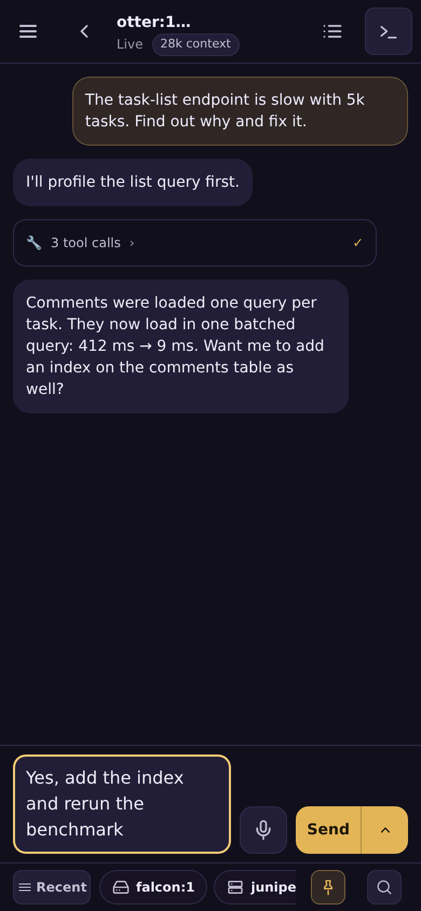
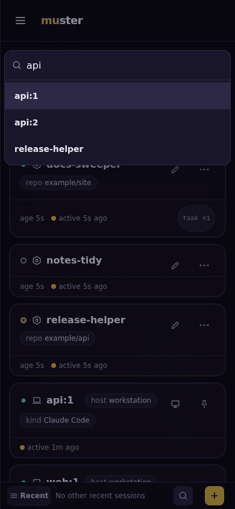
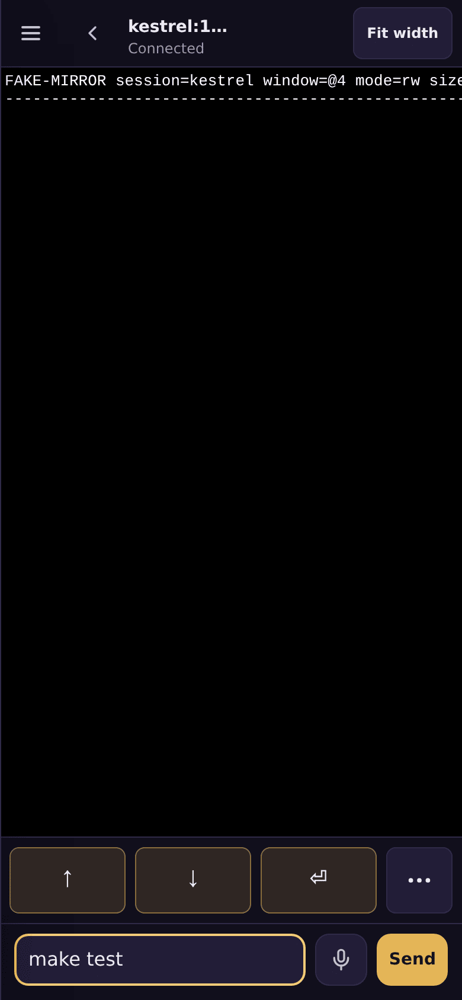

# Mirrored sessions

A **mirrored session** is a tmux window on one of your own machines, shown as a
card on muster's Agents list. You can watch it, open its terminal, read a Claude
Code conversation as a chat, and send it a message, all from a phone.

Mirroring is off unless the server runs with `MUSTER_MIRROR=1`, and it needs a
database. When it is off, `GET /mirror/connect` and the mirror routes answer
404, and nothing mirrored is drawn.



## How it connects

A host connects to muster; muster never connects to a host. A small binary,
`muster-mirror`, runs on each host. It lists that host's tmux windows and opens
**one** WebSocket to muster, authenticated by a per-host *mirror token*. Terminal
attaches and rendered views are multiplexed back down that one connection.

muster holds no SSH key, address or inbound route to the host, and the host holds
no muster credential except its own token.

```sh
# where the server runs (needs DATABASE_URL); the token is printed once
muster-server mirror token create <host>      # also: mirror token ls, mirror token revoke <id>

# on the host
nix profile install github:ZacxDev/muster#muster-mirror   # or: go install ./cmd/muster-mirror
install -D -m600 /dev/stdin ~/.config/muster-mirror/token  # paste the token
muster-mirror -url https://muster.example.com -token-file ~/.config/muster-mirror/token
```

`<host>` is a lowercase DNS label. `muster-server mirror token create` requires
it. `muster-mirror -host` defaults to the short hostname. A token minted for one
host cannot register another.

Every flag can also be set as a `MUSTER_MIRROR_*` variable (the full list is in
[configuration.md](configuration.md#muster-mirror-host-agent)). Use the variables
when running under a systemd user unit, so the token never appears on a command
line. If muster sits behind an auth proxy, `GET /mirror/connect` must bypass it:
the route checks its own tokens. So must `POST /mirror/mcp` if you use the
host's MCP endpoint for its Claude Code sessions ([attention.md](attention.md#mirrored-claude-code-sessions)).

## What you see

- **One card per tmux window.** Each window is addressed by its session and
  tmux's own window id (`@12`), not by its index, which tmux renumbers. A card
  says what runs in the window's active pane: Claude Code, opencode, a shell, or
  the command name. A host lists up to 512 windows and reads them with one tmux
  call per refresh, every 5 seconds.
- **Titles.** A card is titled `<session>:<index>`. With `-labels-file` you can
  map a session to a codename: a JSON object `{"<session>": "<codename>"}`. Each
  of that session's windows is then titled `<codename>:<index>`. The window's
  own pages show the raw session name beside it; its card does not (it is the
  title's tooltip, and the search still finds it). Each entry is checked on its own: an invalid one
  is logged and skipped, and a missing or unreadable file is logged and ignored,
  never fatal.
  When the same title appears on more than one host, every one of them carries
  its host (`mango:1 · <host>`); when it repeats on one host (two sessions given
  one codename), each also carries its tmux address (`mango:1 · <session>:<index>`).
  The card, both view headers and the page title always agree.
- **Most recently active first.** One flat list across all your hosts AND your
  dispatched agents, ordered by last activity, newest first. A **Claude Code**
  window's last activity is its conversation's last message (the newest user or
  assistant message in its transcript, to the minute — not tmux's activity,
  which a tmux restart resets for every window, and not the rows a resumed
  session writes on start, nor the "No response requested." Claude Code writes
  itself); while that session is WORKING — a turn running, waiting on you, a
  background shell of its own — it is now, since Claude Code writes nothing
  meanwhile. A host from before this reports none, and the window falls back to
  tmux's. Any other window's is when its host last saw it
  active, to the minute; output in a pane counts as activity, not only
  keystrokes. A dispatched agent's is the newer of
  its last chat message and its last change (a status write, a rename). The
  host is not a section: it is the icon on each card. A window whose host did
  not report activity comes last. Ties keep a stable order: agents first, then
  windows by host, session and index. An open list reorders only when the order
  actually changes.
- **How recent, at a glance.** Beside "active 3m ago" each card draws a small
  dot tinted on the same 8-step Gruvbox scale as tmux's idle-fade window colours:
  bright green under 10 minutes, green to 30, aqua to an hour, yellow to 2
  hours, orange to 4, red to 8, purple to a day, grey past it. It re-tints as
  time passes, without a refresh. The card's border is not used for this.
- **Long titles.** A card's title longer than 60 characters is cut and ends
  in a **…** button — its name, and its focus title when it has one
  ([focus.md](focus.md)). Tap it (or press Enter on it) to see the whole title
  in a popover; it never opens the card. On a desktop, hovering a long name
  shows it too.
- **Not an agent, and not stored.** muster keeps each connected host's window
  list in memory, under the token owner's account. A mirrored window cannot be
  dispatched, deleted, or mistaken for a muster agent. A disconnected host stays
  listed as `offline` for a day. The database holds `mirror_tokens`, as sha256
  hashes, and your pins (below), both under row-level security.
- **Pins.** The pin button on a card (and **Pin to top** in an agent card's ⋯
  menu) puts that entry first in your list, on every device you sign in on.
  Pinned entries keep their own most-recently-active order, ahead of the rest.
  A mirrored pin is the window's address — host, session and tmux window id —
  so it survives renumbering, a list refresh and a muster restart. A pin whose
  window is gone is kept and shown nothing; it comes back with the window. A
  tmux-server restart (a reboot) reissues window ids, so after one a pin names
  whichever window now has that id in a same-named session, or nothing — re-pin.
  The filter still hides a pinned card that does not match.
- **A filter.** One box above the cards narrows dispatched agents and mirrored
  windows together. It is case-insensitive, and every word must match. It shows
  an "N of M" count and runs entirely in the page. A `field:value` term looks
  at one field only, as a substring: `host:<name>` (a dispatched pod agent's
  host is `cluster`), `status:`, `kind:`, `repo:`, `name:`, `account:`,
  `session:`, `ns:`, `mode:`, `state:`, `type:` (`agent` or `mirrored`). Quote a
  value with a space in it: `kind:"claude code"`. A term whose prefix is not one
  of those fields is plain text, so `gold:8` still finds a window called
  `Gold:8`. `field=value` matches the whole field instead of a substring. The
  filter is kept in the page's `?q=`, so a link reproduces it.
- **Quick filters.** Under the box, four chips:
  - **Waiting on you**: something on the card asked you to decide. Either an
    agent or a Claude Code session called `attention_ask` and waits for your
    answer, or a mirrored Claude Code session is stopped at a prompt (a
    permission prompt: the session asking to go on) or holds an
    `AskUserQuestion` picker open for you — the
    [attention queue](attention.md)'s **Question**, **Session waiting** and
    **Session question** items — or a dispatched agent is blocked at a
    permission prompt (its **awaiting approval** badge).
  - **Idle >15m**, **Idle >1h**, **Idle >1d**: no activity for more than that
    long (the same activity time the list is ordered by). A window with no
    reported activity is never counted as idle.

  The chips combine with OR: a card is shown when it matches ANY chosen chip
  (waiting on you, or idle that long). Only one idle chip
  is on at a time. The chips together, the box and the host tab must all match.
  A reply draft does not count as waiting on you. The chosen chips are remembered
  on this device, and a list refresh never resets them; **Clear**, shown while
  any chip is on, turns them all off. A card that crosses an idle threshold
  while the list is open is not shown or hidden by itself — that would move
  the cards around it — it waits behind the **N new ↑** pill like an arrival,
  and is applied on the tap.
- **Host tabs.** Above the box: **All**, then one tab per host on the list
  (dispatched pod agents under **cluster**), each counting its cards that match
  the box. The hosts named in `MUSTER_HOST_ORDER` come first, in that order,
  then every other host alphabetically, then **cluster** last
  ([configuration](configuration.md)). A tab narrows the list to that host exactly, together with the box.
  The chosen tab is remembered by the browser (not in `?q=`). While its host is
  not listed (a restart, a laptop asleep) the list shows **All**, and goes back
  to that host when it returns; only picking another tab changes the choice. A
  shared link carrying its own `?q=` opens on **All**. A refresh that changes
  only cards the current tab and search hide is applied at once, with no
  "N new ↑". On a phone the strip scrolls sideways.
- **Host icons.** Every entry draws its host's icon beside its name — on its
  card, its "Recently viewed" entry, its host tab and the badge on its own
  pages — with the host's name in the icon's tooltip. A mirrored window's card
  also spells its host in a chip in its body (`host laptop`). Dispatched pod
  agents draw the cluster's icon, which no mirrored host ever draws. A host
  given an icon in `MUSTER_HOST_ICONS` (`laptop=laptop`) draws it, and no other
  host does. Any other host's icon is picked by when its first mirror token was
  minted, so your first hosts usually each draw a different one, and minting a
  token for a new host (or a second token for an old one) never changes an
  existing host's icon.



## Viewing never moves your terminal

A tmux session has one current window, shared by every client attached to it.
If muster attached to your session to show you a window, it would change the
window you are looking at.

So muster never shows a window through your session. Each viewer gets a
short-lived session of its own, `muster-view-<random>`, that **links** the one
window it shows. Its client takes no part in sizing (`ignore-size`), and tmux
removes the session when the viewer leaves (`destroy-unattached`).
`muster-mirror` also kills a viewer session on close, and removes any leftover
ones when it starts. A message is pasted into a *pane id*, which needs no window
switch at all.

⚠ While a viewer is attached, its session is visible to other tmux tooling:
`tmux ls`, a session picker, and `session-created` / `client-attached` hooks.

The terminal never shrinks your window either. The host reports the window's
size, and the browser's terminal uses that size unless the browser's own is
larger. On a phone, a wider window is shown in a scrolling, pinch-zoomable view
with a "Fit width" control.

## Rendered and terminal views

When a window's active pane runs Claude Code, its card opens a **rendered** view
by default. Prompts and replies appear as chat bubbles, and each tool call as one
collapsed row showing the tool, its target, and whether it succeeded, failed or
is still running. It updates live while a turn runs. Thinking is never shown.
Every window has its own view: two Claude Code windows in the same directory each
show their own conversation.

The **Terminal** view is one tap away, for every window. It is an xterm.js
terminal attached through the tunnel.

Switching between a window's Rendered and Terminal views keeps both open. The
first switch opens the other view over the current one. After that, a switch
only shows one view and hides the other: the transcript is not read again and
no new terminal is attached. Both views stay connected for as long as you stay
on the window. A window with both views open uses one rendered view and one
terminal of the host's limits below. Opening another window, going back to the
list or reloading closes both connections. Reloading opens the view you were
on, and Back leaves the window, because a switch does not add a history entry.
A dispatched claude-code agent's chat and Terminal switch the same way.



Rendered views stream bounded events: at most 300 when opened, taken from the
last 4 MiB of the transcript, with each field capped. Anything in them that
looks like a secret is replaced by `«redacted»` on the host, before it is sent:
prompts, replies, errors, tool calls' targets and arguments, tool output,
notices, questions and their answers, and the message index. The shapes it
knows are the [attention queue's](attention.md#what-is-in-it); it is a
heuristic, so a secret in a shape it does not know still passes. A host
running an older `muster-mirror` sends the transcript unredacted. The
transcript file itself is never sent, and nothing is stored on the server. Limits per host: 8 open
terminals, 8 rendered views. Limit per server: 64 hosts.

### A rendered view's snapshot, kept on this device

Each rendered view keeps a copy, in this browser (IndexedDB), of what it drew
and where its stream stood. Opening the window again paints that copy at once
and resumes the stream from where the copy ends, instead of waiting for the
host to send the conversation again. Until the stream answers, the status line
says "Connecting…"; after a second without an answer an **Updating…** chip
shows, in room the header always keeps for it. If the stream is refused or
closes before it answers, the copy is removed from the page and from the
browser, and the view starts again from the beginning.

- **What is kept** is what the page already showed, as the server sent it
  (redacted on the host as above), plus the stream's position. At most 2 MiB
  per window and 12 windows; the oldest go first.
- **Five minutes since it was written, thirty since a full read.** A copy is
  shown only within five minutes of its last save, and only within thirty
  minutes of the last time its conversation was read in full from the host
  (a copy that is only ever resumed keeps the HTML it was first drawn with, so
  after thirty minutes the window is read from the start again). Both are
  checked whenever a copy is read: when a window opens, and when warming
  resumes one.
- **Per user and per build.** A copy names the signed-in user and the muster
  version, and is checked against both before it is shown. Any other user's or
  version's copy is deleted unread.
- **When copies are deleted.** A copy that fails any of these checks is deleted
  when it is read, or when the next muster page that keeps copies (the Agents
  list, an agent's page, a rendered view) is loaded and sweeps them. Until
  then it stays in the browser's storage, unread: a session that ends at a
  sign-in proxy in front of muster, or a tab that is simply closed, leaves its
  copies there until the next such page load or a visit to muster's sign-in
  page. At most 12 copies of at most 2 MiB each are ever kept.
- **Signing out deletes them all.** The sign-in page (and every other page
  shown signed out) deletes them, and a sign-out ends there. Another tab still
  open on a rendered view stops keeping copies at that moment, for as long as
  it stays open.
- **Warming.** While you are on the Agents list or an agent's page, muster
  refreshes the copies of up to three windows you are likely to open next
  (pinned, then recently viewed, then the ones this browser has copies of), one
  at a time when the browser is idle, every two minutes at most, skipping a
  copy saved in the last two and a half minutes. It reads each
  through the window's stream, never its page, so a warmed window is not
  recorded as visited and does not move in **Recent**. It stops on a hidden
  tab, with Save-Data on, or on a 2G connection, and reads at most 3 MiB per
  pass. Refreshing a copy resumes its stream, so only what is new is read, except
  for a Hermes window, whose host always sends the whole conversation again.

### How a pane's transcript is found

The host walks the pane's process tree to the `claude` process. Then it tries
each of these in order:

1. **The pane map**, if `-pane-map-dir` is set. This is a directory that a
   Claude Code hook keeps current, holding one file per pane: `claude-p<N>.json`
   for pane `%N`. Its first JSON value is:

   ```json
   {"runtime":"claude","pane_id":"%N","tmux_pid":"<tmux server pid>","session_id":"…","transcript_path":"…","claude_pid":"<the claude process>","claude_start":"<its /proc/<pid>/stat start time>"}
   ```

   An entry is used only while it still describes the pane: the same tmux
   server, the same Claude process (pid and start time), and a transcript that
   exists as `<session_id>.jsonl` under the Claude config directory's
   `projects/`. This comes first because Claude Code does not rewrite its
   sessions file when a conversation changes id within one process.
2. **The CLI's own sessions file**, `sessions/<pid>.json`. If Claude Code has
   parked a background job (`/bg`), the host follows it to the job's own
   session.
3. **A guess**: the newest transcript in the process's working directory. This
   is used only when the process has **no** sessions file. A guess that two
   panes would share is dropped.

If the sessions file exists but its transcript cannot be found, the window has
no rendered view; the host does not guess.

The Claude config directory is `$CLAUDE_CONFIG_DIR`, or `~/.claude` when that is
unset. `muster-mirror -list -claude` prints one row per Claude Code window,
ending in how its transcript was resolved: `pane-map`, `sessions` or `guessed`.
`-list -windows` prints every window that would be registered.

## Read-only, interactive, and sending

`muster-mirror` is **read-only by default**. muster then offers no Live keys
switch and refuses an interactive attach. Read-only is enforced in three places:

- muster refuses it;
- the host refuses it, and drops keystrokes on a read-only stream;
- tmux attaches the client read-only (`-f read-only,ignore-size` for a window
  viewer, `attach -r` for a session).

The host opens only windows it listed itself.

🔴 **`-interactive` is a shell on the host.** An interactive tmux client can
switch to any session on that tmux server, or open a new window. So anyone who
can use muster's Live keys switch for the host can run commands there, as the
user `muster-mirror` runs as. The "only listed windows" rule limits what a
read-only viewer can see. It does not limit an attached interactive client.

With `-interactive`, both views get a message box. Typing into one requires a
recent sign-in. See [sending-and-step-up.md](sending-and-step-up.md).

### muster pastes into Hermes only through its gated send

🔴 The host refuses to type into a pane that runs
[Hermes](design/hermes.md), except through the one gated send described in
[Sending to a Hermes window](#sending-to-a-hermes-window--hermes-send). On
Hermes's approval prompt, a pasted message followed by Enter **approves the
command**, whatever the message says. This covers every other way muster types
into a pane: the Terminal view's message box, a Claude Code send, and an
answer typed into Claude Code's question picker. Nothing reaches the pane, and
the page says why, whether or not script ran: "Not sent: Hermes runs in this
pane…". Type into Hermes in the terminal itself (Live keys, or the terminal on
the host), or send from its window's rendered view on a host that runs with
`-hermes-send`.

The host decides this itself, by what runs in the pane at the moment it
types. It does not depend on the server's version. It walks the pane's process
tree from its root process and refuses when any process in it is one of
these:

- a process named `hermes` whose second argument is a `hermes` launcher (the
  Nix wrapper, a pip or uv install), whatever follows: `chat`,
  `-p <profile> chat`, `gateway run`;
- a Python interpreter with any argument that names `hermes_cli` (`-m
  hermes_cli…`, a script under `hermes_cli/`, `-c` code importing it) or a
  script named `hermes`, or a `cli.py` beside a `hermes_cli/` directory;
- a terminal multiplexer client: `tmux`, `screen`, `dtach`, `abduco` or
  `zellij`. A tmux started inside the pane can show a session of another
  server, whose programs the host cannot see from this pane, so the host
  refuses rather than guess. The message says so.

When no process matches, the host also looks at the pane's **screen**: one
showing Hermes's input area (its status bar's `☤`, two rules around a `❯`
line) is refused too. That catches a Hermes run over `ssh` or `docker exec`
while its chrome is drawn. It is a best-effort extra and misses a Hermes whose
chrome is not drawn (for a moment after a resize, in a pane under 64 columns,
or with its status bar turned off).

The gateway counts, so a pane running `hermes gateway run` is refused too. So
is a Claude Code pane whose tree holds Hermes: one where Hermes was started in
the foreground after Claude Code (`claude &`, then `hermes chat`), or one where
Claude Code itself runs `hermes mcp serve` or `hermes acp`. If the host cannot
read a process in the pane's tree, it refuses rather than assume.
Shells, Claude Code and other programs are otherwise unaffected.

These refusals are accepted as safe even when no Hermes is there: a nested
tmux, screen or zellij session, a hand-run gateway, and a Claude Code pane
whose Claude started a Hermes subprocess.

Known gaps:

- a Hermes run over `ssh` or `docker exec` inside the pane, whose chrome the
  screen check above does not see;
- a Hermes started under a renamed interpreter or from a copied tree;
- a host with no `/proc`, which means macOS. There the host cannot see
  processes, and it types as before. Refusing every message there would take
  the message box away from every macOS user, and no deployment runs Hermes on
  a macOS host.

### muster does not send to opencode yet

🔴 The same host guard refuses to type into a pane whose process tree holds
[opencode](https://github.com/anomalyco/opencode): a process whose name or
first argument is `opencode` (the Nix wrapper's `.opencode-wrapped`
included), **and that is on the pane's terminal**: its stdin, or its
controlling terminal, is the pane's. An opencode started with no terminal
(Claude Code's Bash tool running `opencode run`, stdin `/dev/null`) does not
make its Claude pane refuse. When either terminal cannot be read, the host
refuses. An npm or bun install's JavaScript shim is refused through the
native `opencode` it starts, which is in the same tree. A paste
into opencode is blind, because nothing checks what its screen shows, and
Enter there can answer a permission request it is showing. Every send is
refused this way, Send, Queue and Send now alike, and the page says
"Sending to opencode isn't supported yet…". A later version sends to opencode
through its own API, never keystrokes. Type into opencode in the terminal.

Like the Hermes refusal, the host decides this itself, from the pane's
processes at the moment it types, not from the window's `opencode` label: a
window labelled `zsh` whose pane runs opencode is refused too.

Known gaps (the host types into these panes as into any other):

- an opencode that runs inside a JavaScript runtime (`bun` or `node`) and
  starts no native `opencode` binary: neither process is named opencode;
- an opencode over `ssh`, or inside a container (`docker exec`, `podman
  exec`): its processes are not in the pane's tree;
- a renamed binary, or one run through a symlink of another name: its name
  and first argument do not say opencode.

### opencode's token (`muster-mirror opencode-pair`)

muster-mirror reads a host's opencode v2 server (the background service every
opencode TUI on the host is a client of, `127.0.0.1:<port>`) through its HTTP
API, with a **pair token** of its own — never the server's password. Pair each
host once:

```sh
muster-mirror opencode-pair
```

It reads the service's **registration file**, `$XDG_STATE_HOME/opencode/service-prod.json`
(else `~/.local/state/opencode/…`; `service.json` for the latest, dev, beta
and next channels; `-registration <file>` names another). That file is where
opencode keeps the server's url and password for its own clients. The pairing
step then:

1. refuses a url that is not a loopback address;
2. asks the server for a pairing code with the password (`POST /api/pair`);
3. redeems the code for a token (`GET /auth/connect/<code>`);
4. writes `{"url", "token"}` to `~/.muster/opencode-token` (mode 0600;
   `-token-file`, or `MUSTER_MIRROR_OPENCODE_TOKEN_FILE`).

It prints the file it read, the server, the token's fingerprint (the first 8
hex digits of its SHA-256) and its expiry, and the file it wrote. The password
is used for that one request and kept nowhere, and nothing prints the password,
the code or the token.

The daemon reads the same file (`-opencode-token-file`,
`MUSTER_MIRROR_OPENCODE_TOKEN_FILE`; default `~/.muster/opencode-token`). It
refuses a file others can read, a symlink, and a url that is not loopback. A
token lives 30 days. Within 10 days of its expiry, the daemon mints its
replacement with the token itself, writes it to the same file (0600, whole),
and only then uses it. It checks hourly and logs each renewal and each failure
by fingerprint. A failing renewal, a token within 3 days of expiry and an
expired token are also shown in the opencode window's rendered view and by
`-list -opencode`.

### opencode windows

A window whose pane runs the opencode TUI is listed as an **opencode window**.
The TUI is an `opencode` process on the pane's terminal (its stdin) with no
subcommand (`serve`, `run`, `pair`… are not the TUI). With a token, the host
also resolves the session the pane shows, **by the pane's title**. The TUI
names its pane `OC | <session title>` and cuts a long title with `…`. The host
matches that title against the server's root sessions: the whole title, or the
part before `…` as a prefix. It shows a session only when **exactly one** root
session matches. Two sessions with one title (opencode's default title, say)
match nothing, and that window gets no view rather than a guess. A TUI started
with `--standalone` or `--server` runs on another server and is never matched.

The window's card opens a **read-only rendered view**: the session's prompts,
the agent's replies, and each tool call by its name and target (the command,
the file). It never shows a tool's input or output, nor the model's reasoning.
The view opens with a "matched by title" row, because a title is a heuristic:
a renamed session, or a TUI that switched sessions, moves it. Text appears once
it is final (a reply streams in place upstream), and the view starts over when
something it drew changes. The busy marker comes from the server's event
stream (`session.status`). While that stream is down the status is unknown, and
unknown fails closed.

When the token needs the person — a renewal is failing, it is within 3 days
of expiry — the view's first row says so, in the same words `-list -opencode`
prints (and the card's note, below).

The composer is disabled, saying sending to opencode isn't supported yet:
muster sends nothing to opencode, and the paste guard above still refuses its
panes. Permission requests and the
question tool's forms are answered in the terminal; muster's attention queue
does not see them yet.

A window has no view, and an unknown status, when the host has no token, the
server refuses the token (it expired, or the server's password was rotated),
the title matches no root session or several, or the TUI is on another server.
The window's **card** says which, in one line ("opencode is not paired on this
host: run muster-mirror opencode-pair", "… ambiguous, so none is shown", …);
an open view that loses its session closes with the same line. The host sends
the line with the window (`Window.AgentNote`: at most 200 bytes, on at most 8
windows of a list). `muster-mirror -list -opencode` says it too, with the
detail:

- `token`: the token file, its fingerprint and expiry, or `none` and why;
  `token-health`: the token's line, when it has one (failing renewal, close to
  expiry, expired);
- `server`: `ok` and the server's version, `REFUSED the token`, or
  `unreachable`;
- per opencode window: its pane, TUI process, session (`-` for none), status
  and `source` (`title` when matched); its `pane-title`; the `match` ("matched
  by title", noting a prefix match); and `no-view` with the reason.

`-list -windows` prints an opencode window as
`opencode <pane> <state> <session id or -> <source>`.

🔴 **A token is not scoped and cannot be revoked on its own** (upstream at
`6ec5682`, docs/design/opencode.md). It reaches the whole opencode API. muster
only ever reads with it, and its one other call is the renewal's
`POST /api/pair`. To take muster's access away, rotate the opencode service
password. That revokes every token, muster's and every other paired client's.

### Hermes windows

A window whose pane runs the Hermes CLI (`hermes chat`, or bare `hermes`) is
listed as a **Hermes window**: a process named `hermes`, a Python running a
`hermes` launcher, no `gateway` argument, reading the pane's terminal
(`#{pane_tty}`). A profile-launched `hermes -p <name> chat` is not recognised
as one; the paste refusal above still covers it. Its card carries the kind
chip **Hermes** (`kind:hermes` in the filter), whatever its pane's command
reads. muster sends into it only from its rendered view, and only on a host
that runs with `-hermes-send` (below); elsewhere Send, Queue and Send now all
refuse it.

**Rendered view.** A Hermes window whose session the host can name
(below) opens in a Rendered view of its conversation, read from Hermes's
session store as it is written: the prompts, the replies, the tool calls and
their results, and a compact row for what Hermes adds itself (a process
finishing, a model switch). Thinking is never shown. On a host without
`-hermes-send` its message box is drawn disabled and says why, with no send
queue. Terminal is one tap away, as for Claude Code. A compression that
rewrites the conversation redraws the view from the start.

**Which session.** The host finds the window's Hermes session from the
breadcrumb Hermes writes for its terminal,
`~/.hermes/terminal-sessions/tty-<terminal>`, and looks it up in Hermes's
session store, `~/.hermes/state.db`, read-only. A breadcrumb is believed only
when it is newer than the Hermes process in the pane. A conversation that
Hermes compressed into a new session is followed to its newest one. 🔴 **After
`/resume` or `/branch` at the terminal, Hermes leaves the breadcrumb on the old
session**, which Hermes marks as ended. The window then has no session and its
status is unknown, until `/new` or a restart of the CLI writes a new
breadcrumb. muster never shows the abandoned session's status as this window's.

**Status.** Hermes reports no status of its own, so the host reads one that a
Hermes shell hook writes: `muster-mirror hermes-hook`, one small file per
session in `~/.muster/hermes-status/` (0700; it holds the status, its time and
a request's kind and id, never a prompt or a command). `busy` is believed only
while Hermes holds the conversation's turn lease and the gateway that wrote it
is running; `idle` only while no lease is held and no message is newer than it.
Anything else is **unknown**. An unknown window holds the send queue, and its
card shows no status.

The host reads only these Hermes files: `state.db` (and its `-wal` and `-shm`),
`terminal-sessions/tty-*`, and `shell-hooks-allowlist.json` — and, only with
`-hermes-send`, `config.yaml`'s `display.vim_mode` (that key alone). It never
opens `auth.json`, `.env`, `pastes/`, `memories/`, `logs/` or
`runtime/active_sessions.json`. The Hermes home is `$HERMES_HOME`, else
`~/.hermes` (`-hermes-home` overrides it).

#### Sending to a Hermes window (`-hermes-send`)

Sending to Hermes is **off** unless the host's `muster-mirror` runs with
`-interactive` **and** `-hermes-send` (`MUSTER_MIRROR_HERMES_SEND`). It needs
the status hook (below). Turn it on per host, and only:

- after `make test-livehermes` has ended with `HERMES HARNESS VERDICT: GREEN`
  against the Hermes commit that host runs;
- 🔴 **never in vi mode**, and the host enforces it: it reads
  `display.vim_mode` from the Hermes home's `config.yaml` (that one section
  and key) on every connect and every send, and while it is on — or the file
  cannot be read — advertises nothing and sends nothing. One Escape there
  would enter vi navigation, where the message's characters would be read as
  commands. The startup log and `muster-mirror -list -hermes` (`vi-mode`)
  say which.

With it on, the window's rendered view offers Send, Queue and Send now. Every
send goes through the host's **gated send**, in this order:

1. muster refuses unless the window is **idle** (busy, waiting and unknown are
   refused, saying why), and sends the status time it decided on;
2. the host refuses a message whose text starts with `/` or `!` (Hermes would
   run it as a command), ends with `\` (Enter would continue the line), or is
   only a number (after `/resume` Hermes takes it as a session to switch to), and
   one so long, on one line, that Hermes's input box could not show it whole
   (about 8 rows: shorten it, or send six or more lines, which Hermes collapses);
3. the host checks again that Hermes is idle at exactly that time;
4. it checks the screen: Hermes's status bar is there (it is blank while the
   command palette or the model picker is open) with at least one row above
   it (a pane of 4 rows is refused as too short), no stash panel (found by its
   header, even when a short pane cuts the rest of it), no vi label,
   no images attached, the idle prompt `❯ ` with an empty box, nothing below
   it. Any approval, question, password prompt, confirm or running turn
   changes that prompt, so it is refused here;
5. it types one Escape, waits 1.5 s and checks the screen again;
6. it pastes the message, waits 150 ms, checks the status again and that the
   box shows exactly the message (or Hermes's `[Pasted text #N: L lines → …]`
   placeholder), then presses Enter;
7. it waits up to 8 s for the message to appear in Hermes's session store.

What you see: **Sent** (the message is in the conversation); **Not sent…
Nothing was pasted** (refused at steps 1–5, possibly after some Escapes);
**Pasted, not submitted** (the text is in Hermes's input box and Enter was not
pressed: check the terminal); or **May have been submitted: check the
conversation before sending again** (Enter was pressed and Hermes recorded no
message in time). After a "may have been submitted", muster will not send the
same message again by itself: sending it again is refused, and the message
box offers **Send again** for when you have checked. Queued messages and Send
now say the same words, never "Not sent". A send takes about five seconds. Right after a turn ends,
Hermes can say it is idle while its screen still shows the turn finishing; a
send in that moment is refused, and a queued message waits its idle time
anyway.

⚠ **Accepted residual risk** ([design](design/hermes.md#residual-cases-accepted)):
a person opening an overlay at the terminal in the second before muster's
Enter; an overlay a future Hermes adds before the harness is re-run; and a
turn Hermes starts on its own between the last check and Enter. Hermes's `/busy queue` (it saves `display.busy_input_mode: queue`)
turns the last one into a queued message instead of an interrupted turn; with
it, Hermes can still submit a queued message up to about 2 s after it says
idle, under load. A pasted message of 2,000 characters or more is saved by
Hermes in `~/.hermes/pastes/`; muster never reads that directory.

#### Hermes's approvals, questions and sudo prompts (`-hermes-answer`)

A Hermes window waiting on you is in the **Attention** queue (and counts on
its card's badge), saying what it waits on, as Hermes's status hook recorded
it:

- **an approval** — Hermes wants to run a command. On a host that runs with
  `-interactive` **and** `-hermes-answer` (`MUSTER_MIRROR_HERMES_ANSWER`),
  the host attaches Hermes's **gateway viewer** to that session while it
  waits, the queue shows the command (`terminal: rm -r ./build`) and why
  Hermes asks, and offers **Allow once** and **Deny**. muster never offers
  `session` or `always`, and offers **Allow once** only for a plain terminal
  command it can show whole: the approval must be Hermes's terminal gate's
  (not a file write, a plugin's rule or computer use, whose "command" is only
  a label), its command must be the very command pending in the conversation,
  plain ASCII on one line within the card's length, with nothing redacted or
  masked out of it. Otherwise only **Deny** is offered. An answer needs a fresh
  sign-in, as answering Claude's questions does, and goes through the gateway,
  never as keys into the pane. After it, the terminal keeps showing Hermes's
  prompt until a key is pressed there (the queue says so); the answer has
  already been taken. Without `-hermes-answer`, or when the host cannot reach
  the gateway (none running, not the pinned commit — `-list -hermes` names
  it), the item says to answer in the terminal.
- **a question** (Hermes's clarify tool): the queue shows the first question,
  its choices and how many more there are, read from the conversation; answer
  it in the terminal.
- **a sudo password**: listed only. muster never answers a password prompt.

The viewer is attached only while a session waits on an approval, and only
to the pinned Hermes's gateway; it keeps nothing of the session but the
approval's command, description and choices (docs/design/hermes.md, Phase 4).

#### Installing the Hermes status hook

The hook runs inside Hermes's gateway. Hermes runs a configured hook only when
the exact `(event, command)` pair is in its allowlist,
`~/.hermes/shell-hooks-allowlist.json`. A configured hook that is not
allowlisted is skipped, and every new Hermes CLI then stops before its UI on
`Allow this hook to run? [y/N]:`. So the host's configuration must declare both
halves, with the same command string. `<muster-mirror>` below is the absolute
path of the `muster-mirror` binary, for example
`${pkgs.muster-mirror}/bin/muster-mirror` in Home Manager.

1. **The hooks**, in Hermes's `config.yaml` (with Home Manager, through the
   `hermes-agent` module's `settings`, as `settings.hooks`):

   ```yaml
   hooks:
     pre_llm_call:            [{command: "<muster-mirror> hermes-hook", timeout: 5}]
     on_human_input_request:  [{command: "<muster-mirror> hermes-hook", timeout: 5}]
     on_human_input_resolved: [{command: "<muster-mirror> hermes-hook", timeout: 5}]
     on_session_end:          [{command: "<muster-mirror> hermes-hook", timeout: 5}]
     on_session_finalize:     [{command: "<muster-mirror> hermes-hook", timeout: 5}]
   ```

2. **The allowlist entries**: one `{event, command}` approval per hook above.
   Write them with the allowlist writer, in a Home Manager activation step
   ordered after the `hermes-agent` module's own:

   ```sh
   <muster-mirror> hermes-allowlist -command "<muster-mirror> hermes-hook"
   ```

   It writes the way Hermes does: under Hermes's lock
   (`shell-hooks-allowlist.json.lock`), as a real 0600 file through a temp file
   and a rename. Never link a read-only file there: Hermes writes the same file
   when someone answers `[y/N]` (a Home Manager link into the Nix store is
   replaced by a real file; any other symlink there is refused). It keeps every
   other approval, removes entries for an older `muster-mirror hermes-hook`
   path (every Nix upgrade changes it), carries nothing but approvals over,
   and changes nothing when the five pairs are already there. It refuses to
   replace an allowlist that is not valid JSON.

3. **The daemon** must run with `-write-hook-config`
   (`MUSTER_MIRROR_WRITE_HOOK_CONFIG=1`), as for `muster-mirror ask`, so the hook
   writes where the daemon reads (`-hermes-status-dir`, default
   `~/.muster/hermes-status`).

The hook prints nothing, always exits 0, and gives up after a second rather
than hold Hermes up. If it cannot write, the window's status is unknown, never
idle.

#### Diagnosing a Hermes window

`muster-mirror -list -windows` prints a Hermes window as
`hermes <pane> <state> <session id> <source>`, with `-` for the session of a
window that has no rendered view and `unknown` for a status muster does not
believe. `muster-mirror -list -hermes` says why:

- `hook-declared`: each `muster-mirror hermes-hook` command Hermes's
  `config.yaml` declares, per event (only its `hooks:` section is read).
  `hook-config` says when it declares none, or several.
- `hook-consent`, per declared command: `ok for <command>`, or `MISSING for
  <command>` with the events whose `(event, command)` pair is not in the
  allowlist, and the command that fixes it (`muster-mirror hermes-allowlist
  -hermes-home … -command <the declared command>`; none when several are
  declared). `hook-undeclared` names events the config does not hook;
  `hook-other` names allowlisted entries of a command that is not declared
  (an older binary's, which the next `hermes-allowlist` removes).
- per Hermes window: its pane, CLI process, terminal, session and status; the
  `breadcrumb` (its session and time, or `none`); the `lineage` and how its tip
  ended; the newest `status-file`; and, when there is one, the `no-view` and
  `unknown` reasons (no breadcrumb, a breadcrumb older than the CLI, a switched
  session, no status file, a stale busy, an idle under a live turn).

- `gateway`: the home's Hermes gateway, as its control socket's `identify`
  names it — `none running`, `code_sha <sha> (the pin)`, `NOT THE PIN` (the
  commit it booted from is not the one muster supports), or `refused` with
  why (a control path another user could reach, a gateway that is not ready).
  muster attaches its gateway viewer (to answer Hermes approvals) only to the
  pin; otherwise every Hermes approval is answered in the terminal. It asks
  `identify` only: no ticket, no attach.

muster also refuses every send into a window the host reports as Hermes on
its own side, before anything reaches the host. A Hermes the host does not
report as one (a profile-launched CLI, or any Hermes on a host older than this
release) is refused by the host alone, as above; a host older than that
refusal has no protection at all, so upgrade every host that runs Hermes.

## Answering Claude's questions

When Claude Code calls `AskUserQuestion`, the question shows in **both places
at once**: the terminal draws its own picker, and the window's Rendered view
draws the same questions as a form. Answer in either. Whichever is answered
first counts, and the other side shows what happened. This needs a Claude Code
hook on the host: `muster-mirror ask`. Add it to that machine's Claude Code
`settings.json`, with no flags:

```json
"PreToolUse": [
  {
    "matcher": "AskUserQuestion",
    "hooks": [
      {
        "type": "command",
        "command": "muster-mirror ask",
        "timeout": 10
      }
    ]
  }
]
```

The hook only tells muster about the question. It returns at once (it gives up
after 3 seconds), prints nothing, and never answers or holds the call, so the
terminal's picker appears as it would without it. It runs alongside any
`PermissionRequest` hook you already have, such as an approval router, and that
hook still runs for the call as it does today.

It needs no flags because it uses what the host's `muster-mirror` service runs
with. A Claude Code hook does not inherit that service's environment, so the
service runs `muster-mirror` with `MUSTER_MIRROR_WRITE_HOOK_CONFIG=1` (or
`-write-hook-config`). The daemon then writes its URL and token file path
(never the token) to `~/.muster/mirror-hook.json` (`MUSTER_MIRROR_HOOK_CONFIG`)
when it starts. Only a daemon started that way writes the file, so an ad-hoc or
development `muster-mirror` never repoints the hook. The hook reads the file
when it has no `-url` and no `MUSTER_MIRROR_URL`. It then uses the recorded
token file, or `~/.muster/mirror-token` when none is recorded.

🔴 **The recorded token goes only to the recorded URL.** A hook given a URL by
`-url` or `MUSTER_MIRROR_URL` must also be given its own token (`-token-file`,
`MUSTER_MIRROR_TOKEN_FILE` or `MUSTER_MIRROR_TOKEN`); otherwise the question
shows in the terminal only. If the token file cannot be read, the hook writes
one line to stderr, which appears in Claude Code's debug log.

How it works:

- The window's Rendered view shows a card above the message box as soon as the
  hook registers the question (the view's connection is told; it does not wait
  for a poll). It has one section per question: the question's header, its
  options with their descriptions (radio buttons, or checkboxes for a
  multi-select question), and an **Other** box for your own answer. One
  **Submit** sends every answer. The question is also one item in the
  attention queue.
- **Answering in muster types your answer into the terminal's picker.** The
  host's `muster-mirror` sends the picker the keys a person would press (digits
  for options, the arrow keys, your own words, Enter). Before every key it
  reads the pane twice, a quarter of a second apart, and needs the picker in
  exactly the state the last key should have produced both times — Claude
  Code redraws a key in 6–72 ms (measured), so a key someone typed but the
  screen has not drawn yet shows up in the second look. Right before each key
  it also reads when the terminal last had input from a tmux client that can
  type (muster's own read-only viewer does not count); if a key from that
  moment might not be drawn yet, it waits until it would be and looks again.
  tmux's only such clock also moves for focus events and the mouse, so
  switching to the terminal to watch does not stop it; a key that changes
  the picker does. Only one answer is typed into a pane at a time (another
  one is refused: *another answer is being typed*). The keys go in with tmux
  `paste-buffer -S`, which works while muster's read-only viewer is attached.
  🔴 **It needs tmux 3.7 or later** (3.7 added `-S`); on an older tmux the
  host says so in its log and does not offer answering. A multi-select answer
  is its options joined by `, `, in the question's order.
- **The card follows what Claude Code recorded.** muster reads the call's result
  from the conversation's transcript: answered with the answers you typed in
  muster, the card says *Answered here*; with other answers, *Answered in the
  terminal*, with those answers; dismissed (Esc), *Dismissed in the terminal*.
- 🔴 **Never half an answer.** If someone has started answering in the terminal,
  or the picker is gone or changes while muster types, muster stops before the
  next key and nothing is submitted. The card says which: *someone else has
  started answering it in the terminal* (finish it there), or *muster lost
  track of the terminal's picker part-way through typing your answer*. An
  answer that arrives after the terminal's is refused, and nothing is typed.
- **Trying again continues muster's own partial answer.** When muster stopped
  part way (a key whose screen never came), it records how many keys of your
  answer it typed, and the card shows that answer with **Try again** — which
  resends exactly it (nothing on the card can be changed: the picker holds part
  of it). Trying again continues from the first key not yet taken, but only
  when the picker shows exactly what muster's own keys left; anything else is
  someone else's and is refused as above. Which answer an earlier question was
  given is not on the screen, so before the final submit muster checks the
  review screen lists exactly your answers — an earlier answer changed in the
  terminal is caught there, said as someone answering in the terminal, and
  nothing is submitted. A muster restart, or a typing whose outcome the host
  never reported, records nothing to continue: the picker is then the
  terminal's to finish.
- **Options with previews.** When a question's options carry a `preview`,
  Claude Code draws them in a column with the highlighted option's preview
  boxed beside them, and no row for your own answer (measured, 2.1.289). The
  card shows each option's preview under it and no **Other** for that
  question; muster moves the picker's cursor to your option and takes it. A
  note added to such a question in the terminal (`n`) is part of the answer:
  muster then types nothing, as for anyone answering there.
- **Cancel question.** A question the terminal still shows has **Cancel
  question** on its card. It opens a dialog naming the window (*Send Esc to
  <window>? The question is dismissed.*); only **Send Esc** sends anything —
  ONE Escape to that pane, which dismisses the whole ask (measured, Claude Code
  2.1.289: on any question or the review screen, part answered or not; the CLI
  records it declined). Before the key the host reads the pane once and needs
  a picker on it — without one, an Escape would interrupt Claude itself, so
  nothing is sent. It does not check that the picker is this card's ask (a
  picker taller than the terminal cannot be read; one picker shows at a time).
  The card says *Esc sent*, or, if the picker was still showing afterwards,
  that the terminal still shows the question — muster never sends a second
  Escape. When Claude Code records the ask declined, the card shows it
  dismissed. Same gates as an answer — your own host, `-interactive`, a
  same-origin request, one key at a time per pane — but no recent sign-in is
  asked: the dialog is the confirmation. A host whose `muster-mirror` predates
  it does not offer it, and muster never sends it one. (Hermes approval and
  clarify cards have no Cancel: they are answered through Hermes's gateway,
  not by keys.)
- **One answer at a time.** Once you submit, closing the page does not stop
  it: muster waits for the host to report how it went. No second answer for
  the question starts until it has (or until 90 seconds have passed, when the
  host never reports).
- **A newer question replaces an older one.** Claude Code shows one picker at a
  time, so when the same session asks again, the older card says it was
  replaced and can no longer be answered.
- **A session that ends takes its questions with it.** When Claude exits or its
  window closes before the question is answered, the card says so once the
  host has been connected for 30 seconds without listing the session, and the
  question leaves the attention queue. Time the host is disconnected does not
  count. If the transcript later shows the question answered (the session came
  back), the card still changes to that answer.
- **When Claude Code changes its picker.** If the host cannot read the picker
  — including one showing this question with its rows drawn in a layout muster
  does not know, which is never blamed on someone in the terminal —
  the card says *couldn't recognise the terminal picker (Claude Code may have
  changed); answer in the terminal*, the host logs it, and muster counts it in
  `muster_mirror_ask_typing_total{result="unrecognised"}` (all outcomes are
  counted there). Run `make test-liveclaude` on every Claude Code upgrade: it
  answers a real Claude Code's pickers in a scratch tmux server, checks the
  CLI recorded those answers, and re-measures the redraw lag.
- **When muster cannot read the question.** Long questions (drawn boxed) and
  long answers (wrapped over several rows) are read back as one text. If the
  picker is untouched but its question still does not read as the one muster
  was sent, or the picker is taller than the terminal so its question is off
  screen, the card says *couldn't read this question off the terminal's
  screen* — not that someone is answering it — and it is counted as
  `result="unreadable"`. Nothing is typed; if the picker went off screen part
  way through typing, nothing is submitted and the card says it may be partly
  filled in. A taller terminal (or answering there) gets past it.
- Answering has the same rules as sending: you must own the host, the host must
  be `-interactive`, and your sign-in must be recent. A read-only host's card
  shows the questions without a form.
- Afterwards the conversation also shows the call read-only, with the answers it
  was given, wherever they were given.

Questions live in muster's memory only. A restart forgets them; the terminal's
picker is unaffected.

## Scrolling history

The Terminal view's own tmux client draws only the visible screen, so the
browser holds no history. On a host that can, **a vertical drag on the terminal
scrolls the pane's tmux history** (on a desktop, so does the mouse wheel). A
sideways drag still pans a far side wider than the page.

The host does it with tmux **copy-mode** on the window's active pane. It runs
`copy-mode -e` if the pane is not already in copy-mode, then
`send-keys -X -N <n> scroll-up` or `scroll-down`. The scrolled view arrives on
the page like any other output.

- **The pane leaves the host's copy-mode on its own.** `-e` exits when you
  scroll back to the bottom. If nobody scrolls that pane for 30 seconds, the
  host sends `-X cancel`. A disconnect cancels at once. A message sent from the
  composer cancels it first, so the message and its answer are on screen.
  - The 30 seconds count from the last *scroll*. Keys typed at the host do not
    reset them, so a selection someone starts at the host in that copy-mode is
    cut off when they run out. A message sent from a composer (the Terminal
    view's or the rendered view's) also ends the host's copy-mode, at once, so
    it cuts off such a selection too.
  - tmux modes stack. If someone opens a menu (choose-tree, say) over the
    host's copy-mode, the cancel cannot reach it. The host tries again every
    30 seconds, also after a disconnect, and cancels it once the menu closes.
  - Copy-mode the operator entered themselves (prefix-`[`) is scrolled but
    never cancelled, not even by a message. One case slips through: if the
    operator leaves the host's copy-mode by hand and enters their own before the
    host's 30 seconds are up, the host cancels theirs.
- **No step-up is asked for.** While a pane is in copy-mode, tmux sends input to
  copy-mode, not to the program. Scrolling sends nothing but copy-mode's own
  commands, so nothing reaches the program. The route still requires a signed-in
  session, a same-origin request and an `-interactive` host that advertised it.
  Each request moves at most 200 lines, and each user gets 240 requests a second.
  A page waits for each answer, and the host's own work is ~6–7 ms a scroll
  (measured on real tmux), so a page cannot send more than about 150 a second.
- **A scroll that does not land is sent again.** On a failure that names no
  reason (a timeout, a 429, a broken link), the page puts the lines back and
  retries: on the next frame, then after 100, 200 and 400 ms. After five
  failures in a row it drops what is pending and says *Scrolling is not reaching
  the host*.
- **A refusal with a reason keeps the gesture.** The page drops what is pending,
  shows a note, and clears it once a scroll lands:
  - *Host reconnecting* when the host is not connected right now;
  - *The pane is in another mode (e.g. a tmux menu)* when something other than
    copy-mode is on top of the pane;
  - *This window is no longer on the host*, or *The host refused the scroll*.

  Only a host that cannot scroll at all (read-only, or an older `muster-mirror`)
  turns the gesture off. **Reconnect** turns it back on.
- ⚠ **Copy-mode is the pane's, not the viewer's.** Everyone attached to that pane
  sees it scrolled. Someone typing at the pane during copy-mode types into
  copy-mode (its key table), not into the program, until it exits.

A read-only host, or a `muster-mirror` that predates scrolling, advertises
nothing. Its page wires no gesture, and touch pans the terminal as before.

An agent pod's Terminal view has no drag-to-scroll in this release. Only
mirrored windows do.

## Tokens, revocation, rate limits

- muster re-checks each host's token every 30 seconds. A **revoked** token ends
  the host's connection and its open terminals at the next check, and removes the
  host from the list.
- If the database cannot verify the token twice in a row (about a minute), the
  host is disconnected. It stays listed as `offline`, like any other disconnect.
- Repeated bad tokens from one peer (10 a minute) get 429. A valid token is never
  refused by that limit.
- The tunnel is in-process state, so run **one** muster replica.

## Rolling upgrades

muster accepts hosts on tunnel protocol v1 or v2. A v1 host simply has no rendered
view. A v2 `muster-mirror` falls back to v1 against an older muster, so either
side can be upgraded first.

Newer capabilities are announced in the host's hello, without a version bump:
pasting into non-Claude panes, per-window registration, scrolling a pane's
history, and reporting each
Claude Code window's status (`busy`, `idle`, `waiting`) with the time Claude
Code wrote it (`statusSince`, from its sessions file's `statusUpdatedAt`), which
the [send queue](sending-and-step-up.md#queue-send-when-claude-code-is-idle)
waits on. A host that does not report status, or reports it without its time,
is never sent a queued message. Claude Code's `shell` (idle, with a background
shell still running) is reported as `idle`. The host maps it before it sends,
so a `muster-mirror` older than the mapping reports `shell` as unknown,
whatever muster runs.
The same way, a host reports each Claude Code window's **session id**
(`claudeSession`), which its [focus](focus.md) is keyed by. A host that does not
report it still works; its windows have no focus.
And a waiting window's **pending action** (`pending`: a one-line summary of the
tool call it waits on, its tool's name, and the last thing Claude said — each
capped, with anything that looks like a secret redacted on the host — on at most 8
windows per report), which the [attention queue](attention.md#what-is-in-it)
shows. An older muster ignores it; a host that does not send it gets muster's
generic "waiting" line.

The time is Claude Code's, measured on Claude Code 2.1.289 (2026-10-15, one
Linux host, about 40 minutes of every live sessions file, read-only). The
CLI's session writer stamps `statusUpdatedAt` with the current time on every
write that carries a `status`. Across 122 observed status writes it moved on
every one, including all 6 into `idle` (4 from `busy`, 2 from `waiting`). One
turn lasted 0.86 s, shorter than the host's 5 s refresh, and its `idle` still
carried the newer time. No session re-wrote `idle` while already idle.
Re-stamps while `busy` do happen. They do not matter here, because `busy`
holds the queue whatever its time. An older host is
never asked for them, and an older muster never asks. A host that registers
windows still sends a per-session list too, so an older muster shows one card per
session as before. An older, per-session host is capped at 64 sessions.
