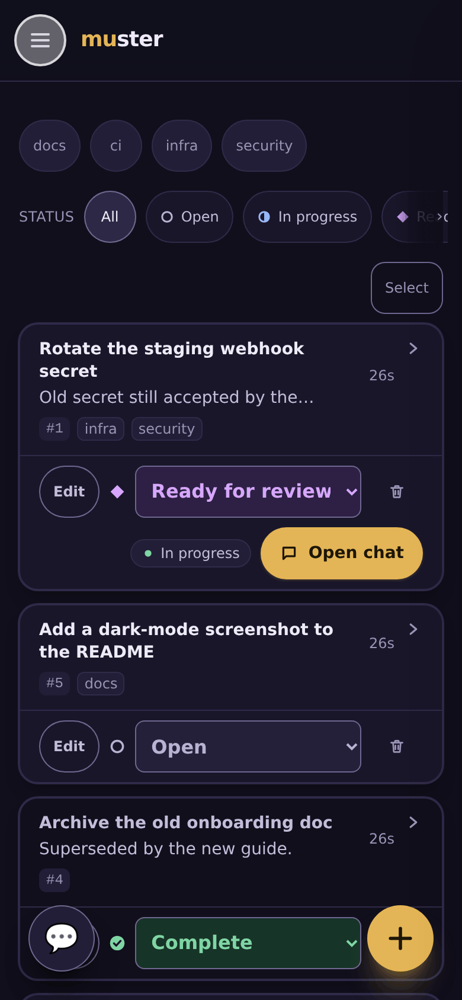
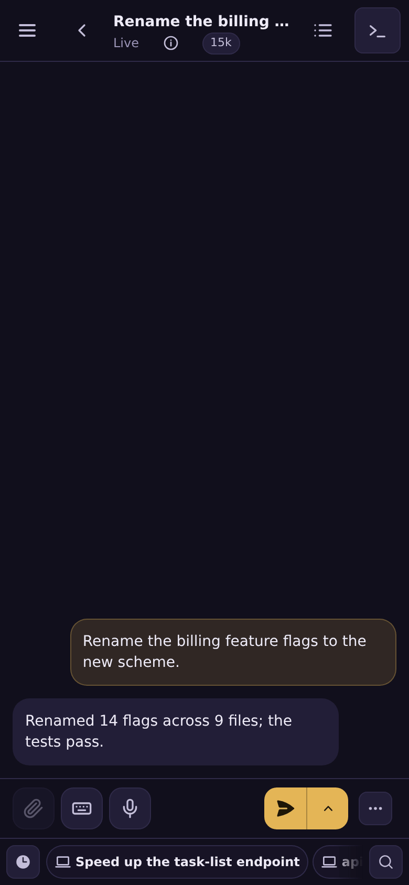
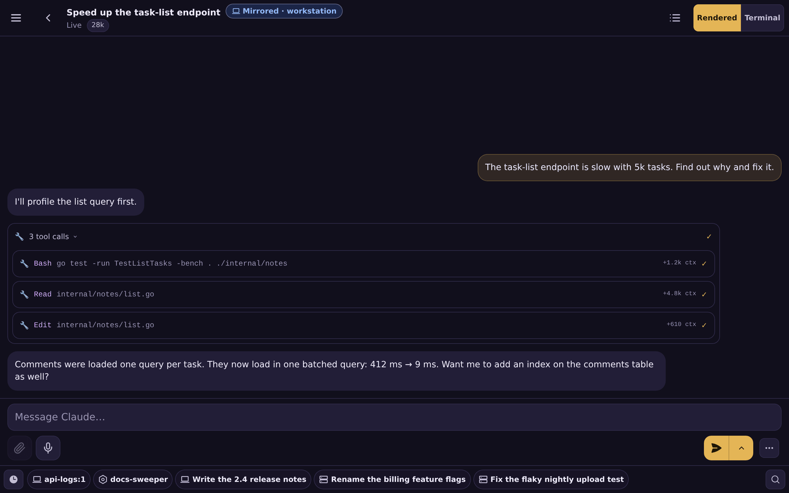

# muster in detail

The [README](../README.md) is the short version. This page is the long one:
what you get, how notifications behave, the core and the optional features,
how muster compares with Remote Control, and its limits. The full
documentation index is [README.md](README.md).

## What you get

Sessions are called by a **name**: the one you give with **Rename…**, or
their first good focus title ([focus](features.md#focus): optional, needs
an OpenRouter key). Without either, a window shows its tmux session and window
(`work:1`), or a label you give that tmux session (`muster-mirror
-labels-file`), as the shells, the Codex windows and the opencode window in
the README's pictures do.

- **A push when a session needs you, and one queue for everything waiting.** A
  session's stop is pushed once and never quoted; asks are pushed with their
  text ([below](#notifications-only-when-you-are-needed)). The **Asks** page
  gathers everything blocked on you. This needs Push, which INSTALL.md turns
  on; on iOS, Add to Home Screen first.
- **Mixed agents in one place.** Claude Code renders as a chat; opencode has
  its own read view; Codex, Gemini CLI and plain shells are live terminals.
  Each opens in a Terminal view you can type into, on a machine you let muster
  type into.
- **Everything stays on your machines and your tailnet** (unless you turn on
  an optional feature that calls an outside API, such as suggested replies,
  focus or a hosted speech-to-text). The server runs on one of your machines
  and is reached only over Tailscale. Each machine dials
  out to it, so muster opens no network port on them (the optional MCP
  endpoint listens on loopback only). Machines are read-only until you let
  muster type into them, one machine at a time.

### Asks, the chief and officers

- **Agents ask you instead of stopping.** A Claude Code session can ask you a
  question with options and wait for your answer, and Claude Code's own
  multiple-choice questions become a form you answer from your phone. Each
  needs a one-time setup per machine.
- **A chief that knows what every session is on.** An optional fleet agent
  you chat with: ask it what everyone is working on, who is on what, or what
  needs you, and have it hand a request or a task to the session already on
  it (routing is off until `MUSTER_SESSION_ROUTING=1`). It sends what it reads of your sessions to its model, and on an
  OpenRouter key muster sets no budget: put a credit limit on the key.
  Finding who is on what, routing and its standups rely on
  [focus](features.md#focus), which needs an OpenRouter key. What it needs: [docs/features.md](features.md#chief);
  prompts that work, with real replies:
  [docs/chief-cookbook.md](chief-cookbook.md).
- **Officers** need Kubernetes, or run in the Compose stack as host-spawned
  sessions on one opted-in machine: [docs/features.md](features.md#officers).

  

  

## Before the first session

What each part needs, and what is optional: [Core vs optional](#core-vs-optional).
While there is no session yet, home walks an admin through connecting a
computer and starting an agent in plain steps; the one prompt
([onboarding.md](onboarding.md)) and the tmux command
(`tmux new -A -s work claude`) are each behind an ⓘ with a Copy button. With a
computer already connected it leads with starting an agent. Anyone who is not
an admin is told to ask their admin, and anyone whose menu lists their team's
agents is pointed to the menu.

## Notifications: only when you are needed

From v0.146.0 the Compose stack pushes each stop of a session **once**: when it
waits on you, or when it has sat idle 10 minutes (stalled). The push names the
session and never quotes it. Asks are pushed with their text: an agent's or the
chief's question, muster's own, a Claude Code question held by the ask hook, and
opencode questions and permission requests
([docs/attention.md](attention.md#stalled--waiting-session-state)). Task
events have their own switches under **Account → Notifications**. Turning
this off: [docs/features.md](features.md#session-state).

## Core vs optional

The core runs with **no optional dependency**: Docker Compose with its bundled
Postgres on one machine, and `muster-mirror` and tmux on each machine;
Tailscale adds the phone and other machines. Everything else is off until you give it what it needs, and is
turned on with a few lines in `.env` (and, for some, a Compose profile).

Every feature, what it needs, and its default:

| feature | needs | default |
|---|---|---|
| [Core](features.md#core): mirrored sessions, chat and Terminal views, typing into sessions, sidebar and search, the Asks page, tasks, the installable app, the CLI and `muster doctor` | Compose and its Postgres; `muster-mirror` and tmux on each machine; Tailscale | on |
| [Push](features.md#push) | keys the Compose stack generates; HTTPS (Tailscale) for the phone | on |
| [One push per stop](features.md#session-state) | Push (above) | on in the Compose stack, from v0.146.0 |
| [Dictation](features.md#dictation) | `--profile stt` (bundled, CPU), `--profile stt-cohere` (GPU), or your own OpenAI-compatible speech-to-text | off (the agent install asks) |
| [Attachments](features.md#attachments) | `--profile s3`, or your own S3-compatible store | off |
| [Suggested replies](features.md#suggested-replies) and [focus](features.md#focus) | an OpenRouter key | off until the key is set; suggested replies then stay off for each user until they turn them on in Account (with no database, until `MUSTER_SUGGEST=on`) |
| [Agent ask tool](features.md#agent-ask-tool) and [ask cards](features.md#ask-cards) | a one-time setup on each machine | off |
| [Accounts](features.md#accounts) (per-user sign-in, passkeys) | a GoTrue server you run | off (one shared password) |
| [Chief](features.md#chief) | `--profile chief` (amd64 hosts), the connector store's key, and a Claude subscription token or an OpenRouter key; routing work to sessions also needs `MUSTER_SESSION_ROUTING=1` | off (routing too) |
| [Dispatch](features.md#dispatch) | **Kubernetes** | off; not in the Compose stack |
| [Officers](features.md#officers) | **Kubernetes** (pods), **or** in the Compose stack as host-spawned sessions on one opted-in machine (built-in backend only; outbound drafts and connectors work, HQ, ship gates, tiers, transcripts and the LLM proxy do not; the sessions run as that machine's user with no pod isolation, so muster's approval of their posts is the sanctioned path, not a boundary) | off |
| [Approval router](features.md#approval-router) | an external permission router you run (advanced) | off |

Every other optional feature, what it needs and the `.env` lines that turn it
on: [docs/features.md](features.md). `muster doctor` checks the install
end to end and says how to fix what fails
([docs/cli.md](cli.md#muster-doctor)); each section of docs/features.md
ends with how to check that feature is on.

## A guide per feature

Set up the core first, then add one optional dependency at a time, each with a
short guide (what it adds, what it needs, the settings, how `muster doctor`
confirms it, how to turn it off). The guides:
[docs/README.md](README.md#set-it-up-the-core-first-then-one-feature-at-a-time).
The words muster uses: [docs/glossary.md](glossary.md).

## muster vs Remote Control

If you use only Claude Code on a paid Claude plan, **Remote Control is less
work**: nothing to install or host, a native app with its own push for
permission prompts and questions, those prompts answered in the app,
first-party support, deeper Claude Code integration (subagent progress,
compaction), and Trusted Devices.

muster is for what it does not cover: agents other than Claude Code, Claude
Code on an API key, Bedrock, Google Cloud, Microsoft Foundry or a custom
`ANTHROPIC_BASE_URL`, every tmux session on every machine in one list, and a
session that stays on your own machines and tailnet instead of going through
Anthropic's servers. muster also picks up every session already in tmux on
its own, with nothing to run inside each one, and reads the session on your
own machine.

The full comparison, with Happy and SSH + tmux too and the sources for every
cell, plus a line each on herdr and Paseo citing their READMEs:
[docs/comparison.md](comparison.md).

## Limits

What muster does not do, or has not proven (platforms, permission prompts,
agents without a waiting push, one replica, an interactive mirror being a
shell on its host, dispatch): [limits.md](limits.md).

## The name

Not to be confused with two other apps called Muster: the Mac menu-bar app
([agentmuster.app](https://agentmuster.app/)) and the desktop app for running
parallel agents in git worktrees ([musterup.dev](https://musterup.dev/)). This
muster is the self-hosted one, for your phone and every machine you run agents
on.

*To muster is to assemble a force for duty. A muster roll is the register of who
is present and what each is assigned.*
