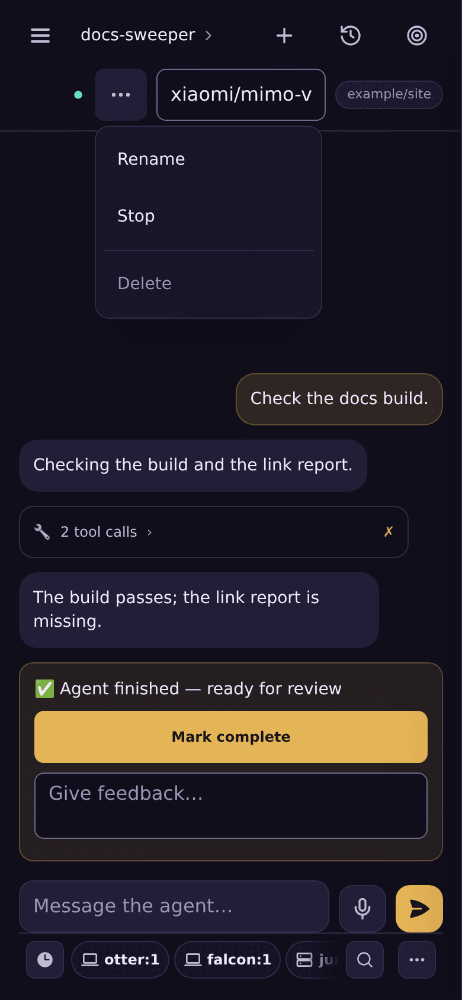

# Agents: dispatch, kinds, the chief, and the provisioner

muster can start a coding agent against a task, talk to it, and stop it. **All of
this is opt-in and off by default.** On a default deployment, every agent-control
route is registered but answers **503**, with `"provisionerUnwired": true` in the
body. The boot banner says `agent provisioning: UNWIRED`.

The web UI offers no dispatch on such a deployment, the docker compose install
included: the sidebar has no **+** beside **Agents** (it says "Agent dispatch
not set up" there instead, linking here), task cards have no **Dispatch**
button, and the dispatch sheet, if an old page still opens it, says that no
agent runtime is configured and points here. Setting `MUSTER_AGENT_PROVISIONER`
brings all three back.

Everything else still works without it: the sidebar lists mirrored sessions
([mirroring.md](mirroring.md)) and any agent rows already stored.

## The two switches

| switch | values | what it turns on |
|---|---|---|
| `MUSTER_AGENT_PROVISIONER` | `none` (default), `noop`, `kubernetes` | **Lifecycle:** dispatch, start, stop, destroy, logs, terminal. |
| `MUSTER_AGENT_GATEWAY` | `none` (default), `hooks-sha256` | **Chat:** messages to a running agent, plus delivery of the first turn (the "kickoff"). |

`noop` records specs and creates nothing. Use it to develop everything above the
provisioner without a cluster. `kubernetes` uses **in-cluster credentials only**.

The boot checks, all refused at boot rather than at the first dispatch:

- Any provisioner other than `none` requires `MUSTER_AGENT_IMAGE_REPO` and
  `MUSTER_AGENT_API_URL`.
- A gateway requires a provisioner, plus `MUSTER_AGENT_GATEWAY_MODEL`,
  `MUSTER_AGENT_RUNTIME_CONFIG` and `MUSTER_AGENT_RUNTIME_INSTALL`.
- The runtime-config pair set without a gateway also refuses to boot.

What happens when you dispatch:

- **No provisioner:** 503.
- **A provisioner but no gateway:** a dispatch that asks for a kickoff is refused
  with **409**, and nothing is created. "Save for later" followed by Start still
  works, but the agent is never told what to do.
- **Both:** the agent is created. A background deliverer then sends the task as
  its first turn once the instance is ready, every 10 seconds, at most once per
  agent. A failed kickoff is shown on the card, with the error.

### What a Kubernetes deployment needs that this repository does not ship

- **RBAC for muster's ServiceAccount**, in one of two layouts (see
  [Kubernetes RBAC](#kubernetes-rbac) below). By default, a ClusterRole holding
  every namespaced right cluster-wide; with `MUSTER_AGENT_NAMESPACE_CLUSTERROLE`
  set, a narrow cluster-wide grant plus a per-namespace RoleBinding muster writes
  itself. The Kubernetes driver's `render.go` is the authority on what it creates.
- **The muster Deployment itself:** this repository ships a container image
  definition (`Dockerfile`), but no manifests.

### Kubernetes RBAC

Each agent lives in its own namespace, `<MUSTER_AGENT_NAMESPACE_PREFIX><agent>`
(unless `MUSTER_AGENT_NAMESPACE_SHARED` is set), holding a ServiceAccount, up to
three Secrets, a ConfigMap, a PersistentVolumeClaim, a Deployment, a Service and
a NetworkPolicy. muster also execs into the pod and reads its logs. These are
the rights it needs **inside** an agent namespace; in both layouts they go in a
ClusterRole:

```yaml
apiVersion: rbac.authorization.k8s.io/v1
kind: ClusterRole
metadata:
  name: muster-agent-namespace
rules:
  - apiGroups: [""]
    resources: [serviceaccounts, secrets, configmaps, services, persistentvolumeclaims]
    verbs: [get, list, create, update, delete]
  - apiGroups: [""]
    resources: [pods]
    verbs: [get, list]
  - apiGroups: [""]
    resources: [pods/log]
    verbs: [get]
  - apiGroups: [""]
    resources: [pods/exec]
    verbs: [create]
  - apiGroups: [apps]
    resources: [deployments]
    verbs: [get, list, create, update, delete]
  - apiGroups: [networking.k8s.io]   # when claude-code is enabled
    resources: [networkpolicies]
    verbs: [get, create, update, delete]
```

**Default layout (`MUSTER_AGENT_NAMESPACE_CLUSTERROLE` unset).** Because the
namespaces are created at dispatch, the ClusterRole above is bound with a
**ClusterRoleBinding**, plus `get`, `list`, `create` and `delete` on
`namespaces`. That lets muster read Secrets and create Deployments in **every**
namespace of the cluster.

**Least-privilege layout (`MUSTER_AGENT_NAMESPACE_CLUSTERROLE=<name>`).** muster
binds its own ServiceAccount to the named ClusterRole **inside each agent
namespace**, with a RoleBinding named `muster-provisioner` that it writes
immediately after creating the namespace and before anything else in it. The
ClusterRole above is then **not** bound cluster-wide; the cluster-wide grant
shrinks to:

```yaml
apiVersion: rbac.authorization.k8s.io/v1
kind: ClusterRole
metadata:
  name: muster-provisioner
rules:
  - apiGroups: [""]
    resources: [namespaces]
    verbs: [get, list, create, delete]
  - apiGroups: [rbac.authorization.k8s.io]
    resources: [rolebindings]
    verbs: [get, create]
  - apiGroups: [rbac.authorization.k8s.io]
    resources: [clusterroles]
    verbs: [bind]
    resourceNames: [muster-agent-namespace]   # = MUSTER_AGENT_NAMESPACE_CLUSTERROLE
---
apiVersion: rbac.authorization.k8s.io/v1
kind: ClusterRoleBinding
metadata:
  name: muster-provisioner
roleRef:
  apiGroup: rbac.authorization.k8s.io
  kind: ClusterRole
  name: muster-provisioner
subjects:
  - kind: ServiceAccount
    name: <muster's ServiceAccount>
    namespace: <muster's namespace>
```

How it behaves:

- **The subject is read off the pod's own ServiceAccount token** (its `sub`
  claim), so there is nothing else to configure; muster refuses to boot if it
  cannot read it.
- **Propagation.** RBAC is not read-your-writes. After writing a binding, muster
  probes the namespace with a real request (a `get` of the agent's
  ServiceAccount) until it is no longer 403, for up to 30 seconds; past that the
  dispatch fails naming the ClusterRole, having written nothing else in the
  namespace. Check that the ClusterRole exists and grants `get` on
  `serviceaccounts`.
- **Agents created before you turn it on** have no RoleBinding. Every operation
  on an agent — dispatch, Start, Stop, status, logs, terminal, Delete, and the
  agent list — writes the binding first if it is missing. So: set the variable,
  restart muster, and only then remove the old cluster-wide ClusterRoleBinding.
- **A binding muster did not write**, under the name `muster-provisioner`, is
  refused, never adopted. One of muster's with another ClusterRole or subject
  (you renamed the role, or muster's ServiceAccount) is refused too, with an
  error naming the mismatch: a roleRef is immutable and muster holds no `delete`
  on RoleBindings, so delete it by hand
  (`kubectl -n <namespace> delete rolebinding muster-provisioner`) and muster
  writes the configured one at the agent's next operation. **Renaming the
  ClusterRole (or muster's ServiceAccount) therefore means deleting every
  agent's `muster-provisioner` binding by hand.** Until you do, each such agent
  appears in the agent list with an unknown state (its card reads
  provisioning, and the stopped-agent reaper leaves it alone), the server log
  names its namespace once per list, and actions on that agent fail with the
  mismatch. Every other agent is unaffected.
- **Delete** removes the namespace, and the RoleBinding with it.
- **The agent list** reads each agent namespace on its own instead of listing
  Deployments and Pods cluster-wide. A namespace counts only when it is
  muster-labelled and named exactly `<prefix><its agent label>`, so another
  installation's namespaces are never read (or bound into), even when its prefix
  starts with yours.
- **Refused at boot** with any driver but `kubernetes`, and with
  `MUSTER_AGENT_NAMESPACE_SHARED` (there is no namespace to bind in: grant muster
  a Role in the shared namespace instead). A ClusterRole name that does not
  exist is not caught at boot: the first dispatch fails after the propagation
  wait, naming it.
- **Outside agent namespaces:** a deploy-key pool's source Secret is read from
  muster's own namespace (`MUSTER_AGENT_NETPOL_FROM_NAMESPACE`). Under this
  layout, grant `get` on `secrets` there with a Role and RoleBinding of its own.

⚠ **What the narrow grant still allows.** `create` on `rolebindings` has to be
cluster-wide, because agent namespaces are created at dispatch. So muster can
still bind **itself** to that one ClusterRole in **any** namespace, and reach
that namespace's Secrets that way: two deliberate, audited writes rather than a
standing right, but not a boundary. (It holds no `delete` or `update` on
RoleBindings, so it cannot remove or rewrite anyone else's.) Kubernetes RBAC
cannot restrict a grant by namespace name. To close it, add an admission
policy, for example:

```yaml
apiVersion: admissionregistration.k8s.io/v1
kind: ValidatingAdmissionPolicy
metadata:
  name: muster-rolebindings-in-agent-namespaces-only
spec:
  failurePolicy: Fail
  matchConstraints:
    resourceRules:
      - apiGroups: [rbac.authorization.k8s.io]
        apiVersions: ["*"]
        operations: [CREATE, UPDATE, DELETE]
        resources: [rolebindings]
  matchConditions:
    - name: is-muster
      expression: request.userInfo.username == "system:serviceaccount:<muster's namespace>:<muster's ServiceAccount>"
  validations:
    - expression: request.namespace.startsWith("devpod-")   # = MUSTER_AGENT_NAMESPACE_PREFIX
      message: muster may only write or delete RoleBindings in its agent namespaces
---
apiVersion: admissionregistration.k8s.io/v1
kind: ValidatingAdmissionPolicyBinding
metadata:
  name: muster-rolebindings-in-agent-namespaces-only
spec:
  policyName: muster-rolebindings-in-agent-namespaces-only
  validationActions: [Deny]
```

## Agent kinds

`MUSTER_AGENT_KINDS` is a comma list of `gateway` and `claude-code`. It
defaults to `gateway`, and `gateway` must always be in it.

A `hermes` kind existed (up to `d46b22e1`) and was removed. A `hermes` entry
in `MUSTER_AGENT_KINDS` is now an unknown kind and refuses to boot, and
migration `0047` refuses to run while any `hermes` agent row exists: destroy
those agents with a build that still has the kind before upgrading.

- **`gateway`** runs your agent image (`MUSTER_AGENT_IMAGE_REPO:TAG`), which
  serves an HTTP chat gateway. muster derives the bearer token the pod accepts as
  `sha256("gw-" + <the agent's token>)`.
- **`claude-code`** runs the image built from
  [`images/claude-code-agent`](../images/claude-code-agent): the Claude Code CLI
  in tmux, supervised by `ccd` ([`cmd/ccd`](../cmd/ccd)).
  - `ccd` serves `POST /v1/responses` on port 18789. It pastes each prompt as a
    bracketed paste and reads the reply from the transcript.
  - The image refuses to start if any API-key-style Anthropic variable is set,
    so it can only use a Claude subscription token.
  - It requires `MUSTER_AGENT_CC_IMAGE`, pinned to a tag or digest.
  - It requires `MUSTER_AGENT_CC_ACCOUNTS`, plus one
    `MUSTER_AGENT_CC_TOKEN_<NAME>` per account.
  - On Kubernetes it requires both `MUSTER_AGENT_NETPOL_FROM_*` variables.

  **The account pool.** Each new agent is assigned an account: first excluding
  accounts marked `auth_failed`, then any account still cooling down after a
  `rate_limited` (until the reset time the CLI stated, else
  `MUSTER_AGENT_CC_RATE_LIMIT_COOLDOWN`, default `1h`) ranked last — but still
  chosen when it is all there is — then the least recently rate-limited, then
  the one with the fewest live agents. A pin at dispatch overrides this. An agent
  keeps its account for life. The token goes only into that agent's own Secret,
  as `CLAUDE_CODE_OAUTH_TOKEN`. The pool configured in the environment belongs
  to the admin; members use credentials they stored themselves
  ([auth.md](auth.md)).

  **A worker pool.** The dispatch forms' **Worker pool** field, shown only
  while Claude Code is picked, makes the new agent a member of that pool of
  the machine job API ([jobs.md](jobs.md#worker-pools)). Leave it empty for an
  ordinary agent.

  **The pod.** It runs as uid 1000 with no ServiceAccount token, and has a
  `/data` volume (`MUSTER_AGENT_CC_STORAGE_SIZE`, default `10Gi`). Its
  NetworkPolicy:
  - admits connections only from muster's pods;
  - allows egress only to cluster DNS and TCP 443 on public IPv4 addresses, plus
    muster's connect port;
  - for an **officer instance** only, drops the public-443 rule and the DNS
    rule: the connect port, nothing else. The cluster must allow name-filtered
    DNS and `api.anthropic.com` by name
    ([officers.md](officers.md#the-instances-network)).

  See [limits.md](limits.md) for what that does and does not stop.

  **A workspace ccd cannot write in.** On a volume first used by an image up to
  0.49.0, `/data/workspace` may be root-owned 0755. If it is **empty**, `ccd
  seed` replaces it with one owned by uid 1000 and logs `ccd seed: replaced …`.
  If it is **not empty** or is a **symlink**, nothing is removed: the pod
  crash-loops with `ccd seed: <dir> is a directory this process (uid 1000) cannot
  create files in …` (or `… is a symlink …`). `kubectl exec` into the agent is
  impossible because its pod never starts. Instead, in the agent's namespace
  (`<MUSTER_AGENT_NAMESPACE_PREFIX><agent>`, e.g. `muster-agent-<agent>`), run a
  debug pod as root that mounts the agent's PVC (`<agent>-workspace`) at `/data`
  and run `chown -R 1000 /data/workspace && chmod u+rwx /data/workspace` there —
  one command whoever owns it (for a symlink, the error names the link's target:
  run it on that). Then delete the agent's pod so it restarts.

  **Permission prompts.** These go to `ccd approve`. If
  `MUSTER_APPROVAL_GATE_URL` is configured, it relays the prompt to the
  permission router; otherwise the prompt falls back to the agent's own terminal.

### A claude-code agent's repository

A claude-code agent can be dispatched with a repository (`owner/name`, and a
branch), from the dispatch forms, the API or the chief's `agent_dispatch`, like a
gateway agent — but only one of your **connected** GitHub repositories, from
every door (its session starts pre-trusted in the checkout, so the repository's
own `.claude/` runs beside the subscription token; see below). An agent without
one is exactly what it was before: no clone, the CLI in `/data/workspace`, the
same resume (`--resume` of its own conversation by id).

- **The checkout.** muster gives the pod `CCD_REPO`, `CCD_REPO_BRANCH` (when
  there is a branch) and `CCD_WORKSPACE=/data/workspace/<name>`. Before it
  starts the CLI, `ccd` clones `https://github.com/<owner/name>` there, on the
  agent's volume, and then starts the CLI **in the checkout**. The session's
  project is the repository: its `CLAUDE.md` and `.claude/` (project skills in
  `.claude/skills`, project settings) are the session's, alongside the managed
  `/etc/claude-code/CLAUDE.md`. An existing checkout (a restarted pod) is used
  as it is, never re-cloned or reset.
- **Credentials.** Only through the `github` connector
  ([connectors.md](connectors.md)): git reaches GitHub through muster's proxy
  once the agent holds an approved grant. With a [GitHub App](github-app.md)
  the proxy injects a token limited to the agent's own repository. No token is placed in the pod. A
  public repository clones without one.
- **Until the clone succeeds the CLI does not start.** Every turn answers
  `503 not_ready` with the reason (git's error, and what the `github` connector
  needs), so the kickoff's failure on the card says why; `/healthz` stays 200
  and reports the checkout under `repo`; `ccd` retries every 30 seconds. When
  the clone fails and the agent holds no `github` grant at all, `ccd` files the
  agent's request for it **once** (the same request the session's
  `connector_request` tool would file); approve it under Connectors and the
  next retry clones. A denied or revoked grant is not asked for again.
- **The first turn waits for the checkout.** While `/healthz` reports the
  checkout as `cloning` or `awaiting_grant` (the agent's `github` request is
  pending), muster does not send the kickoff and does not mark it sent; it
  looks again every 10 seconds. The card reads "Waiting for your github
  approval" with a link to Connectors. Once the checkout is ready the kickoff
  is delivered as usual, exactly once — no re-send by hand. After 24 hours of
  waiting (`MUSTER_CHECKOUT_WAIT_TIMEOUT`, measured from the agent's last status
  change) the agent goes to `error`: "the github grant was not approved". Any
  other clone failure (`failed`: a denied or revoked grant, an approved grant
  git cannot use) is not
  waited on: the kickoff is sent, and its `not_ready` reason is recorded.
- ⚠ **The repository's own `.claude/settings.json` applies to the session**
  (project settings: hooks, permissions, `env`). `ccd` strips `env` and
  `apiKeyHelper` only from the CLI's user settings, so dispatch only onto
  repositories you trust with the agent's subscription token.
- **Machine jobs at a commit do not use the checkout.** A [job](jobs.md) with a
  `sha` fetches its pull request's head anonymously from github.com (around any
  proxy routing the pod has) and runs in a git worktree of its own at
  `/data/workspace/.muster-jobs/<job id>` — beside the checkout, on the same
  volume — with the commit's agent configuration replaced by the default
  branch's, in a Claude Code session whose CLI `ccd` starts in that directory
  (`X-Muster-CC-Workdir`). `ccd` accepts only that exact directory shape; the
  CLI trusts it as a worktree of the trusted checkout. The worktree is removed
  when the job ends. The checkout, its branch and its working tree are never
  moved.

To start one from the chief: the repository must be one of your connected
repositories (in the GitHub App's installation, [github-app.md](github-app.md)),
make sure a `github` connector exists, then have the chief call `agent_dispatch`
with `target: "pod/claude-code"` and `repo`.

### The image as a docker compose service

The same image runs as a `docker compose` service when `CCD_SPEC_DIR` is set.
The entrypoint then runs `ccd compose` (`cmd/ccd/compose.go`) and nothing else;
without the variable, which is the Kubernetes case, it runs exactly as above.
muster configures the service through files in a shared volume, not through a
docker socket.

- **The spec.** muster writes `$CCD_SPEC_DIR/spec.json`:
  `{"version":1,"name":…,"generation":N,"replicas":0|1,"epoch":"<hex>","env":[{"name","value"}…],"secrets":[…]}`.
  `ccd compose` reads it every 2 seconds. A `version` other than 1 is refused,
  and so are a `generation` below 1, `replicas` other than 0 or 1, an `epoch`
  that is not hex, a variable named twice, and `CCD_LISTEN`, `CCD_SPEC_DIR` or
  `CCD_APPROVE_UNANSWERED` in `env` or `secrets`. Fields it does not name, and other
  files in the directory, are ignored. Files that belong elsewhere in the
  container are written under `$CCD_SPEC_DIR/files/<path>` and mounted
  read-only by the compose file (`files/etc/claude-code` at `/etc/claude-code`);
  `ccd compose` does not copy them.
- **The child.** With `replicas` 1, `ccd compose` runs the entrypoint again
  as a child, without `CCD_SPEC_DIR`, with the spec's `env` and `secrets` in its
  environment, `CCD_LISTEN=127.0.0.1:18790` and `CCD_APPROVE_UNANSWERED=deny`.
  It proxies every request on port 18789 to the child, streamed responses
  included. A new `generation` or `epoch` stops the child and starts another.
  With `replicas` 0, an absent `spec.json` or a refused one, no child runs:
  no CLI, so no model calls. `ccd compose` itself keeps running, so the
  container does not exit.
- **Stopping.** SIGTERM to the child's process group, SIGKILL after 20
  seconds, then `tmux kill-server` on the server `ccd` used, then SIGKILL to
  anything still descended from `ccd compose`. The last two steps are needed
  because tmux runs in a session of its own: killing `ccd` leaves tmux and
  `claude` running. `ccd compose` is a child subreaper, so the sweep can find
  them.
- **The epoch.** Before each start, if `/data/.muster-epoch` exists and holds
  a different epoch, everything under `/data` is removed. Then the spec's epoch
  is written there. If the file does not exist, nothing is removed. This is how
  a destroy and create gives a chief a fresh volume.
- **Supervision.** A child that exits is started again after a backoff (1s,
  doubling, at most 30s). A child whose `/healthz` has not answered 200 within
  305 seconds of starting, or has not answered 200 for 90 seconds after it
  once did, is stopped and, after the same backoff, started again. These are
  the Kubernetes driver's startup and liveness budgets.
- **`GET /compose/status`** always answers 200:
  `{"state","generation","replicas","epoch","boot","ready","reason"}`. `state`
  is `awaiting_spec`, `off`, `starting`, `running`, `exited` or `error`.
  `boot` is a random id for each child start, `""` when no child is running.
  `ready` is whether the child's `/healthz` answered 200 on the last check.
  While no child runs, `/healthz` (and `GET /`) answers 503 with
  `{"compose":<that status>}`, and every other request a 503 `not_ready`
  failure.
- **Permission prompts are denied.** Nobody can answer one: there is no
  approval gate and no terminal muster can reach, so a prompt deferred to the
  terminal would hang the turn. With `CCD_APPROVE_UNANSWERED=deny`, `ccd
  approve` denies every prompt that reaches it, without contacting the relay.
  Only tools that are pre-allowed run.
- **Logs.** `ccd compose` logs variable counts, never values.
- **Users.** `ccd compose` must run as uid 0 and refuses any other uid. The
  compose service runs it as `0:1001` with every capability dropped except
  `SETUID`, `SETGID` and `KILL`, so it has no DAC override: it reads what group
  1001 may read. The driver writes `spec.json` 0640 in group 1001. The child
  runs as uid 1000, gid 1000, supplementary groups exactly `[1000]`, so the CLI
  and its tool calls cannot read `spec.json` and its secrets, the turn bearer
  included. This keeps the bearer out of the session's reach, as the Kubernetes
  path does ([configuration.md](configuration.md#ccd-inside-the-claude-code-agent-image)).
  The files under `files/` are group 1000 and readable by the CLI. The `/data`
  wipe, the epoch marker and `tmux kill-server` run as uid 1000 (`ccd
  compose-epoch` is the wipe's helper), because uid 0 without DAC override
  cannot touch uid 1000's 0700 `/data`. `ccd compose` marks itself
  non-dumpable.

`images/claude-code-agent/compose-smoke.sh <image>:<tag>` runs this mode
with the real `ccd` and CLI, as `deploy/docker-compose.yml`'s own `chief`
service, and CI runs it. A stand-in for muster writes the specs muster never
would (a new generation, a new epoch, an unknown version, a removed spec).
`tests/compose-up.sh`'s chief phase covers the rest with muster itself.

## Talking to an agent

When a gateway is configured, three routes are live:

- `POST /api/agents/{name}/messages` takes a machine token (`muster agent …`,
  `muster chief ask`).
- `GET /agents/{name}/ws` is the chat socket.
- `POST /agents/{name}/send` is the message box (see
  [sending-and-step-up.md](sending-and-step-up.md)).

A `claude-code` agent has the same Rendered | Terminal switch as a mirrored
session.

## An agent's page

A dispatched agent's page shows, under its title, the agent's live status (with
**awaiting approval** while it waits at a permission prompt, **kickoff owed** or
**kickoff failed**, and what it has running), and a **⋯** menu: **Rename**,
**Start** or **Stop**, and **Delete** (two steps; never for the chief). A failed
kickoff, a first turn held for your GitHub approval, or a GitHub App problem is
explained above the transcript. To start a new agent, use the **+** beside
**Agents** in the sidebar: **Dispatch**, or **Save for later** to start it later
from its page.



## How an agent's work ends

Every agent started with a first turn — from the dispatch form, a task's
**Dispatch**, or the chief's `agent_dispatch` — ends in an **outcome** you can
see: never silently "running". The outcome is shown on the agent's page (a
**failed** or **stuck** badge beside the status, and a notice above the
transcript saying why), on its sidebar row, on the chief panel's card for it,
and in `GET /api/agents` (`outcome`, `outcomeReason`, `outcomeAt`).

| outcome | when | what happens |
|---|---|---|
| `running` | the agent was started with a first turn | — |
| `waiting` | its turn ended and it is idle **without saying it finished** — it asked a question, or reported progress (or its pod's background work ended) | after 60 seconds, if you have neither replied nor opened the agent's page: one push, `<agent> is waiting for you: <the LAST line of its reply>`, and one note to the chief quoting its last lines (the same with `MUSTER_SESSION_STATE=1`; session state then does not push this wait again as a stalled conversation). A conversation you are in pushes nothing. Its next turn puts it back to `running` |
| `done` | it **said** it finished: it moved its own task to **ready for review** or **complete** (the chief or a mirrored session moving it does not count), or called `agent_report_done{summary}` (offered to every agent but the chief; a dispatch with no task is told to call it) | one push, `<agent> finished: <summary>` (none beside the task's own ready-for-review push), and a note to the chief; a new turn puts it back to `running` |
| `failed` | a turn of it **failed**: the runtime reported the turn failed (a model it does not know, say — also when it then completes with no answer), it answered nothing, or its first turn was never delivered | its status becomes `error` with the reason as its error message; one push, `<agent> failed: <reason>`, linking to the agent; and a note to the chief that started it, so the chief can tell you and offer to start it again |
| `stuck` | the [silence watchdog](#the-silence-watchdog) saw no activity | one push, `<agent> is stuck: <reason>`, and a note to the chief |

🔴 **A reply is never "done".** A turn that ends is as often the agent's
question ("Which repository should I work in?") as its result, so only an
explicit signal finishes it; every other idle end is `waiting` on you.

**What does not count as a failure:** you closing the chat while a turn runs,
a runtime that refused a turn before it typed anything (busy, not ready, rate
limited — the sender is told), a connection to a pod that is restarting, a
turn that outlived its budget and a first turn cut off by muster itself
shutting down (in both the runtime may still be running it; the watchdog
judges what it does next), and an `error` event the runtime followed with a
completed turn. **Only a dispatched agent is set to `error`** (one started from
the dispatch form or by the chief's `agent_dispatch`); an officer's instance or
a saved agent you Started keeps its status. **The chief is never set to
`error` by a failed turn**: its status gates every delivery muster makes to
it, so its failure is pushed and shown, and its next good turn clears it.

**One push per change.** Every change of outcome is a database write
conditional on the outcome it leaves, so of two writers (two replicas, a turn
ending while the watchdog runs) exactly one applies it, and only that one
pushes. A second failure of an agent already `failed` updates the reason and
pushes nothing. The push is the `agent_outcome` event on **Account →
Notifications**, under the same per-owner cap as every push
([push.md](push.md)).

**Starting it again.** **Start** from the ⋯ menu clears a `failed` or
`stuck` outcome; the agent is then not watched until it is given new work.
Fix the cause first: for a model the runtime did not know, change the agent's
model (it is checked, below), then Start it.

### Models are checked before a pod starts

Every door that sets an agent's model — the dispatch form, a task's own model
when it is dispatched, `POST /agents/{id}/model` on the agent page, replacing
the chief (before the old one is removed), and the chief's `agent_dispatch`
(before it reserves anything) — checks the value
against the OpenRouter model catalogue (the list the dispatch form's model
picker reads, cached for an hour):

- an exact id passes (`openrouter/<id>`, or a bare `<id>`, stored as
  `openrouter/<id>`);
- a display name, or a case or spacing variant, that matches **exactly one**
  model (its name, its name without the `Vendor: ` prefix, or its id's model
  half) is resolved to that model's id, and both are recorded;
- anything else is **refused** before any pod starts, with up to five of the
  closest ids, so the chief can ask you which you meant.

**What is stored is always the route form, `openrouter/<catalogue id>`**: a
gateway agent holds one credential, OpenRouter's, and its runtime reads the
provider from the model's prefix. (An id OpenRouter itself owns, such as
`openrouter/auto`, is already in that form.)

When the catalogue cannot be read, a value with the id shape passes unchecked
(logged as a warning) — but a bare `vendor/model` is then still refused by the
credential check, which names the route form (`did you mean
"openrouter/vendor/model"`), so only `openrouter/<vendor>/<model>` gets through;
a display name is refused.
muster's own suggested models always pass. The chief's `task.chief_dispatch`
audit row records the `model` the agent runs on, and `model_input` when the
value given was resolved.

### The silence watchdog

A sweep, every `MUSTER_AGENT_WATCHDOG_INTERVAL` (`1m`), over every agent whose
outcome is `running` or `stuck`:

- **no first reply** and no activity for `MUSTER_AGENT_STUCK_NO_REPLY`
  (`5m`) after its first turn was delivered → `stuck`, *no reply since
  kickoff*;
- **replied, still working**, and no activity for `MUSTER_AGENT_STUCK_SILENT`
  (`30m`) → `stuck`, *silent for 30 min*;
- `stuck`, and then any activity → `running` again (no push).

"Activity" is everything muster can see the agent do: a turn **open** in
muster — a chat turn, its first turn, a scheduled job's turn or a memo turn
(a claude-code turn streams nothing until it ends, so an open turn is
never "no reply since kickoff"), the runtime taking a turn or a turn ending, every read of a
turn's stream (text, thinking, tool calls), its pod's work reports (sent every minute
while it has subagents or background shells running), and the agent's row and
transcript (the same "last active" the sidebar orders by). So a genuinely
working agent is never flipped. A message the runtime refused before typing
it (a `busy` session; muster holds it and asks again) is not activity, and does
not put a waiting agent back to running: only a turn the runtime takes does. A
job's or a memo's turn keeps the agent working while it runs and is judged as
nothing (its reply is the job's result); a chat reply that ends during one is
judged when it ends. A first turn muster stops waiting for
at its budget is not a failure, but it is no longer open: if the agent then says
nothing, it goes `stuck`. Before its first turn is delivered, the
kickoff deliverer owns the verdict: an agent whose instance never became
ready is failed after 15 minutes, as before, and that is now pushed too.

### Reading an outcome

`GET /api/agents` (the machine roster) carries `outcome` — `running`,
`waiting`, `done`, `failed`, `stuck`, or `""` for an agent nobody dispatched —
with `outcomeReason` and `outcomeAt`. The chief panel's card for an agent it
started reads the same recorded outcome as the agent's page (`failed` and
`stuck` with the reason, `waiting for you` with the last line, `done`),
through one projection,
`api.Server.AgentOutcomeOf`, so the two cannot disagree.

## Destroying an agent

Two doors take the same teardown (`destroyAgent` in `internal/api/agents.go`):

- **Delete** in an agent page's **⋯** menu (`DELETE /agents/{id}`, a signed-in session);
- **`agent_destroy {name | id}`** from one of your own mirrored Claude Code
  sessions (`POST /mirror/mcp` only — see
  [attention.md](attention.md#the-agent-tools)), so a stuck agent can be torn
  down without a browser. `muster agent ls` lists the names it takes.

Both refuse the chief before anything starts (use `muster chief replace` for
it; [chief.md](chief.md)), then run the provisioner's `Destroy` in the
background: the instance, then the row — and the row is **kept** (status
`error`) when the instance could not be removed (rule 2 below). What goes with
the row is the same on both doors: the agent's attention asks are deleted
(migration 0025's `ON DELETE CASCADE`; nothing on this path sends the
"resolved" message that would clear a notification already on your phone), and
a turn it is running is not stopped first — the pod's teardown ends it.

After a **successful** teardown, on both doors:

- if the agent was the one the chief's `agent_dispatch` started on its task, the
  chief's one start on that task is **released** (an
  `task.chief_dispatch_released` row in the chief-dispatch ledger; nothing is
  deleted), so the chief may start one new agent there — see
  [chief.md](chief.md). ⚠ This is new for the agent page's Delete too.
- your open tabs re-fetch: `agent.changed` and `attention_queue.changed` are
  broadcast to you.

**The task is kept on both doors** (unlike deleting the task, which tears its
agent down). Only `agent_destroy` also moves it back: a task still
`in_progress` with no other live agent goes to `open` (status writer
`agent-destroy-reopen`), which `agent_dispatch` needs (open, ungated, no live
agent). A plugin task reference is never moved back: its status is the
upstream's ([plugins.md](plugins.md#task-references)). The write is conditional — it moves the task only while it is still
`in_progress` — so a status you set meanwhile is kept. After the browser's
Delete the task stays as it was; reopen it on its card.

Neither door writes an audit row for the destroy: an `agent_destroy` call's
host and session are in muster's server log only.

A task becoming `complete` **stops** (never destroys) the agent the chief started for it: see [plugins.md](plugins.md#completing-a-task-stops-the-chiefs-agent).

### Reaping stopped agents

An agent whose stored status has been `stopped` for
`MUSTER_AGENT_REAP_STOPPED_AFTER` (default `336h`, 14 days) is destroyed by
the **stopped-agent reaper**, through the same teardown as the two doors above
(`destroyAgent`, acting as the agent's owner): the chief is refused, then the
provisioner's `Destroy` removes the instance and then the row, and after a
successful teardown the chief's start on the agent's task is released and your
open tabs are told, exactly as for the agent page's Delete. Like that Delete,
it leaves the agent's task as it was.

- **The clock** is `agents.stopped_at` (migration 0045): the time the row last
  moved into `stopped`, stamped by a database trigger (today the writers of
  `stopped` are Stop and a saved dispatch). Writing `stopped` over a row that
  already is `stopped` does not move it. **Start** moves the row out of
  `stopped`, so the next Stop starts a new clock: a restarted agent that is
  stopped again waits a full window. Agents already stopped when 0045 was
  applied have their clock started at that moment.
- **Never reaped:** the chief (either kind, [below](#the-chief)); an agent in
  any other status, `error` included; a [pool worker](jobs.md#worker-pools)
  (`worker_pool` set); and an agent that **never ran** — saved for later and
  never started. "Ran" is `agents.first_started_at` (migration 0045), stamped
  by the same trigger the first time the row is written `provisioning` or
  `running`: a dispatch writes `provisioning` only after the instance was
  created, and Start only after it was brought up, while a save writes
  `stopped` straight away and a refused or failed dispatch writes `error`.
  Started once, it stays stamped. When 0045 was applied, a row counted as
  having run only if it was `running` or a first turn had been handed to an
  instance (`kicked_off`, a recorded kickoff pod, or a delivery attempt);
  every other row, including a stopped agent that was started but never got
  its first turn, counts as never started until it is Started again.
- **When:** the reaper rides the idle-task reaper's sweep, every 30 minutes,
  on every pod (`muster-server` installs no leader gate for these loops; see
  [limits.md](limits.md#deployment)). Before it starts a teardown it claims the agent with one
  conditional update that re-checks the stored conditions above (status,
  pool, ran, window) and that no other claim is live, so two pods never both
  destroy an agent, and an agent Started after the sweep read it (now
  `provisioning` or `running`, or stopped again with a fresh `stopped_at`) is
  left alone. A claim excludes other claims for an hour.
- **The instance is checked too.** A stored `stopped` is not proof the
  instance is down: Start brings the instance up before it writes
  `provisioning`, so a Start whose status write failed leaves a running
  instance under a `stopped` row. Before claiming anything, each pass reads
  the provisioner's instances and skips (and logs: `agent-reap: agent <id>
  (<name>) is stored stopped but its instance reads <status>; not reaped`)
  any due agent whose instance reads anything but stopped, by the same rule
  the agent's page uses. No instance at all, or one scaled to zero, counts as
  stopped. If the instances cannot be read, or the read has not answered
  within 30 seconds, the pass destroys nothing.
- **The record** is one server log line per agent whose teardown it started
  (`agent-reap: destroying agent <id> (<name>) of user <owner>, task <id or
  none>: stopped since <time>, longer than <window>`). No task comment and no
  audit row are written. A teardown that could not remove the instance is
  logged and keeps the row with status `error` (rule 2 below), so it is not
  retried; one that removed the instance but not the row leaves it `stopped`,
  and it is claimed again once the hour has passed.
- **Off:** `MUSTER_AGENT_REAP_STOPPED_AFTER=0` (or `off`). The boot log says
  which (`agent reaper: sweeping every …` or `agent reaper: off`).

⚠ A Start in flight — instance being brought up, `provisioning` not yet
written — whose instance the pass's read did not yet see as up still reads
`stopped` on both counts. A claim landing then wins, and the teardown removes
what the Start brought up: the same race as pressing Start and Delete at once.

## The chief

The **chief** is an ordinary agent row: your fleet agent. Its slug is `chief` for
user 1 and `chief-<id>` for any other user, so each user has their own.

- `POST /chief/provision` starts your chief if it exists. Otherwise it creates
  one and dispatches it with a fixed introduction ("You are chief, muster's fleet
  agent…").
- The chief panel (`/ui/chief/panel`) is the agent chat view mounted in a side
  panel.
- `muster chief ask` sends it a question from the CLI.
- Only a `gateway` chief receives the cairn coordinates (`MUSTER_AGENT_CAIRN_URL` and
  `MUSTER_AGENT_CAIRN_TOKEN`).
- It can run on either kind, and `muster chief replace` moves it from one kind
  to another. See [chief.md](chief.md).

## The provisioner seam (`internal/provision`)

`internal/provision` sits between "an agent should exist, configured like this"
and whatever runs it. It imports nothing outside the standard library, so wiring
the no-op driver brings in none of a cluster client's dependencies.

| driver | what it is for |
|---|---|
| `provision.Noop` | Records instead of provisioning. Use it to develop everything above the seam without a backend. |
| `provision/k8s` | Renders its own minimal manifests and installs no chart: Namespace, ServiceAccount, **two** Secrets (confidential environment, and separately confidential files), ConfigMap, PVC, Deployment, Service, and a NetworkPolicy for `claude-code`. |
| `provision/compose` | The chief on the `docker compose` install. It starts no container (that would need the Docker socket): it writes each admitted instance's spec and files into a volume shared with the `chief` container, whose supervisor runs, stops (replicas 0) and restarts (a new generation) the agent. It asks that container for its status. No exec, no network confinement, no resource limits: specs asking for those are refused. `Spec.Security` (`RunAsNonRoot`, `Restricted`, the uid and groups) is neither applied nor refused: this driver drops it, and the agent's identity and capabilities are whatever the Compose file and the image's supervisor give it. |

`internal/agentprovision` adapts a driver to the API's lifecycle interface.
`internal/agentgateway` speaks the chat protocol over the same driver.

Four rules define a driver. Each rule's main clause is pinned by a test in
`provisiontest.RunContract` rather than by prose, with **one named exception**.
Rule 2's `ErrNotManaged` clause needs a shared backend to be expressible at all,
so it is pinned in the Kubernetes driver's own ownership tests instead.
`RunContract` has 20 cases, and none of them mentions `ErrNotManaged`. The rules
are stated in full in the package doc; in short:

1. **A driver that cannot see its backend returns an error, never an empty
   set.** A caller reads a `List` error as "keep the stored status", and an empty
   `List` as "nothing is running".
2. **`Destroy` returns `nil` only if the instance was removed or was already
   absent.**
   - A FOREIGN object holding the instance's name is neither of those. It is
     `ErrNotManaged`, which deliberately does **not** satisfy
     `errors.Is(err, ErrNotFound)`.
   - That refusal also means **nothing was removed**: a driver decides ownership
     before it deletes anything.
3. **`Create` is idempotent; a divergent spec is an error**, not a silent
   overwrite. Note the one asymmetry: when `Create` refuses because a foreign
   object has the same name, the error stays `ErrDivergentSpec`. It does **not**
   report `ErrNotManaged`.
4. **`Capabilities` is useless unless callers branch on it.** Each capability's
   refusal is spelled in exactly one place, and `capabilities.go`'s doc comment
   is the authority on which.

`internal/provision/provisiontest` is the contract suite every driver must pass.
It requires a working driver, a **blind** one and a **restricted** one, and it
does not skip.

- Without the blind driver, rule 1 cannot be tested.
- Without the restricted driver, the capability refusals are never seen to fire.
