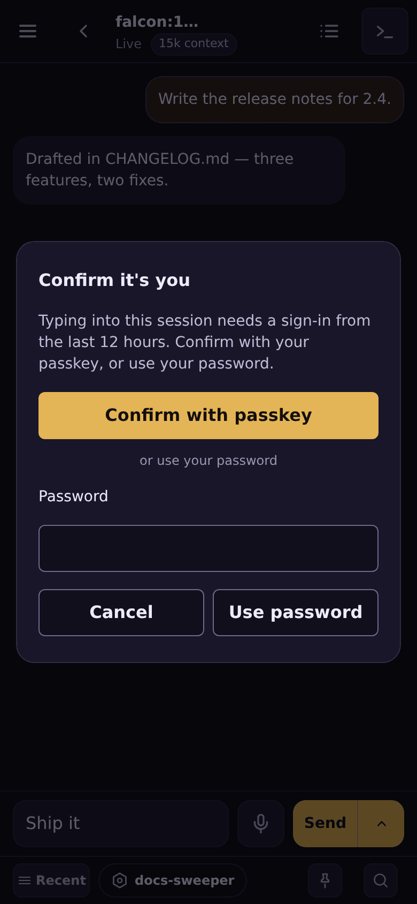

# The message box and step-up

## Where the message box appears

| view | message goes to | needs |
|---|---|---|
| A mirrored window's **Rendered** view (Claude Code) | the Claude Code pane, pasted as typed | the host's `-interactive`, plus a fresh sign-in |
| A mirrored window's **Terminal** view (any program except Hermes) | the window's active pane, followed by Enter | the host's `-interactive`, plus a fresh sign-in |
| A dispatched agent's chat and **Terminal** view | `POST /agents/<name>/send`: one agent turn, run in the background | a running agent with chat wired ([provisioner.md](provisioner.md)) |
| The chief panel | the chief agent | as above |

Each box can also have a microphone; see [dictation.md](dictation.md). Each
box also keeps what you type as a draft on this device; see
[Drafts](#drafts-kept-on-this-device).

**Mirrored sends:**

- A message is pasted into a *pane id*, never by switching windows.
- On the Rendered view, it goes only into a pane that is **still** running Claude
  Code, never into a shell left behind after Claude exits. A leading `/` or `!`
  is passed through as typed.
- On the Terminal view, the box does not need the Live keys switch. That switch
  is a live keyboard; the box is one gated paste per Send. So the page never
  calls itself "read-only" while its box can send: with live keys off the status
  reads just "Connected". A read-only host says so once, in the box's disabled
  note.
- On either view, the host refuses a message into a pane that runs Hermes
  (or a nested terminal multiplexer, or processes it cannot read), and nothing
  is pasted — except the rendered view's send to a Hermes window on a host
  started with `-hermes-send`, which goes through Hermes's gated send
  ([mirroring.md](mirroring.md#muster-pastes-into-hermes-only-through-its-gated-send)).
- 🔴 **Never into a Claude Code prompt.** The Rendered view's Send, Send now and
  a queued or routed message are refused while the window's Claude Code is
  waiting on you (a permission prompt, a question, a menu): the paste's Enter
  would answer it, for example approve a tool call. muster refuses a window its
  host reports `waiting`, and the host checks again at the moment it types —
  Claude Code's own session status and the pane's screen (ccd's dialog reading,
  [`internal/ccdialog`](../internal/ccdialog/ccdialog.go)), before the paste and
  again before its Enter — so a prompt that opened after the host's last report
  is caught too. The refusal says "Claude is waiting on a permission prompt —
  answer it first", and nothing is typed. The host also refuses while Claude's
  input box already holds text ("Claude's input box already has text — clear
  or send it first"): a message pasted after it would be submitted with it as
  one turn. If a prompt opens between the paste and its Enter, the Enter is
  withheld and the reply says "Pasted, not submitted"; the text stays in the
  box, so it counts as possibly delivered — the queue waits for the turn after
  it, and its Retry asks first.
  - **A queued message is held, not failed**, and sent once the prompt is
    answered (or the box is cleared). When the host refused it on what it read
    at the moment of typing, the queue shows the host's reason and tries again
    after 4 s, 8 s, 16 s, then every 30 s, until the window's status changes.
  - **A Send or Send now that is refused is not held.** A Send says why and
    keeps its text in the box. A Send now that the host refuses at the moment
    of typing ends its row failed, saying why; Retry queues it again.

  The Terminal view's box is not gated: it is you typing into the pane you are
  looking at. It is a check before each key, not a lock: a prompt that opens in
  the milliseconds between the last check and a key is not caught. A host
  whose muster-mirror cannot read the screen and check the paste refuses every
  Rendered-view message into Claude Code. Deploy muster before upgrading the
  hosts' muster-mirror: an older muster shows the new host's refusals as plain
  failures and fails a queued message instead of holding it.
- Only newline and tab are accepted as control characters. Several lines arrive
  as one bracketed paste, and the single Enter runs them in order. A program that
  did not ask for bracketed paste gets the text as typed, so each newline is an
  Enter.
- On a read-only host the box is drawn disabled and says why. An offline host
  has no box.
- A non-Claude pane needs a `muster-mirror` that announces it can paste into any
  pane. With an older one, the box works only for Claude Code panes.

**Agent sends:**

- A message reaches only a running agent. Otherwise the box is disabled and says
  why.
- A failed turn is stored in the conversation, where the reply would have been.

## Queue: send when Claude Code is idle

Beside **Send**, a mirrored Claude Code window's **Rendered view** has
**Queue**. A queued message is kept by the server (`send_queue`, migration
`0019`) and sent there, so it is sent with the page closed, and every device of
yours shows the same queue under the box. Each message not yet being sent has a **⋯**
menu with **Send now**, **Edit** (not on a message your chief routed), **Copy message**
and **Cancel**. It is pasted into the
window's Claude Code pane, the pane whose idle it waited on. The Terminal view,
dispatched agents and the chief panel have no Queue.

- **When.** A message is sent once the window's Claude Code session has been
  idle for `MUSTER_SEND_QUEUE_IDLE` (default `30s`), through the same path as
  Send.
- **What idle means.** Claude Code's own session status and the time it wrote
  it (`status` and `statusUpdatedAt` in its sessions file), which
  `muster-mirror` reports per window. "Idle for 30 s" is measured on
  muster's own clock, from when muster first saw that status. `busy` and
  `waiting` (a prompt or a question for you) both hold the queue.
- **A background shell is idle.** While a `run_in_background` Bash task is
  still running and no turn is, Claude Code writes `shell` instead of `idle`.
  The prompt is free, so it counts as idle, and its time is the turn's end.
  `muster-mirror` maps it before sending, so a host needs a `muster-mirror` with
  the mapping; an older one reports it as unknown, which holds the queue
  ("the host cannot read whether this window's Claude Code session is busy").
  A background subagent is different: Claude Code reports `busy` while one
  runs, and the queue holds.
- **One at a time, after every paste.** Whenever anything is pasted into the
  window (a queued message, or your own Send), muster records the status time
  the window held then. The next queued message waits until Claude Code reports
  a status time newer than that, which is the turn the paste started, ended.
  That holds however short the turn was, even one that started and finished
  between two of the host's 5-second refreshes. There is no time-based
  fallback. A window that never reports a newer status keeps its queue held. A
  paste into another pane of a Claude Code window (from the Terminal view)
  holds the queue the same way, until Claude Code's next turn. A Send you make
  in the moment between the server deciding to send a queued message and
  pasting it wins: the queued paste is refused before it reaches the window,
  and the message goes back to the queue behind your Send's turn.
  A Send to a session with no window named counts for the window it went to.
- **Clock skew does not matter.** Status times are the host's clock and are
  compared only with each other, and the idle time is measured on muster's
  clock. A host whose clock is ahead or behind neither stalls the queue nor
  releases a message early.
- 🔴 **Unknown is not idle.** Nothing queued is sent to a window muster cannot
  read. For a `muster-mirror` that does not report the status (an older one) or
  a window whose pane is not Claude Code, Queue is drawn disabled saying why and
  a queue post is refused saying why. A message already queued for such a
  window is held with the reason shown. So is one for a host that reports the
  status without its time.
- 🔴 **A usage limit holds the queue.** See
  [A usage limit holds the queue](#a-usage-limit-holds-the-queue) below.
- **At most 20** messages can wait per window. Finished ones are shown for a
  while and deleted after 7 days, or sooner with their **Delete** (below).
- **Never twice.** A message is claimed (`queued` → `sending`) before it is sent
  and never put back once anything may have reached the window. (The one way
  back to `queued` is the Send-wins case above, where nothing was pasted.) The
  claim is a 30-second lease that the sending muster renews while it sends. If
  that muster stops in the middle of a send, the message is marked failed ("may
  or may not have been delivered") once the lease has run out, and is not sent
  again. During a rolling update two muster pods overlap, and neither fails or
  finishes the other's send. The lease is kept on the database's clock, so pods
  whose clocks disagree still judge it the same way. A message held for an
  edit is never claimed ([Editing a queued message](#editing-a-queued-message)).

**Send now** sends a queued message at once, without waiting for idle
(`POST /send-queue/{id}/send-now`). It is pasted like a Send, so it goes in
while Claude Code is busy, and it needs the same fresh sign-in (the dialog, or
the plain confirm page). The message is claimed first, as the dispatcher claims
one, so it is never sent twice. It ends sent, or failed saying why. The send
checks the account, the sign-in that queued it and a routed message's route,
as the dispatcher's send does. The paste is recorded like a Send's, so the next
queued message still waits for its turn. It is refused, sending nothing, while
Claude Code is waiting for you (a prompt or a question: the paste's Enter would
answer it), while another message for the window is being sent, when the host
is offline or read-only, or when the message is no longer queued. Once it is
claimed, it is sent even if the page goes away. It is also refused while the
message is being edited. **Copy message** copies the whole message, and is not
offered without JavaScript. The menu works without JavaScript (Send now, Edit
and Cancel are forms). The list is not redrawn while a menu is open, or while a
message is open for editing.

### A usage limit holds the queue

When Claude Code hits a usage limit it ends the turn at once with a message of
its own ("You've hit your session limit · resets 10:30pm (…)") and goes back to
its prompt. Its status then reads idle, with a newer time, exactly as after an
answer. Before this, the queue sent the next message into the same limit, and
the next, until the queue was empty: every message used up by the limit.

`muster-mirror` now reads, from the transcript of each idle Claude Code
window, how the latest turn ended. When it ended in a message Claude Code wrote
itself (model `<synthetic>` with an error flag), muster is told the kind, the
reset time when the message names one, and whether the prompt it answered got
any real reply at all. With that:

- **The queue holds.** It shows **Held — usage limit, resumes 10:30 PM**, the
  time in your own local time, until the reset time plus one minute; then it
  sends again. If the limit names no reset time muster can place, it holds
  until Claude Code gives a real answer (for example to a message you send by
  hand) or you tap **Send now**. A real answer lifts the hold at once. The reset
  time is the record's `quotaLimits.resetsAt` when it has one (newer Claude
  Code), else the time its text names, read in the zone it names.
- **A message Claude Code refused is failed, for a Retry by hand.** If a
  queued message was sent and Claude Code refused it before working on it — a
  usage limit, "Not logged in", an API error, as its only reply — that message
  is marked failed, *Rejected: …*, with its ordinary **Retry**. Nothing
  re-sends it on its own. muster marks it only when the transcript shows it
  was THAT message (the refused prompt's text matches, in the same Claude
  Code session it was pasted into — muster remembers that in memory, so after
  a restart it marks nothing) and nothing came
  between its paste and the refusal (the newest record before the refused
  prompt is no later than the status it was pasted on). A message Claude
  answered, followed by another prompt typed in the terminal that hit the
  limit, stays sent; so does one whose text a fresh `claude` in the same
  pane happens to start with; so does any message the transcript cannot show
  was refused. A Retry of a message that was in fact answered would run it twice.
- **The limit is the account's — and muster assumes ONE account per host.**
  When any Claude Code window on a host hits it, `muster-mirror` also reports
  it for the whole host, and every Claude Code window there holds — until the
  reset, or until any of its windows gets a real answer (which lifts it for
  all of them). A window on that host signed in to another account, or using
  another provider, is held too, until the reset, unless you tap **Send now**.
  If the newer of a window's own limit and its host's is the host's, that one
  holds.
- **Other immediate failures trip a breaker that backs off.** When the last 2
  turns each ended within 10 seconds of their prompt in another error Claude
  Code wrote itself ("Not logged in", an API error), the queue holds, saying
  so and when it retries: 1 minute after muster saw the failure, then 2, then
  5, then every 15 minutes, one message each time. A real answer resets it.
- **When.** The time a held queue resumes is shown in your local time, with
  its date when it is not today (a weekly limit). The line takes at most two
  lines; tap it (or press Enter on it) for the whole text.
- **Send now** still works while the queue is held, and sends only the one
  message you tapped.
- A `muster-mirror` that predates this reports nothing about how a turn ended,
  and its windows' queues behave as before.

### Editing a queued message

**Edit** opens the message's text in its row, with **Save** and **Cancel**.

- 🔴 **It is held first.** Edit asks the server to hold the message
  (`POST /send-queue/{id}/edit`), and only then is its text shown for editing.
  While it is held, the server never sends it, and nothing queued after it for
  the same window is sent either: it keeps its place, and the queue waits behind
  it. Every device of yours shows it as being edited. The dispatcher's claim
  skips a held message in the same database update that claims it, so a hold
  and a send cannot both win. What you type stays in the browser until Save, so
  half an edit is never pasted.
- **Save** replaces the text and releases the hold. The message keeps its place
  in the queue and its queued time, so the 7-day limit still counts from when it
  was queued.
- **Cancel** releases the hold. The message is unchanged.
- **A hold runs out after 10 minutes** (on the database's clock), so a page
  closed in the middle of an edit cannot stop the window's queue for long. The
  message is then queued again with its **original** text, and its row says the
  edit ran out. A Save after that is refused, saying so, and the text you typed
  is put in the message box if the box is empty. If the message was sent in the
  meantime, the refusal says it was sent with its original text. The server
  takes a hold that ran out off the message on its next pass (every few
  seconds), so a message carries a hold only while someone is editing it.
- Editing a message on a second device takes it over: the first device's Save
  is then refused. 🔴 The edit form is drawn only under the hold that device's
  own Edit was given (it rides in the page's address, `&hold=…`, without
  JavaScript), so reloading the first device's page does not pick up the
  second device's hold: the row says it is being edited on another device.
- **A message that already answered a question** (it answers its session's
  question when it is queued; see [attention.md](attention.md)) can be edited,
  but the answer is not: it was delivered as first written. The edit form says
  so before you type, and Save says so again. Cancel says the same thing.
- Edit is refused for a message being sent, or one that has finished.
- **A message your chief routed has no Edit**, and the server refuses one: its
  text is the chief's, and it is gated by its route, not by your sign-in.
- 🔴 **Edit and Save need the same fresh sign-in a Queue needs** (the dialog,
  or the plain confirm page). Save records its own sign-in time on the message,
  as a Queue does. When the message is sent, the server checks that this
  sign-in was inside the step-up window when the edit was saved, and holds it to
  the account's cutoffs below, as it does the sign-in that queued it. Cancel
  needs no sign-in: it changes nothing that will be pasted.
- It works without JavaScript: Edit is a form, and the page comes back with the
  message open for editing; Save and Cancel are a form.

A background subagent holds the queue: Claude Code reports `busy` while one
runs, with no turn running. To send a message anyway, use Send now.

A plugin message your chief [routes to the window](plugins.md#routing-a-message-to-a-session) is queued the same way and waits on the same rules; it carries the route's own time instead of a sign-in (see there).

🔴 **Step-up for a queued message is decided when you QUEUE it.** Queueing
needs the same fresh sign-in a Send needs (the dialog, or the plain confirm page
at `POST /send-queue/confirm`), and the server records the sign-in time of the
session that queued it. When the message is sent, the server checks again, from
the stored row, that this sign-in was inside the step-up window when the message
was queued, and that the message was queued at most **7 days** ago. A message
past 7 days fails as expired and is not sent. The server fails it on its own
pass even while the window never goes idle, so the list never shows a message
"queued" for longer than that and it stops holding one of the window's 20
places.

A failed message of yours offers **Retry**, once. Retry queues the same text
again as a new message, under the sign-in of the request that retried it, which
must be fresh like a queue post's. A message that may already have been sent
asks you to confirm first. A message your chief routed has no Retry: its failed
route goes back to the chief instead.

A finished message (sent, failed, expired or cancelled) has a **Delete**, which
removes it from the list on every device at once (`POST /send-queue/{id}/delete`).
A message still queued has no Delete (Cancel it first), and neither has one
being sent: the send in progress still holds it. Deleting a sent message does
not let the next one in early: the next message still waits for the turn the
deleted one started. Deleting a failed message your chief routed is fine: its
route is not affected, and if the route times out, the message still goes back
to the chief.

🔴 **A queued message does not outlive the account that queued it.** When a
message is sent, the server checks the account again, from the database: if it
is disabled, or the sign-in that queued the message (or that saved an edit of
it) is at or before the account's session cutoff (moved by a disable or a
password reset) or its latest **Sign out everywhere** (recorded on the
account), the message fails, saying why, and nothing is pasted. That check is what holds on every server, after a
restart, and for a message whose queue request was still in flight. Disabling
the account (on the admin page or with `muster-server user disable`), or Sign
out everywhere, also cancels every message it has queued ("Cancelled: …").
Signing out of just the one session that queued it does not withdraw it;
Cancel the message instead.

## Drafts, kept on this device

What you type into a message box is kept in this browser as you type
(`localStorage`), and put back when you come back to the same box: after a
navigation away, a reload, or a closed tab. It is removed once the message is
sent or queued, and when you empty the box. It is kept per device: another
device, or another browser, does not see it.

| box | kept for |
|---|---|
| A mirrored window's **Rendered** view | your account, that host, tmux session and window |
| A mirrored window's **Terminal** view | your account, that host, tmux session and window (apart from its Rendered view) |
| A dispatched agent's chat, and the chief panel | your account, that agent and chat session |
| A dispatched agent's **Terminal** view | your account, that agent |

- 🔴 **A draft is only ever put back into the box it was typed in, for the
  account that typed it.** Its key is the signed-in account and the whole
  address the box sends to, so a draft for one window never appears in another
  window, session or host, or in the other view of the same window — nor for
  another account signed in to the same browser.
- A send the browser makes itself (when the page's script cannot) clears the
  draft only when the page it comes back to says the message was sent.
- Up to 16,384 characters are kept (what a message can hold), for up to 50 boxes. A draft not touched for 7
  days is removed. A box that cannot send (a read-only host, an agent that is
  not running) keeps no draft.
- Drafts kept before the account was part of the key (`muster.draft.v1:`) are
  removed on the first page load, not restored: whose they were is unknown.
  The server never sees a draft.
- A browser that refuses storage (some private windows) keeps no drafts, and the
  box works as before.

## It works without JavaScript, and a message is delivered once

Every message box is a real `<form method="post">`.

- **With script**, it sends in place.
- **When script cannot help**, the browser submits the form itself. That
  happens if the script's request gets no answer while the browser is online
  (for example a sign-in redirect at an auth proxy, or a proxy error), or if
  script cannot run at all. muster answers with a redirect back to the same
  view, plus a line saying what happened: "Sent.", or the reason it was refused.
- **When the form path finds the sign-in stale**, it shows a plain confirm page
  that asks for the password (`POST /mirror/confirm-send`). That page carries the
  message and delivers it once you confirm.

Each message carries a one-time **nonce**. If a message is posted twice because
the first answer was lost, it is delivered once. Delivered nonces are remembered
in memory for 15 minutes, up to 4096 of them, keyed by owner, nonce and text. A
server restart forgets them.

Pages that carry such a form are served with `Referrer-Policy: same-origin`. The
rest of the app uses `no-referrer`. Under that policy, a browser sends
`Origin: null` with a form it submits itself, and the same-origin check refuses
`Origin: null`.

The plain confirm pages are also `Cache-Control: no-store`, because they carry
the message. The four view pages (an agent's chat, the Rendered view and both
terminals) are `Cache-Control: private, no-cache`, so Back and Forward can
restore them from the browser's back/forward cache. A restored page checks
that the same build is still serving and reloads if not. It also reloads if it
was hidden for more than 10 minutes, and when re-requesting it is refused (for
example after you signed out). Otherwise it reconnects its streams and catches
up. Signing out sends `Clear-Site-Data: "cache"`.

## Step-up: "Confirm it's you"

Typing into a mirrored session needs a **fresh sign-in**: one within the step-up
window. This covers both an interactive terminal attach and every mirrored send.
A stale request is refused with 403 before the socket upgrades or anything is
pasted, and the mirror plugin checks again on its own.

Dispatched agents' terminals and sends are **not** step-up gated. Watching
read-only never is.

- **The window** is `MUSTER_STEPUP_WINDOW`, a Go duration. The default is `12h`.
  The server refuses to start with a value outside `1m`–`24h`.
- **What "signed in" means.**
  - In gotrue mode it is the time of the sign-in itself: the access token's `amr`
    timestamp. A token refresh does not move it, and a token with no `amr` is
    never fresh.
  - In password mode it is the session cookie's issue time.
- 🔴 **Freshness belongs to one browser session, never to the user.** It is read
  from the session each request presents, and nothing is recorded per user.
  Confirming on one device leaves your other devices as stale as they were.

When a send or attach is refused as stale, the page shows "Confirm it's you" and
then completes what was waiting: the attach, or sending the **same** text. Nothing
you typed is lost while the dialog is open. You can confirm in two ways:

- **With a passkey.** This is the default when the account has a passkey and the
  browser supports WebAuthn (gotrue mode only). The assertion must include user
  verification and must belong to the *signed-in* user, or it is refused. The
  passkey challenge is requested when the dialog opens, never on page load, and
  not at all for an account with no passkey. Routes:
  `POST /auth/confirm/passkey/options`, then `POST /auth/confirm/passkey/verify`.
- **With the password again** (`POST /auth/confirm`). In password mode this is
  `MUSTER_UI_PASSWORD`.

Both are same-origin only and throttled like sign-in.

The Interactive choice is remembered per host for the browser session. Adding a
passkey has its own fixed window of five minutes, separate from the step-up
window, because a new credential outlives the session that creates it.

