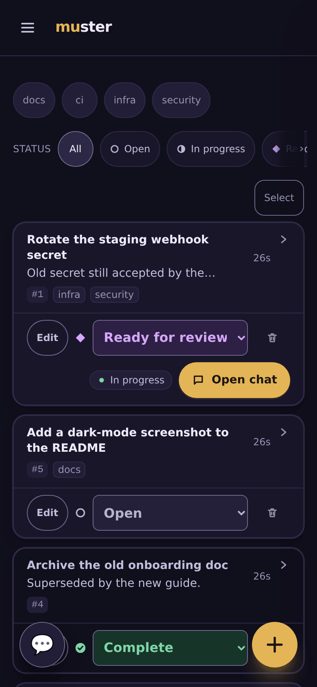

# The task board

Tasks are the shared work queue. People write them in the browser; agents and
scripts write them through the JSON API and the [CLI](cli.md).

## Tasks

- **Statuses:** `open`, `in_progress`, `ready_for_review`, `complete`. Every
  change is logged, with a warning when a status moves backwards. A dispatched
  agent cannot mark a task `complete` through its own route; people and the
  machine API can.
- **Comments:** comments can be added from the browser, the machine API
  (`POST /api/tasks/{id}/comments`), or an agent's own route
  (`POST /agent/task/comment`). A deleted comment leaves a tombstone.
- **Attachments:** up to 10 MiB each, stored in Postgres.
- **Tags:** up to 20 per task. Four namespaces route work:
  - `project:` — at most one per task;
  - `initiative:`;
  - `gate:` — blocks dispatch with 409;
  - `auto:`.
- **The review queue:** `ready_for_review` tasks are counted on the app badge.
  When push is on, they also notify ([push.md](push.md)).
- **Mark complete from the agent:** a dispatched agent's page shows a banner
  when its task is `ready_for_review`, with **Mark complete**. Completing it
  takes you back to the Agents list. Without JavaScript the button is a plain
  form (`POST /tasks/{id}/complete`) that completes the task and redirects to
  the Agents list too.
- **Completing stops the chief's agent:** see [plugins.md](plugins.md#completing-a-task-stops-the-chiefs-agent).
- **The idle reaper:** a task idle longer than `MUSTER_TASK_REAP_AFTER` (default
  7 days) is tagged `stale`, with a system comment. The sweep runs every 30
  minutes.
- **Retention:** a daily pass prunes connector audit rows and chat messages older
  than 90 days.

The task table is called `notes` for historical reasons (see
[schema.md](schema.md)).

## Provenance

Task writes from the CLI carry headers recording where they came from:

- `X-Muster-Source`;
- `X-Muster-Host`, the hostname;
- `X-Muster-Session-Id`, taken from `CLAUDE_CODE_SESSION_ID` or
  `CLAUDE_SESSION_ID` when the CLI runs inside an agent session.

A task records the session that created it. When a permission router is
configured, that session links to its transcript.

## The machine API: what producers trip on

The routes below take the hook token or a personal `mst_` API token
(`Authorization: Bearer …`). The browser routes (`/tasks/*`, `/agents*`) do
not: they need a signed-in session. Verbs, flags and exit codes are the
[CLI](cli.md)'s; its stdout is JSON only, with diagnostics on stderr.

| op | route | what to know |
|---|---|---|
| create | `POST /api/tasks` | `{directory, title, body, model, repo, branch, tags}`; `body` is required. **It answers `{"id":N}` and nothing else**: read any other field back with a GET. Unknown keys are dropped without an error. `directory` is not cosmetic: dispatch infers the repository from it. |
| read | `GET /api/tasks[/{id}]` | `?status=&tag=&limit=&summary=1` filter on the server. `tag` ANDs, and an invalid tag matches nothing (`200 []`). Ask for `summary=1` first: an unsummarised list is large. Comments, attachments and session links are **embedded**; there is no comments GET (`405`). |
| edit | `PATCH /api/tasks/{id}` | Content, dispatch config, and tags: `tags` replaces the set, `addTags`/`removeTags` merge into it, and `tags` together with either is `400`. While the task is `in_progress`, a non-tag field or a routing tag is `409`; an edit of descriptive tags only succeeds. |
| status | `PATCH /api/tasks/{id}/status` | Any status, `complete` included, with no in-progress guard. An agent's own `PATCH /agent/task/status` refuses `complete`. |
| delete | `DELETE /api/tasks/{id}` | **Tears down the task's live agent pod.** No in-progress guard; `404` if absent. |
| comment | `POST /api/tasks/{id}/comments` | `{body}` only. The author comes from the `X-Muster-Source` allowlist, **never from the body**. The body is whitespace-trimmed on storage. |
| un-comment | `DELETE /api/tasks/{id}/comments/{cid}` | **Soft**: it leaves a tombstone (below). A repeat is `404`. |
| vocabulary | `GET /api/tags`, `GET /api/projects` | `[{tag,count}]`; projects is an **object**, `{"projects":[{name,count}]}`. |
| merge | `POST /tasks/merge` | A browser-session route, form-encoded. It has no `/api` twin, by design. |

Every write except create returns the whole object (a `PATCH` the task, a
comment the comment, a delete `{"id":…,"deleted":true}`), so a GET after it is
usually not needed.

- **An empty comment body is a tombstone.** A deleted comment stays in both
  embeds as `{"body": "", "retracted": true}`. `retracted` is the predicate:
  never infer a retraction from an empty body. A live comment has no
  `retracted` key, so a consumer printing comments must branch on it:
  `jq -r '(.comments//[])[] | "[\(.author)] \(if .retracted then "(comment retracted)" else .body end)"'`.
- **Only a comment reaches a watcher.** The machine comment route pushes. A
  status write pushes only when the task ENTERS `ready_for_review`, and edits and
  creates push nothing. So moving a task to `in_progress` notifies nobody: a
  "starting" signal must be a comment. Comments are also exempt from the
  `in_progress` 409, so an agent records a plan as a comment, never by editing
  the body.
- **Request keys are not response keys.** `branch` goes in and comes back as
  `repoBranch`, so a GET body sent back as a PATCH loses it. Provenance reads
  back as `sourceSessionId` (lowercase `d`); the create response does not carry
  it.
- **An invalid tag is a `400` for the whole create**, and that is part of the
  contract: producers retry once without `tags` on that `400`, so a tag refusal
  answered with any other status would drop work. The grammar (charset, caps,
  the routing namespaces) is the header of `internal/notes/tags.go`.
- **Task and session threads.** A task's `sessions` are embedded, each with a
  `role` (`created`, `worked` or `read`). The reverse is
  `GET /api/sessions/{id}/tasks`; an unknown session answers `200` with no
  tasks, so an empty answer cannot tell "touched nothing" from "wrong id".
  `GET /api/tasks/{id}/sessions` is a `404` by design. Filter on `role`, never on
  membership: a read links the session (querying a thread changes it), and a
  subagent inherits its parent's `CLAUDE_CODE_SESSION_ID`.
- **Provenance headers.** `X-Muster-Source` and `X-Muster-Session-Id`; the older
  `X-Clawgate-*` spellings are still accepted. An unknown source is recorded as
  `api`; it is not an error.

## GitHub

**With a GitHub App configured** ([github-app.md](github-app.md)), the App is
muster's GitHub identity. The Repos tab lists its installation's repositories,
and those are the "connected" repositories for every dispatch check. The OAuth
connection below is then not used.

**Without one (deprecated):** the Repos tab connects one GitHub account per user. It needs
`MUSTER_GITHUB_ENCRYPTION_KEY`, because tokens are stored encrypted. You can
connect an account in either of two ways:

- `MUSTER_GITHUB_TOKEN` connects that token at boot.
- `GITHUB_CLIENT_ID` and `GITHUB_CLIENT_SECRET` enable the
  `/github/connect` OAuth flow. Its callback is built from `MUSTER_PUBLIC_URL`.
